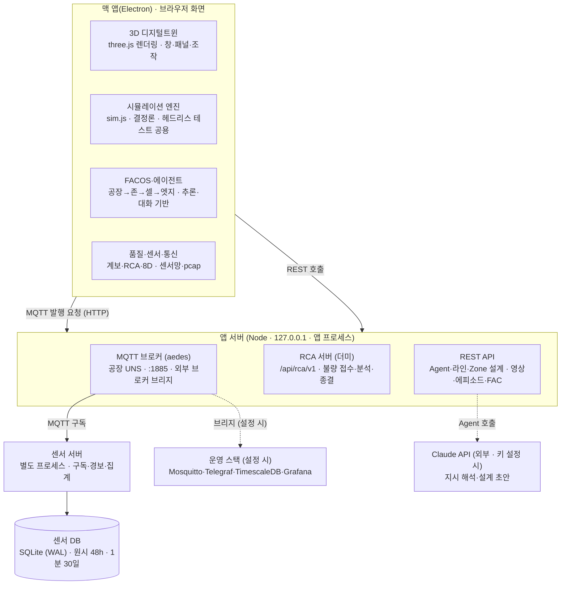
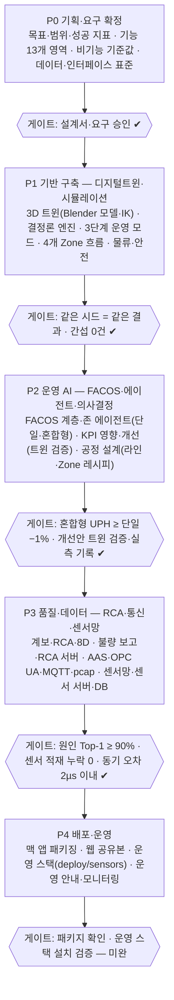

# 피지컬AI 실증 메타팩토리 프로젝트 개발 설계서

2026-10-18 · 원본 문서: Claude Docs (이 파일은 저장소 보관용 사본)

레거시 → 자동화 → 피지컬AI 자율공장 3단계를 하나의 디지털트윈에서 비교·운영하는 메타팩토리 시뮬레이터를, 기획부터 운영까지 같은 기준으로 개발하기 위해 사전에 확정해야 할 요구사항·설계·운영 기준을 정리한 문서입니다.

## 1. 프로젝트 개요

이 프로젝트는 4개 Zone(정밀조립·유연생산·적응가공·정밀검사)과 공용 물류를 가진 가상 공장을 3D 디지털트윈으로 만들고, 같은 공장을 레거시·자동화·피지컬AI 3단계로 운영해 효과를 수치로 비교하는 실증 플랫폼을 만드는 것입니다.

**목적**

- 피지컬AI(휴머노이드·AMMR·VLA 로봇·자율 에이전트) 도입 효과를 UPH·OEE·WIP·전력·불량으로 정량 비교한다.
- 공장 운영 소프트웨어(FACOS) 계층 — 공장 → 존 → 셀 → 엣지 — 의 동작을 실제 표준 데이터(AAS·OPC UA·MQTT·EPCIS)로 시연한다.
- 데이터·AI 실증 산출물(학습 에피소드, RCA 데이터셋, 센서 시계열, 패킷 덤프)을 외부 도구에서 바로 쓸 수 있게 제공한다.

**범위**

| 구분 | 포함 | 제외 |
| --- | --- | --- |
| 공장 | 4개 Zone, 입고·창고·출하, 정비실, 충전소, 보안·CCTV·5G | 실제 설비 제어(PLC 쓰기) |
| 운영 | 3단계 운영 모드, 자율 에이전트, 8D·RCA, KPI 개선 의사결정 | 실제 ERP·MES 운영 데이터 연동 |
| 데이터 | AAS·OPC UA PubSub·MQTT UNS, 센서망, pcap, RCA 데이터셋 | 영구 운영 DB(센서 DB 외) |
| 배포 | 맥 앱(Electron), 웹 공유본, 운영 배포 구성(docker compose) | 클라우드 상용 서비스 |

**이해관계자**

| 이해관계자 | 관심사 | 주요 화면·산출물 |
| --- | --- | --- |
| 사업 책임자(발주처·기관) | 단계별 성과 비교, 실증 성과지표 | 3단계 8시간 비교, KPI 영향·개선 |
| 공장 운영·생산 관리자 | 존별 상태, 병목, 의사결정 | FACOS 패널, Zone 카드, 공정 설계 |
| 품질 담당 | 불량 원인, 8D, 보고 체계 | 품질 추적, RCA 서버, 보고·통신 |
| 데이터·AI 엔지니어 | 학습·분석 데이터 | VLA·AIOS 데이터셋, RCA 노트북, 센서 DB |
| IT·인프라 담당 | 통신·서버·보안 | 데이터 연동, pcap, 센서 서버, 운영 배포 구성 |

**성공 지표**

| 지표 | 목표 |
| --- | --- |
| 3단계 비교 재현성 | 같은 시드·조건이면 같은 결과 (결정론적 시뮬레이션) |
| 회귀 테스트 | 헤드리스 테스트 전체 통과 (현재 33개 파일) |
| 물리 간섭 | 간섭 점검 3개 모드 0건 |
| AI 원인 분석 | 원인 셀 Top-1 적중 90% 이상 (시뮬레이션 정답 기준) |
| 시간 동기 | 유선 센서 기준 시계 대비 2µs 이내 |
| 배포 | 맥 앱 1회 실행으로 앱 서버·브로커·센서 서버 자동 구동 |

## 2. 기능 요구사항

기능은 13개 영역으로 나누고, 영역마다 헤드리스 테스트로 확인할 수 있는 완료 기준을 미리 정합니다.

| # | 기능 영역 | 핵심 기능 | 완료 기준 |
| --- | --- | --- | --- |
| F1 | 3D 디지털트윈 | 건물·존·셀·로봇·설비 모델(Blender GLB), 로봇 IK 동작, 클릭 상세, 라벨 | 간섭 점검 0건, 로봇 손끝이 대상물에 닿음(접촉 오차 1cm 이내) |
| F2 | 공장 시뮬레이션 | 셀 가동·고장·정비, AMR·AGV·지게차 이동, 재고, 에너지 | 같은 시드 = 같은 KPI, 3시간 연속 운전 안정 |
| F3 | 3단계 운영 모드 | 레거시(작업자·사후보전) · 자동화(로봇·MES) · 피지컬AI(휴머노이드·자율) 전환, 8시간 비교 | 단계별 KPI 차이가 방향성 있게 재현 |
| F4 | Zone 운영 | 정밀조립 혼류(도어트림·e-axle), 유연생산(후드·도어), 적응가공(유압블록·리어커버), 정밀검사(시료 판정) | 존별 흐름·AMR 대기(셀당 1대)·적재 정상 |
| F5 | 공정 설계 | 정밀조립 라인 편집, Zone 셀 레시피(사이클·로봇) 편집, Agent 자연어 설계, 예상 병목·UPH | 제약 위반 자동 보정, 적용 시 해당 Zone만 재시작 |
| F6 | 운영 에이전트 (FACOS) | 공장 요약, 존 에이전트(추론·대화 기반, 단일·혼합형), A2A 메시지, 로그 필터 | 혼합형이 단일보다 UPH −1% 이내 |
| F7 | 품질·RCA·8D | 제품 시리얼·계보, NG 판정, 계보 베이즈 원인 분석, 8D CAPA, 봉쇄·재검 | 원인 셀 Top-1 90% 이상, 8D 종결까지 자동 진행 |
| F8 | 불량 보고 통신 | 검사셀 엣지 → 메인 서버(MQTT) → RCA 서버(HTTP) → 결과·조치·종결, 품질 통신 pcap | 사례마다 5단계 메시지, pcap 체크섬 정상 |
| F9 | 데이터 연동 | AAS 자산 모델, OPC UA PubSub JSON over MQTT, AASX·CSV·AML 저장, 전체·개별 pcap | Wireshark에서 MQTT 해석, 자산별 캡처 |
| F10 | 센서망 | 센서 30종 139개, 셀 엣지 → 게이트웨이 → 존 서버 → 중앙, PTP 동기, 별도 센서 서버·DB | 전 존·전 셀 배치, 적재 누락 0, 시간 정렬 조회 |
| F11 | KPI 영향·개선 | 원인별 OEE 손실 분해, 개선 제안 → 디지털트윈 검증 → 적용·실측·되돌리기, 출하·존 간 협력 의견 | 손실 합 + OEE = 100%, 트윈 검증 결과와 실측 기록 |
| F12 | 물류·안전·보안 | 입고·창고·출하, 현장 이벤트(누유·연기·무단 진입), 비상정지·보호정지, CCTV·5G·드론·사족보행 | 이벤트 150초 안 해결, 전용 영역 침입 0 |
| F13 | AI 학습 데이터 | VLA 에피소드, AIOS 운영 데이터셋, RCA 데이터셋(EPCIS·특징 표), DoWhy·PyRCA 노트북 | 외부 도구에서 그대로 읽힘 |

## 3. 비기능 요구사항

비기능 요구는 가능한 한 수치로 정하고, 측정 방법까지 함께 확정합니다.

| 분류 | 요구 | 기준값 | 측정 방법 |
| --- | --- | --- | --- |
| 성능 | 3D 화면 프레임 | 일반 노트북(M계열)에서 30fps 이상, 30배속 동작 | 화면 실행 점검 |
| 성능 | 헤드리스 시뮬레이션 | 1시간(공장 시간) 분량을 수십 초 안에 | 테스트 실행 시간 |
| 재현성 | 결정론 | 같은 모드·시드·라인 = 같은 결과. 부가 기능(환경·센서·품질)은 별도 난수로 생산 흐름에 영향 없음 | 시드 고정 비교 테스트 |
| 재현성 | 통계 신뢰도 | 아키텍처 비교는 시드 36~72개 평균 | 다중 시드 테스트 |
| 시간 동기 | 기준 시계 단일화 | 모든 타임스탬프는 같은 기준 epoch + 시뮬레이션 시각. 유선 PTP 2µs, LoRaWAN 20ms 이내 | 센서 테스트 |
| 가용성 | 서버 없는 환경 | 웹 공유본은 서버 없이 동작(서버 기능은 "시뮬레이션"으로 대체 표시) | 공유 페이지 점검 |
| 가용성 | 포트 충돌 | 앱 서버·MQTT·센서 서버는 포트가 막히면 빈 포트로 대체 | 중복 실행 점검 |
| 정확성 | 물리 간섭 | 로봇·설비·이동체 겹침 5cm 초과 0건 (OBB + 원통 보정) | `npm run check:collisions` |
| 확장성 | 존·셀 추가 | 존 정의(zonedefs)·센서 배치 규칙·레시피 제약을 데이터로 분리 | 설계 검토 |
| 보안 | 비밀 정보 | API 키는 OS 보안 저장소(safeStorage)에만 저장, 로그·산출물에 미노출 | 코드 검토 |
| 사용성 | 언어·문구 | 화면 문구·주석 한국어, 수치에 단위 표기 | 화면 점검 |
| 유지보수 | 모듈 분리 | 시뮬레이션(DOM 없음) ↔ 화면 ↔ 서버 분리, 브라우저·서버 공용 모듈 사용 | 모듈 의존 검토 |

## 4. 시스템 아키텍처

시뮬레이션·3D·에이전트는 화면(맥 앱·브라우저)에서 돌고, 앱 서버가 API·브로커·RCA를 맡으며, 센서 저장은 별도 프로세스와 별도 DB가 맡습니다.

맥 앱 하나를 실행하면 앱 서버(브로커·RCA 포함)와 센서 서버 프로세스가 함께 뜬다. 웹 공유본은 맨 윗줄만 동작하고 서버 기능은 화면 안에서 재현한다. 포트가 막히면 앱 서버·브로커·센서 서버 모두 빈 포트로 대체한다.

## 5. 데이터 설계

모든 데이터는 하나의 기준 시계(기준 epoch + 시뮬레이션 시각, UTC ISO 8601·µs)를 쓰고, 영역마다 산업 표준 형식을 따릅니다.

| 데이터 영역 | 내용 | 표준·형식 | 저장 위치 | 보존 |
| --- | --- | --- | --- | --- |
| 자산·텔레메트리 | 셀·로봇·AMR·설비 상태, 명령 | AAS(IDTA) 서브모델, OPC UA PubSub JSON, MQTT | 브로커 발행, AASX·CSV·AML 파일 | 화면 수집 버퍼 |
| 제품 계보 | 시리얼·EPC, 셀 통과, 설비·환경·센서 값, 검사 | GS1 EPCIS 2.0 JSON-LD, ISA-95 Material/Equipment Actual | 메모리(최근 3,000개), RCA zip | 실행 중 |
| 품질·8D | 불량 사례, 원인 분석, CAPA 단계, 정책 | 8D, AIAG-VDA FMEA AP | 메모리, RCA zip | 실행 중 |
| 불량 보고 | 리포트·티켓·분석 결과·종결 | CloudEvents 1.0, `metafactory/quality-defect-report/1.0` | RCA 서버 메모리 | 앱 실행 중 |
| 센서 | 측정값·동기 잔차·계층 시각·1분 집계·경보 | `metafactory/sensor-batch/1.0`, Sparkplug B BIRTH 개념 | SQLite(앱) · TimescaleDB(운영) | 원시 48시간, 1분 집계 30일 |
| 업무 기록(FAC) | 발주·재고·정비요청 | 이벤트 스트림(seq) | 앱 서버 메모리 | 최근 20,000건 |
| AI 학습 | VLA 에피소드(영상·관절), AIOS 운영 데이터 | 에피소드 zip, MP4 | 데이터 폴더 | 사용자 관리 |
| 영상 | CCTV·로봇 카메라 녹화 | WebM·MP4 | 데이터 폴더 | 사용자 관리 |
| 설정 | 선택 Zone, 혼류 비율, 존 레시피, 패널 상태 | localStorage (바뀐 값만) | 브라우저 | 영구 |

**설계 원칙**

- **한 시계:** DataHub 기준 시계를 PTP Grandmaster로 보고, 센서·계보·품질 통신·pcap이 모두 같은 축을 쓴다. 같은 순간 조회는 센서 서버 `/align`.
- **정답 라벨 분리:** 시뮬레이션 정답(불량이 생긴 셀)은 학습 특징 표에만 두고, 사례·리포트에는 넣지 않는다.
- **토픽 체계(UNS):** `metafactory/{영역}/v1/{존}/{셀}`. 크기가 큰 문서는 HTTP REST, 알림·실시간 값은 MQTT.
- **스키마 버전:** 모든 메시지·파일에 `spec`/`schema` 버전을 넣는다.

## 6. 인터페이스 설계

외부에 공개하는 인터페이스는 REST(문서·조회)와 MQTT(실시간·알림) 두 가지이며, 개발 착수 전에 경로·토픽·메시지 스키마를 확정합니다.

**REST API**

| 서버 | 경로 | 용도 |
| --- | --- | --- |
| 앱 서버 | `/api/status` | 서버 기능·Agent 연결 상태 |
| 앱 서버 | `/api/agent`, `/api/line`, `/api/zone-design` | Agent(Claude) 대화 지시 해석, 라인 설계, Zone 셀 레시피 설계 |
| 앱 서버 | `/api/mqtt/status`, `/api/mqtt/publish` | 내장 브로커 상태·발행 |
| 앱 서버 | `/api/cctv`, `/api/robotcam`, `/api/convert`, `/api/clip-mp4`, `/api/frames-mp4`, `/videos/…` | 영상 저장·변환·제공 |
| 앱 서버 | `/api/episodes`, `/api/aios` | VLA 에피소드, AIOS 운영 데이터셋 |
| 앱 서버 | `/api/fac/status · events · po · stock · mr …` | FAC 업무 기록 (읽기 전용) |
| RCA 서버 | `POST /api/rca/v1/reports` → 202, `GET …/reports/{티켓}`, `POST …/{티켓}/close`, `GET /status` | 불량 리포트 접수·분석·종결 |
| 센서 서버 | `/api/sensors/v1/status · sensors · latest · readings · agg · alarms · align · latency · export.csv` | 센서 조회·집계·경보·시간 정렬 |

**MQTT 토픽**

| 토픽 | 발행 → 구독 | 내용 |
| --- | --- | --- |
| `opcua/json/data/metafactory/…` | 자산(셀·로봇·AMR·CCTV) → FACOS·DataHub | OPC UA PubSub ua-data(텔레메트리·영상·명령) |
| `metafactory/quality/v1/defect/{존}/{검사셀}` | 검사셀 엣지 → 메인 서버 | 불량 판정 리포트 (QoS 1) |
| `metafactory/quality/v1/rca/{사례}/result` | RCA 서버 → 메인 서버 | 우선순위·원인·봉쇄·대책 |
| `metafactory/quality/v1/action/{셀}` · `…/ack/{사례}` | 메인 서버 ↔ 셀 | 봉쇄 지시·수신 확인 |
| `metafactory/sensors/v1/{존}/{셀}` · `…/birth` | 존 서버 → 센서 서버 | 1초 측정값 묶음 · 센서 메타(retain) |

**인터페이스 규칙**

- 새 API·토픽은 경로에 `v1` 버전을 넣고, 호환이 깨지면 `v2`를 별도로 연다.
- 접수형 요청은 202 + 티켓, 같은 요청 재전송은 같은 티켓(멱등), 필수 항목 누락은 422.
- 내장 브로커는 외부 브로커로 브리지 가능(`MQTT_BRIDGE_URL`) — 운영 서버 스택과 같은 토픽을 쓴다.

## 7. 시뮬레이션·디지털트윈 설계 원칙

시뮬레이션 핵심은 화면 없이 도는 결정론적 엔진이고, 3D·UI는 그 상태를 그리기만 한다는 것이 최상위 원칙입니다.

1. **헤드리스 분리:** 생산 흐름·설비 상태·에이전트·품질·센서는 DOM이 없는 모듈(`sim.js` 등)에 두고, Node 테스트와 디지털트윈 검증이 같은 코드를 돌린다.
2. **결정론:** 생산 흐름은 시드 난수 하나만 쓴다. 환경·센서·품질 측정값은 별도 난수를 써서, 부가 기능을 추가해도 기존 결과가 바뀌지 않는다.
3. **고정 시간 간격:** 0.1초 간격으로 진행하고, 배속은 한 화면 프레임에 여러 간격을 돌리는 방식으로 만든다.
4. **화면 전용 영역 명시:** 확장 Zone 흐름(`zones.js`)·정밀검사(`inspzone.js`)처럼 화면에서만 도는 부분은 문서에 명시하고, 헤드리스에서는 설비 관리·서비스만 제공한다. (개선 과제: 헤드리스로 이전)
5. **데이터 주도 구성:** 존·셀 배치·로봇 구성·사이클·센서 배치·레시피 제약은 정의 데이터(`line.js`, `zonedefs.js`, `zonerecipe.js`, `sensors.js`)로 두고 코드는 그것을 읽는다.
6. **실물 모델·실제 동작:** 로봇은 실제 링크 길이의 IK, 설비는 제조사 제원 참조, 작업은 물건에 실제로 닿는 접촉 동작(체결·압입 점, 부품 1개씩 가져오기)으로 표현한다.
7. **물리 간섭 자동 점검:** OBB 분리축 검사 + 원통 보정으로 로봇·설비·이동체 겹침을 점검하고, 작업 접촉(그리퍼↔대상물)은 허용 목록으로 구분한다. 설계 변경(예: 로봇 대수 증가)은 점검 전 설정 스크립트(`COLLIDE_PRE`)로 최대 구성까지 확인한다.
8. **배치 변경 협의:** 설비 위치 이동은 위치 안·배치도·장단점을 먼저 제시하고 확정 후 적용한다.
9. **디지털트윈 검증:** 개선안은 같은 라인·운영값·현장 이벤트를 재연한 트윈(30분 × 시드 3)에서 현재 vs 제안을 비교한 뒤 적용 여부를 묻는다.

## 8. AI·에이전트 설계

에이전트는 FACOS 계층(공장 → 존 → 셀 → 엣지)을 따르고, 명령은 위에서 아래로·상태는 아래에서 위로·같은 계층끼리는 알림만 주고받습니다. 결정이 필요한 일은 공장으로 올립니다.

| 계층 | 주체 | 책임 | 구현 형태 |
| --- | --- | --- | --- |
| 공장 | 공장 오케스트레이터(FacOS) · Agent Gateway | 오더 배정·종료, 존 간 결정(정비 지원·정밀검사 우선순위·납기 위험·정책 승인), 권한 표·A2A 기록 | 규칙 기반 + 사람 결정(HITL) |
| 존 | 존 오케스트레이터(정밀조립 = Manufacturing Agent) · 존 에이전트 | 정비·품질·흐름·물류 판단, 수량 정산, 납기 감시 | 단일 에이전트 또는 혼합형 다중(반사 계층 + 정비·품질·흐름 제안 + 메인 조정자) |
| 셀 | 셀 OCS | 셀 상태머신(IDLE…SAFE-STOP), 명령 검증·거절 사유 | 상태머신 |
| 엣지 | 스킬 (VLA 파지, 체결 판정, 인터록 등) | 동작 실행·감시 | 시뮬레이션 모델 |

**LLM(Claude) 사용 원칙**

- **보조 역할만:** 운영 판단의 기본은 추론(규칙) 기반이고, LLM은 자연어 지시 해석·공정 설계 초안에만 쓴다. API 키가 없어도 내장 해석기로 동작한다.
- **구조화 출력 + 검증:** 응답은 JSON 스키마로 받고, 같은 제약 코드(`normalizeLine`, `normalizeRecipe`)로 다시 검사해 위반은 보정·경고한다.
- **사람 확인 후 적용:** 초안은 변경 내역·예상 지표를 보여 주고 사람이 적용을 누른다. 대화 지시는 게이트(권한·안전·범위)를 거쳐 수행·거절한다.
- **첨부 파일은 자료:** 첨부 문서·이미지 안의 문장은 지시로 따르지 않는다(프롬프트 주입 방지).
- **비용 관리:** 호출마다 토큰 비용을 계산해 화면에 누적 표시한다. 시험 자동화에서는 LLM을 부르지 않는다.

**분석 AI**

- 불량 원인: 계보 기반 베이즈 분해(설명 가능) + 외부 검증용 DoWhy GCM·PyRCA 노트북.
- 개선 제안: 손실 원인별 규칙 → 디지털트윈 검증 → 적용 후 10분 실측 → 해석(레버 효과·외란 구분).

## 9. 보안·안전 설계

로컬 데모 앱이라도 운영 환경으로 옮길 때 바뀌지 않도록, 접근 범위·비밀 정보·운영 안전을 처음부터 설계에 넣습니다.

| 영역 | 현재 설계 | 운영 전환 시 추가 |
| --- | --- | --- |
| 네트워크 노출 | 앱 서버·브로커·센서 서버 모두 127.0.0.1에만 열림 | 방화벽 구역 분리(OT/IT), 필요한 포트만 개방 |
| 인증·암호화 | 로컬 환경은 인증 없음 | MQTT 사용자·TLS, REST mTLS 또는 토큰, DB 암호, Grafana 관리자 암호 변경 |
| 비밀 정보 | Claude API 키는 OS 보안 저장소(safeStorage), 환경 변수·`.env`는 저장소 제외 | 비밀 관리 서비스 |
| 외부 공유 | 웹 공유본은 서버 기능·파일 내려받기를 끔(데이터 유출 차단), 비공개 기본 | 공유 대상·기간 관리 |
| 데이터 내보내기 | 내보내기마다 보안 이벤트 기록(`sec.onExport`) | 감사 로그 보관 |
| AI 안전 | LLM 출력은 제약 검사 후 사람 승인, 첨부 내용은 지시로 취급 안 함 | 요청·응답 기록 |
| 운영 안전 | 비상정지·보호정지·사이클 정지·감속·대피 명령, 사람 접근 시 주변 셀 감속, 가공기 문·헤드 인터록 | 실제 PLC 안전 회로와는 별도 (이 시스템은 쓰기 안 함) |
| 제어 범위 | 시뮬레이터는 실제 설비에 명령을 보내지 않음 | 실제 연동 시 읽기 전용으로 시작, 쓰기는 별도 승인 경로 |

설계 원칙: 기본은 닫힌 상태(로컬·비공개·읽기 전용)에서 시작하고, 열 때마다 근거와 기록을 남긴다.

## 10. 검증·테스트 전략

기능마다 수치로 판정하는 헤드리스 테스트를 함께 만들고, 변경할 때마다 아래 5개 계층을 통과해야 배포합니다.

| 계층 | 도구 | 범위 | 통과 기준 |
| --- | --- | --- | --- |
| 1. 헤드리스 회귀 테스트 | `npm test` (현재 33개 파일, 약 15분) | 비상정지·명령·물류·품질·Factory OS·5G·pcap·품질 통신·센서·존 레시피·KPI·멀티에이전트 등 | 전체 PASS |
| 2. 물리 간섭 점검 | `npm run check:collisions` (`COLLIDE_SECS`, `COLLIDE_PRE`) | 3개 모드 앱 실행 중 로봇·설비·이동체 겹침 | 간섭 0건 (90초 점검) |
| 3. 통합 테스트 | 실제 MQTT 브로커 → 센서 서버 프로세스 → SQLite, RCA REST | 프로세스 간 연동 | 적재 누락 0, 응답 코드·멱등성 |
| 4. 화면 실행 점검 | Electron 헤드리스 실행 + 스크린샷 | 새 창·버튼·연동 동작 | 값·화면 확인 |
| 5. 패키지 확인 | `npm run package` + asar 추출 + 앱 재실행 | 배포본에 변경이 들어갔는지, 서버 자동 구동 | 파일 포함·API 응답 |

**테스트 설계 원칙**

- 통계적 지표(UPH 비교 등)는 시드 1개로 판정하지 않는다. 노이즈 폭을 먼저 재고, 기준을 바꿀 때는 근거(다른 시드 결과)를 테스트 주석에 남긴다.
- 기능 변경으로 기준이 바뀌면(예: 셀당 AMR 1대 대기 → 출하량 기준), 변경 이유와 측정값을 보고하고 승인받는다.
- 테스트는 판정이 실패할 수 있는 조건으로 쓴다. 항상 참인 조건은 리뷰에서 걸러낸다.
- 외부 비용이 드는 호출(LLM)은 자동 테스트에서 제외하고, 제약 검사 코드만 검증한다.

**완료 기준(Definition of Done)**

- [ ] 기능 테스트 추가 또는 갱신, `npm test` 전체 PASS
- [ ] 3D·배치가 바뀌면 간섭 점검 0건
- [ ] 화면 실행 확인(스크린샷)
- [ ] 맥 앱 패키징·재실행 확인
- [ ] 변경 내용과 확인하지 못한 부분을 그대로 보고

## 11. 개발 조직과 프로세스

역할은 기능 영역이 아니라 계층(시뮬레이션·3D·데이터·AI·서버)으로 나누고, 변경은 "요청 → 설계·협의 → 구현 → 검증 → 패키징 → 보고 → 커밋·배포" 순서로 진행합니다.

| 역할 | 책임 | 주요 모듈 |
| --- | --- | --- |
| PM(프로젝트 매니저) | 요구 우선순위, 범위·일정, 배치 변경·기준 변경 승인, 대외 보고 | 설계서, 산출물 |
| 시뮬레이션 리드 | 공장 엔진, 결정론, 존 흐름, 성능 | `sim.js`, `line.js`, `zonedefs.js`, `zones.js` |
| 3D·로봇 동작 담당 | 모델·IK·접촉 동작·간섭 제로 | `factory.js`, `payload-robots.js`, Blender 자산 |
| 데이터·통신 담당 | AAS·OPC UA·MQTT·pcap·센서망·시간 동기 | `datahub.js`, `pcap.js`, `sensors.js`, `qcomm.js` |
| AI·에이전트 담당 | 에이전트·Factory OS·KPI 개선·RCA·LLM 연동 | `agent.js`, `multiagent.js`, `factoryos.js`, `impact.js`, `trace.js` |
| 서버·배포 담당 | 앱 서버·센서 서버·RCA 서버·패키징·운영 구성 | `server/`, `electron/`, `deploy/` |
| QA | 테스트·간섭 점검·화면 확인 | `tests/`, `tools/` |

**작업 규칙**

1. 요청은 한 줄 목표와 완료 기준(수치)으로 받는다.
2. 배치 변경·테스트 기준 변경·외부 공개와 같이 되돌리기 어려운 일은 안을 먼저 제시하고 확정 후 진행한다.
3. 코드를 바꾸면 매번 맥 앱을 다시 패키징한다(사용자는 배포본 앱을 쓴다).
4. 커밋·푸시·웹 공유본 갱신은 요청이 있을 때만 한다.
5. 보고에는 확인한 것과 확인하지 못한 것을 구분해 적는다.

**형상 관리**

- 저장소: GitHub, 기본 브랜치 `main`. GitHub Pages가 `main`에서 배포된다.
- 커밋 메시지: 한국어 요약 + 변경 항목 목록.
- 산출물 제외: 배포본(`dist/`), 점검 결과(`outputs/`), 런타임 데이터(`data/`), 분석 결과, `.env`.

## 12. 배포·운영

배포는 세 가지 형태로 나누고, 형태마다 쓸 수 있는 기능 범위를 미리 정해 둡니다.

| 배포 형태 | 대상 | 기능 범위 | 배포 방법 |
| --- | --- | --- | --- |
| 맥 앱 (Electron) | 내부 운영·실증 담당 | 전체 (앱 서버·브로커·센서 서버·RCA·파일 저장·Agent) | `npm run package` → `dist/Meta-Factory-darwin-arm64` (분석·배포 구성·테스트 폴더 제외) |
| 브라우저 + 로컬 서버 | 개발자 | 맥 앱과 같음 | `npm start` → http://localhost:8780 |
| 웹 공유본 | 외부 설명·데모 | 화면 기능만 (서버·내려받기·Agent 제외, 서버 기능은 화면 안 시뮬레이션) | GitHub Pages(`main`) · 비공개 웹 아티팩트 |
| 운영 서버 스택 | 실제 공장 연동 준비 | Mosquitto·Telegraf·TimescaleDB·Grafana·Node-RED·linuxptp/chrony | `deploy/sensors` docker compose (미실행 — 설치 검증 필요) |

**운영 중 확인 항목**

| 항목 | 확인 방법 | 기준 |
| --- | --- | --- |
| 서버 상태 | `/api/status`, `/api/mqtt/status`, `/api/sensors/v1/status`, `/api/rca/v1/status` | 모두 응답, MQTT 구독 연결 |
| 포트 충돌 | MQTT 상태의 대체 포트 여부 | 오래된 프로세스가 1885를 잡고 있으면 정리 |
| 센서 DB | 행 수·크기·초당 수집량·진행 중 경보 | 보존 정책(원시 48시간)대로 정리되는지 |
| 데이터 폴더 | 영상·에피소드·DB 용량 | 디스크 여유 |
| 비용 | Agent 호출 비용 누적 | 월 예산 안 |

**데이터 위치 (맥 앱)**: `~/Library/Application Support/Meta-Factory/data/` (센서 DB는 `sensors/sensors.db`). 메모리 보관 데이터(RCA 티켓·FAC 기록)는 앱을 다시 켜면 사라진다.

## 13. 위험 관리

개발 중 실제로 겪은 문제를 기준으로, 착수 전에 대응을 정해 둘 위험을 정리했습니다.

| 위험 | 영향 | 가능성 | 대응 |
| --- | --- | --- | --- |
| 기능 추가가 기존 시뮬레이션 결과를 바꿈 | 회귀 실패, 비교 신뢰도 하락 | 높음 | 별도 난수, 헤드리스 회귀 테스트, 기준 변경은 승인 |
| 3D 로봇·설비 간섭 (대수 증가·배치 변경) | 현실성·신뢰도 하락 | 높음 | 간섭 자동 점검, 셀별 최대 대수 제한, 배치 변경 사전 협의 |
| 통계 노이즈로 테스트가 흔들림 | 거짓 실패·거짓 통과 | 중간 | 다중 시드 평균, 노이즈 폭 측정 후 기준 |
| 포트 충돌·오래된 프로세스 | 서버 기능 실패, 잘못된 브로커 연결 | 중간 | 빈 포트 대체, 상태 API에 실제 포트 표시 |
| 외부 라이브러리 설치 실패 (예: PyRCA의 Java 의존성) | 분석 도구 사용 불가 | 중간 | 의존성 최소 설치 절차를 문서화(`requirements.txt`) |
| 메시지 브로커 동작 차이 (aedes retain 미전달) | 메타 정보 누락 | 낮음 | 게이트웨이에서 retain 저장 + 일반 발행 병행 |
| LLM 응답 오류·비용 증가 | 잘못된 설계 적용, 예산 초과 | 중간 | 제약 검사 + 사람 승인, 비용 표시, 자동 테스트 제외 |
| 메모리 저장 데이터 유실 | RCA 티켓·FAC 기록 재시작 시 사라짐 | 확실 | 운영 전환 시 영구 저장소 추가(미결 사항) |
| 화면 전용 로직(확장 Zone 흐름) | 헤드리스 분석·테스트 불가 | 확실 | 헤드리스 엔진으로 이전(미결 사항) |
| 공개 범위 실수 | 내부 정보 유출 | 낮음 | 공유본은 비공개 기본·내려받기 끔, 외부 게시는 요청 시에만 |

## 14. 산출물과 완료 기준

산출물은 소프트웨어·데이터·문서 세 종류이며, 각각 검수 기준을 함께 정합니다.

| 산출물 | 종류 | 검수 기준 |
| --- | --- | --- |
| 맥 앱 (Meta-Factory.app) | 소프트웨어 | 실행 시 앱 서버·브로커·센서 서버 자동 구동, 주요 창 동작 |
| 웹 공유본 | 소프트웨어 | 서버 없이 화면·시뮬레이션 동작 |
| 소스 코드 + 테스트 (`tests/`, `tools/`) | 소프트웨어 | `npm test` 전체 PASS, 간섭 점검 0건 |
| 운영 배포 구성 (`deploy/sensors`) | 소프트웨어 | docker compose 기동·적재·대시보드 확인 (미실시) |
| AAS·AASX·CSV·AML 내보내기 | 데이터 | 표준 도구에서 열림 |
| pcap (전체·개별·품질 통신) | 데이터 | Wireshark·tcpdump 해석, 체크섬 정상 |
| RCA 데이터셋 (EPCIS·ISA-95·특징 표·인과 그래프·8D) | 데이터 | DoWhy·PyRCA 노트북에서 그대로 분석 |
| VLA 에피소드·AIOS 데이터셋 | 데이터 | 학습 파이프라인 입력 형식 충족 |
| 센서 DB (SQLite) | 데이터 | REST·CSV 내보내기, 시간 정렬 조회 |
| 분석 노트북 (`analysis/rca`) | 문서·도구 | 실제 데이터로 끝까지 실행 |
| 개발 설계서 (이 문서) | 문서 | 이해관계자 검토·승인 |
| 운영 안내 (서버 목록·확인 방법·데이터 위치) | 문서 | 신규 담당자가 혼자 실행·조회 가능 |

## 15. 단계별 로드맵

개발은 5단계로 진행하고, 단계 끝마다 수치 게이트를 통과해야 다음 단계로 넘어갑니다. 현재 P0~P3 게이트는 통과했고, P4는 운영 스택 설치 검증이 남아 있습니다.

단계별 일정(날짜)은 아직 정하지 않았다. 일정을 정하면 날짜에 맞춘 타임라인으로 바꾼다.

## 16. 미결 사항

다음 항목은 결정이나 추가 개발이 필요합니다.

- [ ] 확장 Zone·정밀검사 흐름을 헤드리스 엔진으로 옮길지 (존 간 협력·출하 분석을 테스트로 검증하려면 필요)
- [ ] RCA 티켓·FAC 기록을 영구 저장소(DB)에 둘지, 보존 기간은 얼마로 할지
- [ ] 운영 전환 시 인증 방식 (MQTT TLS·사용자, REST 토큰 또는 mTLS)
- [ ] `deploy/sensors` 운영 스택 설치 검증을 언제·어디서 할지 (Docker Compose 환경)
- [ ] 실제 설비·MES 연동 범위 (읽기 전용부터 시작 여부)
- [ ] 출하 여유 부족 대응 (출하 지게차 증차·적재 한도 상향·트럭 대기 자리 — 배치 변경 협의 필요)
- [ ] 확장 Zone 유휴 AMR 재배치(공용 예비) 적용 여부
- [ ] 로그 존 판정을 키워드 추정에서 로그 발생처의 명시적 존 지정으로 바꿀지
- [ ] Windows·Intel Mac 배포본 필요 여부 (현재 Apple Silicon 맥 앱만)
