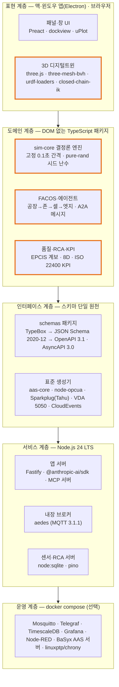
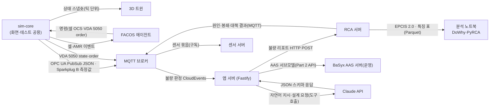
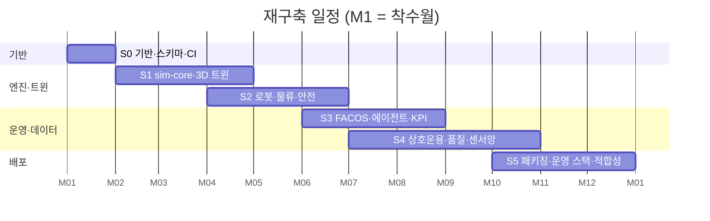

# [개발 계획서] 피지컬AI 실증 메타팩토리 재구축 — 적용 오픈소스·라이브러리·표준 기준

2026-10-19 · 작성 Jin Park · 근거 문서: [R1] `docs/DESIGN.md` · [R2] `OPEN_SOURCE.md` · [R3] `package.json` · [R4] `deploy/sensors/` · [R5] `analysis/rca/requirements.txt` · [R6] `README.md`

> 표기 — `(현행)` 현재 저장소에 구현된 사실 · `(설계)` 본 계획에서 정한 값 · `(설계 추정)` 검증 전 산정값 · `[R# §n]` 근거 문서 절

---

## 0. 요약

- **전제**: 현재 결과물(3D 디지털트윈 + 결정론 시뮬레이션 + FACOS 에이전트 + 품질·RCA + 센서망 + 맥 앱)을 처음부터 다시 만든다고 가정하고, 구성요소마다 적용할 오픈소스·라이브러리·표준을 먼저 확정한 개발 계획임.
- **핵심 방향**: 현행은 의존성 5종(three.js·Electron·aedes·MQTT.js·Anthropic SDK)만 쓰고 나머지 표준 형식(AAS·OPC UA·EPCIS·pcap·AMR 통신)을 직접 작성했음 [R2 §1·§6]. 재구축 시에는 **표준 형식은 검증된 라이브러리·스키마로 생성하고, 차별화 영역(시뮬레이션 엔진·FACOS 판단 로직·3D 동작)만 직접 작성함.**
- **새로 채택하는 표준 6종**: VDA 5050(AMR·AGV 통신), ISO 22400-2(KPI 정의), MTConnect·OPC UA Machine Tools(가공기), LeRobot 데이터셋 형식(VLA 에피소드), AsyncAPI 3.0(MQTT 인터페이스 명세), IEC 62443-3-3(보안 수준). 현행에는 없거나 일부 언급만 있음.
- **채택하지 않는 것**: ROS 2·Open-RMF·Isaac Sim·Gazebo를 실행 런타임으로 쓰지 않음 — 맥 앱 단일 배포·30배속·결정론 재현 요구 [R1 §3]와 충돌함. 대신 그 인터페이스 규약(URDF·REP-103·VDA 5050)을 따라 후속 연동 경로를 열어 둠.
- **일정·투입**: 12개월(M1~M12), 6개 단계, 7개 역할 (설계 추정). 단계마다 산출식이 있는 수치 게이트를 둠(7장).

---

## 1. 개요

### 1.1 목적

- 레거시 → 자동화 → 피지컬AI 3단계 운영을 하나의 디지털트윈에서 정량 비교하는 실증 플랫폼을 재구축함 [R1 §1].
- 재구축의 목적은 기능 추가가 아니라 **표준 적합성·유지보수성·외부 연동성 확보**임. 기능 범위는 현행 13개 영역(F1~F13) [R1 §2]을 그대로 유지함.

### 1.2 재구축 시 바꾸는 이유 (현행 문제 ➔ 재구축 해결책)

| # | 현행 문제 | 근거 | 재구축 해결책 |
|---|---|---|---|
| 1 | 표준 메시지(AAS·OPC UA·EPCIS·Sparkplug)를 문자열 조립으로 직접 생성, 적합성은 외부 Python 도구로 사후 검증 | [R2 §2·§6] | 스키마 우선(Schema-first) — JSON Schema·AsyncAPI·OpenAPI를 먼저 정의하고 생성·검증을 라이브러리로 수행 |
| 2 | AMR·AGV 통신이 자체 형식 | [R2 §6] | VDA 5050 v2 메시지(order·state·instantActions)로 통일 |
| 3 | 확장 Zone·정밀검사 흐름이 화면 전용 → 헤드리스 테스트 불가 | [R1 §7(4)·§16] | 모든 흐름을 DOM 없는 `sim-core` 패키지에 두고 화면은 상태만 그림 |
| 4 | 순수 JavaScript, 모듈 간 데이터 구조를 주석으로만 약속 | [R3] | TypeScript + 스키마에서 타입 생성 |
| 5 | RCA 티켓·FAC 기록이 메모리 보관 → 재시작 시 유실 | [R1 §13] | Node 내장 SQLite(`node:sqlite`)에 영구 저장, 운영은 PostgreSQL 계열 |
| 6 | 회귀 테스트 33개 파일 순차 실행 약 15분 | [R1 §10] | Vitest 병렬 실행 + 다중 시드는 워커 스레드 분산 |
| 7 | Apple Silicon 맥 앱만 배포 | [R1 §16] | Electron Forge로 macOS(arm64·x64)·Windows 빌드 파이프라인 구성 |

### 1.3 범위

| 구분 | 포함 | 제외 |
|---|---|---|
| 소프트웨어 | 3D 트윈, 시뮬레이션 엔진, FACOS·에이전트, 품질·RCA, 센서망, 데이터 연동, 맥·윈도우 앱, 웹 공유본, 운영 스택 | 실제 설비 제어(PLC 쓰기), 상용 클라우드 서비스 |
| 표준 | 자산·통신·물류·품질·KPI·안전·보안·데이터셋 표준의 형식 준수 및 적합성 시험 | 표준 인증 취득(제3자 인증) |
| AI | LLM 보조 해석·설계, 규칙·통계 기반 운영 판단, RCA 분석 노트북 | 신경망 모델 학습·가중치 배포 |

---

## 2. 기술 선정 원칙

| # | 원칙 | 판정 기준 |
|---|---|---|
| P1 | **표준은 직접 구현하지 않고 라이브러리·공식 스키마로 생성함** | 공식 스키마 또는 참조 구현이 있으면 그것을 씀. 없을 때만 직접 작성하고 적합성 시험을 붙임 |
| P2 | **라이선스는 허용형(MIT·BSD·Apache-2.0)만 앱에 포함함** | GPL·AGPL은 별도 프로세스·개발 도구로만 사용. 앱 번들 포함 금지 |
| P3 | **결정론을 깨는 의존성은 엔진에 넣지 않음** | 물리 엔진·비동기 타이머·`Math.random`은 `sim-core`에서 금지. 시드 난수만 허용 |
| P4 | **단일 앱 실행을 유지함** | 맥 앱 1회 실행으로 앱 서버·브로커·센서 서버가 뜸 [R1 §1]. Docker·외부 DB 없이 전체 기능 동작 |
| P5 | **운영 스택은 같은 인터페이스를 씀** | 앱 내장(aedes·SQLite)과 운영(Mosquitto·TimescaleDB)이 같은 토픽·스키마를 씀 |
| P6 | **버전은 착수 시점에 고정함** | M1에 `package-lock.json`·`uv.lock`·이미지 태그 고정. 주 버전 상향은 단계 게이트에서만 |
| P7 | **유지 상태를 확인함** | 최근 12개월 릴리스 有, 주 유지자 2인 이상 또는 재단 소속. 미충족 시 대안을 함께 기록 |

---

## 3. 목표 아키텍처

### 3.1 계층 스택도

주황 테두리가 직접 개발 영역이고, 나머지는 오픈소스·표준을 그대로 씀.

### 3.2 연계 관계도 (흐르는 대상 표기)

### 3.3 저장소 구조 (모노레포, npm workspaces)

| 경로 | 내용 | 런타임 |
|---|---|---|
| `packages/schemas` | TypeBox 스키마, OpenAPI·AsyncAPI 생성 스크립트, 예제 메시지 | Node·브라우저 |
| `packages/sim-core` | 결정론 엔진, 존·셀·물류·고장·에너지, 존 정의 데이터 | Node·브라우저·워커 |
| `packages/facos` | 공장·존·셀·엣지 에이전트, 게이트, A2A 기록 | Node·브라우저 |
| `packages/quality` | 계보·RCA(베이즈 분해)·8D·KPI | Node·브라우저 |
| `packages/interop` | AAS·OPC UA·Sparkplug·EPCIS·VDA 5050·pcap 생성기 | Node·브라우저 |
| `packages/twin3d` | three.js 장면, 로봇 IK, 간섭 점검 | 브라우저 |
| `apps/desktop` | Electron 메인·preload, 서버 프로세스 관리 | Electron |
| `apps/web` | 웹 공유본(서버 기능은 화면 내 대체) | 브라우저 |
| `services/app-server` · `sensor-server` · `rca-server` | Fastify 서버 3종 | Node |
| `assets/blender` · `blender/` | bpy 모델링 스크립트, GLB 산출물 | Blender |
| `analysis/` | RCA·KPI 노트북 (uv 관리) | Python |
| `deploy/` | 운영 docker compose | Docker |

---

## 4. 계층별 적용 오픈소스·라이브러리

> 버전은 주 버전 기준이며, M1에 잠금 파일로 정확한 버전을 고정함(P6). 라이선스는 각 프로젝트 저장소 기준.

### 4.1 언어·빌드·공통

| 구성요소 | 채택 | 라이선스 | 용도 | 대안·미채택 사유 |
|---|---|---|---|---|
| 언어 | TypeScript 5.x | Apache-2.0 | 전 패키지. `strict` 모드 | 순수 JS(현행) — 모듈 간 데이터 계약을 타입으로 강제할 수 없음 |
| 런타임 | Node.js 24 LTS | MIT | 서버·테스트·헤드리스 시뮬레이션 | Bun·Deno — Electron 내장 Node와 동작 차이 위험 |
| 번들러 | Vite 7.x | MIT | 화면 개발 서버·웹 공유본 빌드 | webpack — 설정 비용 대비 이점 없음 |
| 모노레포 | npm workspaces | Artistic-2.0 | 패키지 연결 | pnpm·Nx — 현행 npm 유지로 전환 비용 0 |
| 린트·포맷 | ESLint 9 · Prettier 3 | MIT | 코드 규칙 | Biome — ESLint 플러그인(three·typescript) 생태계 부족 |
| 시드 난수 | pure-rand | MIT | xoroshiro128+ 시드 난수, 스트림 분리(생산·환경·센서·품질) | `seedrandom` — 유지 정체 |
| 다중 시드 실행 | Piscina | MIT | 워커 스레드 풀로 시드 36~72개 병렬 실행 [R1 §3] | 자체 child_process — 풀 관리 재작성 필요 |

### 4.2 3D 디지털트윈·로봇 동작

| 구성요소 | 채택 | 라이선스 | 용도 | 대안·미채택 사유 |
|---|---|---|---|---|
| 렌더링 | three.js (r186 이상) | MIT | 장면·조명·후처리·렌더 타깃(로봇 카메라) | Babylon.js — 현행 자산·코드가 three 기준, 전환 이점 없음 |
| 모델 형식 | glTF 2.0 + GLTFLoader | MIT | Blender 산출 모델 | FBX·OBJ — 재질·계층 손실 |
| 모델 최적화 | glTF-Transform · meshoptimizer · KTX2(Basis Universal) | MIT · MIT · Apache-2.0 | 메시 압축·텍스처 압축, 앱 용량 축소 | Draco 단독 — 디코더 용량 큼 |
| 로봇 모델 | urdf-loaders (gkjohnson) | Apache-2.0 | 벤더 URDF(UR20·IRB4600·SDA10F·RB-Y1·Spot) 직접 로드 [R2 §6] | 현행 Blender 변환 후 GLB — 관절 정의 이중 관리 |
| 역기구학 | closed-chain-ik-js | MIT | 다관절·양팔 IK, 접촉 오차 1cm 이내 [R1 §2 F1] | 해석해 직접 작성 — 로봇 기종마다 재작성 |
| 간섭·레이캐스트 | three-mesh-bvh | MIT | 메시 BVH 기반 간섭 점검, 클릭 선택 | Rapier 물리 엔진 — 결정론 엔진과 이중 상태, P3 위반(점검 도구에서만 선택 사용) |
| 경로 탐색 | recast-navigation-js | MIT | AMR·지게차·작업자 내비메시, 장애물 우회 | 격자 A* 직접 작성(현행) — 통로 폭·회전 반경 반영 어려움 |
| 모델링 | Blender 5.x (bpy 스크립트) | GPL-2.0+ (도구만) | 설비·로봇·제품 모델 생성 [R2 §2] | 앱에 포함하지 않음 |

### 4.3 화면 UI

| 구성요소 | 채택 | 라이선스 | 용도 | 대안·미채택 사유 |
|---|---|---|---|---|
| UI 프레임워크 | Preact 10 + Signals | MIT | 패널·창·카드 상태 렌더링 | React — 번들 3배, 3D 루프와 렌더 경합 · 바닐라 DOM(현행) — 패널 수 증가로 상태 동기 버그 |
| 도킹 레이아웃 | dockview | MIT | 좌·우 패널, 떠 있는 창, 레이아웃 저장 | 자체 창 관리(현행) |
| 시계열 차트 | uPlot | MIT | 센서·KPI 실시간 차트(수만 점) | ECharts — 대시보드형 차트에만 보조 사용(Apache-2.0) |
| 다이어그램 | Mermaid | MIT | 8D·흐름·스윔레인 표시 | — |
| 첨부 파일 읽기 | mammoth · SheetJS CE | BSD-2 · Apache-2.0 | 공정 설계 첨부 .docx·.xlsx [R2 §1] | 현행 유지 |

### 4.4 데스크톱 앱·배포

| 구성요소 | 채택 | 라이선스 | 용도 | 대안·미채택 사유 |
|---|---|---|---|---|
| 앱 셸 | Electron (현행 44 계열) | MIT | 맥·윈도우 앱, `safeStorage` API 키 보관 [R6] | Tauri — Node 서버 3종을 사이드카로 별도 패키징해야 함 |
| 서버 프로세스 | Electron `utilityProcess` | MIT | 앱 서버·센서 서버·RCA 서버 분리 실행 | `child_process.fork` — 앱 종료 시 정리 누락 위험 |
| 패키징 | Electron Forge | MIT | macOS arm64·x64, Windows 빌드, 서명·공증 | @electron/packager(현행) — 공증·인스톨러·자동 업데이트 별도 구성 필요 |
| 자동 업데이트 | update-electron-app | MIT | GitHub Releases 기반 업데이트 | — |

### 4.5 서버·API

| 구성요소 | 채택 | 라이선스 | 용도 | 대안·미채택 사유 |
|---|---|---|---|---|
| HTTP 프레임워크 | Fastify 5 | MIT | 앱·센서·RCA 서버, 스키마 기반 검증·직렬화 | `node:http` 직접 작성(현행) — 검증·문서·오류 형식 재작성 |
| 스키마 | TypeBox + Ajv | MIT | 단일 원천: 타입 = JSON Schema 2020-12 | Zod — JSON Schema 변환이 부가 단계 |
| API 문서 | @fastify/swagger · Scalar | MIT | OpenAPI 3.1 자동 생성·열람 | — |
| 이벤트 봉투 | cloudevents (CNCF SDK) | Apache-2.0 | 불량 리포트·RCA 결과 CloudEvents 1.0 [R1 §5] | 직접 작성(현행) |
| 로그 | pino | MIT | JSON 구조화 로그, 보안 이벤트 기록 | — |
| 관측 | OpenTelemetry JS | Apache-2.0 | 요청 추적·지연 측정(운영 전환 시) | — |
| 앱 내 DB | `node:sqlite` (Node 내장) | MIT | 센서 DB(현행) + RCA 티켓·FAC 기록 영구화 | better-sqlite3 — 네이티브 빌드로 Electron 재컴파일 필요 |
| 분석 저장 | DuckDB (Node) | MIT | 데이터셋 Parquet 내보내기, 집계 질의 | — |

### 4.6 메시징·데이터 연동

| 구성요소 | 채택 | 라이선스 | 용도 | 대안·미채택 사유 |
|---|---|---|---|---|
| 내장 브로커 | aedes | MIT | 앱 내장 MQTT 3.1.1 브로커 [R2 §1] | Mosquitto 내장 — 네이티브 바이너리 동봉, EPL 고지 |
| MQTT 클라이언트 | MQTT.js 5 | MIT | 브리지·센서 서버·테스트 | — |
| 운영 브로커 | Eclipse Mosquitto 2 | EPL-2.0/EDL-1.0 | 운영 스택 MQTT 5, TLS·ACL [R4] | EMQX — 단일 공장 규모에 과함 |
| Sparkplug B | Eclipse Tahu `sparkplug-payload` | EPL-2.0 | 센서 BIRTH·DATA Protobuf 페이로드(Sparkplug 3.0) | 개념만 차용(현행) — 외부 SCADA 호환 불가 |
| OPC UA | node-opcua | MIT | 셀·가공기 OPC UA 서버(정보 모델), PubSub JSON 매핑 | 메시지 문자열 조립(현행) — 클라이언트 접속 불가 |
| AMR·AGV 통신 | VDA 5050 공식 JSON Schema + Ajv | MIT(스키마) | order·state·instantActions·connection 메시지 | 자체 형식(현행) |
| EPCIS | 공식 JSON-LD 컨텍스트·JSON Schema + Ajv · OpenEPCIS(운영 선택) | Apache-2.0 | 제품 계보 이벤트, 저장소 연동 | 직접 작성(현행) |
| pcap | 직접 작성 유지 + tshark 검증 | (Wireshark GPL — 검증 도구만) | 시뮬레이션 통신을 패킷으로 기록 [R2 §4] | 생성 라이브러리 중 유지되는 JS 구현 부족 → P1 예외로 직접 작성, 적합성 시험 필수 |

### 4.7 자산 모델·상호운용

| 구성요소 | 채택 | 라이선스 | 용도 | 대안·미채택 사유 |
|---|---|---|---|---|
| AAS 모델 | aas-core3.x-typescript | MIT | 메타모델 객체·JSON 직렬화·제약 검증 | 직접 작성(현행) — 사후 Python 검증 의존 [R2 §2] · 3.1 지원 판 확인 후 채택, 미지원 시 3.0 + BaSyx 검증 |
| AAS 서버(운영) | Eclipse BaSyx AAS Environment·Registry (Docker) | MIT | IDTA Part 2 REST API 제공 | 자체 REST — 표준 API 재구현 |
| AAS 검증 | BaSyx Python SDK Compliance Tool · aas-core3.0-python | MIT | 내보낸 AASX·JSON·XML 적합성 시험 [R2 §2] | 현행 유지 |
| AASX 패키지 | JSZip + OPC 패키징 규칙 | MIT | AASX(ISO/IEC 29500-2) 생성 | — |
| AutomationML | xmlbuilder2 + CAEX 3.0 XSD 검증(xmllint) | MIT | `.aml` 내보내기 | — |
| RDF | N3.js | MIT | AAS RDF Turtle 내보내기 | 직접 작성(현행) |

### 4.8 AI·에이전트

| 구성요소 | 채택 | 라이선스 | 용도 | 대안·미채택 사유 |
|---|---|---|---|---|
| LLM | Anthropic Claude API (`@anthropic-ai/sdk`) | MIT(SDK) | 자연어 지시 해석, 라인·Zone 레시피 설계 초안 [R1 §8] | 현행 유지. 운영 판단에는 쓰지 않음 |
| 구조화 출력 | 도구 호출(tool use) + TypeBox 스키마 | MIT | 응답을 JSON 스키마로 받고 `normalizeLine`·`normalizeRecipe` 재검사 | 자유 텍스트 파싱 — 형식 오류 |
| 도구 노출 | MCP TypeScript SDK | MIT | 공장 상태 조회·설계 적용을 MCP 서버로 공개 → 외부 에이전트 연동 | — |
| 에이전트 간 통신 | A2A 프로토콜 (Linux Foundation) 메시지 형식 | Apache-2.0 | 존 에이전트 간 알림·위임 기록을 A2A 형식으로 | 자체 형식(현행, 이름만 A2A) |
| 에이전트 프레임워크 | 채택 안 함 | — | — | LangGraph·CrewAI 등 — 결정론·헤드리스 테스트 불가, 운영 판단은 규칙 기반 유지 [R1 §8] |

### 4.9 영상·비전

| 구성요소 | 채택 | 라이선스 | 용도 | 대안·미채택 사유 |
|---|---|---|---|---|
| 녹화 | MediaRecorder · `captureStream` (브라우저 내장) | — | 로봇 카메라·CCTV WebM 녹화 [R2 §4] | 현행 유지 |
| MP4 변환 | WebCodecs + Mediabunny | MPL-2.0 | 화면 안에서 H.264 MP4 직접 생성 | 외부 FFmpeg 호출(현행) — 설치 여부에 따라 기능 차이. FFmpeg는 대체 경로로 유지 |
| 탐지 모델(실증 연동 시) | RT-DETR (ONNX) + ONNX Runtime Web | Apache-2.0 · MIT | CCTV 객체 탐지 실제 추론 | YOLO11 — AGPL-3.0, 앱 포함 시 소스 공개 의무 [R2 §5] |
| 추적 | ByteTrack 알고리즘 | MIT | 다중 객체 추적 ID | 현행 유지(출력 형식 재현) |

### 4.10 분석·데이터셋 (Python, 앱에 포함 안 함)

| 구성요소 | 채택 | 라이선스 | 용도 | 비고 |
|---|---|---|---|---|
| 패키지 관리 | uv | MIT/Apache-2.0 | 잠금 파일·가상환경 | pip + requirements(현행) 대체 |
| 인과 분석 | DoWhy · causal-learn | MIT | GCM 원인 귀속, 인과 그래프 학습 [R5] | 현행 유지 |
| RCA | Salesforce PyRCA | BSD-3 | PC·HT·RandomWalk·ε-Diagnosis [R5] | javabridge 제외 설치 절차 유지 |
| 데이터 처리 | pandas · pyarrow · DuckDB | BSD-3 · Apache-2.0 · MIT | Parquet 데이터셋 처리 | — |
| VLA 데이터셋 | LeRobot 데이터셋 형식 (Hugging Face) | Apache-2.0 | 에피소드를 Parquet(관절·동작) + MP4(영상) + 메타 JSON으로 저장 | 자체 zip(현행) — 외부 학습 파이프라인 바로 투입 불가 |
| 네트워크 검증 | ns-3 + 5G-LENA (오프라인) | GPL-2.0 | Private 5G 지연·핸드오버 모델 교차 검증 | 앱 포함 안 함 |

### 4.11 운영 스택 (docker compose, 선택 구동)

| 구성요소 | 채택 | 라이선스 | 용도 | 유의 사항 |
|---|---|---|---|---|
| 브로커 | Eclipse Mosquitto 2 | EPL-2.0 | 운영 MQTT [R4] | TLS·ACL 설정 필수 |
| 수집 | Telegraf | MIT | MQTT → DB 적재 [R4] | — |
| 시계열 DB | TimescaleDB (PG16 이상) | Apache-2.0 + TSL | 센서 시계열, 연속 집계 [R4] | 압축·연속 집계는 Timescale License(TSL) — 자체 운영은 무상, DBaaS 재판매 불가 |
| 대시보드 | Grafana | AGPL-3.0 | 센서·KPI 대시보드 [R4] | 무수정 별도 프로세스로만 사용 |
| 흐름 | Node-RED | Apache-2.0 | 게이트웨이 흐름 [R4] | — |
| AAS 서버 | Eclipse BaSyx | MIT | AAS 저장소·레지스트리 | 신규 |
| 시간 동기 | linuxptp · chrony | GPL-2.0 | IEEE 1588 PTP, NTP 대체 [R4] | 별도 프로세스 |
| MTConnect | MTConnect cppagent | Apache-2.0 | 가공기(Haas 등) 상태를 MTConnect로 제공 | 신규 |

### 4.12 개발·검증 도구

| 구성요소 | 채택 | 라이선스 | 용도 |
|---|---|---|---|
| 단위·회귀 테스트 | Vitest | MIT | 헤드리스 테스트 병렬 실행 (현행 `node tests/*.mjs` 대체) |
| 속성 기반 테스트 | fast-check | MIT | 레시피 제약·라인 정규화 무작위 입력 검증 |
| 화면 테스트 | Playwright (`_electron`) | Apache-2.0 | 앱 실행·창·버튼·스크린샷 비교 |
| 스키마 계약 테스트 | Ajv + AsyncAPI CLI · Spectral | MIT · Apache-2.0 | 발행 메시지가 명세와 일치하는지, 명세 규칙 검사 |
| 패킷 검증 | tshark | GPL-2.0 (도구) | pcap 해석·체크섬 확인 |
| CI | GitHub Actions (macOS·Ubuntu·Windows) | — | 테스트·적합성 시험·패키징 |
| SBOM | CycloneDX (`@cyclonedx/cyclonedx-npm`, `cyclonedx-py`) | Apache-2.0 | 배포본마다 구성요소 목록 생성 |
| 라이선스 검사 | license-checker-rseidelsohn | BSD-3 | GPL·AGPL이 앱 번들에 들어오면 빌드 실패 |
| 취약점 | `npm audit` · OSV-Scanner | — · Apache-2.0 | 의존성 취약점 검사 |

---

## 5. 적용 표준

> 적용 수준 — **준수**: 공식 스키마로 검증 통과 / **형식 준수**: 메시지·파일 구조를 따르되 통신 전체 동작은 시뮬레이션 / **참조**: 개념·요구값만 반영

### 5.1 자산·정보 모델

| 표준 | 적용 대상 | 적용 수준 | 적합성 검증 방법 |
|---|---|---|---|
| IEC 63278-1 / IDTA-01001 AAS Part 1 메타모델 v3.1 (v3.0 저장 옵션) | 설비·로봇 자산 모델 [R2 §4] | 준수 | aas-core 검증 + BaSyx Compliance Tool |
| IDTA-01002 AAS Part 2 API | 운영 AAS 서버 | 준수 | BaSyx 서버 왕복 시험 |
| IDTA-01005 AAS Part 5 AASX · ISO/IEC 29500-2 | 로봇별 누적 데이터 패키지 | 준수 | BaSyx AASX 파싱 |
| IDTA 02006 Digital Nameplate · 02003 Technical Data · 02008 Time Series | 서브모델 | 준수 | 서브모델 템플릿 semanticId 대조 |
| IEC 62714 AutomationML (CAEX 3.0) | 공장 구성 내보내기 | 준수 | CAEX XSD 검증 |
| IEC 62264 (ISA-95) | 설비 계층(공장·존·셀), Material/Equipment Actual | 형식 준수 | 계층 매핑 표 검토 |
| OPC 40010-1 Robotics · OPC 40501-1 Machine Tools | 로봇·가공기 OPC UA 정보 모델 | 형식 준수 (신규) | UaExpert 접속 확인 |
| ANSI/MTC1.4 MTConnect | 가공기 상태 스트림 | 형식 준수 (신규) | cppagent `/current` 응답 확인 |
| W3C RDF 1.1 Turtle | AAS RDF 내보내기 | 준수 | N3.js 파싱 |

### 5.2 통신·메시지

| 표준 | 적용 대상 | 적용 수준 | 적합성 검증 방법 |
|---|---|---|---|
| ISO/IEC 20922 MQTT 3.1.1 · OASIS MQTT 5.0(운영) | 전 메시징 | 준수 | 브로커 왕복·pcap 해석 |
| IEC 62541-14 OPC UA PubSub (JSON 매핑) | 텔레메트리·명령 | 형식 준수 | 메시지 스키마 검증 |
| ISO/IEC 20237 Sparkplug B 3.0 | 센서 BIRTH·DATA | 준수 (신규 — 현행은 개념만) | Tahu 디코딩 |
| VDA 5050 v2 | AMR·AGV·지게차 지시·상태 | 준수 (신규) | 공식 JSON Schema 검증 |
| CNCF CloudEvents 1.0 | 불량 리포트·RCA 결과 | 준수 | SDK 검증 |
| OpenAPI 3.1 · AsyncAPI 3.0 · JSON Schema 2020-12 | REST·MQTT 인터페이스 명세 | 준수 (신규) | Spectral·AsyncAPI CLI |
| IETF RFC 9457 Problem Details | REST 오류 응답 | 준수 (신규) | 계약 테스트 |
| RFC 3339 (ISO 8601) | 모든 타임스탬프(UTC·µs) [R1 §5] | 준수 | 스키마 `format: date-time` |
| libpcap 형식 · RFC 791 · RFC 9293 | 패킷 덤프 [R2 §4] | 준수 | tshark |
| A2A 프로토콜 | 존 에이전트 간 메시지 | 형식 준수 (신규) | 스키마 검증 |
| Model Context Protocol | 외부 에이전트용 도구 공개 | 준수 (신규) | MCP Inspector |

### 5.3 시간 동기·네트워크

| 표준 | 적용 대상 | 적용 수준 | 적합성 검증 방법 |
|---|---|---|---|
| IEEE 1588-2019 PTP · IEEE 802.1AS | 센서망 시간 동기(유선 2µs) [R1 §3] | 시뮬레이션 + 운영 설정 [R4] | 동기 잔차 통계 |
| 3GPP TR 38.901 InF · TS 38.211·38.300·38.331 · TS 22.104 · TR 38.824 | Private 5G 배치·핸드오버·지연 10ms(p99) [R2 §4] | 참조 | ns-3 5G-LENA 교차 검증 |
| LoRaWAN 1.0.4 | 무선 센서(20ms 이내) | 참조 | 센서 테스트 |

### 5.4 제조 운영·품질·KPI

| 표준 | 적용 대상 | 적용 수준 | 적합성 검증 방법 |
|---|---|---|---|
| ISO 22400-2 제조 운영 KPI | OEE·가용률·성능률·품질률·UPH 정의 | 준수 (신규 — 현행은 자체 정의) | KPI 산출식 표와 코드 대조 테스트 |
| GS1 EPCIS 2.0 / CBV 2.0 | 제품 계보 이벤트 | 준수 | 공식 JSON Schema |
| AIAG-VDA FMEA (AP) · VDA 8D | 품질 사례·CAPA [R1 §5] | 형식 준수 | 8D 단계 상태머신 테스트 |
| ISA-88 (IEC 61512) | Zone 셀 레시피 구조 | 참조 (신규) | 레시피 스키마 검토 |

### 5.5 안전·보안

| 표준 | 적용 대상 | 적용 수준 | 적합성 검증 방법 |
|---|---|---|---|
| IEC 60204-1 정지 카테고리 0·1·2 | 비상정지·보호정지 명령 [R2 §4] | 참조 | 정지 시나리오 테스트 |
| ISO 10218-1·-2:2025 · ISO/TS 15066 | 로봇 셀·협동 속도 제한 | 참조 | 사람 접근 감속 테스트 |
| ISO 3691-4:2023 | AMR·AGV 보호 영역·감속 | 참조 | 진로 위 이벤트 대기·우회 테스트 |
| IEC 62443-3-3 (목표 SL2) | 존·도관(Zone/Conduit) 분리, 인증·로그 | 참조 (신규) | 요구 항목 점검표 |
| W3C DID v1.0 · VC Data Model 2.0 | 주체 신원·권한 흐름 시뮬레이션 [R2 §4] | 형식 준수 | 스키마 검증 |
| OWASP ASVS 4.0 L1 | 앱 서버 REST | 참조 (신규) | 점검표 |

### 5.6 3D·로봇·데이터셋

| 표준 | 적용 대상 | 적용 수준 | 적합성 검증 방법 |
|---|---|---|---|
| ISO/IEC 12113 glTF 2.0 | 3D 모델 | 준수 | glTF Validator |
| URDF · ROS REP-103(좌표·단위) | 로봇 기구 정의 | 준수 (신규 — 현행은 Blender 변환) | urdf-loaders 로드 + 관절 한계 대조 |
| LeRobot 데이터셋 형식 | VLA 에피소드 | 준수 (신규) | `lerobot` 로더로 읽기 |
| H.264 · ISO/IEC 14496-12·14 MP4 · WebM | 영상 | 준수 | ffprobe |
| CycloneDX 1.6 (ECMA-424) · SPDX 라이선스 식별자 | SBOM | 준수 (신규) | CycloneDX CLI 검증 |

※ 좌표계 규칙: three.js(Y-up, m)와 ROS REP-103(Z-up, m)의 변환은 `interop` 패키지 한 곳에서만 수행함.

---

## 6. 현행 대비 변경점 요약

| 영역 | 현행 | 재구축 | 효과 |
|---|---|---|---|
| 언어·구조 | JS 단일 폴더, 화면 전용 흐름 존재 [R1 §7] | TS 모노레포, `sim-core`에 모든 흐름 | 헤드리스 커버리지 100%(설계) |
| AAS | 직접 작성 + Python 사후 검증 | aas-core 생성 + BaSyx 서버 | 적합성 오류를 생성 시점에 차단 |
| OPC UA | 메시지 문자열만 | node-opcua 서버 + PubSub | 실제 클라이언트(UaExpert) 접속 |
| AMR·AGV | 자체 형식 | VDA 5050 | 실제 플릿 관리 SW와 형식 호환 |
| 센서 | Sparkplug 개념만 | Tahu Protobuf | SCADA·Ignition 호환 |
| KPI | 자체 정의 | ISO 22400-2 정의 | 외부 보고 시 정의 논란 제거 |
| VLA 에피소드 | 자체 zip | LeRobot 형식 | 학습 파이프라인 즉시 투입 |
| 서버 | `node:http` 직접 | Fastify + OpenAPI | 문서·검증 자동 |
| 인터페이스 명세 | 설계서 표 [R1 §6] | OpenAPI 3.1 · AsyncAPI 3.0 | 계약 테스트 자동화 |
| 저장 | RCA·FAC 메모리 | `node:sqlite` 영구 저장 | 재시작 유실 0 |
| 영상 | 외부 FFmpeg 필요 | WebCodecs 내장 + FFmpeg 대체 | 설치 의존 제거 |
| 배포 | packager, arm64만 | Forge, arm64·x64·Windows, 공증 | 배포 대상 3배 |
| 테스트 | 순차 15분 | Vitest 병렬 + Playwright | 5분 이내(설계 목표) |

---

## 7. 개발 단계·일정

### 7.1 단계 구성 (12개월, 설계 추정)

※ 착수월은 미정이며 도표의 날짜는 상대 위치 표시용임. 착수일 확정 후 갱신함.

### 7.2 단계별 작업과 적용 기술

| 단계 | 기간 | 주요 작업 | 적용 오픈소스·표준 | 산출물 |
|---|---|---|---|---|
| S0 기반 | M1 | 모노레포·CI·린트, 스키마 패키지, OpenAPI·AsyncAPI 초안, 라이선스 정책·SBOM | TypeScript · Vite · TypeBox · AsyncAPI 3.0 · OpenAPI 3.1 · CycloneDX · GitHub Actions | 인터페이스 명세 v1, CI 파이프라인 |
| S1 엔진·트윈 | M2~M4 | 결정론 엔진, 4개 Zone·3단계 모드, 3D 장면·모델 파이프라인, URDF 로봇 | pure-rand · Piscina · three.js · glTF-Transform · urdf-loaders · Blender · glTF 2.0 | `sim-core` v1, 3D 트윈 |
| S2 로봇·물류·안전 | M4~M6 | IK 접촉 동작, 간섭 점검, AMR·지게차 내비메시, VDA 5050 플릿, 안전 정지 | closed-chain-ik · three-mesh-bvh · recast-navigation · VDA 5050 · IEC 60204-1 · ISO 3691-4 · ISO 10218 | 물류·안전 모듈, 간섭 점검 도구 |
| S3 운영 AI | M6~M8 | FACOS 계층·존 에이전트(단일·혼합형), KPI 손실 분해·개선 트윈 검증, LLM 설계 보조, MCP 서버 | ISO 22400-2 · A2A · MCP SDK · @anthropic-ai/sdk · Preact · dockview · uPlot | FACOS v1, KPI·개선 화면 |
| S4 상호운용·품질 | M7~M10 | AAS·OPC UA·Sparkplug·EPCIS·pcap, 품질 계보·RCA·8D, 불량 보고 통신, 센서망·센서 서버, VLA·AIOS 데이터셋 | aas-core · node-opcua · Tahu · EPCIS 2.0 · CloudEvents · Fastify · `node:sqlite` · LeRobot · DoWhy · PyRCA | 상호운용 패키지, RCA·센서 서버, 노트북 |
| S5 배포·검증 | M10~M12 | 맥·윈도우 패키징·공증, 웹 공유본, 운영 스택(BaSyx·MTConnect 추가), 적합성 시험 일괄, 운영 안내서 | Electron Forge · Playwright · Mosquitto · TimescaleDB · Grafana · BaSyx · cppagent · tshark | 배포본, 적합성 시험 보고서 |

### 7.3 단계 게이트 (산출식 포함)

| 게이트 | 지표 | 산출식 | 목표 | 측정 방법·조건 |
|---|---|---|---|---|
| G0 (S0 종료) | 인터페이스 명세율 | 명세에 정의된 REST 경로·MQTT 토픽 수 ÷ [R1 §6] 목록 수 × 100 | 100% | Spectral·AsyncAPI CLI 검사 통과 |
| G1 (S1 종료) | 결정론 재현율 | 같은 시드 2회 실행 KPI 일치 시드 수 ÷ 시험 시드 수 × 100 | 100% | 시드 36개, 공장 시간 1시간 |
| G1 | 헤드리스 커버리지 | `sim-core`에서 도는 Zone 흐름 수 ÷ 전체 Zone 흐름 수 × 100 | 100% (현행 25%: 4개 중 1개) | Zone 4개 기준 |
| G2 (S2 종료) | 물리 간섭 | 겹침 5cm 초과 건수 | 0건 | 3개 모드 × 90초 [R1 §10] |
| G2 | VDA 5050 적합률 | 스키마 통과 메시지 수 ÷ 발행 메시지 수 × 100 | 100% | 공장 시간 1시간 전 메시지 |
| G3 (S3 종료) | 혼합형 에이전트 성능 | (혼합형 UPH − 단일 UPH) ÷ 단일 UPH × 100 | −1% 이상 [R1 §2 F6] | 시드 36개 평균 |
| G3 | KPI 정합 | 손실 합 + OEE | 100% (±0.1%p) | ISO 22400-2 산출식 기준 |
| G4 (S4 종료) | 표준 적합률 | 적합성 시험 통과 산출물 수 ÷ 전체 내보내기 산출물 수 × 100 | 100% | 5장 검증 방법 일괄 |
| G4 | 원인 분석 정확도 | 원인 셀 Top-1 적중 사례 수 ÷ 불량 사례 수 × 100 | 90% 이상 [R1 §1] | 시뮬레이션 정답 기준, 사례 200건 이상 |
| G4 | 센서 적재 누락 | (발행 측정값 수 − 적재 측정값 수) ÷ 발행 측정값 수 | 0 | 통합 테스트 1시간 |
| G5 (S5 종료) | 회귀 테스트 시간 | `npm test` 전체 실행 시간 | 5분 이내 (설계 목표, 현행 약 15분) | M 계열 맥, CI 기준 |
| G5 | 앱 번들 라이선스 위반 | 번들 내 GPL·AGPL 구성요소 수 | 0 | SBOM + 라이선스 검사 |
| G5 | 배포 대상 | 빌드·실행 확인된 플랫폼 수 | 3 (macOS arm64·x64, Windows x64) | 앱 실행 후 `/api/status` 응답 |

---

## 8. 조직·역할 (설계 추정)

| 역할 | 인원 | 책임 | 주 담당 패키지 | 핵심 기술 |
|---|---|---|---|---|
| PM | 1 | 범위·일정·게이트 판정, 표준 적용 수준 결정 | 문서 | — |
| 시뮬레이션 리드 | 1 | 결정론 엔진, Zone 흐름, 성능 | `sim-core` | TypeScript · pure-rand · Piscina |
| 3D·로봇 담당 | 1 | 트윈·IK·간섭·모델 파이프라인 | `twin3d` · `blender/` | three.js · urdf-loaders · Blender |
| 상호운용 담당 | 1 | AAS·OPC UA·Sparkplug·VDA 5050·EPCIS·pcap | `interop` · `schemas` | aas-core · node-opcua · Tahu |
| AI·에이전트 담당 | 1 | FACOS·KPI·RCA·LLM·MCP | `facos` · `quality` · `analysis/` | Claude API · MCP · DoWhy |
| 서버·배포 담당 | 1 | 서버 3종·앱·운영 스택·CI | `services/` · `apps/` · `deploy/` | Fastify · Electron Forge · Docker |
| QA | 1 (0.5 겸임 가능) | 테스트·적합성 시험·화면 점검 | `tests/` | Vitest · Playwright · tshark |
| **합계** | **7** | | | |

※ 투입 인원·기간은 현행 규모(JS 59개 모듈·서버 9개·테스트 37개)를 기준으로 한 설계 추정이며, 기준선(1인월당 처리 기능 수)은 S0 종료 시 실측 후 확정함.

---

## 9. 품질·검증 계획

| 계층 | 도구 | 범위 | 통과 기준 | 실행 시점 |
|---|---|---|---|---|
| 1. 단위·회귀 | Vitest · fast-check | `sim-core`·`facos`·`quality`·`interop` | 전체 PASS | 커밋마다 (CI) |
| 2. 계약 | Ajv · AsyncAPI CLI · Spectral | 발행 메시지·REST 응답 vs 명세 | 불일치 0 | 커밋마다 |
| 3. 표준 적합성 | BaSyx Compliance · aas-core · tshark · glTF Validator · VDA 5050 스키마 · LeRobot 로더 | 내보내기 산출물 전 종류 | 적합률 100% | 일 1회 |
| 4. 통합 | 실제 aedes·센서 서버·RCA 서버 프로세스 | 프로세스 간 연동 | 적재 누락 0, 멱등성 | 일 1회 |
| 5. 물리 간섭 | three-mesh-bvh 점검 도구 | 3개 모드 | 0건 | 3D·배치 변경 시 |
| 6. 화면 | Playwright `_electron` | 창·버튼·스크린샷 비교 | 픽셀 차 기준 이내 | PR마다 |
| 7. 패키지 | Electron Forge 산출물 실행 | 서버 자동 구동·API 응답 | 3개 플랫폼 응답 | 릴리스마다 |

**테스트 원칙** (현행 유지 [R1 §10])

- 통계 지표는 다중 시드 평균으로 판정하고, 기준 변경 시 근거를 테스트 주석에 남김.
- LLM 호출은 자동 테스트에서 제외하고 스키마·제약 검사 코드만 검증함.
- 항상 참인 판정 조건은 코드 리뷰에서 제외함.

---

## 10. 라이선스·공급망 관리

| 항목 | 규칙 |
|---|---|
| 앱 번들 허용 | MIT · BSD-2/3 · Apache-2.0 · ISC · MPL-2.0(무수정 파일 단위) |
| 별도 프로세스·도구만 허용 | GPL-2.0 (Blender·linuxptp·tshark·ns-3) · AGPL-3.0 (Grafana) · EPL-2.0 (Mosquitto·Tahu — Tahu는 무수정 사용 시 앱 포함 허용) |
| 사용 제한 | TimescaleDB TSL 기능은 자체 운영에서만 · YOLO11(AGPL) 미채택 [R2 §5] |
| 고지 | 배포본에 `THIRD_PARTY_NOTICES` 자동 생성(SBOM 기반), `OPEN_SOURCE.md` 갱신 |
| SBOM | 릴리스마다 CycloneDX 1.6 생성·보관 |
| 상표 | 로봇 외형은 독자 디자인, 기관 로고는 CI 지침 확인 후 사용 [R2 §7] |

---

## 11. 위험·대응

| 위험 | 영향 | 가능성 | 대응 |
|---|---|---|---|
| aas-core TypeScript의 메타모델 3.1 지원 지연 | AAS 3.1 생성 불가 | 중간 | 3.0으로 생성 + BaSyx 3.1 검증 병행, 3.1 판 출시 시 교체 |
| node-opcua 번들 크기·Electron 호환 | 앱 용량 증가, 빌드 실패 | 중간 | 앱 서버 `utilityProcess`에서만 로드, 화면 번들 제외 |
| 라이브러리 도입으로 결정론 붕괴 (비동기·타이머) | 3단계 비교 신뢰도 하락 | 높음 | `sim-core` 의존성 허용 목록 운영, 린트 규칙으로 `Math.random`·`Date.now` 금지 |
| VDA 5050 주 버전 변경 | 메시지 재작성 | 낮음 | 스키마 버전을 토픽에 포함(`v2`), 어댑터 계층 분리 |
| 표준 범위 과다로 일정 지연 | S4 지연 | 높음 | 5장 적용 수준(준수·형식 준수·참조)을 S0에 확정하고 범위 추가는 게이트 승인 |
| Windows 빌드에서 경로·서명 문제 | 배포 지연 | 중간 | S0부터 CI에 Windows 러너 포함 |
| 외부 API(Claude) 비용·응답 변동 | 설계 보조 기능 품질 | 중간 | 스키마 검증·사람 승인 유지 [R1 §8], 키 없을 때 내장 해석기 |
| 라이선스 오염 (전이 의존성의 GPL) | 배포 불가 | 낮음 | CI 라이선스 검사로 빌드 차단 |

---

## 12. 미결 사항

- [ ] 착수월과 투입 인원 확정 (7장 날짜 갱신)
- [ ] Windows 배포 필요 여부 최종 확인 [R1 §16] — 불필요 시 G5 배포 대상 2로 조정
- [ ] OPC UA 서버를 앱 기본 기능으로 켤지, 운영 옵션으로 둘지
- [ ] ROS 2 브리지(rosbridge·Open-RMF 플릿 어댑터)를 후속 단계에 넣을지
- [ ] 운영 인증 방식 (MQTT TLS·사용자, REST 토큰 또는 mTLS) [R1 §16]
- [ ] CCTV 실제 추론(RT-DETR + ONNX Runtime Web)을 실증 범위에 넣을지

---

## [부록 A] 앱 의존성 초안 (`package.json` 주요 항목)

| 구분 | 패키지 |
|---|---|
| 화면 | `three` · `three-mesh-bvh` · `urdf-loader` · `closed-chain-ik` · `recast-navigation` · `preact` · `@preact/signals` · `dockview-core` · `uplot` · `mermaid` · `mammoth` · `xlsx` · `mediabunny` |
| 도메인 | `pure-rand` · `@sinclair/typebox` · `ajv` · `ajv-formats` |
| 상호운용 | `@aas-core-works/aas-core3.0-typescript` · `node-opcua` · `sparkplug-payload` · `cloudevents` · `jszip` · `xmlbuilder2` · `n3` |
| 서버 | `fastify` · `@fastify/swagger` · `aedes` · `mqtt` · `pino` · `piscina` · `@anthropic-ai/sdk` · `@modelcontextprotocol/sdk` · `duckdb` |
| 앱 | `electron` · `@electron-forge/cli` · `update-electron-app` |
| 개발 | `typescript` · `vite` · `vitest` · `fast-check` · `@playwright/test` · `eslint` · `prettier` · `@asyncapi/cli` · `@stoplight/spectral-cli` · `@cyclonedx/cyclonedx-npm` · `license-checker-rseidelsohn` · `@gltf-transform/cli` |

※ 패키지명은 S0에서 레지스트리 실존·유지 상태(P7)를 재확인한 뒤 고정함.

## [부록 B] 근거 매핑

| 본 계획 항목 | 근거 |
|---|---|
| 기능 범위 F1~F13 | [R1 §2] |
| 비기능 기준값(30fps·2µs·간섭 0) | [R1 §3] |
| 인터페이스 목록 | [R1 §6] |
| 현행 라이브러리·라이선스 | [R2 §1·§2], [R3] |
| 현행 표준 목록 | [R2 §4] |
| 직접 작성 범위 | [R2 §6] |
| 운영 스택 구성 | [R4] |
| 분석 의존성 | [R5] |
| 앱 배포·키 보관 | [R6] |
| 미결 사항 | [R1 §16] |
