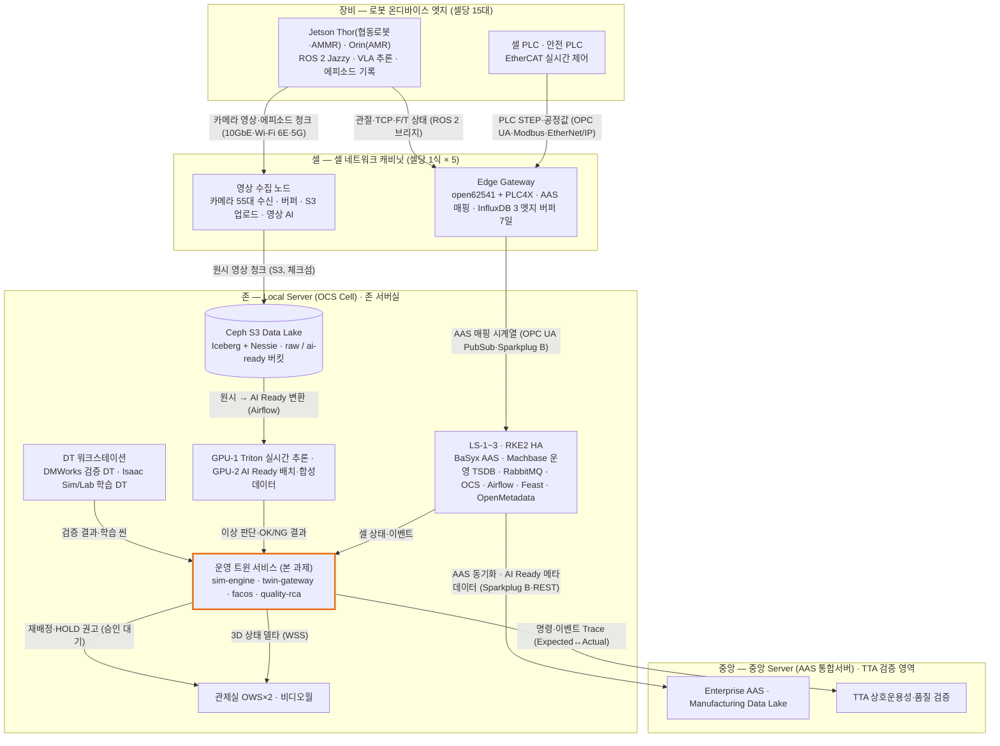
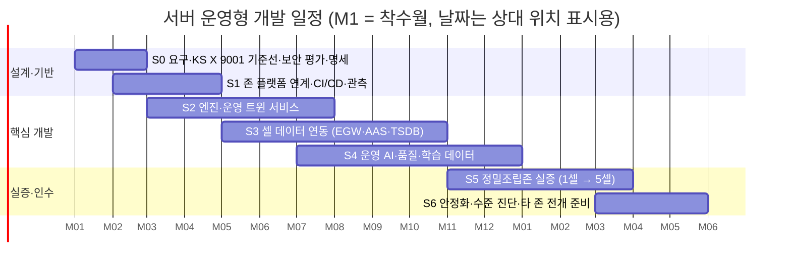

# [개발 규격서·계획서] 피지컬AI 실증 메타팩토리 — 서버 운영형 시스템

2026-10-19 작성 · 같은 날 개정(정밀조립존 기준 적용 · KS X 9001 적용) · 작성 Jin Park

> **근거 문서**
> [R1] `docs/DESIGN.md` · [R2] `OPEN_SOURCE.md` · [R3] `docs/DEV_PLAN.md` · [R4] `deploy/sensors/` · [R5] `analysis/rca/requirements.txt` · [R6] `README.md`
> [R7] `../micro-cell/docs/ocs_precision.html` — 로컬 OCS Zone 구성 - (예시) 정밀조립존 (총괄5-세부1 · A-3 정밀조립(Micro) Zone, 2026-10-09 갱신, 설계 추정본)
> [K1] KS X 9001-1 스마트공장 — 제1부: 기본 개념과 구조 · [K2] KS X 9001-2 제2부: 용어 · [K3] KS X 9001-3 제3부: 운영관리시스템(진단 평가 모델) · [K3-1] KS X 9001-3-1 제3-1부: 제조혁신 역량수준 및 진단평가모델 · [K3-2] KS X 9001-3-2 구축 시스템 수준 · [K4] KS X 9001-4 제4부: 중소·중견기업을 위한 스마트제조 전개 가이드
>
> **표기** — `(현행)` 저장소에 구현된 사실 · `(설계)` 본 문서에서 정한 값 · `(설계 추정)` 검증 전 산정값 · `TBD` 기준선 측정 후 확정 · `[R# §n]` 근거 문서 절
>
> **문서 관계** — 본 문서는 **실제 서버에서 운영하는 시스템**의 규격·계획임. 맥 앱(Electron)은 간이 테스트·개발용 클라이언트로 격하함. 실증 기준 존은 [R7]의 **A-3 정밀조립(Micro) Zone**이며, 나머지 존(유연생산·적응가공·정밀검사)은 같은 계층 구조를 복제함 [R7 §1].

---

## 0. 요약

- **전제 전환**: 현행은 맥 앱 한 대에서 시뮬레이션·3D·서버·브로커·DB가 모두 도는 단일 사용자 구조임 [R1 §4]. 본 문서는 이를 **중앙 Server — 존 Local Server(OCS Cell) — 셀 Edge Gateway·영상 수집 노드 — 로봇 온디바이스 엣지**의 4계층 운영 시스템으로 재정의함 [R7 §1].
- **기준 존**: A-3 정밀조립존 5셀(A-3-1~5), 셀당 로봇 15대(협동로봇 10·AMR 4·AMMR 1)·카메라 55대, 존 합계 로봇 75대·카메라 275대·AAS 태그 약 49,750개 [R7 §4]. 메타팩토리 시뮬레이터의 정밀조립Zone(도어트림·e-axle 혼류)을 이 실존 구성의 디지털트윈으로 맞춤.
- **데이터 경로 2개**: ① 상태·공정값 = OPC UA → 엣지 TSDB → 운영 TSDB, ② 영상·진동·오디오 대용량 = OPC UA 우회 → S3 → Data Lake [R7 요약]. 존 데이터 발생량 월 약 494TB(카메라 영상 98%) [R7 §4].
- **제어 경계**: 로봇·서보 실시간 제어는 셀 PLC EtherCAT에 둠. 본 시스템(OCS·트윈)은 **수집·감독·재계획만** 맡고, 실설비 쓰기는 사람 승인(HITL) 경로로만 수행함 [R7 요약, R1 §9].
- **스마트공장 국가표준 적용**: KS X 9001-1 참조 구조로 시스템 계층을 매핑하고, KS X 9001-2 용어를 화면·문서 용어 기준으로 삼으며, KS X 9001-3-1·3-2로 수준 진단을 단계 게이트에 넣음. **목표 수준은 고도화 단계** (설계 목표, 10장).
- **로봇·AI 스택**: ROS 2 Jazzy · Isaac ROS · ros2_control · MoveIt 2 · LeRobot · **Isaac Sim·Isaac Lab(학습 DT, 정식 채택)** · Triton · TensorRT · DMWorks(검증 DT).
- **일정·투입**: 18개월(M1~M18), 7단계, 12.5명 (설계 추정).

---

# 제1부. 규격 (Specification)

## 1. 시스템 개요

### 1.1 운영 목적

| # | 목적 | 측정 지표 |
|---|---|---|
| O1 | 실설비 데이터를 받아 디지털트윈을 실시간 동기화하고 운영자가 웹·관제실에서 공동 관제함 | 트윈 반영 지연 p95, 동시 접속 수 |
| O2 | 레거시·자동화·피지컬AI 3단계 운영을 같은 공장 조건에서 정량 비교함 [R1 §1] | 다중 시드 비교 처리 시간 |
| O3 | 셀 이상 시 HOLD·재시도·격리를 판단하고 재배정함 [R7 §2] | 이상 판단 시간 (10초 KPI) |
| O4 | 품질 불량을 계보 기반으로 원인 분석하고 8D로 종결함 [R1 §2 F7] | 원인 Top-1 적중률 |
| O5 | 표준 데이터(AAS·OPC UA·EPCIS·Sparkplug·VDA 5050)를 중앙 Server·TTA 검증 영역에 제공함 [R7 §1] | 표준 적합률, Trace 일치율 |
| O6 | 피지컬AI 학습 데이터(VLA 에피소드·AI Ready 데이터셋)를 축적·제공함 [R7 §6] | 데이터셋 생성량, 품질 리포트 통과율 |

### 1.2 범위

| 구분 | 포함 | 제외 |
|---|---|---|
| 배치 | 중앙 Server 연계, 존 Local Server(OCS Cell), 셀 Edge Gateway·영상 수집 노드, 로봇 온디바이스 엣지 SW | 중앙 Server(AAS 통합서버) 자체 구축 — 별도 과제 [R7 확인 필요] |
| 실설비 연동 | OPC UA·PLC4X 드라이버·로봇 SDK·ROS 2·VDA 5050 **읽기**, 영상·텔레메트리 수집 | PLC 로직·로봇 안전 기능 변경, 승인 없는 제어 쓰기 |
| 사용자 | 운영·품질·데이터·IT 담당, 관제실 운영자 2인 [R7 §2], 발주처 열람자 | 불특정 외부 공개 |
| 클라이언트 | 최신 Chromium·Firefox·Safari(WebGL2), 관제 비디오월 | 모바일 3D 화면(요약 화면만) |
| 맥 앱 | 개발자 로컬 테스트·스테이징 데이터 발생기 | 운영 배포 대상 아님 |

### 1.3 현행(맥 앱) 대비 변경 요약

| 영역 | 현행 [R1 §4·§12] | 서버 운영형 |
|---|---|---|
| 시뮬레이션 실행 위치 | 화면(렌더러) 안 | 존 Local Server `sim-engine` (권위 있는 상태) |
| 데이터 원천 | 시뮬레이션만 | 실설비(로봇 75대·카메라 275대) + 시뮬레이션, 출처 태그로 구분 |
| 사용자 | 1명, 인증 없음 | 다중 사용자, Keycloak SSO, 역할 기반 권한(RBAC) |
| 저장 | 메모리 + SQLite | 운영 TSDB(Machbase) · PostgreSQL · Ceph S3 Data Lake(Iceberg) |
| 브로커 | aedes 내장 (127.0.0.1) | RabbitMQ 3노드(MQTT 5·Sparkplug B), TLS |
| 배포 | `npm run package` | 컨테이너 + RKE2(존)·K3s(엣지) + Rancher·GitOps |
| 디지털트윈 | 자체 3D 시뮬레이터 1종 | 운영 트윈(본 시스템) + 검증 DT(DMWorks) + 학습 DT(Isaac Sim) 3종 |

---

## 2. 시스템 아키텍처 규격

### 2.1 계층 배치 (정밀조립존 기준)



※ 주황 테두리 = 본 과제(메타팩토리) 직접 개발 영역. 나머지 OCS Cell 구성은 [R7]의 오픈소스·상용 SW 선정을 그대로 따름.

### 2.2 데이터 경로 규격

| 경로 | 대상 | 흐름 | 주기·지연 (설계) | 근거 |
|---|---|---|---|---|
| ① 상태·공정값 | PLC STEP·공정값·로봇 관절·TCP·알람 | 장비 → EGW(OPC UA 집약·AAS 매핑) → 엣지 TSDB → 운영 TSDB(Machbase) | 20ms / 200ms / 1~3s 3단 주기, 단절 시 7일 버퍼 | [R7 §6 OPCUA·ETSDB, W8] |
| ② 대용량 원시 | 카메라 영상·Depth·F/T 1kHz 파형·오디오 | 엣지 → 영상 수집 노드(NVMe 수신 → HDD 5일 버퍼) → Ceph S3 raw 버킷 | 청크 업로드, 체크섬 재전송 | [R7 §5 VNODE·§6 RAW] |
| ③ AI Ready | 동기 정렬·결측 검사·AAS 매핑·LeRobot 변환·품질 리포트 | raw 버킷 → Airflow(GPU-2) → ai-ready 버킷 → 중앙 Data Lake | 배치 종료 후 | [R7 §6 ETL] |
| ④ 트윈 상태 | 셀·로봇·AMR 상태 델타 | 운영 TSDB·RabbitMQ → sim-engine → twin-gateway → 브라우저 | 10Hz, p95 200ms | (설계) |
| ⑤ 검증 Trace | OCS 명령 → PLC STEP 전이 → 로봇 동작 이벤트 | OCS·EGW → Trace API → TTA | 이벤트 단위 | [R7 §6 TRC] |

### 2.3 서비스 구성

| 서비스 | 책임 | 구현 기반 | 배치 | 출처 |
|---|---|---|---|---|
| `sim-engine` | 실시간 미러·What-if 세션 실행 (`sim-core` 결정론 엔진) | Node.js 24 | Local Server | 본 과제 |
| `sim-batch` | 다중 시드 비교·개선안 트윈 검증 [R1 §7(9)] | Airflow KubernetesPodOperator + `sim-core` 워커 | Local Server | 본 과제 |
| `twin-gateway` | 인증 WebSocket, 세션별 상태 델타, 구독 범위 제어 | Fastify · protobuf-es | Local Server | 본 과제 |
| `facos` | 공장·존·셀 에이전트, A2A 기록, 재배정 권고 [R1 §8] — OCS(Manufacturing·Field Logistics Agent)와 API 연계 | Node.js | Local Server | 본 과제 + [R7 §6 OCS] |
| `quality-rca` | 계보·NG·RCA·8D, 불량 보고 수신 [R1 §2 F7·F8] | Fastify | Local Server | 본 과제 |
| `agent-llm` | 자연어 지시 해석·설계 초안, MCP 서버 | Fastify · `@anthropic-ai/sdk` · MCP SDK | Local Server | 본 과제 |
| `web` | 3D 트윈·관제 SPA | Vite · three.js · Preact | Local Server | 본 과제 |
| OCS (존 오케스트레이터) | 셀 상태 집계·배치 진척·재계획, 공장 PA Agent 연계 | 자체 개발 | Local Server | [R7 §6 OCS] |
| AAS Repository·Registry | 존 자산 AAS 저장·조회, 중앙 Enterprise AAS 동기화 | Eclipse BaSyx (AAS V3) | Local Server | [R7 §6 AASR] |
| 운영 TSDB | 상태·알람·공정값, 초당 약 20만 포인트·12개월 | Machbase Cluster Edition | Local Server | [R7 §6 OTSDB] |
| MQTT 클러스터 | 중앙 전송·셀 KPI 이벤트, Sparkplug B | RabbitMQ 3노드 (MQTT 5 플러그인·quorum 큐) | Local Server | [R7 §6 MQTT] |
| AI Ready 파이프라인 | 원시 → AI Ready 변환 | Apache Airflow + 자체 개발 | Local Server·GPU-2 | [R7 §6 ETL] |
| Data Lake | raw·ai-ready 버킷, 테이블 버전 관리 | Ceph S3 + Apache Iceberg + Nessie | 스토리지 노드 | [R7 §6 LAKE] |
| Feature Store | 학습·추론 공통 피처 | Feast | Local Server | [R7 §6 FS] |
| 카탈로그·리니지 | order·cell_task·episode 공통 ID 추적 | OpenMetadata | Local Server | [R7 §6 CAT] |
| 추론 엔진 | 이상 판단·OK/NG·재계획 모델 | NVIDIA Triton | GPU-1 | [R7 §6 INF] |
| Trace API | Expected↔Actual Trace 비교 제공 | 자체 개발 (TTA 협의) | Local Server | [R7 §6 TRC] |
| Edge Gateway SW | OPC UA 집약·정규화·AAS 매핑·엣지 버퍼 | open62541 + Apache PLC4X · InfluxDB 3 Core | EGW | [R7 §6] |
| 원시 업로드 | 청크 업로드·store-and-forward | 자체 개발 | 영상 수집 노드 | [R7 §6 RAW] |
| 온디바이스 엣지 SW | 로봇 제어 브리지·VLA 추론·안전 감지·에피소드 기록 | JetPack · ROS 2 Jazzy · Isaac ROS · ros2_control · MoveIt 2 · TensorRT(-LLM) · LeRobot | Jetson Thor·Orin | [R7 §8] |

### 2.4 디지털트윈 3종 역할 분담

| 트윈 | 도구 | 역할 | 입력 | 산출 |
|---|---|---|---|---|
| 운영 트윈 (본 과제) | 메타팩토리 `sim-core` + three.js | 실시간 미러 관제, 3단계 운영 비교, What-if, KPI 개선 검증 | 운영 TSDB·RabbitMQ 실상태, 시나리오·시드 | 관제 화면, KPI 비교, 개선 권고 |
| 검증 DT | DMWorks 3.0 (BASE + MULTIPLE PROCESS + PLC SIMULATION) | 지그·공정 투입 전 로봇 경로 간섭·사이클타임 가상 시운전, PLC 시퀀스 검증 [R7 §2] | 셀 레이아웃·로봇 경로·PLC 프로그램 | 간섭·사이클타임 검증 결과 |
| 학습 DT | NVIDIA Isaac Sim · Isaac Lab | VLA·파지 스킬 학습 씬, 합성 데이터, 실물 에피소드 리플레이로 S2R/R2S 정합 오차 측정 [R7 §6 ISAAC] | USD 씬, LeRobot 에피소드 | 학습 정책, 합성 데이터셋, 정합 오차 |

※ 세 트윈은 같은 AAS ID·셀 좌표계(ROS REP-103)를 써서 결과를 상호 참조함. 운영 트윈의 셀 배치·사이클은 검증 DT 결과를 기준값으로 받음.

### 2.5 운영 트윈 운전 모드

| 모드 | 입력 | 시계 | 결정론 | 용도 | 동시 세션 (설계) |
|---|---|---|---|---|---|
| 실시간 미러 | 실설비 상태 | 실제 시각 (PTP 동기) | 해당 없음 | 관제·이상 감지 | 존당 1 |
| 가정 시뮬레이션 (What-if) | 시나리오 + 시드 (미러 스냅숏 분기 가능) | 1~30배속 | 필수 | 3단계 비교, 공정 설계 검토 | 전체 10 |
| 개선안 검증 (Batch) | 개선안 + 시드 36~72개 | 최대 속도 | 필수 | KPI 개선 판정 [R1 §7(9)] | 동시 작업 4 |

※ 모든 데이터에 `source: live | sim | batch`, `scenario_id`, `seed`, `engine_version` 을 붙여 실데이터와 섞지 않음.

---

## 3. 기능 규격

현행 기능 영역 F1~F13 [R1 §2]을 유지하고, 서버 운영·정밀조립존 실증에 따른 변경·추가 사항만 정함.

| # | 기능 영역 | 서버 운영형 변경·추가 | 완료 기준 |
|---|---|---|---|
| F1 | 3D 디지털트윈 | 정밀조립존 5셀(A-3-1~5) 실배치·로봇 15대/셀 반영, 서버 상태 스트림 렌더 | 동시 50명, 30fps 이상 |
| F2 | 공장 시뮬레이션 | `sim-engine` 서버 실행, 미러 스냅숏에서 What-if 분기 | 같은 시드 = 같은 결과 |
| F3 | 3단계 운영 모드 | 배치 작업으로 8시간 비교 | 시드 36개 비교 30분 이내 |
| F4 | Zone 운영 | 4개 Zone 모두 헤드리스 실행 [R1 §16], 정밀조립존 셀 구성은 [R7] 기준 | 화면 전용 로직 0 |
| F5 | 공정 설계 | 설계안 버전·승인 흐름, DMWorks 검증 결과 첨부 필수 | 승인 이력 100% |
| F6 | 운영 에이전트 | OCS와 API 연계, HOLD·재배정 권고 → 운영자 승인 | 승인 없는 쓰기 0건 |
| F7 | 품질·RCA·8D | 티켓 영구 저장, 체결 토크 곡선 등 운영 TSDB 원천 연결 | 재시작 유실 0 |
| F8 | 불량 보고 통신 | 실검사 장비 리포트(CloudEvents) | 사례당 5단계 메시지 |
| F9 | 데이터 연동 | BaSyx AAS(OPC 30270 정보모델), 중앙 Enterprise AAS 동기화 | 같은 AAS ID로 중앙·DT 조회 |
| F10 | 센서·텔레메트리 | EGW 3단 주기 수집, 엣지 7일 버퍼 | 단절 복구 후 누락 0 |
| F11 | KPI 영향·개선 | KS X 9001·ISO 22400-2 KPI, 실측 기반 손실 분해 | 손실 합 + OEE = 100% |
| F12 | 물류·안전·보안 | 실AMR VDA 5050·ROS 2 상태, 작업자 근접 영상 AI 알람 | 엣지 알람 100ms 이내 |
| F13 | AI 학습 데이터 | AI Ready 파이프라인·LeRobot 변환·카탈로그 리니지 | 품질 리포트 통과·외부 로더 읽힘 |
| **F14** | **사용자·권한 (신규)** | Keycloak SSO·HIWARE 접근통제·감사 로그 | 5.3절 권한 표 100% |
| **F15** | **운영 관리 (신규)** | 서비스 상태·백업·보존 정책·스마트공장 수준 자가진단 화면 | 7장·10장 규격 충족 |
| **F16** | **검증 Trace (신규)** | OCS 명령 → PLC STEP → 로봇 동작 Trace 기록·제공 | Trace 누락 0, TTA 비교 API 응답 |

---

## 4. 비기능 규격 (성능·용량·가용성)

### 4.1 성능 규격

| 항목 | 규격값 | 산출식·측정 방법 | 근거 |
|---|---|---|---|
| 이상 판단 시간 | 10초 이내 | 이상 이벤트 발생 → OCS HOLD·재시도·격리 판단 시각 차 | [R7 §2 GPU-1] |
| 엣지 안전·이상 알람 | 100ms 이내 | 감지 프레임 시각 → 알람 발행 시각 차 | [R7 §6 EAI] |
| 3D 상태 전송 지연 | p95 200ms 이내 | 엔진 상태 생성 → 브라우저 수신 시각 차 95백분위 | (설계) |
| 실설비 → 트윈 반영 | p95 1초 이내 | 설비 타임스탬프 → 엔진 반영 시각 차 | (설계) |
| 운영 TSDB 적재 | 초당 20만 포인트, 12개월 보관 | 부하 시험 적재율 | [R7 §6 OTSDB] |
| 동시 접속 | 3D 50명, 요약 200명 | k6 동시 WebSocket 수 | (설계 추정) |
| 다중 시드 배치 | 시드 36개 × 8시간 공장 시간 30분 이내 | 작업 시작 → 결과 저장 | [R1 §3] |
| 시간 동기 | 유선 PTP 2µs, 로봇 100Hz·F/T 1kHz·영상 타임스탬프 정합 | linuxptp·PTP 그랜드마스터 통계 | [R1 §3], [R7 §5 PTP] |

### 4.2 용량 규격 — 정밀조립존 기준 [R7 §4]

| 항목 | 산출식 | 값 |
|---|---|---|
| 셀 구성 | 협동로봇 10 + AMR 4 + AMMR 1 | 로봇 15대/셀 |
| 카메라 | 로봇 15 × 3(손목·머리·가슴) + 협동로봇 엑소센트릭 10 | 55대/셀, 존 275대 |
| 카메라 1대 대역폭 | RGB H.265 4Mbps + Depth 16bit 무손실(약 4:1) 18.4Mbps | 22.4 Mbps |
| 셀 평균 대역폭 | 카메라 + 텔레메트리 | 1,246 Mbps/셀, 존 6,232 Mbps |
| AAS 태그 | 장비당 약 400 엘리먼트 기준 추정 | 9,950개/셀, 존 49,750개 |
| 월 발생량 | 월 176시간 연속 기록 | 98.7 TB/셀, 존 493.6 TB/월 (영상 98%) |
| 필요 저장 | (원시 3개월 1,481TB + AI Ready 3개월 296TB) × 1.3 | 2,310 TB |
| 스토리지 노드 | 2,310 ÷ 사용률 0.8 ÷ 노드당 usable 160TB(raw 240TB, EC 4+2) | 19노드 (usable 3,040TB) |
| 엣지 버퍼 | EGW 시계열 7일 · 영상 수집 노드 HDD 24TB(RAID1) 약 5일분 | — |

※ 보관 기간을 원시 1개월로 줄이면 약 770TB·6노드로 감소 [R7 확인 필요]. Depth 미기록 시 월 약 92TB. 카메라 설정·보관 정책 확정 후 재산정함.

### 4.3 가용성·복구 규격

| 항목 | 규격값 (설계) | 산출식 |
|---|---|---|
| 존 서비스 가용성 | 월 99.5% | (월 총 시간 − 장애 시간) ÷ 월 총 시간 × 100 |
| 노드 장애 | Local Server 3노드 중 1대 장애 시 자동 재배치, 5분 이내 | etcd 쿼럼 유지 [R7 §2] |
| 데이터 유실 | 0 (엣지 버퍼·체크섬 재전송) | (발행량 − 적재량) ÷ 발행량 |
| RPO | 운영 TSDB·AAS·설정 24시간 이내(백업 NAS), PostgreSQL 5분 | 백업 주기 |
| RTO | 단일 노드 5분, 존 전체 4시간 | 장애 주입 시험 실측 |
| 원시데이터 원본 | 중앙 Golden Copy, 존은 3개월 작업 사본 | [R7 §5 BAK] |
| 전원 | UPS 20kVA × 2 병렬, 30분 유지 | 서버실 부하 약 17.2kW [R7 §5 UPS] |

### 4.4 기타 비기능

| 분류 | 규격 | 측정 방법 |
|---|---|---|
| 재현성 | What-if·배치는 같은 시드·설정·이미지 다이제스트면 같은 결과 | 재실행 비교 |
| 데이터 재현 | 학습 데이터셋은 Iceberg 스냅샷으로 고정해 같은 데이터로 재학습 [R7 §6 LAKE] | 스냅샷 ID 기록 |
| 확장성 | 신규 셀은 EGW 설정 템플릿 복제로 수집 시작 [R7 §6 GWM] | 셀 추가 시험 |
| 사용성 | 화면 문구 한국어, KS X 9001-2 용어 사용 | 용어 점검표 |
| 접근성 | 요약 화면 WCAG 2.2 AA | axe-core |

---

## 5. 보안 규격

### 5.1 보안 목표

- **IEC 62443-3-3 SL2** 목표, IEC 62443-3-2로 존·도관 위험 평가를 S0에 수행함.
- OT/IT 경계는 산업용 방화벽 HA 쌍(OPC UA·MQTT DPI)으로 분리함 [R7 §5 FW].
- 실설비 쓰기는 승인 경로 외에 만들지 않음.

### 5.2 존·도관 규격

| 존 | 구성 | 허용 도관 (출발 → 도착 : 프로토콜) |
|---|---|---|
| Z1 셀 제어 | PLC·안전 PLC·로봇 컨트롤러·서보 (EtherCAT) | Z1 → Z2 : OPC UA(TLS)·Modbus TCP·EtherNet/IP 읽기, TSN 스위치 경유 |
| Z2 셀 엣지 | 온디바이스 엣지·EGW·영상 수집 노드 | Z2 → Z3 : MQTT 8883·OPC UA PubSub·S3 HTTPS (셀 → 존 방향만) |
| Z3 존 서버 | Local Server·GPU·스토리지·DT 워크스테이션·관제실 | Z3 → Z4 : 방화벽 경유 MQTT·REST (중앙 연계) · Z3 → 외부 : Claude API HTTPS(프록시·허용 목록) |
| Z4 중앙·검증 | 중앙 Server·TTA 검증 영역 | Z4 → Z3 : 작업지시·모델 배포 구독만 |
| Z5 사내 IT | 사용자 PC | Z5 → Z3 : HTTPS 443 (SSO) |

### 5.3 사용자·권한 규격 (RBAC)

| 역할 | 3D 관제 | What-if | 공정 설계 적용 | HOLD 승인·재배정 | 품질 티켓 | 데이터 내보내기 | 시스템 설정 |
|---|---|---|---|---|---|---|---|
| 시스템 관리자 | ● | ● | ● (승인) | — | ● | ● | ● |
| 존 관제 운영자 | ● | ● | 요청만 | ● | 조회 | 요약 | — |
| 셀 알람 대응자 | ● | — | — | ● | 조회 | — | — |
| 품질 담당 | ● | ● | — | — | ● | 품질 데이터 | — |
| 데이터·AI 엔지니어 | ● | ● | — | — | 조회 | ● (감사 기록) | — |
| 열람자 | ● | — | — | — | — | — | — |
| 감사자 | 감사 로그만 | — | — | — | — | — | — |

### 5.4 보안 통제 규격

| 영역 | 규격 | 구현 |
|---|---|---|
| 사용자 인증 | OIDC SSO, 관리자 MFA | Keycloak [R7 §6 SEC] |
| 접근통제·감사 | 서버 접속 통제·기록, 1년 보관 | HIWARE 접근통제 [R7 §6 SEC] · Loki |
| 장비 인증 | OPC UA 인증서 PKI(Basic256Sha256 이상), 엣지 장비 인증서 | OPC UA PKI · step-ca [R7 §8 ESEC] |
| 엣지 무결성 | Secure Boot · OP-TEE · 디스크 암호화, 분실 엣지 인증서 차단 | Jetson 보안 기능 [R7 §8 ESEC] |
| 비밀 관리 | API 키·DB 암호는 비밀 저장소에만 | HashiCorp Vault + External Secrets Operator |
| 공급망 | 이미지 서명·SBOM·Critical/High 0건 배포 | cosign · Kyverno · Trivy · CycloneDX |
| 런타임 | 비루트·읽기 전용 루트, NetworkPolicy 기본 거부 | Pod Security Standards · Falco |
| LLM 안전 | 첨부 내용은 지시로 취급 안 함, 출력 스키마 검증 후 사람 승인 [R1 §8] | `agent-llm` 게이트 |
| 개인정보 | 작업자 영상 비식별(GPU-2 배치), 보존 기간 게시·자동 삭제, 접근 기록 | [R7 §2 GPU-2] · `media` 보존 정책 |

---

## 6. 인터페이스 규격

### 6.1 외부 인터페이스

| 구분 | 방식 | 규격 | 명세 형식 |
|---|---|---|---|
| 웹 화면 ↔ 서버 | HTTPS REST, WSS | `/api/{서비스}/v1/...`, 오류 RFC 9457 | OpenAPI 3.1 |
| 3D 상태 스트림 | WSS + Protocol Buffers | `twin.v1.StateDelta` | `.proto` (Buf) |
| 존 메시징 | MQTT 5 (RabbitMQ) | 6.2절 토픽 체계, Sparkplug B 3.0 | AsyncAPI 3.0 |
| 자산 정보 | AAS Part 2 REST (BaSyx) | IDTA-01002, 메타모델 v3.1 | BaSyx OpenAPI |
| 설비 정보 모델 | OPC UA | IEC 62541, **OPC 30270 (AAS Companion Spec)**, Robotics(OPC 40010)·Machine Tools(OPC 40501) | NodeSet2 XML |
| 필드 장비 | PLC4X 드라이버 | S7·Modbus·EtherNet/IP·ADS [R7 §6 DRV] | 드라이버 설정 |
| 로봇 | ROS 2 Jazzy | `/joint_states`·`/wrench` 등 표준 메시지, ros2_control | `.msg`·`.srv` |
| AMR | VDA 5050 v2 · ROS 2 | order·state·instantActions | 공식 JSON Schema |
| 중앙 Server | MQTT(산업용) · REST(무선통신) | AI Ready 메타데이터·셀 KPI 발행, 작업지시·모델 배포 구독 [R7 §6 MQTT] | AsyncAPI·OpenAPI |
| TTA 검증 | Trace API (REST) | Expected↔Actual Trace 비교 | OpenAPI (TTA 협의) |
| 제품 계보 | EPCIS 2.0 | GS1 EPCIS 2.0 / CBV 2.0 | 공식 OpenAPI |
| 외부 에이전트 | MCP (Streamable HTTP) | Model Context Protocol | MCP 도구 스키마 |

### 6.2 토픽 체계 (ISA-95 계층)

```
mf/{site}/{area}/{cell}/{domain}/v1/{type}
  site   : 실증 공장 코드
  area   : 존 (a3-precision · a1-flexible · a2-machining · inspection · logistics)
  cell   : 셀 ID (A-3-1 … A-3-5), 존 단위는 _zone
  domain : telemetry · event · quality · fleet · kpi · trace
  type   : data · alarm · report · result · ack
```

| 토픽 예 | 발행 → 구독 | 페이로드 | QoS |
|---|---|---|---|
| `spBv1.0/mf-a3/DDATA/{egw}/{device}` | EGW → 운영 TSDB·sim-engine | Sparkplug B 3.0 | 0 |
| `mf/{site}/a3-precision/A-3-5/telemetry/v1/data` | EGW → sim-engine·interop | OPC UA PubSub JSON (Part 14) | 0 |
| `uagv/v2/{manufacturer}/{serial}/state` | AMR → sim-engine | VDA 5050 v2 | 0 |
| `mf/{site}/a3-precision/A-3-5/kpi/v1/data` | OCS → 중앙 Server·DCC | 사이클타임·NG율 (Sparkplug B) | 1 |
| `mf/{site}/a3-precision/_zone/event/v1/alarm` | OCS·엣지 → 관제 | CloudEvents 1.0 | 1 |
| `mf/{site}/a3-precision/A-3-5/trace/v1/data` | OCS·EGW → Trace API | CloudEvents 1.0 (Trace 레코드) | 1 |

※ 현행 토픽 `metafactory/{영역}/v1/...` [R1 §6]은 스테이징 브리지에서 변환해 하위 호환을 유지함.

### 6.3 공통 규칙

- **공통 ID**: `order_id` · `cell_task_id` · `episode_id` 를 운영 TSDB·Data Lake·카탈로그·Trace에 공통 키로 둠 [R7 §6 CAT].
- **AAS 서브모델**: 장비마다 Nameplate · TechnicalData · OperationalData · Maintenance 를 정의하고, 같은 계열 장비는 같은 Semantic ID를 재사용함 [R7 §6 AASIM].
- 타임스탬프는 RFC 3339 UTC µs, 설비 시각·수신 시각 병기.
- 접수형 요청은 202 + 티켓, `Idempotency-Key` 로 멱등 처리.
- 명세는 `packages/schemas` 단일 원천, CI에서 하위 호환 검사(Buf breaking·oasdiff).

---

## 7. 데이터 규격

| 데이터 | 저장소 | 형식·표준 | 보존 (설계) | 백업 |
|---|---|---|---|---|
| 운영 시계열 (상태·알람·공정값) | Machbase Cluster (3노드) | AAS 매핑 태그 | 12개월 | 백업 NAS |
| 엣지 시계열 버퍼 | InfluxDB 3 Core (EGW) | — | 7일 | 없음 (버퍼) |
| 업무 데이터 (티켓·설계안·권한·감사·시뮬레이션 요약) | PostgreSQL 17 (CloudNativePG) | 관계형 | 영구 (감사 1년 이상) | WAL 연속 + 일 1회 |
| 제품 계보 | PostgreSQL (EPCIS JSONB) | EPCIS 2.0 | TBD (품질 기록 기준) | 위와 동일 |
| 자산 모델 | BaSyx | AAS v3.1 | 영구 | 백업 NAS |
| 원시 영상·파형 | Ceph S3 raw 버킷 (Iceberg) | MP4(H.265)·Depth 무손실·Parquet | 3개월 (TBD: 1개월 안) | 중앙 Golden Copy |
| AI Ready 데이터셋 | Ceph S3 ai-ready 버킷 (Iceberg) | LeRobot(Parquet+MP4) · RLDS 변환 옵션 | 3개월 (중앙 영구) | 중앙 전송 |
| 피처 | Feast | 온라인·오프라인 피처 | 모델 수명 | — |
| 메타데이터·리니지 | OpenMetadata | — | 영구 | 백업 NAS |
| 로그·메트릭 | Loki · Prometheus | — | 로그 90일(감사 1년), 메트릭 30일 | 감사 로그만 |

**데이터 원칙**

- **출처 분리**: 실데이터와 시뮬레이션 데이터를 `source` 태그로 구분, 학습 데이터셋에 섞지 않음.
- **정답 라벨 분리**: 시뮬레이션 정답은 학습 데이터셋에만 둠 [R1 §5].
- **한 시계**: GNSS PTP 그랜드마스터 → 코어·TSN 스위치 경계/투명 클럭 → 셀 장비 [R7 §5 PTP].
- **AI Ready 품질**: 완전성·결측·시간 정합성 검사를 통과한 데이터만 ai-ready 버킷에 올림 [R7 §6 ETL].

---

## 8. 인프라·하드웨어 규격 — 정밀조립존 기준 [R7 §5·§7]

### 8.1 존 HW (OCS Cell)

| 구분 | 품목 | 수량 | 주요 사양 | 역할 |
|---|---|---|---|---|
| 연산 | 로컬 서버 노드 LS-1~3 | 3 | 2U · Xeon 6 2소켓 · RAM 512GB · NVMe 2×7.68TB · 25GbE×2 | RKE2 HA, 존 SW 약 20종 |
| 연산 | GPU 서버 GPU-1·GPU-2 | 2 | 4U · EPYC 2소켓 · RTX PRO 6000 96GB × 4 (8장 증설) · RAM 512GB | 실시간 추론(Triton) / AI Ready·합성데이터·재학습 |
| 저장 | 스토리지 노드 | 19 | 12 × 20TB HDD + NVMe 캐시 · EC 4+2 · 25GbE×4 | Ceph S3 Data Lake |
| 저장 | 백업 NAS | 1 | usable 50TB · 스냅샷 · 오프사이트 복제 | AAS·TSDB·설정·모델 백업 |
| 셀 | Edge Gateway | 6 (셀 5 + 냉예비 1) | 산업용 · 24코어 · 64GB · RTX 2000 Ada · NVMe 4TB · 10GBASE-T | OPC UA 집약·AAS 매핑·엣지 TSDB·F/T 이상감지 |
| 셀 | 영상 수집 노드 | 5 | Xeon 6 · 128GB · NVIDIA L4 · NVMe 3.84TB×2 + HDD 24TB×2 · 10GbE×2 | 카메라 55대 수신·버퍼·업로드·영상 AI |
| 셀 | 셀 네트워크 캐비닛 | 5 | 18U · 2.2kVA UPS | EGW·영상 노드·셀 스위치 수납 |
| 네트워크 | 코어 스위치 | 2 | 48×25GbE + 6×100GbE · MLAG · PTP | 존 백본 |
| 네트워크 | 셀 TSN 스위치 | 20 | IEEE 802.1AS·1588 · TSN(Qbv) | PLC·로봇 컨트롤러·엣지 연결, µs급 동기 |
| 네트워크 | 셀 액세스·PoE 스위치 | 5 | 24×mGig UPOE · 10G 업링크 | 공정 비전·AP·제어 PC |
| 네트워크 | 관리망 스위치 | 1 | 48×1GbE | IPMI·관리망 |
| 보안 | 산업용 방화벽 | 2 (HA) | 10GbE · OPC UA·MQTT DPI · VPN | IEC 62443 Zone/Conduit 경계 |
| 시간 | PTP 그랜드마스터 | 1 | GNSS · IEEE 1588 / 802.1AS · OCXO 홀드오버 | 존 단일 기준 시계 |
| 무선 | 산업용 Wi-Fi 6E AP | 7 | 로밍 50ms 이하 · PoE | AMR·AMMR 업로드 (5G는 이음5G 별도) |
| 운영 | OCS 운영 워크스테이션 | 2 | i9 · 64GB · 32″ × 2 | 존 관제 1 + 셀 알람 대응 1 |
| 운영 | DT 워크스테이션 | 2 | Xeon W · 256GB · RTX PRO 6000 96GB | DMWorks 검증 DT 1 + Isaac 학습 DT 1 |
| 운영 | 관제 비디오월 | 1식 | 55″ 2×2 | 셀 영상·트윈·KPI 표시 |
| 기반 | 서버 랙 · UPS · 항온항습기 · KVM | 4 · 2 · 1 · 1 | 42U · 20kVA 병렬 30분 · 20kW 인로우 | 서버실 부하 약 17.2kW |

### 8.2 로봇 온디바이스 엣지 (셀당 15대 × 5셀)

| 품목 | 셀당 | 5셀 | 사양 | 역할 |
|---|---|---|---|---|
| 협동로봇·AMMR용 엣지 | 11 | 55 | Jetson AGX Thor T5000 · 128GB · 25GbE | VLA·파지·삽입 추론, 카메라 수신·기록, 제어 브리지, 안전 감지 |
| AMR용 엣지 | 4 | 20 | Jetson AGX Orin 64GB · 275 TOPS | LiDAR·카메라 인지, 도킹, 로컬 버퍼 |
| 무선 클라이언트 · 5G 모뎀 | 5 · 5 | 25 · 25 | Wi-Fi 6E · 5G NR n79(이음5G) | 이동 로봇 업로드 |
| 국산 NPU 모듈 (선택) | 2 | 10 | DEEPX DX-M1 | GPU·NPU 지연·전력 비교 |

※ 단가·총액은 [R7]에 있으며 본 문서에는 옮기지 않음. 존 HW·SW와 셀 HW 구성은 [R7]을 정본으로 하고, 본 과제는 그 위에서 도는 서비스를 개발함.

---

# 제2부. 적용 표준·오픈소스·라이브러리

## 9. 플랫폼·애플리케이션 오픈소스

### 9.1 존 플랫폼 ([R7] 선정 계승)

| 구성요소 | 채택 | 라이선스 | 용도 |
|---|---|---|---|
| Kubernetes (존) | RKE2 + Rancher | Apache-2.0 | Local Server 3노드 HA, 엣지와 관리 체계 통일 |
| Kubernetes (엣지) | K3s + Rancher | Apache-2.0 | EGW·온디바이스 엣지 컨테이너·OTA·롤백 |
| AAS | Eclipse BaSyx (Repository·Registry·Discovery) · aas-core3.1-typescript | MIT | AAS 저장·조회·생성·검증 |
| 운영 TSDB | Machbase Cluster Edition | 상용 | 초당 20만 포인트, 12개월, HA |
| 엣지 TSDB | InfluxDB 3 Core | MIT/Apache-2.0 | EGW 7일 버퍼, 다운샘플링 |
| MQTT | RabbitMQ 3노드 (MQTT 5·quorum 큐·OAuth 2) | MPL-2.0 | 존 메시징·중앙 전송 |
| 스토리지 | Ceph (S3 + NFS) | LGPL-2.1/3 | Data Lake |
| 테이블·카탈로그 | Apache Iceberg + Project Nessie | Apache-2.0 | 데이터 버전·스냅샷 |
| 파이프라인 | Apache Airflow | Apache-2.0 | AI Ready 변환 + 시뮬레이션 배치 (단일 워크플로 엔진) |
| Feature Store | Feast | Apache-2.0 | 학습·추론 공통 피처 |
| 메타데이터 | OpenMetadata | Apache-2.0 | 리니지·데이터셋 추적 |
| 추론 | NVIDIA Triton Inference Server | BSD-3 | 이상 판단·OK/NG·재계획 모델 |
| 엣지 AI | TensorRT · TensorRT-LLM · ONNX Runtime · DXNN SDK | NVIDIA 라이선스 · Apache-2.0 · MIT · 딥엑스 | 엣지·NPU 추론 |
| OPC UA | open62541 · node-opcua | MPL-2.0 · MIT | EGW Aggregation Server · 운영 트윈 OPC UA 클라이언트 |
| 장비 드라이버 | Apache PLC4X | Apache-2.0 | S7·Modbus·EtherNet/IP·ADS |
| 인증·접근통제 | Keycloak · HIWARE | Apache-2.0 · 상용 | SSO · 서버 접근통제·감사 |
| PKI | step-ca | Apache-2.0 | 장비·엣지 인증서 |
| 관측 | Prometheus · Grafana · Loki · Tempo · OpenTelemetry | Apache-2.0 · AGPL-3.0 | 메트릭·대시보드·로그·추적 |
| 검증 DT | DMWorks 3.0 | 상용 (이지로보틱스) | 가상 시운전·PLC 시뮬레이션 |
| 학습 DT | NVIDIA Isaac Sim · Isaac Lab | NVIDIA 오픈 라이선스 · BSD-3 | 학습 씬·합성 데이터·S2R 정합 |

### 9.2 존 플랫폼 보강 (본 과제 추가)

| 구성요소 | 채택 | 라이선스 | 용도 |
|---|---|---|---|
| 업무 DB | PostgreSQL 17 + CloudNativePG | PostgreSQL · Apache-2.0 | 티켓·설계안·권한·감사·시뮬레이션 요약 |
| 인그레스 | Envoy Gateway (Gateway API) | Apache-2.0 | TLS 종단·WebSocket 라우팅 |
| 인증서 | cert-manager | Apache-2.0 | 서비스 TLS 자동 갱신 |
| 비밀 | HashiCorp Vault + External Secrets Operator | BSL 1.1 · Apache-2.0 | 비밀 저장·주입 |
| 캐시 | Redis | RSALv2/SSPLv1/AGPLv3 | 세션·배치 결과 캐시 |
| GitOps | Argo CD | Apache-2.0 | 서비스 선언형 배포 (Rancher Fleet 대체 가능) |
| 이미지 저장소 | Harbor | Apache-2.0 | 사내 레지스트리·취약점 검사 |
| 정책·런타임 | Kyverno · Falco | Apache-2.0 | 서명 이미지 강제·이상 행위 탐지 |
| 백업 | Velero · pgBackRest | Apache-2.0 · MIT | 클러스터·DB 백업 |

### 9.3 운영 트윈 애플리케이션 (본 과제)

| 구성요소 | 채택 | 라이선스 | 용도 |
|---|---|---|---|
| 언어·런타임 | TypeScript 5 · Node.js 24 LTS | Apache-2.0 · MIT | 전 서비스 [R3 §4.1] |
| HTTP·스키마 | Fastify 5 · TypeBox · Ajv | MIT | REST·검증·OpenAPI |
| 상태 직렬화 | protobuf-es · Buf | Apache-2.0 | 3D 상태 델타 |
| DB 접근 | Kysely · node-pg-migrate | MIT | 타입 안전 SQL·마이그레이션 |
| 3D | three.js · three-mesh-bvh · urdf-loaders · closed-chain-ik · recast-navigation | MIT · Apache-2.0 | 렌더·간섭·로봇 모델·IK·경로 [R3 §4.2] |
| UI | Preact · dockview · uPlot · oidc-client-ts | MIT · Apache-2.0 | 화면·도킹·차트·로그인 |
| 상호운용 | aas-core3.1-typescript · Eclipse Tahu · cloudevents · VDA 5050 Schema | MIT · EPL-2.0 · Apache-2.0 | 표준 메시지 생성·검증 |
| AI | `@anthropic-ai/sdk` · MCP TypeScript SDK | MIT | 자연어 지시·설계 초안·도구 공개 |
| 비전 | Ultralytics YOLO11 · RT-DETR · ByteTrack | AGPL-3.0 · Apache-2.0 · MIT | 작업자 근접·이상 탐지·추적 [R7 §8 SAFE-AI] |
| 분석 | DoWhy · causal-learn · PyRCA · DuckDB | MIT · BSD-3 | RCA 검증 [R5] |

### 9.4 로봇·엣지 ([R7 §8] 선정 계승)

| 구성요소 | 채택 | 용도 |
|---|---|---|
| 엣지 OS | JetPack 7(Thor) · JetPack 6(Orin) | Jetson Linux·CUDA·TensorRT |
| 로봇 미들웨어 | ROS 2 Jazzy (LTS, 2029-05) · Isaac ROS (nvblox·cuMotion) | 인지·장애물 지도·경로계획 |
| 제어 브리지 | ros2_control · MoveIt 2 + 제조사 SDK | 추론 결과 → 로봇 명령, 안전 PLC 정지 반영 |
| 다기종 교통 | Open-RMF · VDA 5050 어댑터 | AMR·AMMR 교통 관리 (본 과제 추가) |
| VLA 추론 | TensorRT-LLM + OpenVLA·π0.5 경량화 (FP8/FP4) | 손목 카메라 기반 삽입 궤적 보정 |
| 에피소드 기록 | LeRobot 기록 도구 확장 (F/T·PTP·ID 태깅) | 1사이클(약 180초) 단위 에피소드 |
| 업로드 | rclone · S3 클라이언트 | 음영 구간 버퍼 후 일괄 전송 |
| 감시 | jtop · node-exporter | GPU 온도·추론 지연 |

### 9.5 개발·검증 도구

| 구성요소 | 채택 | 용도 |
|---|---|---|
| 테스트 | Vitest · fast-check · Testcontainers | 단위·속성·통합 |
| E2E·부하·장애 | Playwright · Grafana k6 · Chaos Mesh | 화면·부하·RTO 실측 |
| 계약 | Buf breaking · oasdiff · AsyncAPI CLI · Spectral | 인터페이스 하위 호환 |
| 보안 | Trivy · cosign · CycloneDX · OWASP ZAP · kube-bench | 이미지·SBOM·웹·CIS |
| 적합성 | BaSyx Compliance Tool · aas-core · UaExpert · tshark · glTF Validator · LeRobot 로더 | 표준 적합성 |

---

## 10. 스마트공장 국가표준 (KS X 9001 계열) 적용

### 10.1 적용 대상 표준

| 표준 | 제목 | 상태 (확인 기준) | 본 과제 적용 |
|---|---|---|---|
| [K1] KS X 9001-1 | 스마트공장 — 제1부: 기본 개념과 구조 | 2016 제정, 2021 확인. IEC SG8 「인더스트리 4.0: 스마트공장」 프레임워크 기반 | 시스템 계층·구성요소를 참조 구조에 매핑 (10.2) |
| [K2] KS X 9001-2 | 스마트공장 — 제2부: 용어 | 2016 제정, 2021 확인 | 화면 문구·문서·API 필드 설명의 용어 기준 (10.4) |
| [K3] KS X 9001-3 | 스마트공장 — 제3부: 운영관리시스템(진단 평가 모델) | 2021 확인. 2025-08 폐지·3-1·3-2로 분리했다는 보도 있음 (원문 확인 필요) | 운영관리시스템 프레임워크(5계층·6프로세스)를 기능 매핑에 사용 (10.3) |
| [K3-1] KS X 9001-3-1 | 스마트공장 — 제3-1부: 제조혁신 역량수준 및 진단평가모델 | 2025-02 제정 | 조직·운영 역량 수준 자가진단 (10.5) |
| [K3-2] KS X 9001-3-2 | 스마트공장 — 구축 시스템 수준 | 2025-02 제정 | 구축 시스템 수준 목표·자가진단 (10.5) |
| [K4] KS X 9001-4 | 스마트공장 — 제4부: 중소·중견기업을 위한 스마트제조 전개 가이드 | 2025 확인 | 단계별 전개 순서·타 존 수평 전개 기준 (10.6) |

※ S0에서 표준 원문을 구매·입수해 조항 단위 적용 점검표를 만들고, 아래 매핑을 조항 번호로 확정함.

### 10.2 KS X 9001-1 참조 구조 매핑

| 참조 구조 관점 | 본 시스템 대응 | 대응 구성요소 |
|---|---|---|
| 계층 (기업 → 공장 → 존 → 셀 → 장비) | 중앙 Server → 존 Local Server → 셀 EGW → 온디바이스 엣지 → PLC·로봇 | 2.1절 계층 배치 |
| 수명주기 (설계 → 시운전 → 운영 → 개선) | 검증 DT(설계·시운전) → 운영 트윈(운영) → KPI 개선·트윈 검증(개선) | 2.4절 트윈 3종 |
| 정보 연계 (자산 정보 표준화) | AAS 서브모델·OPC 30270 정보모델, 공통 ID | 6.1·6.3절 |
| 통신 | OPC UA · MQTT/Sparkplug · TSN · PTP | 6.1절, 8.1절 |

### 10.3 운영관리시스템 프레임워크 매핑 ([K3] 5계층 · 6프로세스)

| 계층 [K3] | 본 시스템 대응 |
|---|---|
| 비전 및 전략 | 3단계 운영 비교(레거시·자동화·피지컬AI) 결과로 투자 판단 근거 제공 |
| 목표 및 성과 | KPI 영향·개선(OEE 손실 분해, ISO 22400-2 KPI), 스마트공장 수준 자가진단 화면 |
| 기업경영 | 중앙 Server·ERP 연계(B2MML), FAC 업무 기록 |
| 제조운영 | OCS·FACOS 에이전트·운영 트윈·품질 RCA·8D |
| 기계 및 제어 | 셀 PLC EtherCAT·로봇 컨트롤러 (본 시스템은 읽기·감독만) |

| 프로세스 [K3] | 대응 기능 | 대응 서비스 |
|---|---|---|
| 제품개발 | 공정 설계·Zone 셀 레시피·검증 DT 시운전 | `agent-llm` · DMWorks |
| 생산계획 | 오더 배정·셀 재배정·납기 예측 | OCS · `facos` |
| 공정관리 | 셀 상태머신·HOLD·재시도·격리, 실시간 미러 | OCS · `sim-engine` · Triton |
| 품질관리 | 계보·NG 판정·RCA·8D·불량 보고 | `quality-rca` |
| 설비관리 | 설비 상태·정비 요청·AAS Maintenance 서브모델 | BaSyx · `facos` |
| 물류관리 | AMR·AMMR 운행·VDA 5050·Open-RMF 교통 | `sim-engine` · Open-RMF |

### 10.4 용어 적용 규칙 [K2]

- 화면·문서·API 설명에 [K2] 정의 용어를 우선 사용하고, 정의가 없는 용어는 `packages/schemas/glossary.yaml` 에 정의·출처를 기록함.
- 같은 대상을 두 용어로 부르지 않음 (예: '셀' ↔ '스테이션', '오더' ↔ '작업지시'는 [K2] 기준으로 하나만 씀).
- 용어집은 화면 도움말·OpenAPI 설명에 자동 반영함.

### 10.5 수준 목표·진단 [K3-1·K3-2]

| 수준 단계 | 단계 정의 (지원사업 공고 기준 요약) | 정밀조립존 해당 기능 | 목표 |
|---|---|---|---|
| 기초 | 생산 실적 정보의 기초적 관리 | 오더·실적 기록 | 충족 |
| 중간1 | 생산정보 실시간 수집·분석 | EGW 3단 주기 수집·운영 TSDB·KPI 대시보드 | 충족 (S3 종료) |
| 중간2 | 생산공정 실시간 제어 | OCS HOLD·재배정, 엣지 100ms 안전 판단 (승인 경로 포함) | 충족 (S4 종료) |
| 고도화 | 데이터 기반 최적화·자율 운영 | 디지털트윈 검증 기반 개선 적용, VLA 스킬, 이상 판단 10초 | **목표 (S6 종료)** |

※ 단계 명칭·정의는 스마트공장 지원사업 공고의 요약을 따른 것이며, 판정 항목·배점은 [K3-1]·[K3-2] 원문 입수 후 진단표로 대체함.

| 진단 시점 | 대상 | 방법 | 산출물 |
|---|---|---|---|
| S0 종료 | 착수 기준선 | [K3-2] 구축 시스템 수준 자가진단 | 기준선 진단표 |
| S3·S4 종료 | 중간1·중간2 충족 여부 | 자가진단 + 시스템 시험 결과 대조 | 단계 진단표 |
| S6 종료 | 고도화 충족 여부 | [K3-1] 역량 + [K3-2] 시스템 수준 자가진단, 외부 수준확인 신청 여부 결정 | 최종 진단 보고서 |

### 10.6 전개 가이드 적용 [K4]

- 정밀조립존 1개 존에서 구축·검증한 OCS Cell 구성(EGW 템플릿·AAS 서브모델·대시보드·AI 모델)을 나머지 존에 같은 Semantic ID로 수평 전개함 [R7 §6 AASIM].
- 전개 순서는 [K4]의 단계 전개 원칙(현황 진단 → 목표 수준 설정 → 단계별 구축 → 성과 측정)에 맞춰 13장 일정에 반영함.

---

## 11. 기타 적용 표준

[R3 §5] 표준 목록을 계승하고, 서버 운영·정밀조립존 실증으로 추가·강화되는 표준만 정함.

| 분야 | 표준 | 적용 대상 | 적용 수준 | 검증 방법 |
|---|---|---|---|---|
| 참조 구조 | IEC 62264 (ISA-95) · RAMI 4.0 (IEC PAS 63088) | 계층·토픽·B2MML | 준수 | 매핑 검토 |
| 자산 | IEC 63278-1 · IDTA-01001/01002/01005 AAS v3.1 · **OPC 30270 AAS Companion Spec** · IDTA 02006·02003·02008 | AAS·OPC UA 정보모델 | 준수 | BaSyx Compliance·aas-core |
| 설비 통신 | IEC 62541 OPC UA (Part 14 PubSub, OPC 40010 Robotics, OPC 40501 Machine Tools) | EGW·운영 트윈 | 준수 | UaExpert |
| 메시징 | OASIS MQTT 5.0 · ISO/IEC 20237 Sparkplug B 3.0 · VDA 5050 v2 · CloudEvents 1.0 · AsyncAPI 3.0 | 존 메시징 | 준수 | 스키마·브로커 시험 |
| 실시간 망 | IEEE 802.1Qbv (TSN) · IEEE 802.1AS · IEEE 1588-2019 · IEC 61158 EtherCAT | 셀 TSN·PTP·제어망 | 준수 (망 구성) | 동기 잔차·스케줄 확인 |
| 무선 | IEEE 802.11ax (Wi-Fi 6E) · 3GPP 5G NR (이음5G n79) · TS 22.104 | 이동 로봇 | 참조 | 로밍·지연 측정 |
| 로봇 | ROS 2 REP-103·REP-105 · URDF · ISO 10218-1·-2:2025 · ISO/TS 15066 · ISO 3691-4:2023 | 좌표·기구·안전 | 준수(형식)·참조(안전) | 시나리오 시험 |
| 데이터셋 | LeRobot 형식 · RLDS · Apache Parquet · Apache Iceberg | AI Ready 데이터 | 준수 | 외부 로더 |
| KPI·품질 | ISO 22400-2 · GS1 EPCIS 2.0/CBV 2.0 · AIAG-VDA FMEA · VDA 8D | KPI·계보·품질 | 준수 | 산출식 대조 |
| OT 보안 | IEC 62443-3-2 · 62443-3-3 (SL2) · 62443-4-2 | 존·도관, 장비 | 준수 목표 | 점검표·제3자 점검 |
| 정보보호 | ISO/IEC 27001:2022 · NIST SP 800-82 Rev.3 · OWASP ASVS 4.0 L2 | 운영·웹 | 참조·준수 | 점검표·ZAP |
| 인증 | OpenID Connect Core 1.0 · OAuth 2.1 · RFC 8705 | 사용자·서비스 | 준수 | 연동 시험 |
| 공급망 | SLSA v1.0 Build L2 · CycloneDX 1.6 | 빌드·배포 | 준수 | 서명·출처 검증 |
| 개인정보 | 개인정보 보호법(영상정보처리기기) · 근로자참여법(감시 설비 협의) | 작업자 영상 | 준수 | 비식별·노사 협의 |
| 접근성 | WCAG 2.2 AA | 요약 화면 | 준수 | axe-core |

---

# 제3부. 개발 계획

## 12. 개발 범위 구분

| 구분 | 내용 | 수행 |
|---|---|---|
| A. OCS Cell 인프라 | 존 HW·네트워크·서버실, RKE2·Ceph·Machbase·BaSyx·RabbitMQ·Airflow 등 존 플랫폼 | [R7] 구성 기준, 존 구축 담당 |
| B. 셀 데이터 계층 | EGW(OPC UA Aggregation·AAS 매핑·드라이버)·영상 수집·AI Ready 파이프라인 | 연구 인력 자체 개발 [R7 §6] |
| C. 온디바이스 엣지 | 제어 브리지·VLA 추론·안전 감지·에피소드 기록 | 연구 인력 자체 개발 [R7 §8] |
| **D. 운영 트윈 (본 과제 주관)** | `sim-core`·`sim-engine`·`twin-gateway`·`facos`·`quality-rca`·`agent-llm`·웹 3D, OCS·Trace API 연계, KS X 9001 진단 화면 | 메타팩토리 팀 |

※ 본 계획의 일정·인력은 D를 중심으로 하되, D가 의존하는 A~C의 인터페이스 확정 시점을 게이트에 포함함.

## 13. 단계·일정 (18개월, 설계 추정)



| 단계 | 기간 | 주요 작업 | 적용 기술·표준 | 산출물 |
|---|---|---|---|---|
| S0 | M1~M2 | 정밀조립존 셀·장비 목록 확정, AAS 서브모델 1차 정의(OPC 30270), KS X 9001 원문 입수·점검표·기준선 진단, IEC 62443-3-2 위험 평가, 인터페이스 명세 v1, 보관 정책 결정 | KS X 9001 · OPC 30270 · ISA-95 · AsyncAPI · OpenAPI | 요구 명세서, KS X 9001 점검표·기준선, 위험 평가서 |
| S1 | M2~M4 | RKE2 위 본 과제 네임스페이스·GitOps·Harbor·Vault·Keycloak 연동, 관측 연계, 스테이징 환경(가상 셀) | RKE2 · Rancher · Argo CD · Keycloak · Vault | 스테이징, 배포 파이프라인 |
| S2 | M3~M7 | `sim-core` 서버 이식(4개 Zone 헤드리스), 정밀조립존 5셀·로봇 15대/셀 모델, `sim-engine`·`twin-gateway`·Airflow 배치, 웹 3D | Node.js · protobuf-es · three.js · urdf-loaders · Airflow | 운영 트윈 v1 |
| S3 | M5~M10 | EGW·운영 TSDB·RabbitMQ·BaSyx 연계, 실시간 미러, Sparkplug·VDA 5050·ROS 2 상태 수신, Trace API 연계 | open62541 · PLC4X · Machbase · Sparkplug B · VDA 5050 · ROS 2 | 연동 시험 보고서, 중간1 진단 |
| S4 | M7~M12 | `facos`↔OCS 연계, HOLD·재배정 권고·승인, KPI(ISO 22400·KS X 9001-3 매핑), `quality-rca`, `agent-llm`·MCP, Isaac Sim 학습 씬 연계, LeRobot 데이터셋 리니지 | Triton · Feast · OpenMetadata · Isaac Sim/Lab · LeRobot · Claude API | 운영 AI·품질 v1, 중간2 진단 |
| S5 | M11~M15 | A-3-5 1셀 읽기 전용 실증 → 5셀 확대, 미러 정합 검증, DMWorks 검증 결과 연동, 운영자 교육 | 전체 | 실증 결과 보고서 |
| S6 | M15~M18 | 부하·장애 주입·보안 점검, 고도화 수준 진단, 타 존 전개 템플릿(KS X 9001-4) | k6 · Chaos Mesh · ZAP · KS X 9001-3-1·3-2 | 인수 시험·최종 진단 보고서, 전개 템플릿 |

### 13.1 단계 게이트

| 게이트 | 지표 | 산출식 | 목표 | 측정 조건 |
|---|---|---|---|---|
| G0 | 인터페이스 명세율 | 명세된 경로·토픽 수 ÷ 필요 경로·토픽 수 × 100 | 100% | S0 요구 목록 |
| G0 | KS X 9001 점검표 작성률 | 매핑 완료 조항 수 ÷ 적용 대상 조항 수 × 100 | 100% | [K1]·[K2]·[K3-1]·[K3-2] |
| G1 | 공급망 | 서명 없는 이미지 배포 차단율 | 100% | Kyverno |
| G2 | 헤드리스 커버리지 | 서버 실행 Zone 흐름 수 ÷ 전체 Zone 흐름 수 × 100 | 100% (현행 25%) | 4개 Zone |
| G2 | 결정론 재현율 | 같은 시드 2회 일치 수 ÷ 시험 시드 수 × 100 | 100% | 시드 36개 |
| G2 | 상태 전송 지연 | 생성 → 수신 p95 | 200ms 이내 | 동시 50명 |
| G3 | 수집 누락 | (발행 점 수 − 적재 점 수) ÷ 발행 점 수 | 0 | 초당 20만 포인트 × 1시간, EGW 단절 1시간 포함 |
| G3 | 표준 적합률 | 적합성 통과 산출물 수 ÷ 전체 산출물 수 × 100 | 100% | 11장 검증 방법 |
| G3 | 수준 진단 | KS X 9001 중간1 항목 충족 수 ÷ 중간1 항목 수 × 100 | 100% | 자가진단 |
| G4 | 이상 판단 시간 | 이벤트 → 판단 시각 차 최댓값 | 10초 이내 | 시나리오 100건 |
| G4 | 원인 분석 정확도 | 원인 셀 Top-1 적중 수 ÷ 불량 사례 수 × 100 | 90% 이상 | 시뮬레이션 정답 200건 이상 |
| G4 | 승인 없는 쓰기 | 승인 이력 없는 적용·OT 쓰기 건수 | 0 | 감사 로그 전수 |
| G5 | 미러 정합도 | 트윈 셀 상태와 실설비 상태 일치 시간 ÷ 측정 시간 × 100 | TBD (S5 첫 달 기준선) | 1셀 2주 → 5셀 2주 |
| G5 | Trace 일치율 | Expected Trace와 일치한 Actual Trace 수 ÷ 전체 Trace 수 × 100 | TBD (TTA 협의) | TTA 검증 |
| G6 | 가용성 | 4.3절 산출식 | 월 99.5% | 안정화 1개월 |
| G6 | 수준 진단 | KS X 9001 고도화 항목 충족 수 ÷ 고도화 항목 수 × 100 | 100% (목표) | [K3-1]·[K3-2] 자가진단 |
| G6 | 취약점 | 미조치 Critical·High 수 | 0 | Trivy·ZAP·모의 해킹 |

## 14. 조직·역할 (설계 추정)

| 역할 | 인원 | 책임 | 범위 (12장) |
|---|---|---|---|
| PM | 1 | 범위·일정·게이트, 발주처·TTA·중앙 Server 협의 | 전체 |
| 아키텍트·시뮬레이션 리드 | 1 | 서비스 구조, `sim-core`·`sim-engine` | D |
| 3D·프런트엔드 | 1 | 웹 3D·관제 화면·비디오월 레이아웃 | D |
| 백엔드 | 2 | twin-gateway·facos·quality-rca·Trace 연계 | D |
| 데이터 엔지니어 | 1.5 | EGW AAS 매핑·AI Ready 파이프라인·Iceberg·카탈로그 | B |
| OT 연동 엔지니어 | 1 | OPC UA·PLC4X 드라이버·TSN·PTP | B |
| 로봇·엣지 엔지니어 | 1.5 | ROS 2 제어 브리지·VLA 런타임·에피소드 기록·Isaac Sim | C |
| DevOps·SRE | 1 | RKE2·K3s·GitOps·관측·백업 | A·D |
| 보안 엔지니어 | 0.5 | IEC 62443·PKI·접근통제 | A |
| AI·품질 | 1 | 에이전트·RCA·이상 판단 모델 | D |
| QA·표준 | 1 | 테스트·적합성·KS X 9001 진단 | 전체 |
| **합계** | **12.5** | | |

※ [R7]은 Edge Gateway·AI Ready 파이프라인 구현 팀 부재를 높음 위험으로 기록함 [R7 확인 필요]. 데이터 엔지니어·OT 연동·로봇·엣지 4명은 S0에 확정해야 함.

## 15. 환경·배포 전략

| 환경 | 구성 | 용도 | 배포 |
|---|---|---|---|
| 로컬 개발 | docker compose 또는 맥 앱 | 기능 확인 | 수동 |
| 통합(CI) | Testcontainers · kind | 자동 테스트 | 커밋마다 |
| 스테이징 | 축소 클러스터 + 가상 셀 (시뮬레이터가 OPC UA·Sparkplug·VDA 5050·ROS 2 발행) | 통합·부하·장애 시험 | Argo CD 자동 |
| 운영 | 정밀조립존 OCS Cell (Local Server·EGW·엣지) | 실증 운영 | Argo CD 수동 승인, 엣지는 Rancher 단계 배포·롤백 |

- **가상 셀**: 메타팩토리 시뮬레이터가 정밀조립존 5셀의 장비 데이터를 실제 프로토콜로 발행해, 실설비 없이도 EGW → 운영 TSDB → 운영 트윈 전 경로를 스테이징에서 검증함.
- **엣지 배포**: 모델·기록기 버전은 셀 1개(카나리)에 먼저 배포 후 5셀로 확대, 문제 시 이전 버전으로 롤백 [R7 §8 OTA].

## 16. 운영 규격

| 항목 | 규격 |
|---|---|
| 관제 | 존 관제 1인 + 셀 알람 대응 1인 상시 [R7 §2] |
| 감시 | 디스크 사용률 80%, 수집 지연 5초 초과 시 알람 [R7 §6 MON], 서비스 SLO 대시보드 |
| 장애 대응 | 서비스별 Runbook, 장애 후 5일 내 원인 보고 |
| 백업 시험 | 분기 1회 복구 시험 (RTO·RPO 실측) |
| 보안 갱신 | OS·이미지 월 1회, 긴급 취약점 7일 이내, 엣지 JetPack 분기 1회 |
| 용량 관리 | 월 1회 Ceph 사용률 검토, 80% 도달 시 증설 또는 보관 기간 조정 |
| 수준 관리 | KS X 9001 자가진단 반기 1회 |

## 17. 위험·대응

| 위험 | 영향 | 가능성 | 대응 |
|---|---|---|---|
| EGW·AI Ready 파이프라인 구현 인력 부재 [R7] | 데이터 계층 지연 → 운영 트윈 실증 지연 | 높음 | S0에 인력 확정, 가상 셀로 D 선개발 |
| AAS 서브모델·Semantic ID 미정의 [R7] | 데이터 표준화·중앙 연계 지연 | 높음 | S0에 1차 정의안(TTA 템플릿·자문), 운영 트윈은 정의 파일을 설정으로 읽음 |
| 장비 고유 프로토콜 다수 | 드라이버 개발 부담 | 중간 | 장비 발주 사양에 OPC UA 서버 내장 또는 Modbus·EtherNet/IP 명시 [R7] |
| 데이터량 가정 변동 (Depth·보관 기간) | 스토리지 2~6배 차이 | 중간 | 카메라 설정·보관 정책을 S0에 확정, 4.2절 재산정 |
| 중앙 Server와 추론 역할 경계 불명확 [R7] | 역할 중복·공백 | 중간 | 로컬 GPU(실시간 추론) ↔ 중앙(저장·통합) 경계 합의 |
| 서버 이식 시 결정론 붕괴 | 비교 신뢰도 하락 | 중간 | `sim-core` 순수 함수, 입출력 어댑터 분리, 재현율 게이트 |
| KS X 9001 원문 해석 차이 | 수준 진단 결과 불일치 | 중간 | 원문 기반 점검표, 필요 시 외부 수준확인 기관 사전 자문 |
| 작업자 영상 개인정보 | 실증 중단 | 중간 | 비식별 배치, 보존 기간 게시, 노사 협의 선행 |
| 서버실 전력·하중 (부하 약 17kW) [R7] | 설치 지연 | 중간 | 전력·하중·층고 실측 선행 |
| 이음5G 망 구축 일정 | 이동 로봇 업로드 경로 | 중간 | Wi-Fi 6E 우선 운용 |

## 18. 미결 사항

- [ ] 원시데이터 보관 기간 — 3개월(스토리지 19노드) vs 1개월(6노드) [R7]
- [ ] 정밀조립존 OCS Cell 예산 편성 근거 (협약 품목 부재) [R7]
- [ ] 중앙 Server(AAS 통합서버)와 로컬 GPU 추론 역할 경계 [R7]
- [ ] KS X 9001 외부 수준확인 신청 여부 (S6)
- [ ] LLM 사용 방식 — Claude API 직접 / 국내 리전 경유 / 사내 모델 병행
- [ ] 실설비 쓰기(제어) 단계 착수 여부와 승인 체계

---

## [부록 A] 현행 자산 재사용 계획

| 현행 자산 | 재사용 방식 |
|---|---|
| `js/sim.js`·`line.js`·`zonedefs.js`·`zonerecipe.js` | `sim-core`로 이식, 정밀조립존 셀 정의를 [R7] 5셀·로봇 15대 구성으로 갱신 |
| `js/zones.js`·`inspzone.js` | 헤드리스로 재작성 후 `sim-core`에 편입 |
| `js/factory.js`·`payload-robots.js`·Blender 자산 | 웹 3D 클라이언트로 이식, 협동로봇·AMMR·AMR 모델은 URDF 기준으로 통일 |
| `js/datahub.js`·`aas.js`·`sensors.js`·`qcomm.js` | 스테이징 가상 셀 발생기 (OPC UA·Sparkplug·VDA 5050 발행) |
| `js/vla.js` 에피소드 형식 | LeRobot 형식으로 전환, 실물 에피소드와 같은 스키마 |
| `server/*.mjs` | Fastify 서비스로 재작성, REST `v1` 호환 유지 |
| `deploy/sensors/` | 스테이징 전용 구성으로 축소 (운영 TSDB는 Machbase) |
| `tests/*.mjs` (37개) | Vitest 이식, 판정 기준·시드 유지 |
| 맥 앱 (`electron/`) | 간이 테스트·데모 클라이언트 |

## [부록 B] 근거 매핑

| 본 문서 항목 | 근거 |
|---|---|
| 4계층 배치·데이터 경로·제어 경계 | [R7 요약·§1·§2] |
| 데이터량·저장 용량 | [R7 §4] |
| 존·셀 HW 구성 | [R7 §5·§7] |
| 존·셀 SW 선정 | [R7 §6·§8] |
| 위험·미결 (인력·AAS·보관·중앙 경계) | [R7 확인 필요] |
| 기능 F1~F13·비기능 기준 | [R1 §2·§3] |
| 에이전트·LLM·보안 원칙 | [R1 §8·§9] |
| 라이브러리 선정 원칙 | [R3 §2·§4] |
| 스마트공장 국가표준 | [K1]~[K4] — 국가표준인증종합정보센터(standard.go.kr), 한국표준정보망(kssn.net) |
