# 피지컬AI 실증 메타팩토리 사용자 가이드

2026-10-25 · 대상 버전 1.0.49 (맥 앱 Meta-Factory.app · 윈도우 앱 Meta-Factory.exe · `npm start` 브라우저 실행 · 웹 버전 · claude.ai 공유 아티팩트) · 작성 Jin Park

> 이 문서는 메타팩토리 시뮬레이터를 처음 쓰는 사람이 설치부터 화면 조작, 운영 시나리오 실습, 데이터 내려받기까지 혼자 따라 할 수 있도록 정리한 사용 설명서임. 화면 문구는 프로그램에 표시되는 그대로 「」로 표기함. 그림은 1920×1080 창에서 공장 시간 약 15분을 진행한 뒤 캡처한 화면임.

---

## 0. 요약

- **무엇을 하는 프로그램인가**: 4개 Zone(정밀조립·유연생산·적응가공·정밀검사)과 공용 물류를 가진 가상 공장을 3D 디지털트윈으로 보여 주고, 같은 공장을 레거시·자동화·피지컬AI 3단계로 운영해 생산량(UPH)·설비종합효율(OEE)·재공(WIP)·전력·불량을 비교하는 시뮬레이터임.
- **실행 방법 4가지**: 맥 앱(전체 기능) · 윈도우 앱(전체 기능) · `npm start` 후 브라우저(전체 기능, 개발자용) · 웹 버전(설치 없이 화면 기능 + 대화 기반 Agent — GitHub Pages 또는 claude.ai 공유 아티팩트, 1.6절).
- **가장 먼저 해 볼 것**: ① 상단 「레거시 › 자동화 › 피지컬AI」로 단계 전환 → ② 하단 「⚡ 설비 고장 주입」으로 고장을 넣고 「🛰 오케스트레이터」에서 처리 흐름 확인 → ③ 「📊 3단계 8시간 비교」로 단계별 성과 확인.
- **저장되는 데이터**: AAS(AASX·JSON·XML·RDF)·CSV·AutomationML·pcap·CCTV/로봇 카메라 영상(MP4·WebM)·RCA 데이터셋·VLA 에피소드·AIOS 운영 데이터셋·KPI 리포트(.md) (6장).

---

## 1. 시작하기

### 1.1 실행 형태 비교

| 구분 | 맥 앱 (Meta-Factory.app) | 윈도우 앱 (Meta-Factory.exe) | 브라우저 + 로컬 서버 (`npm start`) | 웹 버전 (GitHub Pages · 공유 아티팩트) |
|---|---|---|---|---|
| 대상 | 실증·운영 담당 | 실증·운영 담당 | 개발자 | 외부 설명·데모 |
| 설치 | 앱 파일만 복사 | 폴더 압축 풀기 | Node.js + 저장소 | 없음 (주소만 열기) |
| 지원 환경 | Apple Silicon Mac | 64비트(x64) 윈도우 10·11 | Node.js 24 이상 | 최신 Chrome·Edge·Safari |
| 주소 | 앱 창 (내장 서버 `127.0.0.1:47625`) | 앱 창 (내장 서버 `127.0.0.1:47625`) | http://localhost:8780 | https://theuniversepark.github.io/meta-factory/ · 공유받은 claude.ai 링크 |
| Claude Agent — 대화 지시 해석 | ○ (⚙ 또는 ⌘,에서 API 키 입력) | ○ (⚙ 또는 Ctrl+,에서 API 키 입력) | ○ (`.env`에 API 키) | ○ (⚙에서 API 키 입력 · 공유 아티팩트는 키 없이 Claude 계정, 1.6절) |
| Claude Agent — 공정 설계 자연어·파일 분석 | ○ | ○ | ○ | × (직접 편집만) |
| MQTT 발행·FAC API·센서 DB·RCA 서버 | ○ | ○ | ○ | × (화면 안에서 시뮬레이션으로 대체) |
| 영상 MP4 저장 | ○ (ffmpeg 설치 시) | ○ (ffmpeg 설치 시) | ○ (ffmpeg 설치 시) | WebM만 |
| 파일 내려받기 | ○ | ○ | ○ | ○ (공유 아티팩트는 ×) |

※ ○ 사용 가능 / × 사용 불가. 웹 버전은 서버 기능이 필요한 곳에 「시뮬레이션」 또는 「웹 버전에서는 사용할 수 없음」으로 표시됨. 웹 버전 사용법은 1.6절.

### 1.2 맥 앱 설치·첫 실행

- **(설치)** `Meta-Factory.app` 을 응용 프로그램 폴더로 옮김. 앱 안에 서버·3D 엔진이 모두 들어 있어 따로 설치할 것이 없음.
- **(첫 실행)** 개발자 서명이 없는 앱(ad-hoc 서명)이라, 이 Mac에서 빌드하지 않은 앱은 처음 한 번 **Finder에서 우클릭 → 열기** 로 실행함. 이후에는 더블클릭으로 열림.
- **(자동 구동)** 앱을 켜면 내장 앱 서버·MQTT 브로커·센서 서버가 함께 뜸. 포트가 이미 쓰이고 있으면 빈 포트로 대체함.
- **(Apple Silicon 전용)** 맥 배포본은 Apple Silicon(M 시리즈) Mac 전용임. 윈도우는 1.3절의 윈도우 앱을 씀.
- **(실패 시)** 「내장 서버를 시작하지 못했습니다.」 오류창이 뜨면 앱을 종료하고 다시 실행함. 계속되면 8장 참조.

### 1.3 윈도우 앱 설치·첫 실행

> ※ 윈도우 버전은 맥에서 빌드해 앱 내용(asar)이 맥 앱과 같음을 확인한 상태이며, 실제 윈도우 PC 실행 확인은 진행 중임(2026-10-19 기준). 이상이 있으면 8장 증상과 함께 알려 주기 바람.

**(1) 준비물**

| 항목 | 내용 |
|---|---|
| 배포 파일 | `Meta-Factory-win32-x64` 폴더 (또는 그 폴더를 압축한 zip) — 약 470MB |
| 운영체제 | 64비트(x64) 윈도우 10·11 |
| 그래픽 | WebGL2를 지원하는 그래픽 드라이버 (최신 드라이버 권장) |
| 선택 | ffmpeg (영상 MP4 저장용, 7.3절), Anthropic API 키 (대화 기반 Agent용, 1.5절) |

**(2) 설치**

1. zip으로 받았으면 우클릭 → 「모두 압축 풀기」로 압축을 풂.
2. `Meta-Factory-win32-x64` 폴더를 **통째로** 원하는 위치에 둠 (예: `C:\Meta-Factory`). 폴더 안의 `Meta-Factory.exe` 하나만 따로 복사하면 실행되지 않음 — 같은 폴더의 `resources`·DLL 파일이 함께 있어야 함.
3. (선택) `Meta-Factory.exe` 우클릭 → 「작업 표시줄에 고정」 또는 「바로 가기 만들기」로 바탕 화면에 바로 가기를 둠.

- 설치 프로그램(인스톨러)이 아니므로 관리자 권한이나 레지스트리 등록이 필요 없음.
- 앱 안에 서버·3D 엔진이 모두 들어 있어 Node.js 등 다른 프로그램을 설치할 필요가 없음.

**(3) 첫 실행 — 「Windows의 PC 보호」 경고**

코드 서명 인증서가 없는 앱이라 처음 실행할 때 파란색 「Windows의 PC 보호」 창이 뜸.

1. 창의 「추가 정보」를 누름.
2. 나타나는 「실행」 버튼을 누름.
3. 이후에는 경고 없이 바로 실행됨 (같은 위치의 같은 파일 기준).

※ 회사 보안 정책으로 「실행」 버튼이 보이지 않으면 IT 담당자에게 해당 폴더의 실행 허용을 요청함.

**(4) 실행 후 확인**

- 앱을 켜면 내장 앱 서버·MQTT 브로커·센서 서버가 함께 뜨고 3D 공장이 나타남. 포트가 이미 쓰이고 있으면 빈 포트로 대체함 (맥 앱과 같음).
- 내장 서버는 이 PC 안(127.0.0.1)에서만 열리므로 보통 방화벽 허용 창이 뜨지 않음. 외부 PC에 MQTT를 공개하도록 설정(7.1절 `MQTT_HOST=0.0.0.0`)한 경우에만 「Windows 보안 경고」가 뜨며, 사내망만 허용하려면 「개인 네트워크」만 체크하고 「액세스 허용」을 누름.

**(5) 맥 앱과 다른 점**

| 항목 | 맥 앱 | 윈도우 앱 |
|---|---|---|
| 창 모양 | 상단 바 안에 신호등 버튼 | 윈도우 기본 창틀 (제목줄·최소화·최대화·닫기) |
| 메뉴 | 화면 맨 위 메뉴 막대 (Meta-Factory·편집·보기·윈도우) | 창 안 메뉴 막대 — 「파일(F)」「편집(E)」「보기(V)」「도움말(H)」 |
| API 키 설정 열기 | ⌘, 또는 Meta-Factory › 「Agent API 키 설정…」 | Ctrl+, 또는 파일 › 「Agent API 키 설정…」 |
| 프로그램 정보 | Meta-Factory › 「Meta-Factory 정보」 | 도움말 › 「Meta-Factory 정보」 |
| 종료 | ⌘Q 또는 Meta-Factory › 종료 | 창 닫기(✕) 또는 파일 › 「종료」 |
| API 키 보관 | macOS 키체인으로 암호화 | 윈도우 데이터 보호(DPAPI)로 암호화 — 이 PC·이 사용자 계정에서만 풀림 |
| 데이터 폴더 | `~/Library/Application Support/Meta-Factory/data/` | `%APPDATA%\Meta-Factory\data\` |

※ 화면 기능·조작(2~6장)은 맥 앱과 같음. 이 문서의 ⌘, 는 윈도우에서 Ctrl+, 로 읽음.

**(6) 업데이트·제거**

- **업데이트**: 앱을 종료한 뒤 기존 `Meta-Factory-win32-x64` 폴더를 새 폴더로 통째로 바꿈. 데이터(`%APPDATA%\Meta-Factory`)와 저장한 API 키는 그대로 남음. 폴더 위치가 바뀌면 첫 실행 경고가 다시 뜰 수 있음.
- **제거**: 앱 폴더를 지움. 녹화·에피소드·센서 DB·API 키까지 지우려면 탐색기 주소창에 `%APPDATA%\Meta-Factory` 를 입력해 그 폴더도 지움.

**(7) 직접 빌드하기 (개발자)**

```
npm install
npm run package:win    # → dist/Meta-Factory-win32-x64/Meta-Factory.exe  (맥에서도 빌드 가능)
```

### 1.4 브라우저 실행 (`npm start`)

```
npm install
npm start          # → http://localhost:8780  (포트 변경: PORT=9000 npm start)
```

- `index.html` 파일을 직접 열면 동작하지 않음(ES 모듈). 반드시 서버 주소로 접속함.
- Claude Agent를 쓰려면 `.env.example` 을 `.env` 로 복사하고 `ANTHROPIC_API_KEY=sk-ant-...` 를 넣음. 키가 없으면 「ANTHROPIC_API_KEY 없음 — 정책 기반 에이전트만 사용 가능」이 콘솔에 표시되고 나머지 기능은 그대로 동작함.

### 1.5 Agent API 키 설정 (맥·윈도우 앱)


1. 상단 오른쪽 「⚙」 버튼을 누르거나 **⌘,**(맥) / **Ctrl+,**(윈도우)를 누름 (메뉴 Meta-Factory › 또는 파일 › 「Agent API 키 설정…」도 같음).
2. 「sk-ant-...」 칸에 Anthropic Console에서 발급한 키를 붙여 넣고 「저장」을 누름.
3. 「키 설정됨 — 대화 기반 Agent를 쓸 수 있습니다」가 표시되면 완료임.

- **(보관)** 키는 맥에서는 macOS 키체인, 윈도우에서는 윈도우 데이터 보호(DPAPI)로 암호화되어 이 컴퓨터에만 저장되고, 화면(렌더러)으로는 전달되지 않음. 지우려면 「저장된 키 삭제」를 누름. 저장 상태는 맥 「키 설정됨 (키체인에 저장)」, 윈도우 「키 설정됨 (PC에 암호화 저장)」으로 표시됨.
- **(키가 없을 때)** 「키가 없습니다 — 정책 기반 에이전트만 사용 가능」으로 표시됨. 시뮬레이션·운영 에이전트·내장 해석기는 모두 동작하고, 해석하지 못한 자연어 지시와 공정 설계의 자연어 요청·파일 분석만 쓸 수 없음.
- **(비용)** Agent 호출 비용은 오른쪽 패널 Agent 상태 줄(「Agent 해석 n회 · 약 $x.xxx」)과 공정 설계 도크(「설계 호출 비용 약 $x.xxx」)에 누적 표시됨.

### 1.6 웹 버전 · 공유 아티팩트 사용

설치 없이 브라우저로 여는 웹 버전은 두 가지가 있음. 화면·시뮬레이션·운영 시나리오(2~5장)는 앱과 같고, 서버가 필요한 기능만 화면 안에서 시뮬레이션으로 대신하거나 쓸 수 없음.

| 구분 | GitHub Pages 웹 버전 | claude.ai 공유 아티팩트 |
|---|---|---|
| 여는 곳 | https://theuniversepark.github.io/meta-factory/ | 소유자가 공유한 `https://claude.ai/artifact/…` 링크 |
| 로그인 | 필요 없음 | claude.ai 로그인 (공유 범위에 따라) |
| 대화 기반 Agent | ⚙에서 API 키 입력 시 | **키 없이 Claude 계정** 또는 ⚙에서 API 키 |
| 파일 내려받기(AAS·CSV·pcap·zip·영상) | ○ | × (브라우저 보안 정책으로 막힘) |
| 3D 모델 | glTF(.glb) | JSON glTF(.gltf.json) — 처음 불러올 때 조금 더 걸림 |
| MQTT·FAC API·센서 DB·RCA 서버 | 시뮬레이션으로 대체 | 시뮬레이션으로 대체 |
| 공정 설계 자연어 요청·파일 분석 | × (직접 편집) | × (직접 편집) |

**(1) 공유 아티팩트 열기**

1. 소유자에게 받은 claude.ai 링크를 엶. 링크가 「비공개」면 소유자가 페이지의 공유(Share) 메뉴에서 상대를 초대하거나 링크 공개를 켜야 열림.
2. 처음 열 때 3D 모델을 내려받는 동안 잠시 빈 공장이 보이다가 설비·로봇이 채워짐. 상단 부제에 「공유용 웹 보기 (전체 기능)」이 표시되며, 「전체 기능」을 누르면 GitHub 저장소로 이동함.
3. 이후 조작은 2~5장과 같음.

**(2) 대화 기반 Agent — Claude 계정으로 (공유 아티팩트, 키 없이)**


1. 오른쪽 패널의 「정밀조립Zone 존 에이전트 설정·현재 판단 ▾」을 펼쳐 엔진을 「대화 기반」으로 바꿈. 상태 줄에 「Agent 연결됨 (Claude 계정)」이 보이면 준비된 것임.
2. 입력창에 지시를 보냄. 내장 해석기가 아는 지시(5.3절 표)는 바로 처리되고, 모르는 문장(예: 「도어트림 품질 개선 아이디어를 제안해줘」)만 Claude에 보냄.
3. **처음 한 번** claude.ai가 이 페이지의 Claude 사용을 허용할지 묻는 창을 띄움 → 「허용」. 이후에는 묻지 않음.
4. Claude가 고른 조치는 지시 게이트(해석 → 대상 → 안전 → 실행 가능성 → 영향)를 거쳐 수행되거나 거절되며, 로그에 「Agent 판단」으로 남음.

- 사용량은 **보는 사람의 Claude 계정**에서 차감되며, 상태 줄 비용 칸에 「Claude 계정 사용량」으로 표시됨 (달러 금액 없음).
- 거절한 경우·조직 정책으로 막힌 경우에는 「이 페이지에 Claude 사용이 허용되지 않았습니다」가 뜨고 그 화면에서는 Claude 계정 방식이 꺼짐 → 페이지의 권한(Permissions) 메뉴에서 다시 허용하거나 아래 API 키 방식을 씀.
- Claude 계정이 없는 사람(로그인하지 않은 공개 링크 방문자 등)에게는 이 방식이 나타나지 않고 내장 해석기만 동작함.

**(3) 대화 기반 Agent — API 키로 (GitHub Pages · 공유 아티팩트)**


1. 상단 오른쪽 「⚙」(또는 ⌘, / Ctrl+,)를 누름.
2. 「sk-ant-...」 칸에 Anthropic API 키를 넣음 (sk-ant- 로 시작하지 않으면 거부됨).
3. 「이 브라우저에 기억」 — 켜면 브라우저를 닫아도 남고(localStorage), 끄면 **이 탭을 닫을 때 지워짐**(sessionStorage, 기본값). 공용 PC에서는 끈 채로 씀.
4. 「저장」 → 「키 설정됨 (이 브라우저) — 대화 기반 Agent가 Claude API를 직접 부릅니다」. 상태 줄에 「Agent 연결됨 (API 키 · 브라우저 직접 호출)」.

- 키는 이 브라우저 저장소에만 두고 **api.anthropic.com으로만 직접** 보냄 — 웹 페이지 서버나 공유 페이지 소유자에게는 전달되지 않음. 지우려면 「저장된 키 삭제」.
- 호출 비용은 키 소유자의 Anthropic 계정에 청구되며, 상태 줄에 「약 $x.xxx」로 누적 표시됨.
- 공유 아티팩트에서는 페이지의 네트워크 정책 때문에 직접 호출이 막힐 수 있음 → 「Claude API에 연결하지 못했습니다」가 뜨면 키를 삭제하고 (2) Claude 계정 방식을 씀.
- 키를 넣으면 공유 아티팩트에서도 Claude 계정보다 API 키 방식이 먼저 쓰임.

**(4) 웹 버전에서 쓸 수 없는 것**

- 공정 설계 도크의 자연어 요청·파일 첨부 분석 — 「웹 버전에서는 공정 설계 자연어 요청과 파일 분석을 지원하지 않습니다」 안내 후 직접 편집만 가능 (맥·윈도우 앱 또는 `npm start`에서 사용).
- MQTT 발행, FAC API, 별도 센서 서버·DB, RCA 서버 — 화면 안 시뮬레이션으로 대체되어 「시뮬레이션」으로 표시됨.
- 영상은 WebM으로만 저장되고, 공유 아티팩트에서는 모든 파일 내려받기가 막혀 있음.

---

## 2. 화면 구성


화면 전체에 3D 공장이 깔리고, 그 위에 상단 바·왼쪽 패널·오른쪽 패널·하단 바·공정 설계 도크가 겹쳐 있음.

### 2.1 상단 바

| 위치 | 요소 | 기능 |
|---|---|---|
| 왼쪽 | 제목 「피지컬AI 실증 메타팩토리」 | — |
| 가운데 | 「🧠 VLA 학습」「🏭 AIOS 학습」 | 로봇 학습·공장 운영 AI 파이프라인 창 (피지컬AI 단계에서만 보임, 5.13) |
| 가운데 | 「📊 KPI 영향·개선」 (숫자 배지) | 이벤트가 KPI에 준 영향과 개선 제안 (5.4) |
| 가운데 | 「🔎 품질 추적」 (숫자 배지) | 제품 계보·불량 원인 분석·8D (5.5) |
| 가운데 | 「레거시 › 자동화 › 피지컬AI」 | 운영 단계 전환 (3.3) |
| 가운데 | 「🛑 비상정지」 | 정밀조립Zone 전체 비상정지 / 발령 중에는 「🔄 비상정지 리셋」 (4.4) |
| 오른쪽 | 「❚❚」/「▶」 | 일시정지 / 재생 |
| 오른쪽 | 「1× 3× 10× 30×」 | 배속 (기본 3×) |
| 오른쪽 | 시계 (시작 08:00:00) | 공장 기준 시각. 날이 넘어가면 「D+n」이 붙음 |
| 오른쪽 | 「📘」 | 이 사용자 가이드를 PDF(`메타팩토리_사용자가이드.pdf`)로 내려받음 — 앱·브라우저·웹 버전은 바로 저장, 공유 아티팩트는 저장 확인 창이 뜸 |
| 오른쪽 | 「⬇」 | 맥 앱·윈도우 앱 내려받기 (GitHub 최신 릴리스 zip) — **웹 버전(GitHub Pages · 공유 아티팩트)에서만 보임**, 앱·npm start에는 없음 |
| 오른쪽 | 「⚙」 | Agent API 키 설정 (맥·윈도우 앱에서만 보임) |

### 2.2 왼쪽 패널 — Zone 카드·KPI

| 요소 | 내용 |
|---|---|
| Zone 선택 드롭다운 | 「정밀조립Zone」「유연생산Zone」「적응가공Zone」「정밀검사Zone」. 고르면 카메라가 그 Zone으로 이동하고, 하단 주입 버튼·공정 설계·로그 필터의 대상도 함께 바뀜 |
| 라인 선택 (정밀조립) | 「정밀조립Zone (혼류)」 / 「사용자 라인」. 바꾸면 시뮬레이션이 다시 시작됨 |
| 혼류 비율 | 정밀조립 「1 : 1」「2 : 1」「1 : 2」「도어트림만」「e-axle만」(다시 시작됨) · 유연생산·적응가공은 다음 투입부터 적용 |
| 셀 목록 | 셀별 상태 칩. 누르면 설비 상세 창(정밀조립) 또는 카메라 이동(다른 Zone) |
| 「메타팩토리 4 Zone」 카드 | Zone별 UPH·가동 셀·NG 요약, 「보기 ▸」로 카메라 이동 |
| 단계 설명 | 「1단계 · 레거시 공장」 등 현재 단계 설명 |
| KPI 타일 | 「양품 생산」「시간당 생산」「설비종합효율 OEE」「불량 유출」「재공 WIP」「전력」「현장 인원」「고장」「자재 / 완제품」 |
| 개선 제안 줄 | 「💡 개선 제안 n건 — … · 적용하시겠습니까?」 → 누르면 KPI 영향 창 |
| 추이 차트 | 「시간당 생산량 (UPH, 최근 10분)」「OEE (누적, %)」. 마우스를 올리면 시각·값 표시 |

### 2.3 오른쪽 패널 — FACOS 공장 운영

| 요소 | 내용 |
|---|---|
| 「FACOS · 공장 운영」 머리말 | 진행 중 오더 수, 결정 대기 수. **누르면 존 요약 칩·존 에이전트 설정을 접고 펼침**(▾/▸) — 접으면 로그가 넓어지고, 상태는 다음 실행에도 유지 |
| 존 요약 칩 | 정밀조립·유연생산·적응가공·정밀검사·공장 공용의 UPH·가동 현황. 누르면 로그가 그 존만 보이게 걸러짐 |
| 「정밀조립Zone 존 에이전트 설정·현재 판단 ▾」 | 펼치면 엔진(「정책 기반」 — 명시적 운영 정책(조건·기준값)으로 판단, 학습 모델·LLM이 아님 / 「대화 기반」), 「응답 대기 시 일시정지」, 구조(「단일 에이전트」/「혼합형 다중」), 「🔬 트윈 비교」, 현재 판단 |
| 「공장 운영 로그」 | 「관찰 → 판단 → 실행」 형식의 에이전트 기록 (최근 80건). 필터 「전체·정밀조립·유연생산·적응가공·정밀검사·공장 공용」, 「왼쪽 Zone 연동」 체크 시 왼쪽에서 고른 Zone만 표시. **왼쪽에서 Zone을 고르거나(드롭다운·「보기 ▸」) 하면 로그도 그 존으로 바뀜** — 로그 탭을 손으로 눌러 연동이 꺼졌어도 다시 켜짐 |
| 지시 입력창 | 대화 기반일 때만 입력 가능 (5.3) |

### 2.4 하단 바

| 버튼 | 기능 |
|---|---|
| 「⚡ 설비 고장 주입」 | 선택 Zone의 임의 설비에 돌발 고장 (4.1) |
| 「⛔ 자재 공급 차질」 | 자재 창고 출고를 10분간 중단 (4.2) |
| 「⚠ 현장 이벤트」 | 누유·이물질·무단 진입·연기 의심 중 하나 발생 (피지컬AI 전용, 4.3) |
| 「🏷 라벨」 | 3D 설비·로봇 라벨 켜기/끄기 |
| 「🛰 오케스트레이터」 | 인시던트 처리 흐름·제어 흐름·명령 콘솔 (4.5) |
| 「📶 5G」「📹 CCTV」 | 무선 커버리지·CCTV 사각지대 지도 (5.9·5.10) |
| 「🌡 센서」「📡 데이터 연동」 | 센서망·표준 데이터 연동 (5.7·5.8) |
| 「🏢 FAC」「🚚 AMR·AGV」 | 업무 기록·이동 로봇 관제 (5.11·5.12) |
| 「🧭 진화 컨셉」「📊 3단계 8시간 비교」 | 단계별 비교 (5.6) |
| 「↺ 리셋」 | 현재 단계를 처음부터 다시 시작 |

※ 주입 버튼에는 대상 Zone 이름이 작게 붙고, 진행 중인 건이 있으면 버튼이 깜빡이며 「n건」「n분」「복구 중」이 표시됨.

### 2.5 공정 설계 도크

오른쪽 아래 「🏭 공정 설계」 제목줄을 누르면 펼쳐짐 (5.2).

---

## 3. 기본 조작

### 3.1 3D 화면 조작

| 동작 | 결과 |
|---|---|
| 마우스 왼쪽 드래그 | 시점 회전 |
| 휠 | 확대·축소 |
| 오른쪽 드래그 | 시점 이동 |
| 설비·셀 클릭 | 설비 상세 창 (5.1) |
| 로봇·AMR 클릭 | 로봇 정보 창 + 바닥에 선택 링 (5.1) |
| CCTV 카메라·전광판 클릭 | CCTV 영상 창 (5.9) |
| 5G 기지국 클릭 | 기지국 정보 창 (5.10) |
| 빈 곳 클릭 | 열린 정보 창이 닫히고, 누른 위치의 Zone으로 왼쪽 드롭다운이 바뀜 |

※ 드래그(5px 이상 움직임)는 클릭으로 인식하지 않음. 우클릭 메뉴는 없음.

### 3.2 키보드 단축키

| 키 | 기능 |
|---|---|
| `[` / `]` | 왼쪽 / 오른쪽 패널 숨기기·보이기 (화면 가장자리 「◀」「▶」 탭도 같음) |
| 방향키 | 화면 기준으로 시점 이동 (Shift와 함께 누르면 2.5배 빠름) |
| ⌘, (맥) · Ctrl+, (윈도우) | Agent API 키 설정 (맥·윈도우 앱) |

※ 입력창에 글을 쓰는 중이거나 ⌘·Ctrl·Alt를 누른 상태에서는 방향키·`[` `]`가 동작하지 않음.

### 3.3 운영 단계 전환


| 단계 | 의미 | 특징 |
|---|---|---|
| 레거시 | 작업자 중심·사후 보전 | 센서·데이터 수집이 없음 → FAC·5G·대화 기반 Agent 사용 불가, 건강도·RUL은 시뮬레이션 내부값으로만 표시 |
| 자동화 (기본) | 로봇·MES 기반 | 명령 전달 MES → PLC 약 0.6초 |
| 피지컬AI | 휴머노이드·AMMR·VLA·자율 에이전트 | 「⚠ 현장 이벤트」「🧠 VLA 학습」「🏭 AIOS 학습」, FACOS 계층 띠, CCTV AI 분석이 추가로 동작 |

- 단계를 바꾸면 그 단계로 시뮬레이션이 새로 시작됨.
- 같은 단계를 처음부터 다시 보려면 「↺ 리셋」을 누름.


### 3.4 재생·배속·Zone 이동

- **(배속)** 「1×」「3×」「10×」「30×」 중 선택. 긴 시간 흐름을 볼 때는 10× 이상을 씀.
- **(일시정지)** 「❚❚」를 누르면 멈추고 「▶」로 재개함. 일시정지 중에도 창 열기·내려받기는 가능함.
- **(Zone 이동)** 왼쪽 드롭다운에서 Zone을 고르거나 「메타팩토리 4 Zone」 카드의 「보기 ▸」를 누르면 카메라가 이동함.

---

## 4. 운영 시나리오 실습

하단 주입 버튼은 **왼쪽 Zone 카드에서 고른 Zone** 을 대상으로 함. 먼저 대상 Zone을 고른 뒤 실행함.

### 4.1 설비 고장 주입


1. 「⚡ 설비 고장 주입」을 누름 → 선택 Zone의 셀 하나에 무작위 고장이 발생하고 오케스트레이터 창이 열림.
2. 「인시던트 흐름」 탭에서 감지 → 셀 자체 조치 → 상위 보고 → 판단 → 명령 → 조치 → 완료 확인 순서를 스윔레인(현장 감지·셀 컨트롤러·공장 오케스트레이터·실행 자원)으로 확인함.
3. 특정 설비를 고장 내려면 그 설비를 클릭해 설비 상세 창의 「⚡ 고장 주입」을 누름.

### 4.2 자재 공급 차질

- 「⛔ 자재 공급 차질」을 누르면 자재 창고 출고가 10분간 멈춤. 버튼에 남은 시간이 표시되고, 에이전트의 긴급 조달·투입 조정 판단이 로그에 남음.

### 4.3 현장 이벤트 (피지컬AI 단계)

- 「⚠ 현장 이벤트」를 누르면 바닥 누유·바닥 이물질·안전구역 무단 진입·연기 의심 중 하나가 로봇 카메라 앞에 발생함.
- 로봇 영상 AI가 감지하고 자율 대응(우회·대기·정비 출동)하는 과정은 오케스트레이터와 CCTV 이벤트 이력에서 확인함.

### 4.4 비상정지·리셋


1. 상단 「🛑 비상정지」를 누름 → 정밀조립Zone 전체 로봇·AMR·이동로봇이 정지하고 배너 「🛑 비상정지 발령 — …」이 표시되며 명령 콘솔이 열림.
2. 재가동하려면 같은 버튼(「🔄 비상정지 리셋」)을 누름 → 「🔄 비상정지 해제 — 셀 자가진단 중」 후 운전이 재개됨.

### 4.5 오케스트레이터 창

「🛰 오케스트레이터」로 열며, 탭 5개로 구성됨.

| 탭 | 내용·조작 |
|---|---|
| 「인시던트 흐름」 | 인시던트 목록(P1~P5 우선순위), 처리 스윔레인, 「셀 자체 해결 포함」 체크 |
| 「제어 흐름」 | 「공정별 제어 흐름도」/「흐름 분석」 보기, STEP 바로가기, 「전체·제어·이벤트」 필터, 단계 지연 표 |
| 「명령 콘솔」 | 대상(「정밀조립Zone 전체」 또는 셀) 선택 후 명령 전송, 「셀 명령 상태」·「명령 이력」 |
| 「Factory OS 계층」 | 공장 → 존 → 존 에이전트 → 셀 OCS 트리, 오더·공장 결정 표, 「고정 운영 규칙 6종」 |
| 「존 간 메시지」 | A2A 메시지 목록, 「🔌 상위망 단절 시험」, 「🛡 가드레일 시험」, 「⬇ 메시지 기록 (.jsonl)」 |

명령 콘솔에서 보낼 수 있는 명령:

| 구분 | 명령 |
|---|---|
| 긴급 명령 | 🛑비상정지 · ✋보호정지 · 🐢안전 감속 25% · 🏃이동로봇 대피(전체만) · 🔄비상정지 해제·리셋 |
| 제어 명령 | ⏸사이클 정지 · ▶운전 재개 · ⏩속도 오버라이드 50/75/100/110% · ⛔투입 정지 · 📥투입 재개(전체만) · 🎯자율 재보정 · 🔧예방정비 지시(셀만) |

※ 명령 전달 경로·지연은 단계마다 다름 — 레거시 「무전·구두 지시 → 작업자 조작」 약 8초, 자동화 MES → PLC 약 0.6초, 피지컬AI OPC UA PubSub/TSN 약 0.2초.

---

## 5. 기능별 사용법

### 5.1 설비 상세 창 · 로봇 정보 창


- **(여는 법)** 3D에서 설비를 클릭하거나 왼쪽 셀 목록을 누름.
- **(설비 상세)** 상태·건강도·잔여수명 RUL·10분 고장확률·공정능력 Cpk·가동률·사이클·처리/불량·고장 횟수·부품 재고·최근 순찰 점검 표시. 「⚡ 고장 주입」「🔧 정비 지시」 버튼.
- **(개별 패킷 캡처)** 「⏺ 캡처 시작」 → 「⏹ 캡처 중지」 → 「💾 pcap 저장」. 「카메라 영상 포함」을 체크하면 영상 메시지도 담김.


- **(로봇 정보)** 상태 표, 관절 표(위치·속도·토크·온도), 「관절 위치 추이」 차트, 센서 값. 피지컬AI 단계에서는 로봇 카메라 실시간 영상(휴머노이드·AMMR은 머리·왼손·오른손·등 탭)이 나옴.
- **(누적 데이터 저장)** 「💾 누적 데이터 저장 (AAS)」에서 형식(「AASX 패키지 (AAS Part 5, 권장)」·「AAS JSON」·「AAS XML」·「AAS RDF (Turtle)」)과 버전(v3.1/v3.0)을 고르고 「저장」.
- 로봇이 창에 가려지면 창이 반대쪽으로 자동 이동함. 창 바깥을 누르면 닫힘.

### 5.2 공정 설계


1. 오른쪽 아래 「🏭 공정 설계」를 눌러 펼침. 대상은 왼쪽에서 고른 Zone임.
2. 공정(셀) 카드에서 공정명·공정 유형·로봇 종류·대수·기준 사이클(초)·하는 일을 고침. 사용자 라인은 「↑」「↓」「✕」로 순서 변경·삭제, 「＋ 공정 추가」(최대 8공정)를 쓸 수 있음.
3. 아래 지표 비교(공정 수·로봇·병목·이론 UPH 변경 전 → 후)를 확인함.
4. 「적용 (n건)」을 누르면 3D 공장과 시뮬레이션이 새 라인으로 다시 시작됨. 「되돌리기」는 편집 취소, 「기본 라인」/「기본 레시피」는 초기값 복원.

- **(Agent로 설계)** 하단 입력줄에 요청을 쓰고 「보내기」. 「📎」 또는 끌어다 놓기로 공정도·레이아웃 파일(PDF·이미지·엑셀·워드·텍스트, 한 번에 10개, PDF 25MB 이하)을 첨부하면 「📄 파일에서 읽은 내용」을 반영한 초안이 나옴. 초안은 사람이 「적용」을 눌러야 반영됨.
- **(HWP)** 「한글(HWP) 파일은 직접 읽을 수 없습니다」가 뜨면 한글에서 PDF로 저장해 첨부함.
- **(Agent 미연결)** 직접 편집만 가능함. 맥·윈도우 앱에서는 「⚙ Agent API 키 설정 열기 (⌘,)」(윈도우는 Ctrl+,) 버튼이 함께 나옴.
- **(Zone 레시피)** 유연생산·적응가공·정밀검사 Zone은 셀 위치가 고정이라 셀 레시피(이름·하는 일·사이클·로봇)만 고침.
- 적용한 라인은 다음 실행에도 남음.

### 5.3 운영 에이전트와 대화 지시

- **(준비)** 오른쪽 패널의 「정밀조립Zone 존 에이전트 설정·현재 판단 ▾」을 펼쳐 엔진을 「대화 기반」으로 바꿈 → 아래 입력창이 열림 (레거시 단계는 사용 불가).
- **(Agent 연결)** 맥·윈도우 앱·`npm start`는 1.5절의 API 키, 웹 버전은 1.6절(API 키 또는 공유 아티팩트의 Claude 계정)로 연결함. 연결하지 않아도 내장 해석기는 동작함.
- **(입력)** 「정밀조립Zone 공정 지시 (예: 포장셀 속도 75%, 도어트림 2:1, e-axle 조립셀 예방정비)」 칸에 지시를 쓰고 「전송」. 쉼표·마침표·「그리고」로 여러 지시를 한 번에 줄 수 있음.
- **(판정)** 지시마다 해석 → 대상 확인 → 안전 규칙 → 실행 가능성 → 영향 평가 게이트를 거쳐 「✓ 반영」 또는 「✗ 미반영 · 원인 · 대안」으로 로그에 남음. 로그의 지시 게이트 항목을 누르면 판정 도식 창이 열림.
- **(응답 대기)** 「응답 대기 시 일시정지」가 켜져 있으면 Agent 응답을 기다리는 동안 시뮬레이션이 멈춤.
- **(구조 비교)** 「단일 에이전트」/「혼합형 다중」을 운전 중에 바꿀 수 있고, 「🔬 트윈 비교」에서 「▶ 1시간 × 3 비교」로 두 구조의 성과를 비교함.

내장 해석기가 알아듣는 지시 (API 키 없이 동작):

| 의도 | 예문 |
|---|---|
| 속도 조정 | 「포장셀 속도 75%」, 「e-axle 체결셀 빠르게」 (30~120%) |
| 혼류 비율 | 「도어트림 2:1로 생산」, 「e-axle만」, 「반반」 |
| 정비·보정 | 「e-axle 조립셀 예방정비」, 「도어트림 체결셀 재보정」 |
| 투입 | 「투입 정지」, 「투입 재개」, 「투입 간격 10초」 (5~20초) |
| 안전 | 「전체 보호정지」, 「보호정지 해제」, 「안전 감속」, 「감속 해제」, 「대피」, 「비상정지」, 「비상정지 리셋」 |
| 사이클 | 「포장셀 사이클 정지」, 「재개」 |
| 상태 질의 | 「부품분류셀 상태 어때?」, 「현황 알려줘」 |

※ 셀 별칭 — 부품분류(분류셀·소팅), 도어트림 조립, 도어트림 체결(스크류·나사), e-axle(이액슬) 조립, e-axle 체결, 포장. 대상이 필요한 지시에 셀이 없으면 「대상 셀을 지정하세요」로 안내함. 해석하지 못한 문장은 Claude가 연결되어 있을 때만 Agent가 해석함.

**유연생산 · 적응가공 · 정밀검사 Zone 지시**

- **(대상 Zone)** 문장에 Zone·제품 이름(유연생산·후드·도어 / 적응가공·유압블록·리어커버 / 정밀검사·ATOS·시료)이 있으면 그 Zone, 없으면 **왼쪽 패널에서 고른 Zone**에 적용함. 입력창 안내 문구도 고른 Zone에 맞게 바뀜.
- **(판정·보고)** 정밀조립Zone과 같은 게이트(해석 → 대상 확인 → 안전 규칙 → 실행 가능성 → 영향 평가)를 거쳐 「✓ 반영」 또는 「✗ 미반영 · 원인 · 대안」으로 그 Zone 로그에 남음 (「왼쪽 Zone 연동」으로 걸러 봐도 보임).
- **(AI 해석)** 내장 해석기로 알 수 없는 문장은 Agent(Claude)가 그 Zone의 셀·상태·제어 상태를 보고 해석해 같은 게이트로 반영함. 반영할 수 없으면 Agent가 판단한 원인을 「미반영」으로 보고함. Agent가 연결되어 있지 않으면 「AI(Agent) 미연결이라 해석 보조 불가」로 보고함.

| 의도 | 예문 | 비고 |
|---|---|---|
| 상태 질의 | 「유연생산 상태 어때?」, 「헤밍셀 상태」 | UPH · 양품 · 가동 셀 · 고장 · 혼류 · 제어 상태 |
| 정지·재개 | 「용접셀 정지」, 「용접셀 재개」, 「유연생산 정지」, 「유연생산 재개」 | 셀 하나 또는 Zone 전체 (공장 비상·보호정지 중에는 재개 불가) |
| 속도 | 「유연생산 속도 80%」, 「적응가공 빠르게」 | Zone 전체만 (30~120%, 셀 작업·AMR 이동) — 셀 하나의 속도는 미반영 |
| 투입 | 「유연생산 투입 정지」, 「투입 재개」 | 정밀검사Zone은 투입 단계가 없어 미반영 |
| 예방정비 | 「헤밍셀 예방정비」, 「유압블록 5축 가공셀 예방정비」 | 고장·정비 중이거나 이미 요청된 셀은 미반영 |
| 혼류 비율 | 「후드 2:1로 생산」, 「도어만」, 「유압블록만 생산」 | 유연생산 · 적응가공 (다음 투입부터) |

※ 셀은 셀 코드(C03 · HB_MILL · ATOS), 번호(「3번 셀」), 이름(「가접·본용접」), 하는 일 낱말(용접 · 실링 · 헤밍 · 장착 · 디버링 · 선삭 …)로 찾음. 운영자 정지·속도·투입 정지는 운영 단계를 바꾸면 처음으로 돌아감.

### 5.4 KPI 영향·개선


1. 상단 「📊 KPI 영향·개선」 또는 왼쪽 「💡 개선 제안」 줄을 누름.
2. 기간(「최근 10분」「최근 30분」「전체」)을 고르고 UPH·OEE·WIP·POWER 타일과 「OEE 손실 분해」를 확인함.
3. 「개선 방법 · 제안」 카드에서 근거·기대 효과·부작용을 읽고 「🧪 트윈 검증」을 누름 → 같은 조건 디지털트윈 결과가 「적용 권장」/「효과 미미」/「보류 권장」으로 나옴.
4. 「✅ 적용」 또는 「⏸ 보류」를 고름. 적용 후 실측 효과가 표시되고, 필요하면 「↩ 되돌리기」.
5. 「📄 리포트 저장 (.md)」으로 분석 리포트를 내려받음.

### 5.5 품질 추적·불량 원인 분석·8D


| 탭 | 사용법 |
|---|---|
| 「🔖 제품 추적」 | 「시리얼 · WIP ID · EPC · AMR · 로트 검색 (예: DT-, WIP-EA, AM-03)」으로 정밀조립 제품을 찾아 공정 단계·파라미터·환경 계보 확인 |
| 「🏷 시리얼·출하」 | 「전체·정밀조립·유연생산·적응가공」으로 Zone을 고르고 「시리얼 · WIP ID · SSCC · 트럭 검색」으로 제품을 찾음. 행을 누르면 실제로 읽히는 QR·DataMatrix 코드, GS1 AI 내용, 판독 등급, 공정 이력, 출하 팔레트(SSCC)·트럭 확인 |
| 「🧯 봉쇄·처분」 | 정밀검사 샘플 로트(판정 대기 → OK 해제 / NG 봉쇄 → 선별검사), 확장 Zone 간이 8D(D0~D8), 처분 기록(재작업·폐기), 유출 의심(회수 대상)·샘플링 강화 상태 확인 |
| 「✖ 불량 분석」 (기본) | 사례별 AI 원인 순위·5 Why·봉쇄 범위. 「⬇ 이 사례 RCA 데이터 (.zip)」「⬇ 전체 데이터셋 (.zip)」 |
| 「📡 보고·통신」 | 검사셀 → 메인 서버 → RCA 서버 메시지 흐름. 「⬇ 이 사례 통신 (.pcap)」「⬇ 전체 품질 통신 (.pcap)」「⬇ 이 사례 리포트·RCA 결과 (.json)」, 연결 상태 「실서버 연결」/「시뮬레이션」 |
| 「🧭 8D 흐름」 | D0~D8 진행. 「자동 반영」 체크 시 대책 자동 승인, 아니면 「✔ 정책 반영」/「보류」 직접 선택 |
| 「📜 운영 정책」 | 현재 정책·이력, 행마다 「되돌리기」 |
| 「📚 표준·솔루션」 | 적용 표준·외부 솔루션 안내 |

**시리얼·마킹 (2단 ID)**

- **ID 두 단계**: 투입할 때 WIP ID(예: `WIP-HD-261022-000012`)로 공정 이력을 쌓고, 최종 검사에 합격하는 순간 중앙 발행기가 제품 시리얼(예: `HD-261022-000010`)을 GTIN별 순번으로 발행함. 불합격품에는 시리얼을 주지 않고, 폐기한 시리얼은 다시 쓰지 않음.
- **발행 셀과 마킹 방식**

| Zone | 발행 셀 | 마킹 | 표준 |
|---|---|---|---|
| 정밀조립 | 6.검사·포장셀 (예전 포장셀) — 최종 외관·라벨 검사 | QR 라벨 (GS1 Digital Link) | ISO/IEC 18004 · 인쇄 품질 ISO/IEC 15415 |
| 유연생산 | C06 치수·외관검사 (C06 NG품은 C07 재작업·재검 합격 때) | QR 라벨 (GS1 Digital Link) | 같음 |
| 적응가공 | 초정밀 측정·리워크셀 (CMM) | GS1 DataMatrix 레이저 직접 각인 | ISO/IEC 16022 · 각인 판독 ISO/IEC TR 29158 · AIAG B-17 |

- **코드 내용**: (01) GTIN · (11) 생산일 · (21) 시리얼 · (10) 로트. QR은 휴대폰으로 읽으면 `https://id.meta-factory.example/01/…/10/…/21/…?11=…` 주소(가상 도메인)가 나옴.
- **판독 검증**: 마킹 직후 모두 읽어 등급을 매김 (A~F, C 이상 합격). 실패하면 한 번 다시 마킹하고(그 시간만 사이클에 더해짐), 다시 실패하면 라벨은 수작업 재부착, 금속 각인은 폐기함. 셀 정보 창 「🏷 시리얼 발행·마킹」에 발행 수·등급 분포·재마킹 수가 나옴.
- **출하**: 출하 지게차가 팔레트를 실을 때 팔레트마다 SSCC(AI 00)를 붙이고 어떤 시리얼이 어느 트럭에 실렸는지 기록함. 트럭이 한 번 출발할 때마다 출하 ID(`SHP-날짜-번호`)를 붙임 — 트럭 이름(화물트럭-N)은 단계 전환·리셋 때 다시 1부터 시작하지만 SSCC와 출하 ID는 앱을 다시 켜도 이어져 재사용되지 않음. 출하 보류 중인 제품은 싣지 않음.
- 3D 화면: 유연생산 C06·C07 문형에 라벨 프린터·부착기와 판독기, 적응가공 CMM 브리지에 레이저 각인 헤드, 정밀조립 검사·포장셀 라벨러 아래 판독 카메라가 있으며 마킹하는 순간 표시등이 밝아짐.

**정밀검사 샘플 NG 봉쇄·처분**

1. 정밀검사Zone이 샘플을 요청하는 순간 그 로트(직전 샘플 이후 같은 제품)를 출하 보류함 — 판정 전에는 출하하지 않음.
2. 판정 OK면 보류를 풂. NG면 같은 시간대 ±10분 제품까지 봉쇄하고, 이미 출하된 것은 「유출 의심(회수 대상)」으로 표시함.
3. 처분 판정(MRB): 레거시 30분(품질 회의) · 자동화 5분(MES 규칙) · 피지컬AI 1분(Quality & Recovery Agent). NG 샘플은 재작업(재검 합격 시 시리얼 유지) 또는 폐기(시리얼 폐기 기록), 봉쇄 로트는 선별검사(전수) 뒤 양품만 해제함.
4. 공정 보정: 유연생산은 C06 검사 기준 강화, 적응가공은 원인 후보 셀 절삭 조건 보정 — 1시간 동안 적용. 건강도가 낮은 셀은 예지정비를 요청함.
5. 샘플링 강화: NG 뒤 다음 샘플 3회는 N/2개마다 1개(예: 유연생산 10 → 5), 3회 연속 OK면 원래 주기로 돌아가고 확장 Zone 간이 8D가 종결됨. 정밀조립 샘플 NG는 기존 「🧭 8D 흐름」으로 처리함.
6. Zone 카드·Zone 표시판에 「보류」「폐기」 수가 나오고, 공장 오케스트레이터 메시지 로그에 「출하 보류·봉쇄」「처분 결과」가 남음.

※ 재작업 가능 비율(정밀조립 70% · 유연생산 60% · 적응가공 50%)과 확장 Zone 선별검사 불량 확률(15%)은 설계 가정값임. 「⬇ 전체 데이터셋 (.zip)」에 `serial_events.jsonld`(EPCIS 2.0 — 발행·포장 묶음·출하·보류·재작업·폐기)와 `serials.csv`가 들어 있음.

### 5.6 3단계 8시간 비교 · 진화 컨셉


- 「📊 3단계 8시간 비교」를 누르면 같은 라인·같은 조건으로 레거시·자동화·피지컬AI를 8시간씩 계산해 막대그래프와 지표 13종 표(최적값 강조, 레거시 대비 증가율)를 보여 줌. 처음에는 「계산 중…」이 표시되며 수십 초가 걸림.


- 「🧭 진화 컨셉」은 세 단계 공장의 차이를 15개 항목으로 비교함. 열마다 「3D로 보기」를 누르면 그 단계로 전환됨.

### 5.7 데이터 연동


| 영역 | 사용법 |
|---|---|
| 「🕒 기준 시계 (동기화)」 | 모든 데이터·메시지가 쓰는 기준 시각(UTC)·실행 ID 확인 |
| 「📥 수집」 | 「수집 주기」 1/5/10/30초 선택, 자산·이벤트 수 확인 |
| 「📡 OPC UA PubSub … over MQTT」 | 내장 브로커 상태, 「수집할 때마다 발행」 체크, 토픽 목록. 외부 PC에서 MQTT Explorer로 `opcua/json/#` 구독 가능 |
| 「📦 패킷 덤프 (pcap · Wireshark)」 | 「⏺ 캡처 시작」→「⏹ 캡처 중지」→「💾 .pcap 저장」 (200MB에서 자동 중지), 「영상 포함」 체크 |
| 「💾 저장」 | AAS 메타모델 버전(v3.1 기본/v3.0) 선택 후 「JSON」「XML」「RDF」「CSV」「AutomationML(.aml)」 |
| 「🗂 EPCIS 저장소」 | 시리얼 발행·적재·팔레트 묶음·출하·보류·처분 이벤트(GS1 EPCIS 2.0)를 모아 둠. 아래 「EPCIS 저장소」 참조 |
| 「📈 설비 대시보드」 | 설비 건강도·RUL · 가공기 상태 감시 · 센서 · 운영 이벤트를 시계열로 쌓아 Grafana로 봄 (앱 전용). 아래 「설비 대시보드」 참조 |

**EPCIS 저장소 (GS1 EPCIS 2.0)**

- **설치할 것 없음**: 맥 앱·윈도우 앱·`npm start`는 앱 안 저장소에 자동으로 쌓임 (데이터 폴더 `epcis/events.jsonl`, 앱을 다시 켜도 보관). GitHub Pages·공유 아티팩트는 브라우저 메모리에 쌓임 (새로고침하면 비워짐).
- **보내는 것**: 시리얼 발행 이후 이벤트만 — 발행 → 적재 → 팔레트 묶음(SSCC) → 출하(트럭) · 출하 보류·해제 · 재작업 · 폐기. 공정 중(WIP) 계보는 「🔖 제품 추적」에 남고, 발행 이벤트에 WIP ID가 함께 기록됨.
- **조회**: 「🔎 품질 추적」 → 「🏷 시리얼·출하」에서 제품을 고르고 「🔎 EPCIS 저장소에서 조회」 → 그 시리얼의 추적 사슬. 출하된 제품은 「🚚 이 출하 리콜 범위」 → 그 출하(출하 ID)에 실린 팔레트 SSCC와 시리얼 목록.
- **시리얼 번호**: 단계를 바꾸거나 앱을 다시 켜도 저장소에 남은 오늘 마지막 번호 다음부터 발행함 (같은 시리얼을 다시 쓰지 않음).
- **외부 저장소로 보내기 (선택, 앱 전용)**: OpenEPCIS · 사내 · 고객사 EPCIS 2.0 저장소 주소를 「외부 저장소 주소」에 넣고 「연결 시험」 → 「켜기」 체크 → 「저장」. 인증이 필요한 저장소는 「인증 토큰」(Bearer)을 넣음.
  - 확장 필드(`mf:`) 스키마를 처음 연결할 때 자동 등록하고, 100건씩 보냄 (저장소가 크기 제한을 알리면 줄여서 보냄).
  - 저장소가 꺼져 있거나 연결이 끊기면 대기 건수가 늘고, 다시 연결되면 밀린 것부터 보냄. 이미 보낸 이벤트는 저장소가 중복으로 걸러 냄.
  - 「처음부터 다시 보내기」: 새 저장소로 옮길 때 사용.
  - 인증 토큰은 이 PC의 데이터 폴더(`epcis/forward.json`)에 보관되고 화면·API 응답에는 나오지 않음. 맥·윈도우 앱은 운영체제 보안 저장소로 암호화해 둠. 주소를 바꾸면 저장한 토큰은 지워지고, 「연결 시험」은 저장한 주소에만 토큰을 붙임 — 다른 주소를 시험하려면 토큰 칸에 그 주소의 토큰을 넣음.
- **OpenEPCIS(오픈소스 EPCIS 저장소)를 직접 운영하려면**: Docker가 설치된 PC에서 OpenEPCIS Community Edition(Apache-2.0)을 실행한 뒤 주소 `http://<PC 주소>:8080`을 넣음 (설치 방법은 github.com/openepcis/epcis-repository-ce). 메모리 4~8GB가 필요함.

**설비 대시보드 (Telegraf → InfluxDB → Grafana · 선택 · 앱 전용)**

- **준비**: Docker Desktop(맥·윈도우) 또는 Colima(맥)를 설치함. Docker Desktop은 먼저 실행해 둠. Colima는 꺼져 있으면 「대시보드 켜기」가 자동으로 켬(colima start · 1분 안팎). 그 밖에 설치할 것은 없음 (앱이 구성 파일을 데이터 폴더 `monitoring/`에 복사해 컨테이너 3개를 띄움).
- **켜기**: 「📡 데이터 연동」 → 「📈 설비 대시보드」 → 「대시보드 켜기」. 처음에는 이미지 내려받기로 몇 분 걸림 (메모리 약 1GB). 「완료」가 뜨면 「대시보드 열기」 → 브라우저에서 `http://127.0.0.1:3300/` (이 PC 안에서만 열림, 로그인 없이 보기 전용).
- **대시보드 5종**: Zone 운영 분석(OEE · 손실/NG 파레토 · 관리도 · 산점도 — 「5.19 Zone 대시보드」 참조) · 공장 개요(가동 중·고장·정비 중 셀 수, Zone별 평균·최저 건강도, 설비 현재 상태) · 설비 건강도·RUL(설비별 건강도·잔여 수명·10분 고장확률·Cpk, 90일 장기 추세) · 적응가공 가공기 상태 감시(이상 점수 · 공구·주축 RUL · 주축 부하 · 진동 RMS·첨도 · AE · 베어링 온도 · 공구 마모 VB · 엣지 AI 판단) · 환경·설비 센서. 상단 「Zone」「설비」「가공기」「지표」로 거르고, 고장·정비·품질 NG 같은 운영 이벤트(경보·주의·조치)가 그래프 위에 세로선으로 겹쳐 보임.
- **보내는 데이터**: 앱이 2초마다 설비 요약(`metafactory/telemetry/v1/{존}/{설비}`) · 운영 이벤트(`metafactory/events/v1/{수준}`) · Zone OEE(`metafactory/oee/v1/{존}`) · 제품별 품질 표본(`metafactory/quality/v1/{존}`)을 앱 MQTT 브로커로 발행함. 센서 묶음·가공기 감시는 기존 토픽을 그대로 수집함. 「최근 1분 수신」에서 측정 종류별 건수를 확인함.
- **보관**: 원시값 7일 · 1분 평균 90일 (그 뒤 자동 삭제). 대시보드 시각은 수신 시각(실제 시각) 기준임.
- **끄기**: 「끄기」는 컨테이너만 멈추고 쌓인 데이터는 남김. 「다시 켜기 (구성 갱신)」는 앱을 업데이트한 뒤 새 대시보드·수집 규칙을 반영할 때 누름.
- **데이터 초기화**: 「데이터 초기화…」 → 경고 확인 → 「지우고 다시 켜기」를 누를 때만 쌓인 시계열과 Grafana 저장 설정을 지움. 데이터 폴더의 `monitoring/.env`가 없어져 저장소 토큰이 맞지 않으면 앱은 데이터를 지우지 않고 「실패 — 저장 공간 토큰이 맞지 않습니다」로 멈춤 → 이전 `.env`를 되돌리거나, 데이터를 버려도 되면 「데이터 초기화」.
- **보안**: 접속 포트(Grafana 3300 · InfluxDB 8186)는 이 PC(127.0.0.1)에만 열림. 저장소 토큰·관리자 비밀번호는 처음 켤 때 무작위로 만들어 데이터 폴더 `monitoring/.env`에만 보관하고 화면에는 나오지 않음.
- **웹 버전·공유 아티팩트**: MQTT 브로커·서버가 없어 쓸 수 없음 (안내 문구만 표시).

※ 「아직 수집된 데이터가 없습니다」가 뜨면 시뮬레이션을 잠시 돌린 뒤 저장함. 웹 버전은 MQTT 발행만 안 되고 수집·저장은 됨.

### 5.8 센서망


- 「🌡 센서」로 열며 탭 「🔀 수집 흐름」「🏭 존·셀 센서」「⏱ 시간 동기」「🗄 센서 서버·DB」「📋 센서 목록」「🧩 오픈소스」로 구성됨.
- 「3D 센서 위치 표시」를 켜면 셀 위에 센서 표지가 생기고 정상 초록·주의 노랑·경보 빨강으로 칠해짐.
- 「🗄 센서 서버·DB」 탭의 「CSV 내보내기」로 센서 DB 값을 내려받음. 서버가 없는 환경에서는 「시뮬레이션」으로 표시됨.

### 5.9 CCTV


- 「📹 CCTV」를 누르면 바닥에 커버리지 지도(빨강 사각지대 · 연두 1대 · 초록 2대 이상)와 「📹 CCTV n대 · 사각지대 n곳」 카드가 나옴. 5G 지도와 동시에 켜지지 않음.


- 「📺 CCTV 영상·이벤트 이력 열기」 또는 3D의 카메라·전광판을 누르면 영상 창이 열림.
- 「◀ 카메라」「카메라 ▶」로 전환, 「⟲」「⟳」로 PTZ 회전.
- 「⏺ 이 카메라 녹화」 → 「⏹ 녹화 정지·저장」 (ffmpeg가 있으면 MP4, 없으면 WebM), 「📸 스냅샷」(JPEG), 「⬇ 전체 CCTV 최근 녹화 (MP4)」.
- 「CCTV 에이전트 이벤트 이력」 표는 「이 카메라만」으로 거르고 「⬇ CSV」로 내려받음. 피지컬AI 단계에서는 AI 모델 검출 결과가 영상 위에 표시됨.

### 5.10 Private 5G


- 「📶 5G」를 누르면 RSRP 커버리지 지도와 기지국·PCI·핸드오버·지연(p99 ≤ 10ms)·최근 핸드오버 로그 카드가 나옴.
- 3D에서 기지국을 누르면 「식별 · 무선 사양」「서비스 영역」「이웃 셀」「지연 · 용량」「접속 단말」「업링크 · 핸드오버」 정보 창이 열림 (1초마다 갱신).
- 레거시 단계에는 5G 특화망이 없음.

### 5.11 AMR·AGV 관제


- 「⏸ 전체 정지」「▶ 전체 시작」「전체 기준 100%」로 모든 차량을 한 번에 조작함.
- 차량군(운반 AMR · 자재 공급 AGV · 유연생산 AMR · 적응가공 AMR)별로 속도(「－10%」·슬라이더 50~150%·「＋10%」)와 운행 대수(「－1대」·슬라이더·「＋1대」)를 바꿈.
- 「🔬 디지털트윈 예측」은 현재 설정과 기준 100% 운행을 15분 비교하고, 「📊 운행 대수별 비교」는 적정 대수를 표시함.
- ※ 단순 시뮬레이션이며 Open-RMF는 적용되어 있지 않음.

### 5.12 FAC 업무 기록


- 탭 「🧾 발주」「📦 재고」「🔧 설비보전」「🔌 FAC API」「🏭 ERPNext 연동」「📜 기록 로그」로 구매오더·재고 전표·정비요청을 확인함.
- 「🔌 FAC API」 탭에 조회 API 목록과 curl 예시가 있음 (웹 버전에서는 서버가 없어 사용 불가). 레거시 단계에는 FAC 기록이 없음. 앱 내장 서버는 앱 화면과 curl·MES 같은 프로그램의 요청만 받고, 다른 웹 페이지(브라우저)가 보낸 요청은 거부함(403) — 사내 웹 대시보드에서 읽으려면 그 서버가 대신 호출해야 함.

**ERPNext 연동 (선택 · 맥 앱·윈도우 앱·npm start)**

FAC 기록 · 공장 오더 · 품질 기록(정밀검사 판정 · 부적합 · 처분 · 8D)을 오픈소스 ERP인 ERPNext(v16, GPL-3.0 — 앱은 REST로 호출만 함)에 실제 전표로 남김. 웹 버전·공유 아티팩트에서는 안내만 표시됨.

| FACOS 기록 | ERPNext 문서 |
|---|---|
| 구매오더 · 입고 | Purchase Order · Purchase Receipt (구매오더 연결) |
| 내부 이동 · 생산 입고 | Stock Entry (Material Transfer · Manufacture — BOM 소비 + 완제품 입고) |
| 출고 | Delivery Note (선택: 트럭 · 출하 ID · 팔레트 SSCC · 시리얼 목록 — FAC 출고 확정에 함께 실려 와 EPCIS 업로드 순서와 무관) |
| 공장 오더 (정밀조립 혼류 양품 100) | Work Order — 도어트림·e-axle 제품별, 생산 입고를 열린 작업지시에 배분, 오더 종료 때 덜 만든 작업지시는 중지 |
| 정비요청 | 설비를 Asset으로 등록(처음 한 번) → 긴급 = Asset Repair · 예방 = Asset Maintenance Log, 완료 단계 반영 |
| 정밀검사 샘플 꺼냄 · 판정 | 구분 적재장 → 「정밀검사-샘플」 창고 이동(Stock Entry) + Quality Inspection(OK = Accepted · NG = Rejected, 그 이동 전표에 연결) · OK면 적재장으로 되돌림 |
| 샘플 NG · 처분 | Non Conformance(정밀검사 샘플링 절차, 로트 선별검사 끝나면 Resolved) + 처분 판정(MRB) Quality Action — 재작업·폐기 항목, 폐기는 재고 출고(Material Issue) |
| 체결 전수 검사 NG · 8D | Non Conformance(8D 절차) + Quality Action(D0~D8 단계, 8D 종결 때 Completed · 그 사례 부적합 Resolved) — 정밀조립 8D와 확장 Zone 간이 8D 모두 |

1. **ERPNext 준비 (한 번)**: 사내·클라우드 ERPNext 주소를 쓰거나, 시연용으로 Docker가 있는 PC에서 공식 체험 구성(github.com/frappe/frappe_docker의 `pwd.yml`, 메모리 약 2~4GB)을 실행함.
2. **API 키 발급 (한 번)**: ERPNext 사용자 설정 → API Access → Generate Keys (비밀 키는 발급할 때 한 번만 보임).
3. **「🏭 ERPNext 연동」 탭**: 주소 · API 키 · 비밀 키(회사는 선택) → 「연결 시험」 → 「ERPNext 준비」(초기 설정 · 품목 · 창고 · 거래처 · BOM · 작업장 · 설비 자산 분류 · 정비팀 · 품질 절차 3종(샘플링·봉쇄 · 부적합품 처리 MRB · 8D) · 검사 항목 · mf_ref 필드를 자동으로 만들고, 이미 있으면 건너뜀) → 「연동 켜기」 체크 → 「저장」.
4. 이후 전표가 자동으로 쌓이며, 탭의 문서 번호를 누르면 ERPNext 화면이 열림. 작업지시 표에서 오더별 계획·생산 수량을 확인함.

- **중복 없음**: 문서마다 mf_ref(운전 ID:FAC 번호)를 남겨 다시 보내도 한 번만 만들어짐.
- **끊겨도 계속**: ERPNext가 꺼져 있으면 대기 건수가 늘고, 다시 켜지면 밀린 것부터 보냄. 검증 오류로 받지 못한 전표는 건너뛰고 「건너뛴 전표」에 사유를 남김.
- **시연용 설정**: 「ERPNext 준비」가 음수 재고 허용 · 작업지시 초과 생산 100%를 켬. 시뮬레이션의 전표 단위(10분 묶음)와 BOM(원자재 1 + 부품 키트 1, 설계 가정) 차이로 일부 창고 수량이 음수로 보일 수 있음. 실제 운영 ERP에는 이 설정을 검토한 뒤 연결해야 함.
- 연동을 켠 뒤의 전표부터 보냄. API 키·비밀 키는 이 PC 데이터 폴더(`erpnext/config.json`)에만 보관되고 화면·응답에는 나오지 않음. 맥·윈도우 앱은 키를 운영체제 보안 저장소(맥 키체인 · 윈도우 DPAPI)로 암호화해 둠. ERPNext 주소를 바꾸면 저장한 키는 지워지므로 새 주소의 키를 다시 넣어야 함.

### 5.13 VLA 학습 · AIOS 학습 (피지컬AI 단계)


- **(VLA)** 로봇 수집 → AI-ready 정제 → 에피소드 → 서버 저장 → VLA 학습 → 평가 게이트 → 로봇 배포 7단계를 보여 줌. 새 에피소드가 5개 이상이면 「🧠 지금 학습 시작」을 쓸 수 있음. 「로봇별 에피소드」 표에서 「⬇ 전체」「⬇ 1개」로 zip을 내려받음.


- **(AIOS)** 운영 데이터 수집 → 데이터셋 → 정책 학습 → 디지털트윈 검증 → 오케스트레이터 배포 흐름. 「🧠 지금 학습 시작」, 「⬇ 운영 데이터셋」「⬇ 최근 10분」.

### 5.14 FACOS 계층 띠·보안 (피지컬AI 단계)

- 피지컬AI 단계에서 상단에 나타나는 띠는 「운영자 지시 › AIOS › 오케스트레이터 › 자율 에이전트 › 명령 센터 › 보안 › 셀·게이트 › VLA › 현장 감지 › DataHub › 5G › FAC」 순서의 상태 칸임. 칸을 누르면 해당 창이 열리고, 맨 앞 「FACOS 공장 운영 SW」 칸은 띠를 접고 폄.
- 보안 칸의 「🛡 피지컬AI 다중 계층 보안」에서 위협(「위조 제어 명령」「권한 밖 명령」「학습 데이터 위변조」「노하우 무단 반출」)을 주입하고 처리 흐름을 확인함.

### 5.15 물류존 미니로드 AS/RS


- 물류존 선반은 **미니로드 AS/RS**(SSI Miniload형 자동창고)임. 두 줄 선반(서쪽 A열 · 동쪽 B열) 사이 통로를 **스태커 크레인**이 오가며 토트를 옮기고, 저장은 **4단**임.
- 구간은 2개이고 크레인이 1대씩 맡음.

| 구간 | 보관 품목 | 칸 수 | 출고 자리 (동쪽 면) |
|---|---|---|---|
| 미니로드 ① (남쪽, 길이 10.2m) | 정밀조립 원자재(도어트림 · e-axle) · 부품(도어트림 · e-axle) | 12베이 × 2줄 × 4단 = 96칸 | 원자재 AGV 1자리 · 부품 피킹 3자리 |
| 미니로드 ② (북쪽, 길이 7.2m) | 유연생산 · 적응가공 원재료 · 부품 | 8베이 × 2줄 × 4단 = 64칸 | 원재료 AGV 2자리 · 부품 키트 피킹 1자리 |

- **입고**: 입고 지게차가 서쪽 면 바닥의 **입고 팔레트 받침**에 팔레트를 내려놓으면, 크레인이 토트 4개를 하나씩 빈 칸에 넣음.
- **출고 · AGV 자동 적재**: 크레인이 칸에서 토트를 꺼내 동쪽 면 바닥의 **출고 이재 컨베이어** 끝(초록 스토퍼)에 미리 대 둠. AGV가 상차 자리에 서면 **신축 롤러**가 선반 면 밖으로 뻗고 토트가 롤러를 타고 AGV 위로 넘어감 — **AGV 상차 2초**(유인 지게차·휴머노이드 피킹은 4초). AGV가 떠나면 롤러는 선반 안으로 접힘.
- **휴머노이드 피킹**: 부품·키트 피킹 자리의 컨베이어는 선반 면에서 끝남. 휴머노이드는 선반을 보고 서서 손을 뻗어 토트를 몸 앞까지 들어 올림.


- **재고 표시**: 칸의 토트는 재고만큼 아래 단부터 참. 색으로 품목을 구분함 — 회색 도어트림 원자재 · 연보라 e-axle 원자재 · 주황 도어트림 부품 · 보라 e-axle 부품, 확장 Zone은 은색 유연생산 원재료 · 연보라 적응가공 원재료 · 파랑/주황 Zone 부품.
- **현황판**: 물류 선반 재고 현황판과 확장 선반 재고 현황판은 선반 뒤 왼쪽 벽에 나란히 걸려 있음. 열 표지·「원자재/부품」 표지는 선반 위 동쪽 면에 고정되어 화면을 돌려도 선반과 같이 돎.
- **자세히 보기**: 마우스로 화면을 물류존(왼쪽 확장동) 동쪽 면 앞으로 옮겨 컨베이어·크레인을 확대함. 크레인 통로는 북쪽 또는 남쪽 끝 위에서 내려다보면 잘 보임. 일시정지하면 크레인도 멈추고, 빠른 배속에서는 8배까지 따라감.


- ※ 「⛔ 자재 공급 차질」 중에는 선반 위에 「출고 중단」 표지가 깜빡이고, AGV는 출고 자리에서 출고 재개를 기다림 (4.2).

### 5.16 유연생산Zone 셀 작업

- 유연생산Zone(후드 · 도어 혼류)의 셀 로봇은 공정마다 전용 엔드이펙터를 달고, AMR 위 패널에 실제로 닿아 작업함. 자동화 · 피지컬AI 단계 모두 같음 (레거시는 작업자 수작업).
- 셀 순서: C01 키팅 → C02 안착·보정 → C03 용접 → C04 실링 → C05 헤밍 → (도어만) C10 정밀 장착 → C06 검사 → (NG) C07 재작업.

| 셀 | 엔드이펙터 | 하는 일 |
|---|---|---|
| C01 공급·키팅 | 그리퍼 | 남쪽 라인사이드 컨베이어에 선 **키트 트레이**에서 브래킷·보강판을 **1개씩** 집어 패널에 내려놓음 — 키트는 셀 남쪽 키팅 구역에서 미리 담아 검증함 (5.16.1) |
| C02 안착·보정 | 그리퍼 | 비뚤게 들어온 패널(1~2cm · 1° 남짓)을 비전 포털이 훑어 편차를 잰 뒤, 로봇이 가장자리를 잡고 1.5cm 들어 기준 자리로 옮겨 내려놓음 |
| C03 가접·본용접 | 서보 C형 스폿용접 건 | 판 밑이 비어 있는 가장자리(후드는 로봇 쪽 짧은 끝, 도어는 긴 가장자리 — 그 밖은 지그가 받침)에 점을 둠. 건을 세워 가장자리 바깥에서 판 높이로 벌린 채 밀어 넣고, 아래 전극이 판 아랫면에 닿게 닫아 위·아래 전극으로 판을 누름. **누르는 동안만 전극 접점에서 불꽃·섬광**이 나고, 점마다 용접 자국이 남음. 두 로봇이 후드의 같은 끝을 용접할 때는 앞·뒤 절반씩 차례로 |
| C04 실링 | 실러 디스펜싱 건 + 호스 | 로봇 뒤 디스펜서(드럼 펌프 · 계량 유닛)에서 팔을 따라 호스가 건까지 이어짐. 노즐이 판에 붙어 지나간 자리에 **실러 비드**가 그어짐 (불꽃 없음) |
| C05 롤러 헤밍 | 진공 그리퍼 (흡착컵 4개) · 롤러 헤드(고가반 6축) | 핸들링 6축이 AMR 위 패널을 흡착해 들어 반 바퀴 돌려 **반전 앤빌 테이블의 그 제품 앤빌**에 올리고 물러남 → 롤러 헤밍 로봇이 플랜지 둘레를 **3번**(30° → 60° → 90°) 따라감 → 유도 코일 경화 → 핸들링 6축이 꺼내 **AMR에 원래 방향대로** 올림 (5.22) |
| C10 정밀 장착 (도어) | 그리퍼 + 너트러너 | 점마다 뒤쪽 트레이에서 힌지를 1개씩 집어 도어에 놓고 그 자리에서 볼트를 조임 |


- **헤밍 셀 배치**: 로봇은 AMR 정차 자리와 프레스 사이 통로 쪽 **받침대(0.45m) 위**, 패널 끝 바깥에 섬. 패널을 넣고 뺄 때 램이 0.5m 더 열림.
- **사이클**: 셀 사이클은 **로봇 1대 기준 레시피**이고, 실제 사이클은 「레시피 × 로봇 종류 배율 ÷ (1 + 0.7 × (대수 − 1))」로 줄어듦 (예: C03 용접 109초 · 로봇 2대 → 64.1초). 공정 설계 도크(2.5 · 5.2)의 예상 UPH도 같은 식으로 계산함.
- **자세히 보기**: 마우스로 화면을 유연생산Zone 셀 앞으로 옮겨 로봇 손끝을 확대함. 1× 배속에서 용접 불꽃 · 실러 비드 · 헤밍 넣고 빼기가 잘 보임.
- ※ 작은 부품(브래킷 · 힌지)은 멀리서는 잘 보이지 않음 — 셀 가까이 확대해서 봄.


#### 5.16.1 C01 공급·키팅 — 키팅 구역 · 라인사이드 공급

실제 차체 공장처럼 부품을 셀 옆 빈에서 바로 집지 않고, **키팅 구역**에서 판넬 한 대분을 키트 트레이에 담아 검증한 뒤 **라인사이드 컨베이어**로 C01에 공급함.

| 설비 | 자리 | 내용 |
|---|---|---|
| 흐름 랙 3대 (슈퍼마켓) | 키팅 구역 남쪽 끝 | 보강판·힌지 보강 · 브래킷(래치·체크 링크) · 소형 브래킷·클립 — 앞으로 기운 2단 선반, 칸마다 표시등. 윗단에서 집고 아랫단은 예비 상자 |
| 피킹 로봇 | 키팅 구역 가운데 | 자동화 = 레일 위 협동로봇(팔을 접은 채 레일로 옮겨 간 뒤 위에서 집음) · 피지컬AI = AMMR(바퀴로 움직이며 몸을 돌려 두 손으로 집고 놓음) |
| 키트 조립대 · 검증대 | 키팅 구역 서쪽 | 조립대에서 트레이에 담고, 북쪽으로 올라가는 짧은 컨베이어 위 검증대(카메라 아치 + 저울)를 지나 라인사이드 컨베이어 대기 자리로 |
| 라인사이드 컨베이어 | C01 남쪽 | 서쪽 대기 자리 2칸 → 트레이 정지 2곳(로봇마다) → 동쪽 빈 트레이 회수대 · 정지 자리 남쪽에 보울 피더 2대(클립·너트) |
| 장착 협동로봇 2대 | C01 남쪽 (AMR 쪽을 봄) | 두 대 모두 남쪽에 서서 패널을 왼쪽·오른쪽 반씩 맡음 — 바로 뒤 트레이에서 집어 패널에 놓음. 공정 설계에서 2대까지 |

- **흐름**: 지금 판넬의 키트 트레이 2개가 C01 사이클 시작에 정지 자리로 오고, 로봇이 집어 갈수록 트레이가 비며, 끝나면 회수대로 감. 그동안 피킹 로봇이 다음 판넬 키트를 담고(로봇 ② 몫 → ① 몫) 검증대를 거쳐 대기 자리로 보냄.

| 피지컬AI 요소 | 피지컬AI 단계 | 자동화 단계 | 레거시 |
|---|---|---|---|
| ① 빈 피킹 | AMMR이 상자 속 섞인 부품을 비전(VLA)으로 집음 — 새 부품도 따로 가르치지 않음 | 레일 협동로봇 · 표시등이 켜진 칸만 | 작업자 키팅 |
| ② 키트 검증 AI | 영상 + 무게로 누락·다른 사양·뒤집힘을 잡아 키팅 구역에서 다시 담음 (C01까지 가는 오류 없음) | 무게만 — 같은 무게의 좌/우·사양 차이는 C01 로봇 비전에서 발견해 다시 가져옴(+12초) | 육안 — 절반만 잡음 |
| ③ 순서 연동 선행 피킹 | 혼류 순서를 보고 다음 판넬 키트를 미리 담고, 순서가 바뀌면 다시 짬 | 생산 순서대로 다음 키트를 미리 담음 | 작업자 판단 |
| ④ 적응 장착 | 트레이 위 부품 위치 편차를 손목 카메라로 보정 · 힘 제어 안착(약 12~20N) | 티칭 위치 · 위치 제어(약 25~50N) | 작업자 |
| ⑤ 재고·보충 | 흐름 랙을 비전으로 세어 35%에서 미리 칸반 보충 요청 — 결품 없음 | 칸반 카드 — 20%에서 보충 요청 | 빈 칸이 보여야 보충 — 결품이면 C01이 기다림(+15초) |
| ⑥ 보울 피더 감시 | 진동·레벨로 막힘을 미리 알아 셀이 쉬는 동안 트랙 정리 — C01 안 멈춤 | 막히면 C01이 멈추고 작업자가 처리(+20초) | 막히면 작업자가 알아챌 때까지 |

- **셀 정보 창 「🧰 공급·키팅」**: 지금 단계 · 피지컬AI 요소별 현재 값(피킹 방식 · 검증 결과 · 장착 보정·힘 · 흐름 랙 재고·보충 중 · 피더 레벨·막힘) · 센서 6종(키트 무게 · 영상 판정 신뢰도 · 보울 피더 진동·레벨 · 흐름 랙 최소 재고 · 피킹 성공률) · 최근 키트 · 보충·피더 기록.
- **데이터**: 내장 MQTT `metafactory/kit/v1/flex/C01`(측정값) · `…/part`(키트별 기록) · `…/event`(보충·피더). Grafana 「환경 · 설비 센서」 대시보드에 보울 피더 진동 · 흐름 랙 최소 재고 · 키트 무게 그래프.

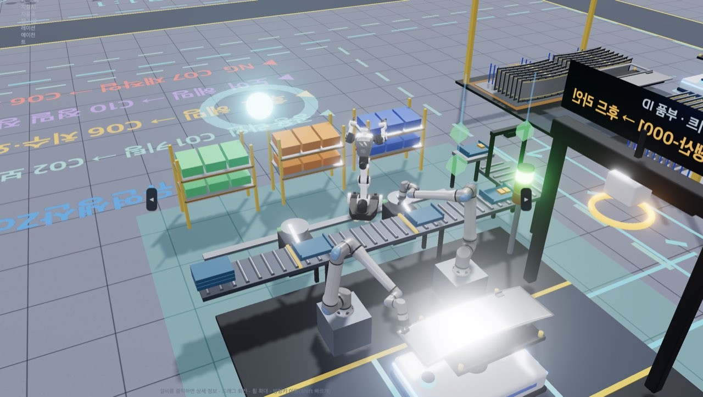


### 5.17 적응가공Zone 셀 작업

- 적응가공Zone(유압블록 · 리어커버 혼류)은 ① 소재 식별·3D측정 → 유압블록 ② 5축 가공 → ③ 사선·디버링 / 리어커버 ④ 정밀절삭 → ⑤ 선삭 → ⑥ 초정밀 측정·리워크 → 합격품 적재 순서로 흐름. 레거시 단계는 작업자 수작업이고, 자동화 · 피지컬AI 단계는 아래 설비와 로봇이 작업함.

| 셀 | 설비 · 로봇 | 하는 일 |
|---|---|---|
| ① 소재 식별·3D측정 | ID 판독 게이트 · LIBS 재질 분석기 · 3D 스캔 부스(턴테이블·저울·스캔 로봇) · 격리 랙 + 이송 6축 · 남쪽 협동로봇(자동화) / 양팔 로봇(피지컬AI) | 주조 각인·RFID 판독 → 재질 분석 → 3D 스캔 → CAD 베스트핏으로 가공 여유 판정. 불합격은 격리하고 예비 소재로 교체 (5.17.1) |
| ② 유압블록 5축 가공 · ④ 리어커버 정밀절삭 · ⑤ 리어커버 선삭 | 가공기 + 머신텐딩 6축 (그리퍼) | 문이 열리면 AMR 지그에서 **소재만** 집어 기계 테이블·척에 넣음 → 문 닫고 가공 (지그 판·클램프는 AMR에 남음) → 문 열리면 꺼내 지그에 다시 올림 |
| ③ 유압블록 사선·디버링 | 사선홀 머시닝센터 + 텐딩 6축 · 워터젯 디버링 부스 · 로봇 투입형 세척기 + 이송 6축 | 사선홀 가공 → 워터젯으로 교차홀 버 제거 → 고압 분사 · 랜스 · 열풍 건조 세척 (5.17.2) |
| ⑥ 초정밀 측정·리워크 | 항온 측정실(브리지형 CMM) · 리워크 머시닝센터 + 이송 6축 · 남쪽 협동로봇(자동화) / 양팔 로봇(피지컬AI) | 에어 블로·소재 온도 측정 → CMM 측정 → 합격 DataMatrix 각인. NG는 재가공 또는 접촉 리워크 뒤 재측정 (5.17.3) |

#### 5.17.1 ① 소재 식별·3D측정셀

| 설비 | 자리 | 내용 |
|---|---|---|
| ID 판독 게이트 | 셀 입구 | 팔레트 RFID 안테나 · 주조 각인 판독 카메라 2대(DPM · OCR, 링 조명) — 로트·히트 번호를 읽음 |
| LIBS 재질 분석기 | 남쪽 | 분석기 본체 · 화면. 남쪽 로봇이 분석 프로브를 소재 윗면에 대어 합금을 판별(유압블록 GCD450 · 리어커버 ADC12) |
| 3D 스캔 부스 | 북서 | 차광 벽 · 동쪽 롤업 셔터 · 턴테이블(로드셀 저울 내장 · 원소재가 돌아도 문 밖으로 나오지 않게 문 면에서 0.55m 안) · 서쪽 받침대 위 스캔 로봇(협동로봇 + 구조광 스캐너). 스캔 중에는 실내 조명을 끄고 턴테이블이 한 바퀴 돎. 지붕은 틀만 두어 위에서 안이 보임 |
| 엣지 서버 | 부스 북동 모서리 밖 | CAD 베스트핏 · 면별 가공 여유 · 결함 판정 계산 |
| 격리 랙 | 북동 | 뒤쪽 기둥만 있는 캔틸레버 랙 — 위 칸 = 교체 작업대, 아래 칸 = 예비 소재, 옆 빨간 격리 통(격리된 소재가 쌓임). AMR이 두 가공 줄로 갈라져 나가는 길에서 0.6m 넘게 떨어져 있음 |
| 이송 6축 | AMR 정북 받침대 | AMR 지그 · 스캔 부스 턴테이블 · 교체 작업대 사이로 소재만 옮김. 부스 문은 드나드는 동안만 열림 |
| 남쪽 로봇 1대 | AMR 정남 | 자동화 = 협동로봇(LIBS 프로브) · 피지컬AI = 양팔 로봇. 공정 설계에서 1대로 고정 |

| 경우 | 순서 |
|---|---|
| 합격 | 게이트 ID 판독 → 재질 분석(프로브 접촉) → 이송 6축이 턴테이블에 놓음(무게 측정) → 3D 스캔 → CAD 베스트핏·가공 여유 판정 → AMR 지그로 |
| 불합격 (주조 결함 · 가공 여유 부족 · 재질 혼입, 투입의 약 1.7%) | 1차 스캔 → 교체 작업대에 내려놓고(격리) 같은 로트 예비 소재를 집음 → 다시 스캔 → AMR 지그로. 셀 시간 2배 |

| 피지컬AI 요소 | 피지컬AI 단계 | 자동화 단계 | 레거시 |
|---|---|---|---|
| ① 주조품 범용 파지 (이송 6축) | VLA 파지 — 거친 주조 표면·놓임 자세를 보고 후보 6~12개 중 선택 · 힘 제어로 턴테이블 기준 핀에 끼움 | 제품별 티칭 파지점 · 위치 제어 | 작업자 |
| ② 능동 스캔 경로 (스캔 로봇) | Next-Best-View — 빠진 면을 채우는 자세만 골라 5~9뷰로 끝냄, 커버리지 99% 이상 | 고정 12뷰 프로그램 (커버리지 96~98%) | 스캔 없음 (버니어 · 육안) |
| ③ 주조 결함 AI | 스캔 영상 이상 탐지 — 기공·균열·탕경계를 놓치지 않고 격리 | 규칙 판정 문턱 — 작은 결함 일부를 놓침 | 육안 — 결함·재질 혼입을 놓침 |
| ④ 가공 여유 → 가공셀 전달 | 면별 여유와 베스트핏 원점 이동을 다음 가공셀(유압블록 5축 가공 · 리어커버 정밀절삭)에 넘김 → 그 셀 사이클 −6%(헛절삭 감소) · 공구 마모 −10%(주물 표피 첫 절입 과부하 감소) | 베스트핏은 합불만 — 가공 프로그램은 고정 여유 | 버니어로 여유 부족만 거름 |
| ⑤ 각인 OCR · 재질 판별 AI | 흐릿한 주조 각인을 딥러닝 OCR로(신뢰도 0.95 이상) · LIBS 스펙트럼을 AI로 분류 | 규칙 OCR(신뢰도가 낮으면 작업자 확인) · LIBS 특성선 비율 | 작업자 대조 · 재질 분석 없음 |
| ⑥ 접촉 측정 (남쪽 로봇) | 양팔 로봇 — 한 손으로 소재를 누르고 다른 손으로 프로브를 일정한 힘(약 8~15N)으로 댐 | 협동로봇 프로브 — 위치 제어(약 18~35N) | 작업자 |

- **셀 정보 창 「🔍 소재 식별·3D측정」**: 지금 단계 · 피지컬AI 요소별 현재 값(파지 · 스캔 뷰 수·커버리지 · 결함 점수 · 최소 가공 여유·원점 이동·가공셀 배율 · OCR·LIBS 판독 · 프로브 힘) · 센서 6종(부스 안 조도 · 스캐너 온도 · 소재 무게 · 스캔 커버리지 · LIBS 판별 신뢰도 · 프로브 접촉 힘) · 최근 소재(로트·히트 · 합금 · 여유 · 무게) · 격리율과 놓친 불량 수.
- **격리**: 불합격 소재는 공장 운영 로그에 「적응가공 소재 격리」로 남음(원인 · 로트 · 히트 · 조치: 예비 소재 교체 · 공급사 품질 통보).
- **데이터**: 내장 MQTT `metafactory/matl/v1/adapt/MATL`(스캔 부스 측정값) · `…/part`(소재별 기록). Grafana 「가공기」 대시보드에 소재 최소 가공 여유 · 스캔 뷰 수 · 소재 무게 그래프, Zone 대시보드 공정 변수에 「소재 최소 가공 여유」.

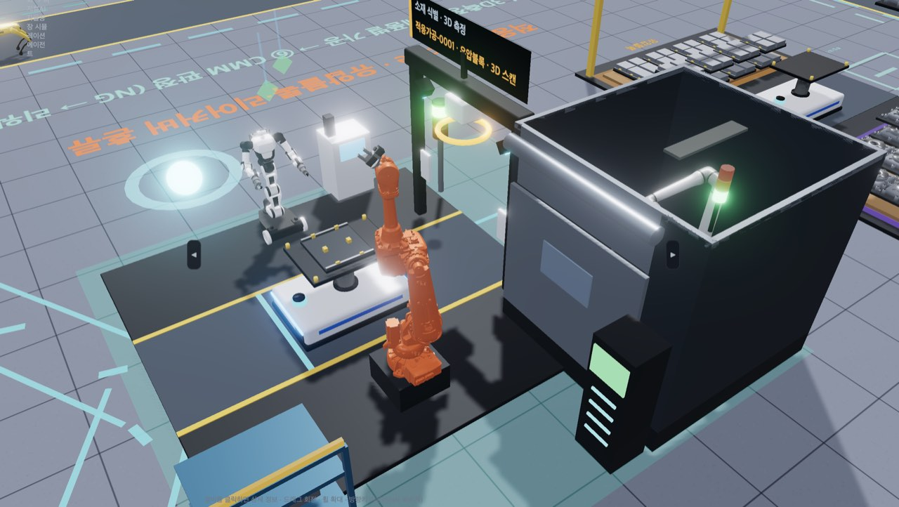

#### 5.17.2 ③ 유압블록 사선·디버링셀

- **배치**: 북쪽에 사선홀 머시닝센터(VF-2형 + 4축 틸팅 로터리 크래들)와 머신텐딩 6축, 남서쪽에 워터젯 디버링 부스, 남동쪽에 세척기, AMR 정남쪽 받침대(0.4m) 위에 부스·세척기 이송 6축이 섬. 이송 6축은 AMR 통로에서 0.7m 떨어져 있음.
- **순서**: 셀 진행의 앞 48%는 머신텐딩 — 문이 열리면 블록을 넣고, 크래들이 기울며 사선홀을 가공한 뒤 꺼냄. 뒤 절반은 이송 6축이 블록만 AMR → 워터젯 부스(교차홀 버 제거) → 세척기(고압 분사 → 랜스 분사 → 열풍 건조) → AMR로 옮김. 지그·클램프는 AMR에 남음.
- **문**: 부스·세척기 롤업 셔터는 이송 6축이 드나드는 동안만 열림. 이송 6축은 팔을 세워 접은 자세에서만 몸을 돌림.
- **세척기 정보 (셀 정보 창 「🚿 세척기」)**: 센서 6종(고압 펌프 압력 · 분사 유량 · 세척액 온도 · 세척액 전도도 · 백필터 차압 · 건조 열풍 온도), 블록별 청정도(최대 금속 입자 µm · 잔류 오염량 mg — ISO 16232 / VDA 19.1, 규격 400µm · 2.0mg). 규격 밖이면 같은 자리에서 한 번 더 세척함(셀 사이클 +30%).
- **필터 정비**: 백필터 차압이 정비 요청선(0.9bar)을 넘으면 정비 인력이 세척기 동쪽 필터 유닛 앞으로 출동해 교체하고 FAC 설비보전에 기록함. 세척액 전도도가 1000µS/cm를 넘었으면 세척액도 함께 교체. 레거시 단계는 차압 센서가 없어 경보선(1.2bar)에서 작업자가 알아챔.
- **데이터**: 내장 MQTT `metafactory/washer/v1/adapt/HB_DEBR`(측정값) · `…/part`(블록별 청정도) · `…/event`(정비). Grafana 「가공기」 대시보드에 세척기 압력·차압·전도도·청정도 그래프, Zone 대시보드 품질 특성에 청정도(최대 입자 · 잔류 오염량).

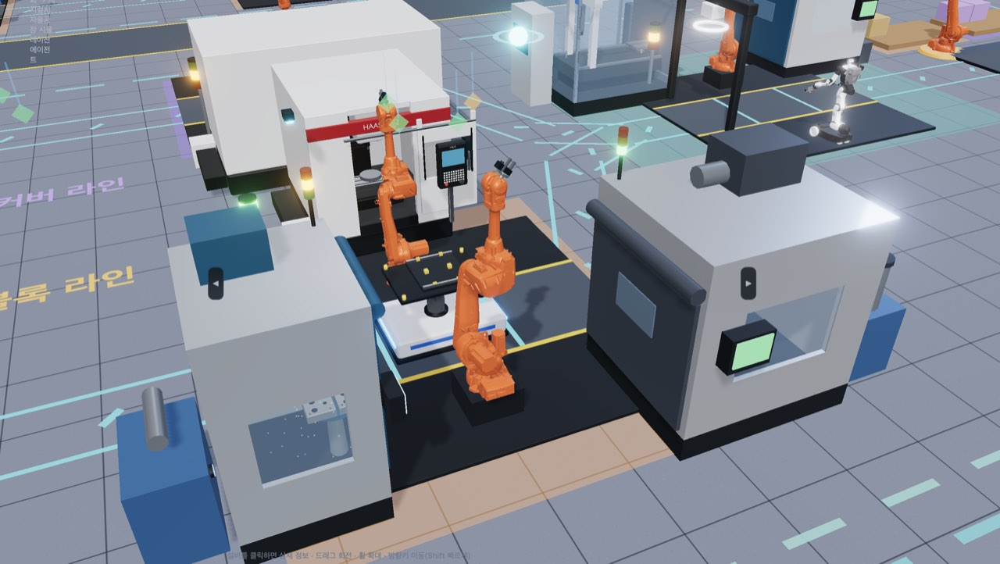

#### 5.17.3 ⑥ 초정밀 측정·리워크셀

| 설비 | 자리 | 내용 |
|---|---|---|
| 항온 측정실 | 북서 | 유리벽 · 정밀 공조기(20 ± 1℃) · 화강암 정반 위 브리지형 CMM · 고정 지그 · 동쪽 롤업 셔터 · 측정 PC·제어반. 브리지는 측정·각인 때만 지그 위로 오고, 그 밖에는 서쪽 끝에 비켜 있음. DataMatrix 레이저 각인 헤드는 브리지 캐리지 옆 |
| 리워크 머시닝센터 | 북동 | 서쪽 자동 셔터 · 바이스 · 주축 머리 · 칩 컨베이어 · 절삭유 탱크. 치수 NG 소재를 다시 깎음 |
| 이송 6축 | AMR 정북 받침대 | AMR 지그 · 측정실 지그 · 리워크 머시닝센터 바이스 사이로 소재만 옮김. 문은 드나드는 동안만 열림 |
| 남쪽 로봇 1대 | AMR 정남 | 자동화 = 협동로봇(디버링 스핀들 + 에어 블로 링 + 접촉 온도 프로브 복합 툴) · 피지컬AI = 양팔 로봇. 측정 전 에어 블로·소재 온도 측정, 버·표면 접촉 리워크. 공정 설계에서 1대로 고정 |

| 경우 | 순서 |
|---|---|
| 합격 | 에어 블로·소재 온도 측정 → 이송 6축이 측정실 지그에 놓음 → CMM 측정 → 합격 DataMatrix 각인 → AMR 지그로 |
| 치수 NG (리워크의 약 65%) | 1차 측정 → 리워크 머시닝센터 재가공 → 측정실 재측정 → 각인 → AMR 지그로 |
| 버·표면 NG (리워크의 약 35%) | 1차 측정 → AMR 지그로 돌려놓음 → 남쪽 로봇 접촉 리워크 → 측정실 재측정 → 각인 → AMR 지그로 |

- 리워크(투입의 약 6%)는 셀 시간이 2배임. 셀 입구 게이트 표시판에 지금 단계(에어 블로·소재 온도 측정 · CMM 측정 · 리워크 머시닝센터 재가공 · 접촉 리워크 · 리워크 후 재측정 · 합격 각인)가 나옴.

| 피지컬AI 요소 | 피지컬AI 단계 | 자동화 단계 | 레거시 |
|---|---|---|---|
| ① 범용 파지 (이송 6축) | VLA 파지 — 손목 카메라로 제품·놓인 자세를 보고 파지 자세 후보 6~12개 중 선택 · 힘 제어로 지그 기준 핀에 끼움 (약 15~30N) | 제품별 티칭 파지점 · 위치 제어로 끼움 (약 35~55N) | 작업자 |
| ② 접촉 리워크 (남쪽 로봇) | 양팔 로봇 — 한 손으로 누르고 다른 손으로 힘 제어 연마·디버링 | 협동로봇 디버링 스핀들 | 작업자 |
| ④ 온도 보정 | AI 열 모델 — 가공·세척 직후 소재 온도로 20℃ 치수 계산, 남은 오차 1µm 미만 (식힘 대기 없음) | 열팽창 계수식(선형) — 소재 속이 아직 따뜻해 열팽창의 6~10% 남음 | 보정 없음 |

- **소재 온도**: 유압블록(구상흑연주철 GCD450 · 11µm/m·K)은 60℃ 세척 직후라 약 +8.5℃, 리어커버(알루미늄 다이캐스팅 ADC12 · 21µm/m·K)는 선삭 직후라 약 +5℃로 들어옴. 보정하지 않으면 열팽창만으로 수십 µm 오차가 남음.
- **셀 정보 창 「📐 초정밀 측정」**: 지금 단계 · 피지컬AI 요소별 현재 값(파지 방식·신뢰도·끼움 힘 · 접촉 리워크 횟수 · 소재 온도·열팽창·남은 오차) · 측정실 센서 6종(측정실 온도 · 상하 온도차 · 소재 온도 · 공기 베어링 압력 · 정반 진동 · 지그 끼움 힘) · 최근 측정 기록 · 누계(측정 · 리워크 · 온도 보정 · VLA 파지 · 끼움 힘 경고).
- **데이터**: 내장 MQTT `metafactory/cmm/v1/adapt/CMM`(측정실 측정값) · `…/part`(소재별 기록). Grafana 「가공기」 대시보드에 측정실 온도 · 소재 온도 · 온도 보정 뒤 남은 오차 그래프, Zone 대시보드 공정 변수에 「CMM 소재 온도」「온도 보정 후 남은 오차」.

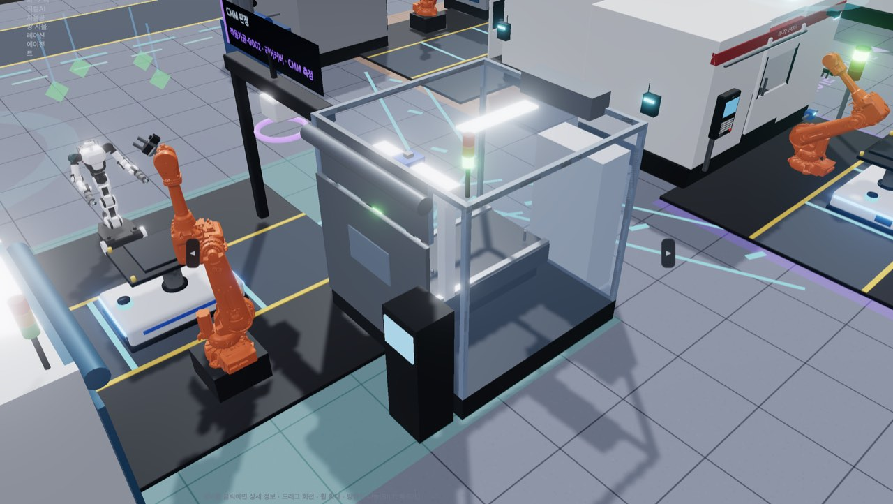

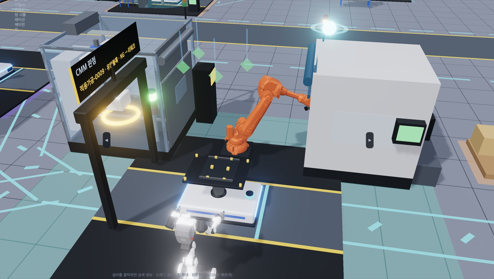


### 5.18 적응가공 가공기 상태 감시 · 예지보전

- 적응가공Zone 가공기 4대(유압블록 5축 가공 · 리어커버 정밀절삭 · 리어커버 선삭 · 유압블록 사선·디버링)에 **상태 감시 장비**가 붙어 있음 — 공구 검사 카메라(링 조명) · 주축 머리의 3축 가속도계·AE 센서·베어링 온도 센서(금색) · 절삭유 유량계 · 레이저 공구 측정기 · 엣지 AI 박스(옆면, 청록 LED).
- **가공기를 누르면** 정보 창이 로봇 창처럼 넓게 열려 왼쪽에 셀 정보, 오른쪽에 「📡 가공기 상태 감시」가 나란히 나옴 (레거시 단계는 센서 없음). 저장 버튼까지 한 화면에 보이며, 높이가 낮은 화면(900px 이하)에서는 「💾 누적 데이터 저장」이 공구 상태 바로 아래로 올라옴.

| 항목 | 내용 |
|---|---|
| 센서 13종 | 주축 부하·전류·가공 전력·회전수 · 주축 진동 RMS·첨도 · 음향방출(AE) · 베어링 온도 · 절삭유 온도·유량 · 공구 플랭크 마모 VB · 공구 치핑 점수 · 공구 길이 편차. 경고는 노랑, 경보는 빨강 (진동 ISO 10816 · 공구 수명 VB 300µm ISO 3685 기준) |
| 공구 상태 | 공구 ID · 마모율 · 가공 개수/수명 · VB · 치핑 · 길이 편차 |
| 🧠 엣지 AI 판단 | 정상 · 감시 · 공구 교체 권고 · 즉시 공구 교체 · 공구 교환 중 · 주축 점검·정비 권고 · 설비 정비 중. 이상 점수와 공구 잔여 수명(개·분)·주축 잔여 수명(분)을 함께 보임 |
| 예지보전 판단 기록 | 판단이 바뀔 때마다 근거 센서값과 함께 남는 정비·교체 데이터 (공구 ID · VB · 잔여 수명 · 작업 유형) |

- **존 자체 예지보전**: 엣지 AI가 공구 마모 추세로 잔여 수명을 계산해 **파손 전에 공구 교환**을 실행함(모바일 매니퓰레이터). 주축 베어링 온도·진동 이상이면 **주축 예지정비**를 요청함.
- **상위 보고**: 판단은 적응가공 오케스트레이터 → 공장 오케스트레이터(FacOS)로 A2A 「상태 보고」로 올라가고, 주축 정비는 「결정 요청」 → FacOS 승인으로 처리됨. 공장 운영 로그 「적응가공」 탭에서 확인함.
- **📤 서버로 전송**: 측정값(5초 묶음)과 판단 기록은 앱 서버로 자동 전송되어 `data/machmon/<실행 ID>.jsonl`에 저장되고 내장 MQTT(`metafactory/machmon/v1/adapt/<셀>`)로도 발행됨. 버튼을 누르면 그 순간의 스냅샷·최근 이력을 바로 보냄. **패킷 캡처**가 켜져 있으면 같은 MQTT 메시지가 pcap에도 기록됨 — 가공기 정보 창 아래 「📦 패킷 캡처 (이 자산만)」(클라이언트 `ADP_<셀>`, 「가공기 감시 N건」 표시)과 📡 데이터 연동 → 패킷 덤프 전체 캡처(「가공기 감시」 행). Wireshark에서 `mqtt.topic contains "machmon"`으로 거르면 측정(`…/adapt/<셀>`)·판단 기록(`…/event`)만 보임.
- **💾 누적 데이터 저장 (AAS)**: 로봇 정보 창과 같은 꼴 — 「패키지 종류(AASX · AAS JSON · AAS XML · AAS RDF) → AAS 버전(v3.1 · v3.0) → 저장」. 셸 1개 · 서브모델 6개(명판 · 기술 데이터 · 운영 데이터 · 공구 상태 · 예지보전 · 시계열, AASX에는 시계열 CSV 포함).
- **AASX 서버 전송**: 가공기·로봇 정보 창에서 **AASX 패키지**를 저장하면 내려받기와 동시에 앱 서버로도 전송되고, 저장 결과 아래에 **전송 위치**(서버 주소 → 저장 경로)가 표시됨 — 맥 앱은 `~/Library/Application Support/Meta-Factory/data/aasx/machine/`(가공기) · `…/aasx/robot/`(로봇), `npm start`는 프로젝트 `data/aasx/`. 웹·공유 페이지는 서버가 없어 전송하지 않음.
- ※ 웹 버전·공유 아티팩트에서는 서버가 없어 서버 전송·서버 저장을 할 수 없음 (공유 페이지는 파일 내려받기도 막힘).

---

### 5.19 Zone 대시보드 (실시간 모니터링 · OEE · 파레토 · 관리도 · 산점도)

상단 「📈 Zone 대시보드」를 누르거나, 3D 화면에서 Zone 전광판(유연생산·적응가공 전광판, 정밀검사 전광판, 정밀조립 중앙 관제 화면)을 누르면 열림. 위쪽에서 Zone(정밀조립 · 유연생산 · 적응가공 · 정밀검사)을 고르고, 탭 3개로 봄. 모든 버전(맥 앱 · 윈도우 앱 · `npm start` · 웹 버전 · 공유 아티팩트)에서 동작함.

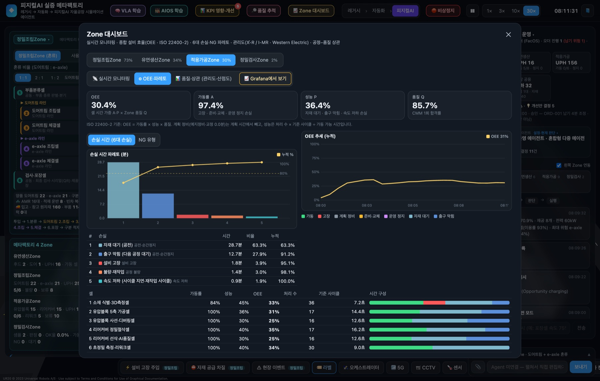

| 탭 | 보는 것 |
|---|---|
| 「📡 실시간 모니터링」 | OEE(지금까지) · 가동 셀 수 · 1회 합격률 · 생산 진행률(교대 8시간 계획 대비, 노란 눈금 = 경과 시간 기준 기대치 · 정밀조립은 현재 오더 진행도 표시) · OEE·가동률·성능·품질 추세 · 셀 건강도 추세 · 셀별 상태·사이클 진행률·건강도·작업 중 제품·처리 수 |
| 「⚙ OEE·파레토」 | 가동률 A · 성능 P · 품질 Q · OEE, 손실 파레토(6대 손실 — 설비 고장 · 준비·교체 · 운영 정지 · 자재 대기 · 출구 막힘 · 속도 저하 · 불량·재작업, 누적 % 선 · 80% 기준선), 「NG 유형」 파레토, 셀별 OEE와 시간 구성 막대 |
| 「📊 품질·상관」 | 품질 특성을 고르면 관리도(표본 40개 이상 X̄-R 부분군 5 · 그보다 적으면 I-MR) · UCL/CL/LCL · 규격선 · Western Electric 규칙 1~4 위반점(빨간 점과 목록) · 공정능력 Cp·Cpk, 공정 변수 × 품질 특성 상관계수 표(상관 강도 큰 순) · 산점도(양품 파랑 · NG 빨강 · 회귀선 · r · R²) — 표의 행을 누르면 산점도가 바뀜 |

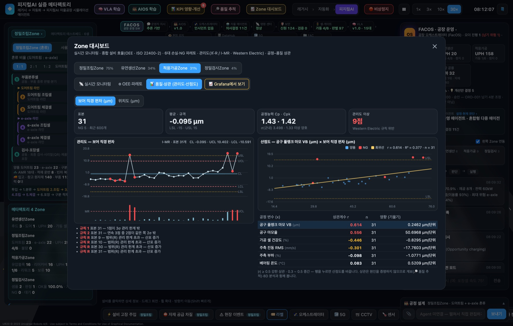

- **OEE 계산 (ISO 22400-2)**: OEE = 가동률 × 성능 × 품질. 계획 정비(예지정비·교정)는 계획 시간에서 뺌. 가동률 손실 = 고장 · 준비·교체(품목 전환·공구 교환) · 운영 정지, 성능 손실 = 자재 대기 · 출구 막힘 · 속도 저하, 품질 = 1회 합격률. 정밀조립은 상단 KPI의 라인 OEE와 같은 값이고, 확장 Zone은 셀 시간 가중 평균임. 유연생산 C07 NG 재작업 셀은 대기가 정상이므로 Zone 합계에서 뺌.
- **품질 특성**: 정밀조립 = 체결 전수 검사 토크·각도(도어트림 나사 · e-axle 볼트 규격을 따로), 유연생산 = C06 치수·외관검사 갭·단차, 적응가공 = CMM 보어 직경 편차·위치도 · 세척 청정도(최대 금속 입자 · 잔류 오염량), 정밀검사 = 샘플 측정 편차(공차 대비 %)·측정 불확도.
- **공정 변수**: 정밀조립 = 셀별 공정 측정값(압입 하중·안착 깊이·인식 점수 등)·건강도·드리프트·환경, 유연생산 = 보정·용접·헤밍 셀 건강도·환경 온도, 적응가공 = 공구 마모율·플랭크 마모 VB·주축 진동·부하·베어링 온도·가공 셀 건강도·세척기 백필터 차압·세척액 전도도·CMM 소재 온도·온도 보정 후 남은 오차·소재 최소 가공 여유, 정밀검사 = 검사 셀 건강도·온도·재측정 여부.
- **관리도·산점도 자동 해석**: 그래프 아래 「🧭 해석」 상자가 지금 데이터로 판정·근거·권장 조치를 문장으로 보여 줌 (왼쪽 테두리 색 초록 = 양호 · 노랑 = 주의 · 빨강 = 조치 필요). 관리도 = 안정성(규칙 위반 종류·개수, 최근 5개 안 신호인지) · 평균 이동·추세(최근 평균의 σ 차이, 구간 기울기) · 산포(R/MR) · 공정능력(Cpk·Cp 등급, 예상 규격 밖 ppm과 실제 개수, 전체 산포 기준 Ppk, 중심 치우침이면 보정량). 산점도 = 상관 강도·방향과 R²(설명 비율) · 통계적 유의성(t) · 영향 크기(x 1단위당 y 변화, 관측 범위에서의 변화가 공차의 몇 %) · 회귀선이 USL/LSL에 닿는 x 값과 최근 표본까지 남은 양(관리 기준 후보) · 양품과 NG의 x 차이 · 회귀선에서 크게 벗어난 점.
- **해석 주의**: 상관은 원인을 증명하지 않음. 상관이 큰 변수는 「🔎 품질 추적」 계보·8D 분석과 함께 확인함. 정밀검사Zone은 샘플 요청이 있을 때만 일하므로 대기 시간이 「자재 대기(공전)」로 보임.
- **3D 전광판**: 유연생산·적응가공 전광판 제목 줄 오른쪽에 OEE(가동·성능·품질)와 교대 진행률이 함께 표시됨.
- **Grafana에서 보기 (앱 전용)**: 설비 대시보드가 켜져 있으면 「📈 Grafana에서 보기」 → 「Zone 운영 분석」 대시보드(OEE·A·P·Q · 교대 진행률 · 추세 · 손실/NG 파레토 · I-MR 관리도 · 산점도, 90일 보관). 상단 「Zone」「품질 특성 (y)」「공정 변수 (x)」로 고름.

---

### 5.20 정밀조립Zone 서열 키팅 · 라인사이드 칸반

정밀조립Zone 혼류 라인(도어트림 · e-axle)의 부품 공급을 실제 공장처럼 두 갈래로 나눔. **대당 사양이 바뀌는 부품**(도어트림 암레스트 좌/우·색상 · 스피커 그릴 · 스위치 · 컵홀더 / e-axle 기어 세트 · 샤프트 · 베어링 · 오일씰)은 생산 순서대로 한 대분씩 키트로 담아 **AMR에 함께 실어** 보내고(서열 키팅 · SPS), **어느 사양에나 쓰는 공용 부품**(클립 · 스크류 · 볼트 · 와셔)은 조립·체결셀 선반에 두고 **투빈 칸반**으로 채움. 1.부품분류셀을 누르면 셀 정보 창에 「🧰 서열 키팅」이, 조립·체결셀(2~5)을 누르면 「🧰 부품 공급」이 나옴.

| 구성 | 위치 | 하는 일 |
|---|---|---|
| ID 게이트 | 부품분류셀 입구 | AMR 위 제품을 판별해 라인으로 분기 (기존) |
| 키팅 구역 2곳 | 셀 남쪽(도어트림) · 북쪽(e-axle), 셀 밖 | 흐름 랙 3대(바깥 통로 쪽에서 보충 · 셀 쪽에서 꺼냄 · 칸마다 표시등) → 피킹 로봇(피지컬AI AMMR · 자동화 레일 협동로봇 · 레거시 작업자) → 담기·검증 자리(카메라 아치 + 저울) |
| 키트 컨베이어 · 서열 버퍼 | 셀 양옆 z ±3.05 | 동쪽 끝에서 담고 검증한 키트 트레이가 서쪽으로 흘러 버퍼 3칸에 대기 — 맨 앞(AMR 가운데 맞은편)이 꺼내는 자리 · 서쪽 끝 회수 슈트 → 컨베이어 아래 회수 레인 |
| 플렉시블 피더 | 도어트림 쪽 셋째 랙 자리 | 섞인 윈도 스위치를 진동판 위에 펼치고 위 카메라로 인식해 집음 |
| 클린 부스 · 개봉대 | e-axle 쪽 | 비닐 커튼 3면 + 지붕 FFU(셀 쪽은 트임) · 포장째 보관한 베어링·오일씰을 개봉대에서 벗기고 로트 라벨을 읽음 |
| AMR 키트 포켓 | AMR 지그 상판 앞뒤 끝 | 키트 부품 4개(칸마다 1개) — 차체 크기 그대로 |
| 라인사이드 투빈 | 조립·체결셀 선반 | 공용 부품 상자 2개 — 앞 상자가 비면 뒤 상자를 쓰고 빈 상자의 칸반 카드로 보충 |

- **흐름**: 피킹 로봇이 버퍼가 찰 때까지 다음 키트를 담음(부품 4개 → 검증) → AMR이 부품분류셀에 들어오면 **그 제품 쪽 로봇 한 대만** 일하고(도어트림 = 남쪽 로봇 · e-axle = 북쪽 로봇) 다른 로봇은 대기 자리에서 쉼 → 조립셀 로봇 4대가 각자 첫 점의 부품을 자기 쪽 키트 칸에서 집고, 나머지 점은 선반의 공용 부품으로 조립.
- **부품분류셀 로봇이 하는 일**: 두 로봇은 AMR 가운데 맞은편에 서 있음 (키트 컨베이어 꺼내는 자리도 그 앞).
  - 피지컬AI AMMR: 컨베이어 쪽으로 돌아 나감 → 지난번 빈 트레이를 회수 슈트에 놓음 → 맨 앞 키트 트레이를 두 손으로 집어 몸 가까이 들고 돌아옴 → AMR 앞에서 뒤 포켓 쪽으로 옆걸음 → 한 손으로 트레이를 들고 다른 손으로 부품을 하나씩 집어 포켓 칸에(2개) → 앞 포켓 쪽으로 옆걸음 · 손을 바꿔 2개 → 빈 트레이를 든 채 대기 자리로.
  - 자동화 협동로봇: 컨베이어 맨 앞 트레이의 부품을 하나씩 위에서 집어 키트 포켓 칸에 넣음(4개) → 빈 트레이를 집어 회수 슈트에.
  - 빈 트레이는 회수 슈트를 미끄러져 컨베이어 아래 회수 레인으로 담기 자리까지 돌아감. AMR 키트 포켓 칸은 제품마다 그 제품 쪽 절반(칸 4개)을 씀.
  - 사이클: 부품 4개를 하나씩 옮기므로 한 대가 약 12초(피지컬AI AMMR 약 10초 · 자동화 협동로봇 약 15초)이고, 로봇 대수로 줄지 않음.
- **피킹 로봇 정보**: 키팅 구역 피킹 로봇(도어트림 `RB-01-K1` · e-axle `RB-01-K2`)을 누르면 로봇 정보 창에 지금 단계 · 집는 부품 · 서열 버퍼 키트 · 피킹 방식 · 관절·TCP가 나옴 (레거시는 작업자). 피킹 로봇은 피킹 길(랙 끝 칸까지) 안에서만 움직이고, 랙 윗단 상자 속 부품을 팔(피지컬AI는 팔 IK)로 집음.
- **버퍼가 비면** 부품분류셀이 담는 중인 키트가 끝날 때까지 기다림(흐름 랙 결품이면 보충까지). 미리 담아 두는 구조라 평소에는 사이클이 늘지 않음.
- **정비·순찰 자리**: 셀 앞(통로 쪽)은 키팅 구역이라 부품분류셀 정비·사족보행 순찰 자리는 셀 서쪽(입구 쪽)으로 옮김.

| 피지컬AI 요소 | 피지컬AI 단계 | 자동화 단계 | 레거시 |
|---|---|---|---|
| ① 범용 파지 | AMMR이 처음 보는 부품·사양도 따로 가르치지 않고 집음 (VLA) | 레일 협동로봇 · 표시등이 켜진 칸만(티칭 위치) | 작업자 키팅 |
| ② 빈 피킹 | 섞인 스위치·오일씰을 비전으로 집고 집기 실패는 스스로 다시 | 정렬된 상자에서만 | 작업자 |
| ③ 키트 검증 AI | 영상 + 무게로 좌/우 · 색상 · 수량 확인 — 조립셀까지 가는 오류 없음 | 무게만 — 같은 무게의 좌/우 · 색상은 조립셀에서 발견해 키팅 구역에서 다시 가져옴(+25초) | 육안 — 절반만 잡음 |
| ④ 로트 추적 | 베어링·오일씰을 집으면서 로트 판독 → 제품 계보 | 검증대 고정 스캐너(가려지면 다시 스캔 +5초) | 수기 기록(누락 시 추적 불가) |
| ⑤ 개봉·청정 취급 | 힘 제어로 포장을 벗기고 이물 없이 담음(사람 출입 없음) | 작업자 개봉 — 포장 조각은 검증대 영상에서 발견해 다시 담음 | 작업자 개봉 · 육안 |
| ⑥ 결품·막힘 예측 | 생산 순서로 흐름 랙을 35%에서 미리 보충 · 조립 라인이 막히면 그 제품 키트는 1개만 담음 | 칸반 카드 — 25%에서 보충 요청 | 빈 칸이 보여야 보충 — 결품이면 키팅이 멈춤 |

- **라인사이드 칸반 (공용 부품)**: 피지컬AI = 셀 부품 선반 재고를 물류 휴머노이드가 채움(기존 · 선반 비전 계수) · 자동화 = 빈 상자 카드를 밀크런이 5분마다 돌며 채움 · 레거시 = 작업자가 빈 상자를 볼 때(3~12분). 두 상자가 모두 비면 급히 가져옴(+45초).
- **셀 정보 창 「🧰 서열 키팅」**: 키팅 구역별 단계(피킹 · 검증 · 버퍼 가득 · 결품)와 담는 중인 키트 변형, 서열 버퍼 키트, 흐름 랙 재고 · 피지컬AI 요소별 현재 값 · 센서 8종(키트 무게 · 영상 판정 신뢰도 · 도어트림/e-axle 서열 버퍼 · 흐름 랙 최소 재고 · 클린 부스 입자 · 라인사이드 최소 재고 · 피킹 성공률) · 최근 키트(변형 · 무게 · 로트) · 보충·칸반 기록.
- **데이터**: 내장 MQTT `metafactory/sps/v1/main/SORT`(측정값) · `…/part`(키트별 기록) · `…/event`(보충·칸반·결품). Grafana 「환경 · 설비 센서」 대시보드에 서열 버퍼 · 흐름 랙·라인사이드 최소 재고 · 클린 부스 입자 그래프. 레거시 단계는 센서·전송 없음.

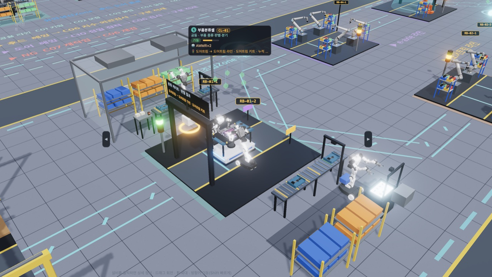

#### 셀이 실제로 하는 작업 (1.0.43)

흉내 동작(제자리 팔 흔들기)을 없애고, 셀마다 로봇·작업자가 실제 대상물을 집고 옮기고 비추도록 바꿈.

- **검사·포장셀 포장**: 그 제품 쪽 로봇 한 대만 일함(도어트림 = 남쪽 · e-axle = 북쪽 · 다른 로봇은 대기). 셀 밖 포장대 옆에 접힌 상자 매거진(8개) · 뚜껑 받침(5개) · 라벨 프린터가 있음.
  - 순서: 접힌 상자(도어트림 트레이 박스 · e-axle 폴딩 크레이트)를 매거진에서 집어 포장대에 놓아 폄 → AMR 위 제품을 들어 상자에 넣음 → 뚜껑을 덮음 → 프린터에서 라벨을 집어 뚜껑에 붙임 → 닫힌 상자를 AMR 지그에 다시 실음. e-axle은 인버터를 피해 감속기 하우징 윗면을 잡음.
  - 자동화 협동로봇은 한자리에서 팔(IK)로만 하고, 피지컬AI AMMR은 바퀴로 포장대 앞 · 매거진 · 뚜껑 랙 · 프린터 · AMR 앞을 오가며 두 손으로 함. 레거시는 작업자 2명.
  - 사이클은 약 12초(로봇 종류에 따라 다름)이며 로봇 대수로 줄지 않음. 매거진·뚜껑 수는 셀 부품 재고를 따라 줄었다가 보충됨.
  - 구분 적재장은 포장된 상자를 쌓음: 도어트림 3열 × 2행 × 4단(24칸) · e-axle 2열 × 2행 × 3단(12칸). 화면에 보이는 칸 수이고 적재 한도(제품마다 24개)는 그대로 — e-axle이 12개를 넘으면 칸은 가득 찬 채로 보이고 로봇은 마지막 칸에 내려놓음. 피지컬AI AMMR은 닫힌 e-axle 크레이트를 양 끝 옆면(로봇 쪽)을 잡아 들고, 도어트림 트레이 박스는 위에서 잡음.
- **정밀검사 셀이 시료를 실제로 훑음**: 비전 검사 로봇은 시료 둘레 6곳에서 카메라를 시료 쪽으로 겨누고(렌즈 불빛), ATOS 3D 스캐너는 8곳에서 겨눔. 스캔 셀은 앞 절반에 윗면을 5줄 래스터로 훑고, 뒤 절반에 UT 탐촉자를 표면에 대고 3줄을 지나감. 레거시 검사원은 아래의 수작업 사이클.
- **유연생산 C01 피지컬AI AMMR 피커**: 팔 IK로 상자 속 부품을 집어(손에 부품이 보임) 조립대 트레이에 놓음. 몸을 숙여 손을 뻗음.
- **유연생산 C07 리워크**: C06 검사에서 NG가 난 차체에는 결함 종류(스폿 · 실링 · 헴)와 자리가 정해지고 그 자리에 빨간 NG 표시가 붙음. 1.0.48부터 C07은 **수리 부스**(5.22) — 수리 작업자(피지컬AI: 휴머노이드)가 결함 쪽으로 옆걸음해 휴대용 공구로 보수함. 끝나면 NG 표시가 사라짐.
- **레거시 작업자의 수작업 사이클**: 부품 상자 쪽으로 돌아섬 → 허리를 숙여 부품을 집음(손에 부품) → 돌아서 제품 쪽으로 한 걸음 → 제품에 대고 누름 → 허리를 폄. 정밀조립 조립셀 · 확장 Zone · 정밀검사 레거시 작업자 모두 같음.
- **셀 입구 게이트 폭 (1.0.44)**: 분류·포장·키팅·소재 식별·측정 게이트 기둥을 양쪽으로 반 칸(0.5m)씩 넓혀 기둥 사이가 1.86m → 2.86m (AMR 폭 0.99m). 옆 설비에 맞춰 검사·포장셀은 ±1.4m(2.66m · AMMR이 매거진으로 옆걸음하는 자리), 소재 식별셀·초정밀 측정셀은 북쪽 기둥만 0.1m(스캔 부스·항온 측정실 벽 앞 · 2.46m). (1.0.48에서 문형은 리더 기둥 + 라이트커튼으로 바뀜 — 5.22) 부품분류셀·C01 경광등은 넓어진 기둥 바깥 모서리로 옮김.

### 5.21 셀 실제 작업 시간 · 정밀검사 개봉·재포장 (1.0.45)

모든 Zone의 셀 시간을 실제 공장 작업 요소를 더한 값으로 바꿈. 단계마다 [레거시 · 자동화 · 피지컬AI] 시간이 따로 있고, 공정 설계에서 바꾼 기준 사이클은 자동화 시간 대비 비율로 모든 단계에 같이 적용됨.

- **계산 기준**:
  - 레거시: 숙련 작업자(집기·놓기 2~3초 · 클립 압입 2.5초 · 전동 드라이버 나사 5초) + 여유율 15%.
  - 자동화: 티칭한 6축(동작 1.5~2초) · 협동로봇(협동 속도 제한, 동작 2~3초) · 서보 프레스·로터 삽입기·서보 너트러너 같은 전용기.
  - 피지컬AI: VLA 인식·계획 0.5~1초에 동작 속도 1.3~1.6배, 다시 집기 5~10%. 빠르지는 않지만 티칭 없이 변종·유연물을 다룸. 용접·실링·헤밍·가공처럼 산업용 로봇·전용기가 하는 공정은 시간이 같음.
- **e-axle 무게에 맞춘 로봇**: 로터(8~12kg)·하우징(15~20kg)은 e-axle 조립셀 6축 2대·체결셀 6축(IRB 4600, 가반 60kg)이 다룸 — 협동로봇 4대이던 조립셀을 6축 2대로 바꿈. 완제품은 약 75kg이라 AMMR·휴머노이드(팔당 10~20kg)로는 들 수 없어 검사·포장셀 e-axle 쪽(피지컬AI 단계도)·구분 적재장 e-axle 적재 로봇·정밀검사 개봉·재포장 로봇을 고가반 6축(IRB 6700급, 가반 200kg)으로 바꿈.

| 정밀조립 셀 (초) | 실제 작업 | 레거시 | 자동화 | 피지컬AI |
|---|---|---|---|---|
| 부품분류 | 게이트 판독 · 키트 부품 4개 옮겨 담기 · 빈 트레이 회수 | 18 | 25 | 30 |
| 도어트림 조립 | 변종 부품 4 · 클립 12 압입 | 35 | 26 | 37 |
| 도어트림 체결 | 스크류 6점 (자동 공급 드라이버) | 21 | 19 | 26 |
| e-axle 조립 | 베어링·오일씰 서보 압입 · 기어축 · 로터 삽입기 (6축 2대) | 77 | 51 | 52 |
| e-axle 체결 + EOL 시험 | 실러(FIPG)·비드 검사 · 하우징 결합 · 볼트 22개 · 누설·절연 전수 시험 (1.0.48 +약 45초) | 198 | 106 | 108 |
| 검사·포장 | 도어트림 / e-axle(고가반 6축) | 35 / 70 | 37 / 53 | 50 / 55 |

| 유연생산 셀 (초) | 레거시 | 자동화 | 피지컬AI | | 적응가공 셀 (초) | 레거시 | 자동화 | 피지컬AI |
|---|---|---|---|---|---|---|---|---|
| C01 키팅·장착 | 17 | 22 | 22 | | ① 소재 식별·3D 측정 | 46 | 10 | 11 |
| C02 안착·보정 | 35 | 20 | 22 | | ② 유압블록 5축 | 65 | 60 | 60 |
| C03 스폿용접 (약 45타점) | 122 | 67 | 67 | | ③ 사선홀·디버링·세척 | 77 | 60 | 60 |
| C04 실링 (3.5m) | 56 | 32 | 32 | | ④ 리어커버 정밀절삭 | 68 | 60 | 60 |
| C05 롤러 헤밍 (3패스 · 1.0.48) | 95 | 62 | 62 | | ⑤ 리어커버 선삭 | 47 | 40 | 40 |
| C10 정밀 장착 | 52 | 30 | 30 | | ⑥ CMM 판정 | 62 | 40 | 42 |
| C06 치수·외관 (갭·단차 30점) | 52 | 16 | 16 | | | | | |
| C07 NG 수리 부스 (1.0.48) | 100 | 75 | 85 | | | | | |

#### 정밀검사Zone: 개봉 → 제품별 검사 → 판정·보고 → 합격 재포장

정밀검사Zone을 6셀에서 9셀로 늘림. 앞쪽 통로(z 9) 건너 빈 바닥에 **시험동**(기능·누설 시험 · 청정도 분석 · 산업용 CT)을 두고, 검사 AMR이 앞쪽 통로를 가로질러 오감. 재포장하므로 검사는 모두 비파괴.

- **흐름**: 정밀조립 시료(도어트림·e-axle)는 포장 상자째 수거됨 → ⓪ 접수·개봉에서 고가반 6축이 뚜껑을 반납 랙에 놓고 → 제품을 임시 받침대로 꺼내고 → 빈 상자를 반납 랙에(접어서 회수) → 제품을 AMR 지그에 올림 → 제품별 검사 → ⑤ 판정·보고(QMS 성적서) → **합격이면** 같은 셀에서 새 포장재 매거진의 상자에 다시 넣고 뚜껑(「정밀검사 합격」 라벨) → 그 Zone 적재장으로 되돌려 놓음. **NG**는 판정 셀 격리 선반에 두고 처분 절차로.
- 유연생산·적응가공 시료는 포장 없이 지그째 와서 개봉 없이 검사하고, 합격이면 적재장으로 되돌림.
- **판정 불확실**: 그 제품의 주 치수 측정 셀(도어트림·e-axle = ATOS · 후드·도어 = 3D 스캔 · 블록·커버 = O-INSPECT)에서 재측정한 뒤 다시 판정.

| 제품 | 검사 경로 (개봉 다음 ~ 판정 앞) | 왜 |
|---|---|---|
| 도어트림 | ① 비전 외관(표면결함 · 색차) → ④ ATOS(검사 지그 · 클립 위치·윤곽) → ⑥ 기능 시험(스위치 작동력·도통 · 조명) | 플라스틱 트림에는 용접 초음파가 맞지 않음 |
| e-axle | ① 비전 외관(외관 · 라벨 · 커넥터) → ④ ATOS + 사진측량(마운트 인터페이스) → ⑥ 공기 누설 · 절연저항 · 볼트 잔류 토크 감사 | 1m · 75kg은 O-INSPECT 측정 범위 밖 |
| 후드·도어 | ① 비전 외관(외관 · 실러 비드) → ② 3D 스캔(갭·단차) + 위상배열 초음파(스폿 20타점) | 그대로 |
| 유압블록 | ③ O-INSPECT(홀 위치 · 보어 · 나사 게이지) → ⑧ 산업용 CT(내부 유로 · 교차홀 버) → ⑦ 청정도 분석(ISO 16232 잔류 입자) | 내부 유로 버·청정도가 유압 부품 핵심 |
| 리어커버 | ④ ATOS(실링면) → ③ O-INSPECT(보어) → ⑧ 산업용 CT(다이캐스팅 기공) → ⑥ 공기 누설 | 기공·누설이 다이캐스팅 핵심 |

| 정밀검사 셀 | 장비 · 로봇 | 시간 (자동화, 초) |
|---|---|---|
| ⓪ 시료 접수·개봉 | ID 리더 · 임시 받침대 · 포장재 반납 랙 · 고가반 6축 | 도어트림 30 · e-axle 50 · 무포장 8 |
| ① 로봇형 비전 외관 | ABIS 표면결함 · 분광 색차 · 표준광원 터널 · 6축 | 도어트림·e-axle 57 · 후드·도어 75 |
| ② 3D 스캔·초음파 | ScanBox · 위상배열 초음파 · 6축 2대 | 후드·도어 130 |
| ③ O-INSPECT | 멀티센서 측정기 · 나사 게이지 · 6축 | 유압블록 510 · 리어커버 390 |
| ④ ATOS 3D | ATOS · 검사 지그 · 사진측량 마커 · 6축 | 도어트림 140 · e-axle 190 · 리어커버 126 |
| ⑤ AI 판정·보고·재포장 | AI 판정 서버 · QMS · 새 포장재 매거진 · NG 격리 선반 · 고가반 6축 | 판정 10 + 재포장 도어트림 25 · e-axle 45 |
| ⑥ 기능·누설 시험 (신규) | 스위치 작동력 시험기 · 공기 누설 시험기 · 절연저항계 · 토크 트랜스듀서 · 6축 | 도어트림 52 · e-axle 100 · 리어커버 60 |
| ⑦ 청정도 분석 (신규) | 압력 세정 추출 캐비닛 · 진공 여과 · 자동 입자 분석 현미경 · 협동로봇 | 유압블록 460 |
| ⑧ 산업용 CT (신규) | 225kV CT · 차폐 캐비닛(문은 넣고 꺼낼 때만 열림) · 턴테이블 · 6축 | 유압블록 520 · 리어커버 400 |

- 레거시는 검사원 1명이 수동 게이지·호이스트로 하므로 1.5~2.5배 걸림. 피지컬AI는 측정 동작이 조금 느리고(손이 하는 개봉·재포장·시험 커넥터 체결이 1.2~1.4배), 대신 처음 보는 자세의 시료 안착·유연물(테이프·완충재) 처리를 티칭 없이 함.
- 시험동은 시료 하나에 8~15분(CT · 청정도)이 걸려 정밀검사 처리량이 이전보다 줄어듦. 샘플링 주기(정밀조립 30 · 유연생산 10 · 적응가공 20개마다 1개)는 그대로.
- **간섭 점검 (1.0.46)**: 단계마다 8분씩 실시간 간섭을 점검해 고침.
  - 정밀검사 ⓪ 접수·개봉: 고가반 6축·임시 받침대·반납 랙을 남쪽으로 옮김 — 검사 AMR이 북쪽(뒤쪽 통로 대기 줄)에서 들어오므로 북쪽에 두면 들어오는 AMR·시료와 부딪힘.
  - 정밀검사 시료는 긴 쪽을 AMR 진행 방향으로 실음 — 후드(1.6m)가 옆으로 나와 3D 스캔 로봇 팔에 닿던 것을 없앰.
  - 적응가공 가공 줄을 벌림: 5축 두 대 ±4.95 · 사선홀·선반 ±4.7 (±4.6이면 두 가공기 뒤 전장함·주물이 7~15cm 겹침). 정비·점검 자리는 월드 위치 그대로.
  - 정밀조립 출하 지게차가 서는 자리를 구분 적재장 팔레트 중심에서 4.6m로 — 돌 때 카운터웨이트가 바깥 줄 포장 상자를 치던 것을 없앰.
  - 검사·포장셀 출구 문형(외관 검사·QR 판독)을 x 1.8로 · 유연생산 C05 헤밍 정비 자리를 프레스 기둥 옆(x +1.6)으로 · 관제 오퍼레이터를 유연생산 AMR 복귀 차로 북쪽으로.
  - 남은 것: 순간 접촉(대부분 2~12프레임, 10~19cm). 피지컬AI 도어트림 AMMR이 트레이 박스에 제품을 넣을 때 아래팔이 판에 6cm 닿음(44프레임). 물류 휴머노이드·사족보행의 기존 간섭은 그대로 남아 있음.
- **사족보행 꼼꼼한 순찰 (1.0.47)**: 셀마다 한 자리 4초가 아니라 셀 가장자리를 따라 점검 자리 2~3곳을 차례로 5초씩 점검함 — ① 점검 자리: 로봇 관절·감속기 열화상 → ② 정비 자리: 제어반·모터 진동·전류 → ③ 반대편: 배관·케이블·소음(누설).
  - 공정 방해 금지: 다음 자리로 옮기기 전에 그 자리 1.6m 안에 AMR·지게차·사람·다른 로봇이 있으면 비킬 때까지 기다림(최대 25초). 정비 중인 셀은 정비 자리를 건너뜀.
  - 부품분류셀·검사·포장셀(셀 앞이 설비)은 두 자리, 적응가공 소재 식별셀·CMM 셀(북쪽에 부스·측정실)은 한자리에서 세 항목을 차례로.
  - 로봇 정보 창에 「점검 항목」이 나옴. 순찰 기록에는 점검한 항목 수가 남음.

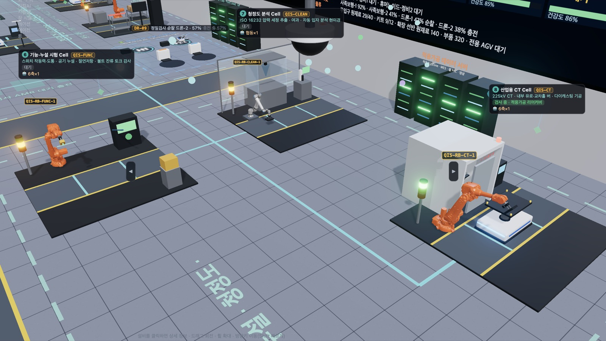

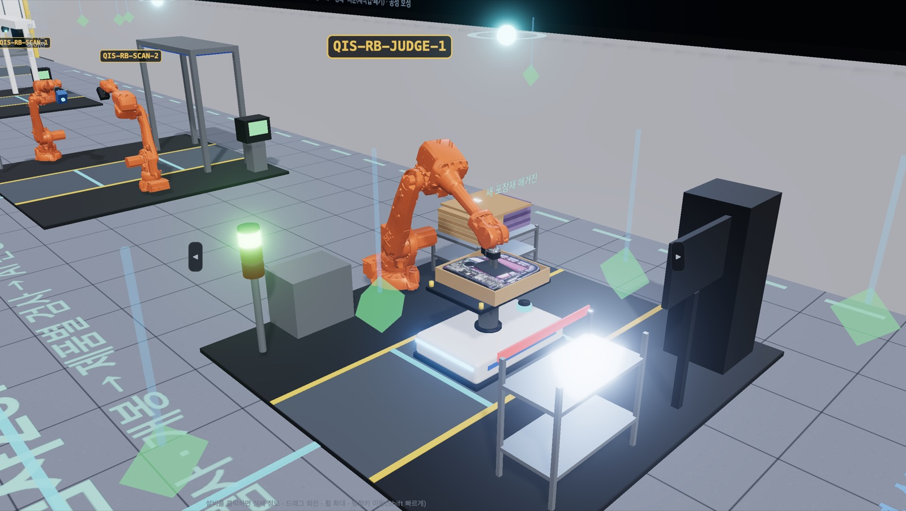

### 5.22 현장 설비 구성 (1.0.48)

실제 차체·구동부 공장과 다르던 설비를 현장 방식으로 바꿈.

| 설비 | 이전 | 지금 |
|---|---|---|
| 유연생산 C05 헤밍 | 테이블형 헤밍 프레스 1대로 후드·도어 번갈아 | **롤러 헤밍 셀**: 반전 앤빌 테이블(위 = 후드 앤빌 · 아래 = 도어 앤빌, 제품이 바뀌면 180° 뒤집힘) · 핸들링 6축이 인너를 결합해 둔 패널을 앤빌에 올림(진공 흡착) → 롤러 헤밍 고가반 6축이 플랜지를 3번(30° → 60° → 90°) 따라감 → 앤빌의 유도 코일이 헴 접착제 가경화. 62초 |
| 유연생산 C07 리워크 | 6축이 셀 안에서 재용접·재도포 | **수리 부스**: 수리 작업자(피지컬AI: 휴머노이드)가 통로 북쪽에 서서 결함 자리로 옆걸음 · AI 프로젝터가 결함 자리를 빨갛게 비춤 · 지브 크레인 밸런서의 휴대용 스폿건(스폿 결함은 불꽃) · 용접 커튼 · 국소 배기 후드 · 공구판 · 재검 작업대(휴대용 3D 스캐너). 출구 문형은 없애고 라벨기는 남쪽 기둥 캔틸레버. 75초 |
| 셀 입구 게이트 (부품분류·검사·포장·C01 키팅·소재 식별·CMM) | 검은 문형 + 위 표시판 | **리더 기둥**(RFID 안테나 · 통로 위 캔틸레버 팔에 비전·바코드 카메라와 판별 표시판) + 양쪽 **라이트커튼**(뮤팅 센서). 통과 폭 그대로. 측정하는 문형(C02 비전 · C06 게이지 · 포장 출구 QR 판독)은 그대로 |
| 정밀조립 6축 셀 | 펜스 없이 열린 채 | **안전 펜스**(철망 1.9m): e-axle 조립·체결셀은 셀 둘레, 검사·포장셀은 고가반 6축이 있는 e-axle 포장대 쪽만. AMR 출입구와 열린 면은 라이트커튼, 정비 자리 앞은 인터록 출입문. 협동로봇·AMMR 셀은 펜스 없음 |
| AMR 위 압입·용접 (e-axle 조립 · C03 스폿) | AMR 지그 위 그대로 | **도킹 스테이션**: AMR 정차 자리 양옆 바닥 블록의 위치 결정 핀·클램프 패드가 차체를 물어 가압력을 바닥이 받음 (작업 중 초록등) |
| e-axle 투입 자재 | 완성 e-axle을 쌓아 둠 | **모터·감속기 하우징**만 투입 → 조립셀에서 스테이터·로터·기어·커버 → 체결셀에서 인버터·고전압 배선·볼트가 보임 |
| e-axle EOL 시험 | 없음 (정밀검사 샘플 감사만) | 체결셀 안 **EOL 시험기**: 로봇 체결이 끝나면 승강 팔이 시험 헤드(누설 플러그 · 고전압 프로브)를 꽂고 누설 → 절연 시험, 표시창에 판정. 체결셀 61 → 106초 |
| 체결셀 갠트리 (1.0.49) | e-axle: 위에서 내려오는 6스핀들 포털 · 도어트림: 머리 위 단축 너트러너 — 로봇이 조인 뒤 한 번 더 내려와 「전수 토크 판정」 | 갠트리를 없앰. e-axle 볼트는 축(x) 방향으로 누운 플랜지에 있어 위에서는 못 조임 → **6축 + 2스핀들 서보 너트러너**(볼트는 공급 호스로)가 툴을 눕혀 양 끝 플랜지 볼트를 조이며 토크·각도 판정. 도어트림은 협동로봇 자동 공급 드라이버가 조이며 판정하고, 끝나면 **비전 카메라**(남동 기둥 캔틸레버)가 나사 유무·들뜸을 찍음. 두 셀 모두 로봇을 AMR 도킹 영역 가운데 맞은편(셀 x 0)으로 옮김 |
| 자재 투입 갠트리 | 이름 「AS/RS」 | 「갠트리 로더」 · 유연생산은 패널 윗변을 무는 에지 클램프 그리퍼 |
| 유연생산 포장·적재 | 후드·도어를 상자째 팔레트에 쌓음 | **수직 슬롯 랙**(24칸 · 간격 5cm): 팔레타이징 로봇이 패널을 눕혀 집어 옮기는 동안 세워 슬롯에 끼움 · 지게차가 랙째 출하 |

- 처리량: e-axle 체결 시간이 늘어 정밀조립 e-axle 출하가 줄고, 유연생산은 C05(62초)가 C03(67초) 다음으로 느린 셀.
- 레거시 단계: C05는 작업자 2명이 수작업 헤밍, C07은 작업자 1명. 펜스·도킹은 자동화·피지컬AI 단계 설비.

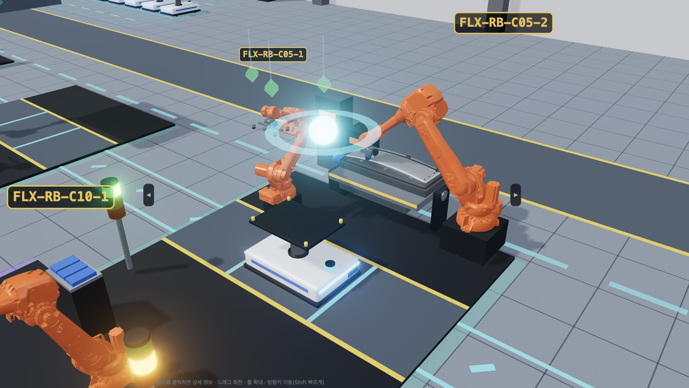

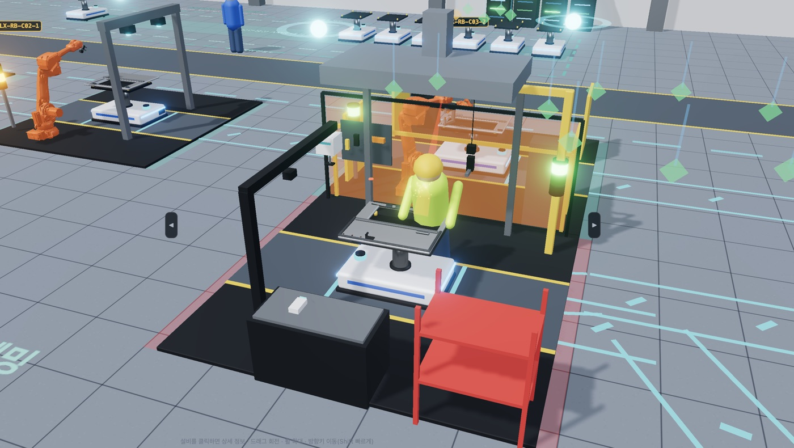

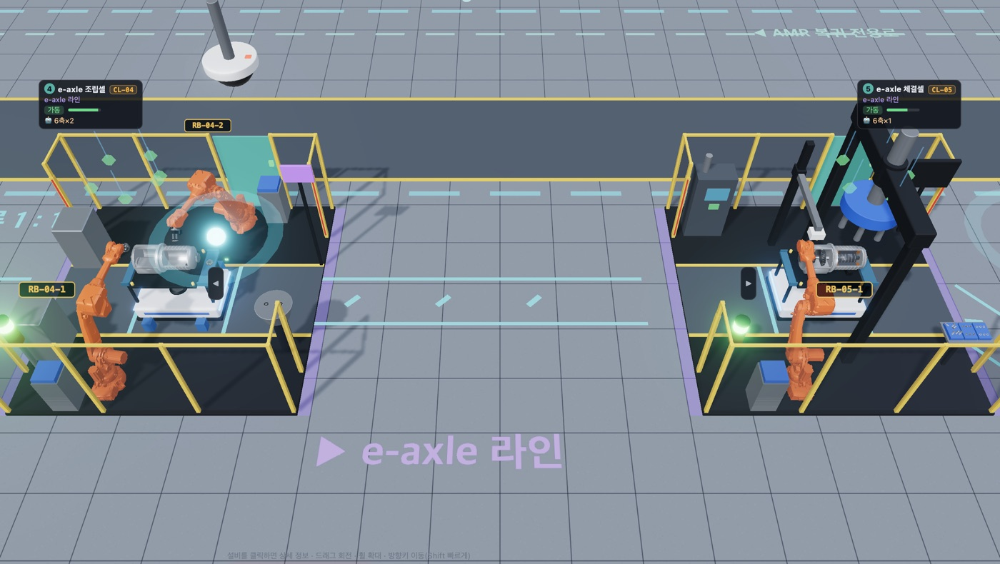

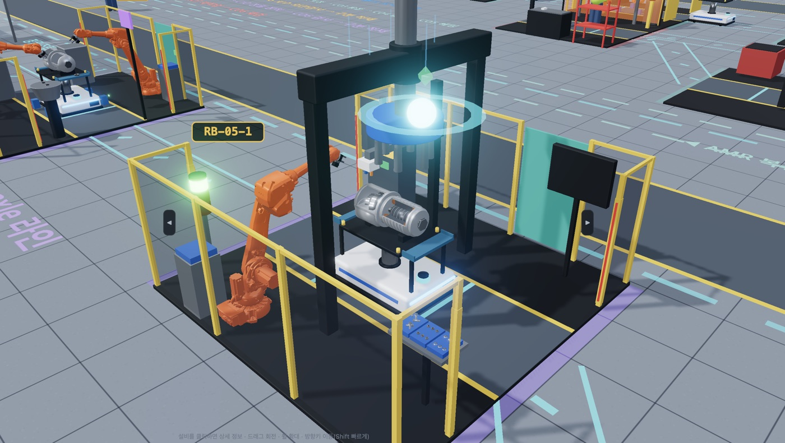

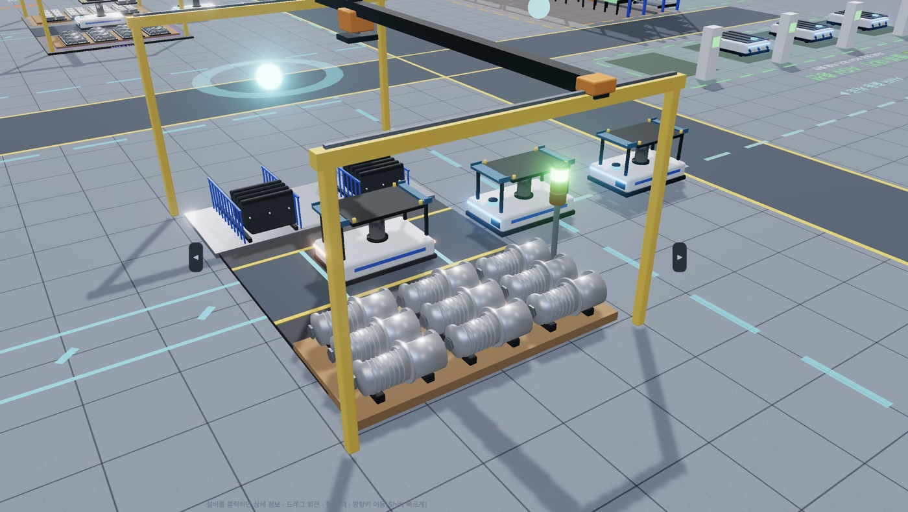

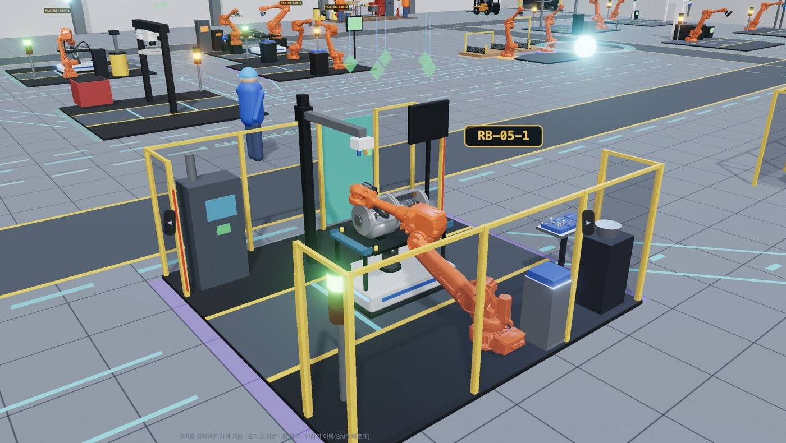

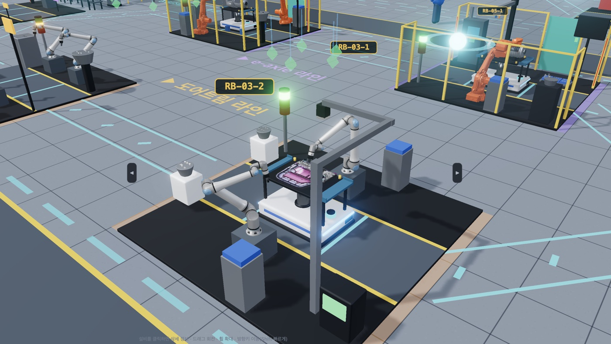

## 6. 파일 저장·내보내기 요약

| 데이터 | 저장하는 곳 | 형식·파일명 |
|---|---|---|
| 자산 데이터 (AAS) | 데이터 연동 「💾 저장」 | JSON·XML·RDF (v3.1/v3.0) |
| 표 데이터 | 데이터 연동 「CSV」 | CSV |
| 공장 구성 | 데이터 연동 「AutomationML(.aml)」 | .aml |
| 로봇별 누적 데이터 | 로봇 정보 창 「💾 누적 데이터 저장 (AAS)」 | AASX·JSON·XML·RDF |
| 통신 패킷 | 데이터 연동·설비 상세 「💾 .pcap 저장」 | `<base>_mqtt.pcap` |
| 품질 통신·리포트 | 품질 추적 「📡 보고·통신」 | `QualityComm_<id>.pcap`, `QualityReport_<id>.json` |
| 불량 원인 분석 데이터 | 품질 추적 「✖ 불량 분석」 | `RCA_<case>_<serial>.zip`, 전체 데이터셋 .zip |
| KPI 리포트 | KPI 영향·개선 「📄 리포트 저장」 | `KPI_impact_<mode>_<s>s.md` |
| CCTV 영상·이력 | CCTV 영상 창 | MP4(또는 WebM)·JPEG, `CCTV_이벤트이력_<runId>.csv` |
| 존 간 메시지 | 오케스트레이터 「존 간 메시지」 | `A2A_messages_<seq>.jsonl` |
| VLA 에피소드 | VLA 학습 「로봇별 에피소드」 | 로봇별 .zip (영상 MP4 또는 JPEG) |
| AIOS 운영 데이터셋 | AIOS 학습 | `AIOS_ops_….zip` |
| 센서 값 | 센서 「CSV 내보내기」 | CSV |

※ 공유 페이지에서는 브라우저 보안 정책으로 내려받기가 막혀 있음 — 맥·윈도우 앱이나 `npm start` 화면에서 저장함.

---

## 7. 서버·데이터 관리

### 7.1 서버와 포트

| 서버 | 기본 포트 | 비고 |
|---|---|---|
| 앱 서버 (맥·윈도우 앱) | 127.0.0.1:47625 | 쓰이고 있으면 빈 포트. 고정 포트여야 AAS 안의 영상 링크가 재실행 후에도 열림 |
| 앱 서버 (`npm start`) | 8780 | `PORT` 로 변경 |
| 내장 MQTT 브로커 | 127.0.0.1:1885 | `MQTT_HOST`·`MQTT_PORT` 로 변경, 외부 PC 공개는 `MQTT_HOST=0.0.0.0`, 외부 브로커 연동은 `MQTT_BRIDGE_URL` |
| 센서 서버 | 자동 (단독 실행 8791) | `npm run sensor-server` |
| RCA 서버 (더미) | 앱 서버 내장 (단독 실행 8790) | `npm run rca-server` |

### 7.2 데이터 폴더

| 실행 형태 | 위치 |
|---|---|
| 맥 앱 | `~/Library/Application Support/Meta-Factory/data/` |
| 윈도우 앱 | `%APPDATA%\Meta-Factory\data\` (보통 `C:\Users\<사용자>\AppData\Roaming\Meta-Factory\data\`) |
| `npm start` | 프로젝트의 `data/` |

- 하위 폴더 — `episodes/`(VLA 에피소드), `aios/`, `cctv/`, `robotcam/`, `sensors/sensors.db`(센서 DB).
- 보관 한도는 환경변수로 바꿈 — `METAFACTORY_EPISODE_KEEP`(기본 500), `METAFACTORY_AIOS_KEEP`(기본 1008), `METAFACTORY_CCTV_KEEP`, `METAFACTORY_ROBOTCAM_KEEP`, `METAFACTORY_MP4_KEEP` 등.
- 메모리에만 있는 데이터(RCA 티켓·FAC 기록)는 앱을 다시 켜면 사라짐. 필요한 것은 종료 전에 내려받음.

### 7.3 영상 변환 (ffmpeg)

- ffmpeg가 설치되어 있으면 녹화 영상을 MP4(H.264)로 변환함. 없으면 WebM으로만 저장함.
- **(맥)** `brew install ffmpeg`. 찾는 순서는 `FFMPEG_PATH` → Homebrew → `~/.local/bin` → PATH.
- **(윈도우)** 명령 프롬프트에서 `winget install Gyan.FFmpeg` 로 설치하거나, 받은 ffmpeg를 `C:\ffmpeg\bin\ffmpeg.exe` 에 둠. 찾는 순서는 `FFMPEG_PATH` → winget 설치 위치 → `C:\ffmpeg\bin` → `Program Files\ffmpeg\bin` → PATH. 설치 후 앱을 다시 켜야 반영됨.

---

## 8. 문제 해결

| 증상 | 원인 | 조치 |
|---|---|---|
| 다른 Mac에서 앱이 열리지 않음 | ad-hoc 서명 | Finder에서 우클릭 → 열기 (처음 한 번) |
| 「내장 서버를 시작하지 못했습니다.」 | 서버 시작 실패 | 앱 종료 후 재실행, 이전 앱 프로세스가 남아 있으면 종료 |
| 데이터 연동의 브로커가 1885가 아닌 포트 | 1885를 다른 프로그램이 사용 중 | 그대로 써도 됨. 오래된 프로세스가 잡고 있으면 정리 후 재실행 |
| 3D 화면이 하얗거나 「3D 화면 복구 중…」 | 그래픽 컨텍스트 끊김 | 자동 복구를 기다림. 안 되면 메뉴 보기 › 「시뮬레이션 다시 불러오기」 |
| 대화 입력창이 비활성 | 엔진이 정책 기반이거나 레거시 단계 | 존 에이전트 설정에서 「대화 기반」 선택, 자동화·피지컬AI 단계 사용 |
| 「내장 해석기 (Agent 미연결)」 | API 키 없음 | 1.5 절차로 키 설정 (`npm start` 는 `.env`) |
| 공정 설계에서 자연어 요청이 안 됨 | Agent 미연결 | 직접 편집하거나 API 키 설정 |
| VLA·AIOS·현장 이벤트 버튼이 안 보임 | 피지컬AI 전용 기능 | 상단에서 「피지컬AI」 선택 |
| 「아직 수집된 데이터가 없습니다」 | 시뮬레이션 진행 전 | 재생해 잠시 돌린 뒤 저장 |
| 영상이 WebM으로만 저장됨 | ffmpeg 미설치 또는 웹 버전 | ffmpeg 설치(7.3절) 후 앱 재실행 |
| 공유 페이지에서 내려받기 불가 | 브라우저 보안 정책 | 맥·윈도우 앱 또는 `npm start` 화면에서 저장 |
| (웹) 「API 키가 올바르지 않습니다」 | 키 오타·폐기된 키 | ⚙에서 키를 다시 입력 (Anthropic Console에서 확인) |
| (공유 아티팩트) 「Claude API에 연결하지 못했습니다」 | 페이지 네트워크 정책이 직접 호출을 막음 | ⚙에서 「저장된 키 삭제」 후 Claude 계정 방식 사용 (1.6절) |
| (공유 아티팩트) 「이 페이지에 Claude 사용이 허용되지 않았습니다」 | 허용 창에서 거절 또는 조직 정책 | 페이지 권한(Permissions) 메뉴에서 허용, 또는 API 키 사용 |
| (공유 아티팩트) 「Claude 사용 한도에 걸렸습니다」 | 보는 사람의 Claude 사용 한도 | 잠시 뒤 다시 시도 — 같은 지시를 반복해서 보내지 않음 |
| (웹) 공정 설계 자연어 요청이 안 됨 | 웹 버전은 서버가 없음 | 직접 편집하거나 맥·윈도우 앱·`npm start` 사용 |
| (공유 아티팩트) 링크가 열리지 않음 | 비공개 아티팩트 | 소유자에게 공유(초대·링크 공개) 요청 |
| (윈도우) 「Windows의 PC 보호」 창이 뜸 | 코드 서명 인증서 없음 | 「추가 정보」 → 「실행」 (처음 한 번, 1.3절) |
| (윈도우) exe를 실행하면 바로 꺼지거나 DLL 오류 | `Meta-Factory.exe` 만 따로 복사함 | `Meta-Factory-win32-x64` 폴더를 통째로 둠 |
| (윈도우) 3D 화면이 검거나 매우 느림 | 그래픽 드라이버가 오래됨 또는 원격 데스크톱 | 그래픽 드라이버 업데이트, 원격 접속이 아닌 PC에서 직접 실행 |
| (윈도우) 「Windows 보안 경고」(방화벽) | MQTT를 외부 PC에 공개하도록 설정 | 사내망만이면 「개인 네트워크」만 허용, 외부 공개가 필요 없으면 「취소」 |
| (윈도우) API 키를 다시 입력하라고 함 | 다른 사용자 계정·다른 PC로 옮김 (DPAPI는 계정별) | 그 계정에서 1.5 절차로 다시 저장 |
| `index.html` 을 열었더니 빈 화면 | ES 모듈은 파일로 직접 실행 불가 | `npm start` 후 http://localhost:8780 접속 |

---

## [부록 A] 첫 30분 실습 순서

1. 자동화 단계에서 3×로 5분 재생 — 왼쪽 KPI와 오른쪽 운영 로그 확인.
2. 「⚡ 설비 고장 주입」 → 오케스트레이터 「인시던트 흐름」에서 처리 과정 확인.
3. 「⛔ 자재 공급 차질」 → 운영 로그에서 에이전트 대응 확인.
4. 「📊 KPI 영향·개선」 → 개선 제안 「🧪 트윈 검증」 → 「✅ 적용」.
5. 「피지컬AI」로 전환 → 「⚠ 현장 이벤트」 → CCTV 영상 창에서 AI 검출 확인.
6. 「🔎 품질 추적」 → 불량 사례의 AI 원인 순위·8D 흐름 확인 → 「⬇ 이 사례 RCA 데이터 (.zip)」.
7. 「📡 데이터 연동」 → 「💾 저장」에서 AAS JSON 저장.
8. 「📊 3단계 8시간 비교」로 단계별 성과 확인.

## [부록 B] 용어

| 용어 | 뜻 |
|---|---|
| UPH | 시간당 생산량 (Units Per Hour) |
| OEE | 설비종합효율 = 가용률 × 성능률 × 품질률 |
| WIP | 재공 — 공정 안에 머무는 미완성 제품 수 |
| RUL | 잔여수명 (Remaining Useful Life) |
| AMR · AGV · AMMR | 자율이동로봇 · 무인운반차 · 팔 달린 자율이동로봇 |
| VLA | 시각·언어·동작 통합 로봇 AI 모델 (Vision-Language-Action) |
| AIOS | 공장 운영 정책을 학습하는 운영 AI |
| FACOS | 공장 → 존 → 셀 → 엣지 계층의 공장 운영 소프트웨어 |
| AAS · AASX | 자산관리셸(Asset Administration Shell) · 그 패키지 파일 |
| OPC UA PubSub · MQTT | 산업용 데이터 발행 규격 · 경량 메시지 전송 프로토콜 |
| pcap | 통신 패킷 기록 파일 (Wireshark로 열람) |
| RCA · 8D | 불량 근본 원인 분석 · 8단계 품질 문제 해결 절차 |
| 미니로드 AS/RS · 스태커 크레인 | 두 줄 선반 사이 통로를 크레인이 오가며 토트(소형 상자)를 넣고 꺼내는 자동창고 · 그 크레인 |
| 디지털트윈 검증 | 개선안을 같은 조건의 가상 공장에서 먼저 돌려 효과를 확인하는 것 |

---

## [부록 C] 기술 구조서

이 부록은 「Meta-Factory 기술 구조서」를 옮긴 것임. 지금까지 구현한 기능, 사용한 오픈소스·표준·라이브러리, 동작 원리, 에이전트 구성과 관계, 온톨로지 관점의 개념 정의를 담음. 사용법은 본문 0~8장을, 내부 구조와 근거는 이 부록을 봄. 도식의 색은 데이터·검증 흐름 = 청록, 명령·통제 흐름 = 보조 네이비, 주황 테두리 = 직접 작성한 핵심 영역임.

### C.1 요약 (Executive Summary)

- **정의**: 4개 Zone(정밀조립·유연생산·적응가공·정밀검사)과 공용 물류를 가진 가상 공장을 결정론적 시뮬레이션 엔진 위에서 레거시 → 자동화 → 피지컬AI 자율공장 3단계로 운영하고, 단계별 UPH·OEE·WIP·전력·불량을 같은 조건에서 비교하는 디지털트윈(Digital Twin) 플랫폼임.
- **운영 판단**: FACOS(공장 운영 시스템) 4계층(공장 → 존 → 셀 → 엣지) 오케스트레이터와 존별 도메인 에이전트 약 35종이 정책 기반(명시적 운영 정책 — 조건·기준값)으로 판단함. 학습 모델이 아니라 정해 둔 기준으로 판단하고, 기준값은 AIOS·KPI 개선 제안이 디지털트윈 검증을 거쳐 조정함. LLM(Claude)은 자연어 지시 해석과 공정 설계 초안에만 쓰고, 결과는 같은 제약 코드로 다시 검증한 뒤 사람이 적용함.
- **데이터**: 자산은 AAS(Asset Administration Shell) v3.1, 실시간 값은 OPC UA PubSub JSON over MQTT, 제품 추적은 GS1 EPCIS 2.0, 업무 전표는 ERPNext v16(선택)으로 내보냄. 모든 시각은 하나의 기준 시계(µs)를 씀.
- **구현 원칙**: 운영 로직(오케스트레이터·에이전트·게이트·RCA·센서망·5G·CCTV·QR/DataMatrix 인코더·pcap 생성기)은 외부 프레임워크(ROS 2·Open-RMF·Eclipse BaSyx·Node-RED) 없이 직접 작성함. 오픈소스 라이브러리는 3D 렌더링·앱 셸·MQTT 전송·Claude 호출·첨부 파일 읽기에만 씀.
- **배포**: 맥·윈도우 앱(Electron, 서버 자동 구동), 브라우저 + 로컬 서버(`npm start`), 서버 없는 웹 공유본(GitHub Pages·Claude 아티팩트) 3형태로 배포함.

### C.2 구현 기능 (Implemented Features)

기능은 7개 묶음 26개 영역으로 정리함. "도입" 열은 해당 기능이 커밋된 프로그램 버전이며, 1.0.x 이전 기능은 "기반"으로 표기함.

| # | 기능 영역 | 핵심 내용 | 주요 모듈 | 도입 |
|---|---|---|---|---|
| **A. 디지털트윈·시뮬레이션** |  |  |  |  |
| F1 | 3D 디지털트윈 | Blender로 만든 GLB 모델(로봇·설비·트럭·드론), 실제 링크 길이 역기구학(IK), 손끝이 대상물에 닿는 접촉 작업(체결·압입 로봇당 2~4점, 스크류 점당 비트 3회), OBB 분리축 간섭 점검 | `factory.js` `blender.js` `payload-robots.js` `endeffectors.js` | 기반 |
| F2 | 시뮬레이션 엔진 | 0.1초 고정 간격, 시드 난수 1개, DOM 없는 헤드리스 실행(Node 테스트·트윈 검증 공용), 배속·일시정지 | `sim.js` | 기반 |
| F3 | 3단계 운영 모드 | 레거시(작업자·사후보전) · 자동화(로봇·AGV·예지정비) · 피지컬AI(휴머노이드·사족보행·드론·혼합형 에이전트) 파라미터 세트, 8시간 비교 화면 | `sim.js MODES` `concept.js` | 기반 |
| F4 | 4개 Zone 흐름 | 정밀조립(도어트림·e-axle 혼류 6셀) · 유연생산(후드·도어, C01~C10 스폿용접·실링·헤밍) · 적응가공(유압블록·리어커버 6셀, 5축 가공·CMM) · 정밀검사(샘플링 검사 비전·3D 스캔·UT·O-INSPECT·ATOS) | `zones.js` `inspzone.js` `zonedefs.js` | 기반 ~ 1.0.12 |
| F5 | 물류 | 입고 트럭·지게차, 미니로드 AS/RS(스태커 크레인 2대), AGV 자재 공급, 출하 트럭 야드, AMR·AGV 관제(속도 배율 50~150%, 정지/시작, 트윈 예측) | `receiving.js` `shipping.js` `fleet.js` | 기반 ~ 1.0.3 |
| **B. 운영 AI·에이전트** |  |  |  |  |
| F6 | FACOS 계층 | 공장·존·셀·엣지 오케스트레이터, Agent Gateway(권한표·등록부·라우팅), 존 간 A2A 메시지 기록 | `factoryos.js` `fosview.js` | 기반 |
| F7 | 자율 운영 에이전트 | 단일 에이전트(6모듈 순차) ⇄ 혼합형 다중(반사 계층 + 정비·품질·흐름 + 메인 조정자), 트윈 비교 | `agent.js` `multiagent.js` `agentinfo.js` | 기반 |
| F8 | 대화 기반 운영 | 한국어 지시 내장 해석기 → 미해석 문장만 Claude 도구 호출, 지시 게이트(해석→대상→안전→실행 가능성→영향→판정), 4개 Zone 모두 적용 | `dialog.js` `zonedialog.js` `gate.js` `llm.js` `agentcore.js` | 기반 ~ 1.0.9 |
| F9 | 공정 설계 | 정밀조립 라인 편집, Zone 셀 레시피(사이클·로봇 종류·대수), 자연어 설계 초안, 예상 병목·UPH 미리보기 | `designer.js` `line.js` `zonerecipe.js` | 기반 |
| F10 | 명령·인시던트 | 비상정지·보호정지·안전 감속·대피·사이클 정지 등 14종 명령(전송→ACK→실행→완료), 인시던트 7단계 스윔레인, 제어 흐름 분석 | `commands.js` `orchestrator.js` `orchview.js` | 기반 |
| F11 | KPI 영향·개선 | 원인별 OEE 손실 분해(손실 합 + OEE = 100%), 개선안 → 트윈 검증(30분 × 시드 3) → 적용 → 실측 → 되돌리기 | `impact.js` `impactview.js` | 기반 |
| F12 | VLA·AIOS 학습 파이프라인 | VLA 에피소드(관절·TCP 5Hz, 카메라 JPEG, 지시·결과 라벨) zip, 학습 → 성공률 게이트 → 카나리 → OTA; AIOS 운영 데이터 10초 샘플 → 정책 헤드 학습 → 트윈 검증 → 배포 (운영 정책 기준값 탐색, 신경망 아님) | `vla.js` `aios.js` | 기반 |
| **C. 품질·추적** |  |  |  |  |
| F13 | 제품 추적·RCA·8D | 셀 통과 계보(ISA-95 Actual 용어), 계보 기반 베이즈 원인 분해, 8D CAPA(D0~D8) 자동 진행, DoWhy·PyRCA 노트북 | `trace.js` `capa.js` `analysis/rca` | 기반 |
| F14 | 불량 보고 통신·RCA 서버 | 검사셀 엣지 → MQTT → 메인 서버 → HTTP → RCA 서버 → 결과·봉쇄·종결 5단계, 품질 통신 pcap | `qcomm.js` `rcacore.js` `server/rca-api.mjs` | 기반 |
| F15 | 시리얼·마킹·출하 추적 | WIP ID / 제품 시리얼 2단 ID, QR(GS1 Digital Link) · GS1 DataMatrix 직접 인코딩, 판독 검증(등급 C 이상), 출하 SSCC, 샘플 NG 봉쇄·처분(MRB) | `serial.js` `codes.js` `traceview.js` | 1.0.18 |
| F16 | EPCIS 2.0 저장소 | 앱 내장 저장소(설치 없음), 웹은 브라우저 메모리, 외부 OpenEPCIS 등으로 선택 전송 | `epcis.js` `server/epcis-api.mjs` | 1.0.19 |
| **D. 데이터·통신·센서** |  |  |  |  |
| F17 | 데이터 연동 | AAS v3.1(기본)·v3.0 JSON·XML·RDF(Turtle)·AASX·CSV·AutomationML, OPC UA PubSub JSON, 내장 MQTT 브로커, 전체·자산별 pcap | `datahub.js` `aas.js` `aasx.js` `pcap.js` | 기반 |
| F18 | 환경·설비 센서망 | 센서 30종 139개(설계서 기준), 센서 → 셀 엣지 → 게이트웨이 → 존 서버 → 중앙 → 센서 서버(별도 프로세스·SQLite), PTP 시간 동기 | `sensors.js` `server/sensor-server.mjs` | 기반 |
| F19 | 가공기 상태 감시·엣지 AI 예지보전 | 주축 부하·진동 RMS·첨도·AE·베어링 온도·공구 마모(VB) 감시, 1초 이상 점수(0 정상 · 1 경고선 · 2 경보선), 공구 잔여 수명(RUL), MQTT·pcap·AAS 저장 | `machmon.js` `machmonview.js` | 1.0.12 |
| F19-1 | 적응가공 소재 식별·디버링·세척·CMM 셀 | ID 판독 게이트·LIBS 재질 분석·3D 스캔 부스·격리 랙(가공 여유 → 가공셀 원점 보정 전달) · 사선홀 머시닝센터·워터젯 디버링 부스·로봇 투입형 세척기(청정도 ISO 16232 · 필터 정비), 항온 측정실 브리지형 CMM·리워크 머시닝센터·이송 6축, 피지컬AI 범용 파지·능동 스캔·결함 AI·접촉 리워크·온도 보정 | `matlcell.js` `matlview.js` `washer.js` `washerview.js` `cmmcell.js` `cmmview.js` `zones.js` | 1.0.35 ~ 38 |
| F19-2 | 유연생산 C01 공급·키팅 | 키팅 구역(흐름 랙 · 피킹 로봇 · 조립대 · 검증대) → 라인사이드 컨베이어(트레이 정지 · 보울 피더) → 협동로봇 장착, 피지컬AI 빈 피킹·키트 검증·선행 피킹·적응 장착·재고 보충·피더 감시 | `kitcell.js` `kitview.js` `zones.js` | 1.0.39 |
| F19-3 | 정밀조립 서열 키팅 · 라인사이드 칸반 | 부품분류셀 양옆 키팅 구역(흐름 랙 · 피킹 로봇 · 검증대 · 서열 버퍼 · 플렉시블 피더 · e-axle 클린 부스·개봉대) → AMR 키트 포켓 → 조립셀 로봇이 키트에서 집음, 공용 부품 투빈 칸반(밀크런), 피지컬AI 범용 파지·빈 피킹·키트 검증·로트 추적·청정 개봉·결품 예측 | `sps.js` `spsview.js` `factory.js` | 1.0.40 |
| F20 | Private 5G·CCTV | 기지국·CCTV 음영 없는 배치(탐욕적 집합 덮개), PCI·핸드오버·DAPS, 5G 지연 10ms(p99) 모델, CCTV AI 오버레이(탐지·추적·분할·연기) | `net5g.js` `cctv.js` `cctvview.js` | 기반 |
| F21 | 영상 녹화·변환 | 로봇 카메라 8분할·CCTV 전광판 자동 녹화(WebM 5분 구간) → ffmpeg MP4·카메라별 분할, AAS 영상 링크 서브모델 | `robotcam.js` `robotrec.js` `cctvrec.js` `server/video-convert.mjs` | 기반 |
| F22 | 보안 시뮬레이션 | DID/VC 신원·최소 권한·OTAC·DPI·동형암호 연합학습·ZKML·eVDI 반출 통제 흐름 재현(실제 암호 연산 없음) | `security.js` | 기반 |
| **E. 외부 시스템 연동 (선택·앱 전용)** |  |  |  |  |
| F23 | ERPNext 연동 | 2단계: FAC 업무 기록·공장 오더 → ERPNext v16 전표 / 3단계: 정밀검사 판정·부적합·처분(MRB)·8D → 품질 모듈 | `server/erpnext-bridge.mjs` `server/fac-api.mjs` | 1.0.20 ~ 21 |
| F24 | 설비 대시보드 | 앱 MQTT → Telegraf → InfluxDB 2 → Grafana를 Docker로 켜고 끔, Docker 엔진이 꺼져 있으면 Colima 자동 시작 | `server/monitor-api.mjs` `monitoring/` | 1.0.22 ~ 23 |
| **F. 분석·대시보드** |  |  |  |  |
| F25 | Zone 대시보드 | 실시간 모니터링 · OEE(ISO 22400-2)·6대 손실·NG 파레토 · 관리도(X̄-R / I-MR, Western Electric 규칙 1~4)·산점도·회귀, 그래프 자동 해석(판정·근거·권장 조치) | `zonekpi.js` `zonedash.js` | 1.0.22 ~ 25 |
| **G. 배포·문서** |  |  |  |  |
| F26 | 배포·사용자 가이드 | 맥(arm64)·윈도우(x64) 앱 패키징, 웹 버전에서만 앱 내려받기, 사용자 가이드 Word·PDF 내려받기, 포트 충돌 시 빈 포트 대체 | `electron/` `tools/guide-pdf.cjs` | 기반 ~ 1.0.17 |

### C.3 시스템 아키텍처 (System Architecture)

판단·시뮬레이션·3D는 모두 화면 프로세스(Electron 렌더러 또는 브라우저)에서 돌고, 앱 서버는 브로커·저장·변환·외부 연동 창구만 맡음. 웹 공유본은 왼쪽 열만 동작하고 서버 기능은 같은 코드(`rcacore.js`, `epcis.js`)를 화면 안에서 돌려 재현함.

![[그림 39] 실행 구성도 (맥·윈도우 앱 기준)](guide-images/tech_01.png)

화면의 각 모듈은 앱 서버의 창구 하나와 짝을 이루고, 앱 서버만 외부와 연결됨. Claude API 키는 앱 서버 프로세스에만 있고 렌더러로 보내지 않음(safeStorage: 맥 키체인·윈도우 DPAPI). (범례: 데이터·검증 흐름 · 명령·통제 흐름 · 구독(선택 구성) · 직접 작성한 FACOS 핵심 영역)

| 배포 형태 | 동작 범위 | 실행 |
|---|---|---|
| 맥·윈도우 앱 | 전체 — 앱 서버·브로커·센서 서버·RCA·EPCIS·파일 저장·Agent·선택 연동 | `npm run package` / `package:win` |
| 브라우저 + 로컬 서버 | 앱과 같음 | `npm start` → localhost:8780 |
| 웹 공유본 | 화면·시뮬레이션만. RCA·EPCIS는 화면 안 메모리, Agent는 입력한 API 키로 브라우저 직접 호출 | GitHub Pages · Claude 아티팩트 |

### C.4 오픈소스·표준·라이브러리 (Open Source, Standards, Libraries)

#### C.4.1 앱에 포함되어 동작하는 라이브러리

| 이름 | 버전 | 라이선스 | 쓰인 곳 · 동작 |
|---|---|---|---|
| three.js | 0.186.1 | MIT | 3D 렌더링 전체. OrbitControls(시점), CSS2DRenderer(라벨), EffectComposer·UnrealBloomPass·OutputPass(발광·후처리), GLTFLoader·RoomEnvironment(Blender 모델·PBR 환경광), WebGLRenderTarget·readRenderTargetPixels(로봇 카메라·CCTV 영상) |
| Electron | 44.5.1 | MIT | 맥·윈도우 앱 셸. 메인 프로세스가 앱 서버·센서 서버를 띄우고, safeStorage로 API 키를 암호화 저장 |
| @anthropic-ai/sdk | 0.131.0 | MIT | 앱 서버에서 Claude Messages API 호출(도구 사용·구조화 출력) |
| aedes | 1.2.0 | MIT | 내장 MQTT 브로커(:1885). 공장 UNS 토픽 중계 |
| MQTT.js (mqtt) | 5.16.0 | MIT | 센서 서버 구독, 외부 브로커 브리지(`MQTT_BRIDGE_URL`) |
| mammoth | 1.13.0 | BSD-2-Clause | 공정 설계 첨부 Word(.docx) 본문 추출 |
| SheetJS CE (xlsx) | 0.20.3 | Apache-2.0 | 공정 설계 첨부 Excel → 시트별 CSV |
| node:sqlite | Node 내장 | — | 센서 서버 시계열 DB(WAL, 원시 48시간 · 1분 집계 30일) |

#### C.4.2 선택형 외부 서비스·컨테이너 (앱에 포함하지 않음)

| 이름 | 연결 방식 | 쓰인 곳 |
|---|---|---|
| Anthropic Claude API (`claude-opus-5-5`) | HTTPS · 키 설정 시에만 | 대화 지시 해석, 자연어 공정·Zone 레시피 설계 초안 |
| ERPNext v16 (GPL-3.0) | REST로만 호출(코드 결합 없음) | 구매·입고·재고 이동·생산 입고·출하·작업지시·설비 자산·품질 문서. v16.52.0(frappe_docker)으로 문서 생성 방식 확인 |
| OpenEPCIS 등 EPCIS 2.0 저장소 | REST `POST {url}/capture` | 앱 내장 저장소의 이벤트를 외부로 전송(확장 필드 스키마 등록, 202 캡처 작업 확인) |
| Telegraf 1.34 · InfluxDB 2.7.12 (MIT) · Grafana OSS 12.4.3 (AGPL-3.0, 수정 없이 별도 서비스) | Docker Compose · 127.0.0.1 포트만 | 설비 대시보드. Telegraf가 앱 브로커를 구독 → InfluxDB(보존 7일) → Grafana 기본 대시보드 |
| Docker Desktop · Colima | CLI 실행 | 모니터링 스택 기동. 엔진이 꺼져 있으면 Colima 자동 시작 |
| FFmpeg (libx264) | 설치본을 외부 프로그램으로 실행 | WebM → H.264 MP4 변환·카메라별 분할. 없으면 WebM만 저장 |
| 운영 스택 구성 `deploy/sensors` | Docker Compose (설치 검증 전) | Mosquitto · Telegraf · TimescaleDB · Grafana · Node-RED · linuxptp/chrony 구성 파일 |

#### C.4.3 개발·검증 도구

| 이름 | 쓰인 곳 |
|---|---|
| Blender 5.2 | AMR·AGV·지게차·드론·휴머노이드·사족보행·6축 팔·AMMR·트럭·설비 모델링 스크립트(`blender/*.py`) → `assets/blender/*.glb` |
| @electron/packager 20.3.0 · codesign | 앱 패키징·ad-hoc 서명 |
| @zxing/library 0.23.0 | 직접 만든 QR·DataMatrix를 실제 디코더로 판독 검증(`tests/serial.mjs`) |
| ajv · ajv-formats | EPCIS 2.0 JSON 스키마 검증 테스트 |
| aas-core3.0 (Python) · Eclipse BaSyx Python SDK 2.2 | 내보낸 AAS JSON·XML·AASX의 표준 적합성 엄격 파싱(`tests/aasbasyx.mjs`) |
| DoWhy (GCM) · PyRCA | RCA 데이터셋 외부 검증 노트북(`analysis/rca`) |
| Node.js 테스트 스크립트 | 헤드리스 회귀 테스트 45개 파일(`npm test`), Electron 화면 점검·간섭 점검 도구(`tools/`) |

#### C.4.4 준수·참고한 표준 (규격 문서 기준, 구현 코드는 직접 작성)

| 분야 | 표준 | 적용 내용 |
|---|---|---|
| 자산 모델 | IDTA AAS Part 1 v3.1(기본)·v3.0 · Part 5 AASX(ISO/IEC 29500-2 OPC) · IDTA 02006 Digital Nameplate · 02003 Technical Data · 02008 Time Series · IEC 62714 AutomationML(CAEX 3.0) · W3C RDF 1.1 Turtle | 설비·로봇 자산 셸과 서브모델, 로봇별 누적 데이터 .aasx, 영상 링크 서브모델 |
| 통신 | OPC UA Part 14 PubSub(JSON) · OASIS MQTT 3.1.1 · CloudEvents 1.0 · Sparkplug B BIRTH 개념 · libpcap · IETF RFC 791(IPv4) · RFC 9293(TCP) | NetworkMessage, 공장 UNS 토픽, 불량 리포트 봉투, 센서 메타 retain, 패킷 덤프 |
| 추적·식별 | GS1 EPCIS 2.0 · CBV 2.0 (JSON-LD) · GS1 Digital Link · SGTIN · SSCC · SGLN · ISO/IEC 18004(QR) · ISO/IEC 16022(DataMatrix ECC200) · ISO/IEC 15415 · ISO/IEC TR 29158 · AIAG B-17 · ANSI/ISA-95 | 2단 ID, 라벨·직접 각인, 판독 등급, 출하 팔레트, 계보 용어(Equipment·Personnel·Material Actual) |
| 품질 | 8D · IATF 16949 10.2.3 · ISO 9001 8.7 · ISO 2859-1 · AIAG-VDA FMEA AP · ISO 22400-2 · Western Electric 규칙 | CAPA, 부적합·MRB, 샘플링 봉쇄, OEE, 관리도 판정 |
| 안전 | IEC 60204-1 (정지 카테고리 0·2) · ISO/TS 15066 | 비상정지·보호정지, 협동 로봇 안전 감속 |
| 무선 | 3GPP TR 38.901 InF · TS 38.211 · 38.331 · 38.300 · Rel-16 DAPS · TS 22.104 · TR 38.824 · SON MLB | Private 5G 경로손실·PCI·A3 핸드오버·URLLC 지연 모델·부하 분산 |
| 시간 | IEEE 1588 PTP (linuxptp 구성) | DataHub 기준 시계를 Grandmaster로 보고 유선 2µs·LoRaWAN 20ms 이내 정렬 |
| 보안 | W3C DID v1.0 · W3C Verifiable Credentials | 주체 신원·권한·OT 명령 검증 흐름(암호 연산 없음) |
| 영상 | W3C MediaStream Recording · WebM(VP9/VP8) · H.264 · ISO/IEC 14496-12·14(MP4) | 자동 녹화와 변환 |

#### C.4.5 참고한 AI 알고리즘 (출력 형식만 재현 · 모델·가중치 미포함)

Ultralytics YOLO11(탐지·분할, AGPL-3.0) · ByteTrack(다중 객체 추적, MIT) · D-Fire 데이터셋(연기·화재, CC0-1.0)의 출력 형식(박스·마스크·클래스·추적 ID·신뢰도)을, 장면의 실제 위치·크기를 카메라로 투영해 만들어 냄. 현장 적용 시 YOLO11은 AGPL-3.0 의무 이행 또는 상용 라이선스가 필요함.

### C.5 동작 방식 (How It Works)

#### C.5.1 시뮬레이션 엔진과 3단계 운영 모드

- **고정 간격**: 0.1초마다 한 틱을 진행함. 배속은 화면 한 프레임에 여러 틱을 돌리는 방식으로 만듦.
- **결정론**: 생산 흐름은 시드 난수 하나만 씀. 환경·센서·품질 측정값은 별도 난수를 써서, 부가 기능을 더해도 기존 KPI가 바뀌지 않음.
- **헤드리스 분리**: 엔진·에이전트·품질·센서 모듈은 DOM을 쓰지 않아 Node 테스트와 디지털트윈 검증이 같은 코드를 돌림. 확장 Zone 흐름(`zones.js`)·정밀검사(`inspzone.js`)는 아직 화면에서만 돎(설계서 미결 사항).
- **데이터 주도**: 셀 배치·로봇·사이클·경로·센서 배치·레시피 제약은 정의 데이터(`line.js`, `zonedefs.js`, `zonerecipe.js`, `sensors.js`)에 두고 코드가 읽음.

| 파라미터 (`sim.js MODES`) | 레거시 공장 | 자동화 공장 | 피지컬AI 자율공장 |
|---|---|---|---|
| 사이클 배율 · 편차 | 1.22 · 22% | 1.00 · 8% | 0.92 · 4% |
| 불량 기본률 · 검출률 | 2.8% · 85% | 1.5% · 98% | 0.8% · 99.5% |
| 수리 시간 · 예지정비 | 160초 · 없음 | 90초 · 건강도 50% | 60초 · 건강도 55% |
| 운반 · 정비 인력 | 지게차 1 · 사람 2 | AGV 3 · 사람 1 | AGV 4 · 휴머노이드 2(+보충 2), 사족보행 2, 드론 3 |
| 운영 주체 | 작업반장(수동, 알람 지연 10초) | 단일 자율 에이전트 | 혼합형 다중 에이전트 |
| 조명 + 공조 | 58 kW | 34 kW | 13 kW |

#### C.5.2 데이터 파이프라인 — AAS → OPC UA → MQTT → 구독자

![[그림 40] 실시간 값이 나가는 경로와 두 갈래 산출물](guide-images/tech_02.png)

한 값이 같은 기준 시계 축으로 AAS 파일·MQTT 메시지·pcap·센서 DB에 동시에 남으므로, 센서 서버 /align으로 같은 순간을 묶어 조회할 수 있음.

- **토픽 체계(UNS)**: `metafactory/{영역}/v1/{존}/{셀}`. 큰 문서는 HTTP REST, 알림·실시간 값은 MQTT로 나눔.
- **pcap 주소 계획**: 브로커 10.20.0.10, FACOS 10.20.0.20, 유선 설비 10.20.1.x, CCTV 10.20.2.x, 5G 이동 로봇 10.45.x.x(UPF N6 경유). TCP 3-way 핸드셰이크·CONNECT·SUBSCRIBE·PUBLISH(QoS 1, MSS 1460B 분할)·PUBACK·PINGREQ까지 실제 바이트로 만들고 체크섬을 계산함.
- **AASX**: 무압축 ZIP에 `[Content_Types].xml` → `_rels/.rels` → aasx-origin → aas-spec 파트, 보조 파일은 aas-suppl 관계로 연결함.

#### C.5.3 시리얼·마킹·출하 추적과 EPCIS 2.0

![[그림 41] 제품 한 개의 수명 — 공정 단계 · EPCIS 이벤트 · ERPNext 전표](guide-images/tech_03.png)

공정 중 이력은 WIP ID로 쌓고, 표준 이벤트는 시리얼이 생긴 순간부터 만듦. eventID는 urn:uuid라 재전송해도 한 번만 저장되고, ERPNext 문서는 mf_ref(운전 ID:FAC 번호)로 중복을 막음.

- **2단 ID**: 투입 순간 `WIP-DT-YYMMDD-000123`, 최종 검사 합격 순간 중앙 발행기가 GTIN별 순차 시리얼 `DT-YYMMDD-000045`(GS1 AI 21, 재사용 없음)를 발행함. 발행 셀은 정밀조립 검사·포장셀, 유연생산 C06(재작업품은 C07 재검 합격 때), 적응가공 CMM 셀임.
- **마킹**: 라벨은 QR + GS1 Digital Link, 금속 직접 각인은 GS1 DataMatrix(FNC1 + AI 원소 문자열). QR은 바이트 모드·오류 정정 M·1~10형, DataMatrix는 ECC200 정사각 10~48로, GF(256) 리드-솔로몬을 직접 구현함. 마킹 직후 100% 판독 검증 — 등급 C 미만이면 1회 재마킹, 다시 실패하면 부적합 처리함.
- **EPCIS 저장소**: `POST /capture`(202 + captureID, eventID 중복 제거), `GET /events`(MATCH_anyEPC · EQ_bizStep · EQ_action · EQ_readPoint · 시간 범위 · 페이지), `GET /trace?epc=`(발행 → 적재 → 묶음 → 출하 사슬)를 제공함. 위치는 SGLN(`urn:epc:id:sgln:업체코드.00001.FLX-C06`) 형식임.

#### C.5.4 불량 보고 통신 · RCA · 8D

![[그림 42] 불량 사례 하나가 오가는 5단계 메시지](guide-images/tech_04.png)

RCA 서버 처리 로직(rcacore.js)은 앱 서버의 실제 HTTP와 웹 버전의 화면 시뮬레이션이 같은 코드를 씀. 모든 메시지는 품질 통신 pcap으로도 남김.

- **원인 분석**: 계보 기반 베이즈 분해(`Bayes-genealogy RCA v1`). NG 제품들이 공통으로 지난 셀·로봇·설비 건강도·드리프트·환경값을 요인으로 사후 확률을 나눠 원인 후보 Top-8과 신뢰도를 냄. 시뮬레이션 정답(불량이 생긴 셀)은 학습 특징 표에만 두고 사례·리포트에는 넣지 않음(목표 Top-1 적중 90% 이상).
- **8D 흐름**: D0 NG 판정·격리 → D1 팀 → D2 문제 기술(5W2H) → D3 봉쇄(의심 제품 출하 보류·원인 후보 셀 재보정) → 총괄 보고 → D4 근본 원인 → D5 대책(운영 정책 변경안) → 총괄 승인(사람 결정) → D6 시행·검증 → D7 FMEA AP 갱신·표준화 → D8 종결. 같은 셀 + 요인의 재발은 진행 중인 8D에 묶음.
- **샘플 NG 봉쇄·처분**: 정밀검사 샘플이 NG면 같은 로트를 출하 보류하고 재검·재작업·격리·폐기로 처분(MRB)함.

#### C.5.5 대화 기반 지시와 LLM 사용 방식

![[그림 43] 운영자 지시 게이트](guide-images/tech_05.png)

내장 해석기가 먼저 문장을 조치로 바꾸고, 해석하지 못한 문장만 Claude가 같은 조치(도구)로 돌려줌. 어느 쪽이든 결과는 같은 게이트를 지나 기존 실행 경로(명령·혼류·투입 간격·긴급 조달·상태 질의)로만 실행됨.

- **Claude 도구 8종** (모두 `strict` JSON 스키마): `schedule_maintenance` · `set_cycle_mode` · `set_release_interval`(5~20초) · `set_release_hold` · `issue_command`(ESTOP~MAINT 14종) · `set_mix` · `zone_command`(유연생산·적응가공·정밀검사) · `expedite_supply`. 설비 ID 목록으로 매 요청마다 enum을 다시 만듦.
- **이중 검증**: 서버(`agentcore.validate`)가 스냅샷 기준으로 한 번, 브라우저가 실제 적용 직전에 한 번 더 검증함. 공정 설계 초안은 `normalizeLine`·`normalizeRecipe`로 제약 위반을 보정·경고하고 사람이 적용을 누름.
- **안전 장치**: 첨부 문서·이미지 안의 문장은 지시로 따르지 않음(프롬프트 주입 방지). 호출마다 토큰 비용을 계산해 누적 표시하고, 자동 테스트에서는 LLM을 부르지 않음.
- **웹 버전**: 서버가 없으면 운영자가 넣은 API 키로 브라우저에서 직접 호출하거나, 공유 아티팩트에서는 Claude 계정 호출을 씀. 프롬프트·도구·검증 코드(`agentcore.js`)는 서버와 공용임.

#### C.5.6 센서망과 시간 동기

![[그림 44] 센서 값이 DB까지 가는 계층](guide-images/tech_06.png)

센서 DB 테이블: sensor(메타) · reading(µs 시각·동기 잔차) · batch(계층별 시각·지연) · agg_1m · alarm. 센서 서버는 앱 서버와 다른 프로세스·다른 DB로 돌아 화면이 멈춰도 적재가 계속됨.

#### C.5.7 KPI 분석과 Zone 대시보드

```
가동률 A = 가동 가능 시간 ÷ 계획 시간 (계획 시간 = 전체 − 계획 정비, 가동 가능 = 계획 − 고장 − 준비·교체 − 운영 정지)
성능 P = 처리 수 × 기준 사이클 ÷ 가동 가능 시간 (자재 대기 · 출구 막힘 · 속도 저하가 여기서 빠짐)
품질 Q = 양품 ÷ 판정 수 → OEE = A × P × Q (ISO 22400-2)
```

- **셀 시간 분류**: Zone 흐름이 dt마다 가동·고장·계획 정비·준비·교체·운영 정지·자재 대기·출구 막힘으로 알려 주고, 이를 6대 손실(설비 고장·준비·조정·공전·순간정지·속도 저하·공정 불량)로 묶어 파레토를 그림.
- **관리도**: 제품마다 규격이 다른 품질 특성(도어트림 체결 토크·각도, e-axle 볼트 토크·각도, 유연생산 갭·단차 등)을 섞지 않고 X̄-R 또는 I-MR로 그림. Western Electric 규칙 1~4로 이상을 판정하고, 판정·근거·권장 조치 문장을 자동으로 붙임.
- **산점도**: 제품 1개 = 표본 1건으로 공정 변수(x)와 품질 특성(y)의 회귀선·상관을 그리고 해석함.
- **KPI 영향 분석**(`impact.js`): 매 틱 셀마다 "가동하지 못한 시간"을 원인으로 나누고, 상류 정지로 생긴 하류 자재대기는 원인 셀로 넘김. 병목 대비 가중치를 곱해 손실 대수·UPH·OEE 손실(합 + OEE = 100%)을 냄. 개선안은 같은 라인·운영값·현장 이벤트를 재연한 트윈(30분 × 시드 3)에서 현재 vs 제안을 비교한 뒤 적용 여부를 물음.
- **그리기**: 차트는 라이브러리 없이 SVG 문자열로 만들어 웹 버전·공유 아티팩트에서도 그대로 동작함.

#### C.5.8 CCTV·Private 5G 배치 최적화

| 단계 | CCTV (`cctv.js`) | Private 5G (`net5g.js`) |
|---|---|---|
| 격자 | 바닥 1m 점(높이 0.3m에서 판정) | 바닥 2m 점, 천장 후보 4m 격자 |
| 덮음 판정 | 큰 설비(셀·랙·서버 랙)에 시야가 가리지 않으면 "보임" (돔 반경 9m, 실외 PTZ 20m) | 3GPP TR 38.901 InF 경로손실로 RSRP 계산, 가리면 NLOS 식 · RSRP ≥ −80dBm, 반경 18m 이내 |
| 선택 | 아직 덮이지 않은 점을 가장 많이 덮는 후보부터 고르는 탐욕적 집합 덮개(Greedy Set Cover) → 동점 처리를 바꿔 여러 번 돌리고, 빼도 음영이 안 생기는 장비를 덜어 최소 대수 배치를 고름 | 〃 |
| 후처리 | Zone별로 나눠 그 Zone 천장 카메라로만 덮음, 5m 안 근접 쌍 정리 (77대) | PCI = 3·SSS + PSS 고유 배정, A3 이벤트·TTT 핸드오버, Rel-16 DAPS(끊김 0ms), 지연 10ms(p99) 모델·부하 분산 |

#### C.5.9 외부 연동과 영상

**ERPNext 매핑 (server/erpnext-bridge.mjs)**

| FACOS 이벤트 | ERPNext 문서 | 비고 |
|---|---|---|
| `po.create` · `receipt.done` | Purchase Order · Purchase Receipt | WMS 재주문점 발주, 트럭 하차 검수 |
| `internal.done` | Stock Entry (Material Transfer) | 선반 → 투입구·셀 이동 |
| `production.done` | Stock Entry (Manufacture) | BOM 소비 + 완제품 입고, 열린 작업지시에 먼저 배분 |
| `delivery.done` | Delivery Note | 시리얼 연결(선택), SSCC 18자리 변환 |
| `order.assign` · `order.close` | Work Order · 중지(Stopped) | 정밀조립 혼류 제품별 |
| `mr.create` · `mr.stage` | Asset · Asset Repair · Asset Maintenance Log | 긴급 = 수리, 예방 = 보전 기록 |
| 정밀검사 판정 · 부적합 · 처분 · 8D | Quality Inspection · Non Conformance · Quality Action | 품질 절차: ISO 2859-1 샘플링, ISO 9001 8.7 MRB, IATF 16949 8D |

- **신뢰성**: 화면 FAC 기록 → 2초마다 `/api/fac/push` → 디스크 대기열(`queue.jsonl`) → REST. ERPNext가 꺼져 있으면 대기열에 두고 다시 보내고, 4xx 검증 오류 전표는 사유를 남기고 건너뜀(한 건 때문에 연동이 멈추지 않음).
- **설비 대시보드**: `monitoring/` 구성을 데이터 폴더로 복사하고 무작위 토큰·비밀번호 `.env`를 만든 뒤 `docker compose -p metafactory-mon up -d`로 띄움. 컨테이너는 `host.docker.internal`로 앱 브로커에 붙고, 데이터 초기화는 사용자가 확인한 경우에만 함.
- **영상**: 로봇·CCTV 카메라 시점을 렌더 타깃 칸에 그리고 `canvas.captureStream` + MediaRecorder로 WebM 5분 구간을 녹화함. 구간마다 칸 색인(JSON: 카메라 ID·자산·칸 좌표)을 남겨 ffmpeg가 카메라별 MP4로 자르고, AAS 파일에 그 로봇 영상 링크(VideoRecordings 서브모델)를 넣음.

### C.6 에이전트 (Agents)

에이전트는 FACOS 계층을 따름. **명령은 위 → 아래, 상태는 아래 → 위, 같은 계층(존 ⇄ 존)은 핸드셰이크·알림만** 주고받고, 결정이 필요한 일은 공장으로 올림. 접수 ACK만으로 재개하지 않음. 모든 에이전트 간 메시지는 Agent Gateway가 권한표로 검사하고 A2A 기록으로 남김.

#### C.6.0 정책 기반 판단

**정책 기반(Policy-based)**은 사람이 미리 정한 조건과 기준값으로 판단하는 방식임. 학습된 신경망이나 LLM이 상황마다 판단하지 않음. 앱의 엔진 선택 「정책 기반 | 대화 기반」 중 정책 기반이 이 방식이며, 대화 기반을 골라도 공장 운영 판단은 정책 기반 에이전트가 계속 맡음.

코드에 들어 있는 실제 정책(에이전트별 조건 → 조치 · 기준값 · 코드 위치)은 C.9 운영 정책 표에 모아 둠.

- **정책 기반을 쓰는 이유**: 판단마다 근거(예: 건강도 48% < 기준 55%)가 운영 로그에 남아 설명할 수 있음. 같은 시드면 같은 판단이 나와 단계 비교와 회귀 테스트가 성립함. 매초 판단해도 외부 API 비용이 들지 않음.
- **학습이 들어가는 곳**: AIOS와 KPI 개선 제안은 정책의 형태는 그대로 두고 기준값만 바꿈. 쌓인 운영 데이터에서 후보 값을 찾고, 디지털트윈에서 현재 값과 비교해 나을 때만 적용함. 실제 적용 예: 피지컬AI 투입 간격 배율 0.98 → 0.94, 자동화 AMR 선행 배차 2대. 자동화 단계의 다른 기준값은 고정임.
- **용어**: 이 문서와 앱에서 "추론"은 학습된 AI 모델을 실행한다는 뜻(VLA 추론 모델 · 카메라 AI 추론)으로만 씀.

#### C.6.1 에이전트 목록 · 기능 · 역할

| 에이전트 | 기능 | 역할 · 권한 | 구현 |
|---|---|---|---|
| **L0 공장 계층** |  |  |  |
| 공장 오케스트레이터 (FacOS) | 오더 배정·종료(존 증빙 확인), 결정 요청 처리(정비 인력 Zone 간 지원·납기 위험·정책 승인·정밀검사 우선순위·응답 시간 초과), 방송 | [명령·결정] 정책 기반 + 사람 결정(HITL) | `factoryos.js` |
| 인시던트 오케스트레이터 | 설비 고장·공급 차질·현장 이벤트를 감지 → 셀 자체 조치 → 상위 보고 → 판단 → 명령 → 실행 자원 조치 → 완료 확인으로 처리. 안전 우선순위 P1 화재·인명 → P2 시설 안전 → P3 생산 정지 → P4 생산 차질 → P5 효율, 정비 인력 배정·선점 | [명령] Zone별로 인시던트를 맡음 | `orchestrator.js` |
| Agent Gateway | 가드레일(계층 권한표) · 탐색(에이전트 등록부·역량) · 라우팅 · A2A 기록 | [차단] 권한표 위반 메시지는 blocked | `factoryos.js allowed()` |
| 생산·계획 PA Agent | 오더 배정안 · 납기 위험 판단안 | [제안만] | `factoryos.js` |
| AIOS 운영 정책 모델 | 10초마다 운영 샘플 수집 → 특징 벡터·이벤트·전이(상태·행동·보상) → 정책 헤드(AMR 선행 배차·셀 절전 진입·인시던트 판단 지연) 후보 탐색 → 트윈 검증 → 배포 | [정책 값 제공] 피지컬AI 단계 | `aios.js` |
| CCTV 에이전트 (공용 인지) | 영상 AI로 현장 이벤트(누유·연기·무단 진입)를 2초 안 감지 → 교차 확인 → 영상 확보 | [보고만] 오케스트레이터에 보고 | `cctv.js` `cctvview.js` |
| 보안 계층 (가드레일) | DID 서명 · VC 권한 · OTAC 인증 · DPI · 반출 통제 흐름 재현 | [통과·차단 기록] | `security.js` |
| **L1 정밀조립 Zone** |  |  |  |
| Manufacturing Agent | 존 에이전트 제안 승인, 수량 정산(고유 투입 = 공정중 + 합격대기 + HOLD·재작업 + 인계완료 + 폐기), 오더 진행·납기 위험 감시, 공장 에스컬레이션 | [승인·에스컬레이션] 로컬 오케스트레이터 | `factoryos.js` |
| Field Logistics Agent | 운반 AMR 셀 간 이송·대기열·충전, 선행 배차 | [실행] | `sim.js` `fleet.js` |
| 정비 에이전트 · 5초 | 건강도 < 예지정비 기준이면 예지정비 제안(기준 −7%p 이하는 위급). 근거: 건강도·10분 고장확률·잔여수명, 사족보행 순찰 보고 | [제안만] | `multiagent.js` |
| 품질 에이전트 · 2초 | 공정능력 Cpk < 재보정 기준이면 재보정 제안(피지컬AI: 셀 자율 보정 · 자동화: 정비원) | [제안만] | `multiagent.js` |
| 흐름 에이전트 · 3초 | 투입 간격 = 병목 사이클 × 배율, 병목 셀 고속 운전(사이클 10%↓)·해제, 공급 차질 긴급 조달 | [제안만] | `multiagent.js` |
| 메인 조정자 · 1초 | 제안 큐 정렬 → 정리 → 안전(P1 조회) → 충돌 판정 ①~⑤ → 승인분만 실행, 지연·충돌·보류 기록 | [승인·실행] 목표 충돌(처리량 ⇄ 설비 수명 ⇄ 안전) 조정 | `multiagent.js` |
| 반사 계층 · 1초 | 자재 보충 배차, 셀 절전(대기전력 70%↓), AGV 충전, 정지 설비 앞 투입 보류(재공 12↑)·재개(7↓) | [바로 실행] 메인이 멈춰도 동작 | `multiagent.js` |
| 단일 자율 에이전트 (대안 구조) | 물류 → 예지정비 → 품질 → 흐름 → 에너지 → 충전 6모듈을 순서대로 판단·실행. 레거시 모드에서는 '작업반장' 수동 운영을 흉내 냄 | [바로 실행] 자동화 단계 기본 | `agent.js` |
| **L1 유연생산 Zone** |  |  |  |
| 전환·흐름 오케스트레이터 | 평소 혼류(지그 ID = 품목 ID로 레시피 자동 선택), 전환 오더 시 셀마다 Wave식 PRELOAD → LAST-JOB → CHANGEOVER → FIRST-ARTICLE → RUN | [승인] thin zone | `factoryos.js FlexOrch` |
| 전환 계획 에이전트 | 셀별 전환 스케줄, 첫물 불합격 시 롤백 제안 | [제안] | `factoryos.js` `zones.js` |
| 품질 연계 에이전트 | C06 치수·외관 NG → C07 재작업 → 재검, 첫물 판정, 정밀검사 샘플 요청 | [판정·요청] |  |
| 지그 풀 물류 에이전트 | 품목별 지그 + 운반 AMR | [실행] |  |
| 셀 공정관리 에이전트 ×8 | STEP 전이, 셀 전환 실행, 지그·레시피·툴 3중 일치 인터록 | [인터록] |  |
| **L1 적응가공 Zone** |  |  |  |
| 적응가공 오케스트레이터 | 공구 교환·조건 변경·제품 분기 승인 (존 ≈ 셀) | [승인] | `factoryos.js AdaptOrch` |
| 가공 진단 에이전트 | 주축 부하·전류·RPM·진동을 제품·공구 ID와 연결, 이상 시 보류 | [보류 제안] |  |
| 공구 감시 에이전트 | 정상 신호 범위·누적 이력 비교 → 마모·파손 의심 → 공구 교환 제안(모바일 매니퓰레이터) | [제안] |  |
| 조건 조정 에이전트 | 절삭 조건 변경안 — 설비 허용 범위·응답속도 확인 뒤 승인·적용, 전/후 기록 | [제안] |  |
| 제품 분기 에이전트 | CMM 판정: OK → 후공정 · 판정 대기 HOLD · 리워크 적합 → 재가공 · 부적합 → 격리 | [분기] |  |
| 생산 계획 에이전트 | 정지·공구 교환·보류품을 반영해 작업 순서 조정, 로봇·AMR 목적지 재지시 | [재지시] |  |
| 가공기 엣지 AI (예지보전) | 가공기 4대 1초 이상 점수 · 공구 RUL · 판단(정상·감시·교체 권고·즉시 교체·주축 점검) → 존 실행·상위 보고 | [판단·보고] | `machmon.js` |
| **L1 정밀검사 Zone (서비스 Zone)** |  |  |  |
| 정밀검사 Orchestrator Agent | 샘플 요청 → 검사 Task 분해, 제품별 검사 경로, 재측정·리워크 순서 | [승인] | `factoryos.js InspOrch` `inspzone.js` |
| Perception Agent | 영상·3D·센서 인식 — 비전 검사(ABIS·AIMAX), 3D 스캔·UT, ATOS Point Cloud | [인식 결과] |  |
| Handling Agent | 검사 AMR 3대 — 수거·도킹·셀 간 이송·정렬 | [실행] |  |
| Quality & Recovery Agent | OK · 판정 불확실(주 치수 측정 셀 재측정) · NG(공정 정지·리워크) 판단 | [판정] |  |
| Asset Management Agent | 검사 장비 가용성·교정 상태 | [감시] |  |
| Process Agent | 결과를 생산 Zone으로 환류(품질 알림·선행공정 조건 보정) | [알림] |  |
| Simulation Agent | 검사 경로·대기 사전 검증 | [다음 단계] |  |
| **L2 셀 · L3 엣지** |  |  |  |
| 셀 OCS (셀 오케스트레이터) | 셀 상태머신 IDLE · READY · RUN · DONE · HOLD · RECOVER · SAFE-STOP, 정비·보정·현장 명령 검증(승인·거부 사유) | [수신 검증] | `factoryos.js OCS` |
| 엣지 스킬 | 비전 부품 판별 · 피킹·키팅(VLA) · 협업 조립·압입(Force) · 위치정합(3D Vision–CAD) · 체결 판정(토크·각도) · 포장·라벨(VLA) · 동작 감시 · 설비 LLM(알람 해석, 제어 안 함) · 인터록(규칙) · AMR 도킹·인계 | [실행·감시] | `factoryos.js EDGE_SKILLS` |
| **현장 이동·대화·학습** |  |  |  |
| 사족보행 순찰 · 순찰 드론 | 셀 가장자리 2~3곳에서 열화상·진동·소음 스캔(공정 이동체가 있으면 대기) → 이상 징후를 정비·품질 에이전트에 보고 / 상공 6m 순회, 사건 현장 우선 출동·중계, 배터리 부족 시 귀환 충전 | [보고] | `sim.js` `drone.js` |
| 운영자 지시 게이트 · 내장 해석기 | 한국어 지시를 문장 단위 조치로 바꾸고 단계별로 수행·거절 판정 | [수행·거절] | `gate.js` `dialog.js` `zonedialog.js` |
| Claude 운영 에이전트 | 스냅샷을 보고 도구 8종으로 조치 제안, 2~3문장 요약 응답 | [제안] 게이트·이중 검증 통과분만 실행 | `agentcore.js` `server/llm-agent.mjs` |
| 공정 설계 에이전트 | 자연어 요청 → 라인·Zone 레시피 초안(구조화 출력) | [초안] 사람이 미리보기 후 적용 | `server/line-designer.mjs` |
| VLA 학습 파이프라인 | 에피소드 수집 → 학습 → 검증 성공률 게이트 → 카나리 1대 → 전체 OTA | [모델 배포] | `vla.js` |
| RCA 서버 (더미) | 리포트 접수 → 재발·원인 확정/재검토·우선순위·기한 → 봉쇄·대책안 → 종결 | [분석 결과] 학습 모델 없음 | `rcacore.js` |

#### C.6.2 에이전트 관계도

![[그림 45] FACOS 4계층 에이전트 관계도](guide-images/tech_07.png)

계층을 건너뛰는 메시지는 Agent Gateway가 막음. 존 ⇄ 존은 서비스 요청·인계·품질 알림만 주고받고 명령은 못 함(예: 생산 Zone → 정밀검사 샘플 요청, 정밀검사 → 생산 Zone 품질 알림). 오른쪽 공용 에이전트는 한 Zone에 속하지 않고 공장 오케스트레이터(AIOS·CCTV·보안), 운영자(게이트·Claude·설계), 엣지(VLA) 또는 존 에이전트(드론·사족보행)와 연결됨. (범례: 명령·결정 (위 → 아래) · 상태·제안·결과 (아래 → 위) · 최상위 결정 주체)

#### C.6.3 정밀조립 Zone 혼합형 다중 에이전트 내부

![[그림 46] 제안 → 조정 → 실행 구조](guide-images/tech_08.png)

충돌 규칙: ① 병목 셀 가동 중이면 위급하지 않은 예지정비를 대기 구간까지 미룸 · ② 실효 부하가 병목의 85%를 넘는 셀도 기다림 · ③ 정비 인력 수보다 많은 예지정비를 동시에 걸지 않음 · ④ 건강도가 낮거나 정비 제안이 대기 중인 셀의 고속 운전 거절 · ⑤ 투입 간격을 20초 안에 반대로 되돌리지 않음. 설계 목표: 혼합형 UPH ≥ 단일 −1%.

#### C.6.4 A2A 메시지 권한표 (Agent Gateway)

| 방향 | 허용 메시지 | 예 |
|---|---|---|
| 위 → 바로 아래 | command · decision 계열, `order.assign`, `order.close`, `broadcast` | 공장 → 정밀검사 우선순위 결정, Zone → 셀 OCS 정비 명령 |
| 아래 → 바로 위 | event 계열 — `decision.request`, `status`, `order.ack`, `order.evidence`, `quality.hold`, `quality.disposition` | 정비 인력 Zone 간 지원 요청, 오더 종료 증빙 |
| 존 ⇄ 존 | handshake · notify — `service.request/accept/result`, `handover.ready/ack`, `quality.alert` | 생산 Zone → 정밀검사 샘플 요청, 정밀검사 → 품질 알림 |
| 모든 방향 | `ack` (수신 확인) | — |
| 금지 | 계층 건너뛰기, 존 ⇄ 존 명령, 셀 ⇄ 셀 직접 메시지 | Gateway가 blocked로 기록 |

결정 요청은 응답 기한(기본 120초)을 넘기면 공장 오케스트레이터가 응답 시간 초과로 처리함.

### C.7 온톨로지 (Ontology)

> ※ 이 저장소에는 OWL·RDF 온톨로지 파일이 따로 없음. 이 절은 코드에 내재된 개념(클래스)과 관계를 정리한 개념 모델이며, RDF로 직렬화되는 것은 AAS Turtle 내보내기(`.ttl`)뿐임. 표준 어휘(AAS·ISA-95·EPCIS CBV·ISO 22400)와 맞춘 대응을 함께 적어, 나중에 OWL로 옮길 때 기준으로 쓸 수 있게 함.

#### C.7.1 클래스 정의

구조 · 행위자 · 제품·물류 · 사건 · 데이터 — 도식 색과 같음.

| 클래스 | 정의 | 식별·표현 | 표준 대응 |
|---|---|---|---|
| **구조 (Structure)** |  |  |  |
| 공장 Factory | 4개 Zone과 공용 물류·시설을 포함하는 최상위 운영 단위. 한 실행(run)에서 운영 모드 하나를 가짐 | 운전 ID · `MODES` 키 | ISA-95 Site/Area |
| 운영 모드 OperatingMode | 공장 전체 파라미터 세트(사이클·불량·정비·운반·인력·에이전트 구조) | `traditional` · `smart` · `dark` | — |
| 존 Zone | 공정 성격이 같은 셀 묶음이자 오케스트레이터 하나가 관할하는 운영 단위 | `main` · `flex` · `adapt` · `insp` | ISA-95 Work Center / Area |
| 셀 Cell | 대상물 하나를 받아 정해진 작업을 하는 최소 공정 단위. 셀 OCS 상태머신을 가짐 | `DT_ASSY`, `C03`, `HB_MILL` … | ISA-95 Work Unit |
| 설비·로봇 Asset | 셀에 배치되거나 공장을 이동하는 물리 자산(6축 로봇·협동로봇·AMMR·가공기·CMM·AMR·AGV·지게차·휴머노이드·사족보행·드론) | 설비 고유 ID · AAS id | ISA-95 Equipment · AAS Asset |
| 센서 Sensor | 자산·셀·존 환경을 재는 장치. 종류·현장 연결·주기·경보 기준을 가짐 | 센서 ID · BIRTH 메타 | Sparkplug B Device(개념) |
| **행위자 (Actor)** |  |  |  |
| 에이전트 Agent | 공장 상태를 관찰하고 조치를 제안하거나 실행하는 판단 주체. 권한(제안만·승인·바로 실행)을 가짐 | 등록부 이름 · 계층 | — |
| 오케스트레이터 Orchestrator | 한 계층(공장·존·셀)을 관할하며 제안을 승인하고 명령을 내리는 에이전트 (Agent의 하위 클래스) | 엔드포인트 `factory` · `zone:main` · `cell:SORT` | — |
| 엣지 스킬 Skill | 셀 안에서 자산을 직접 구동·감시하는 실행 능력(VLA 파지, 체결 판정, 인터록 등) | `EDGE_SKILLS` 항목 | Capability(AAS Capability 개념) |
| 명령 Command | 오케스트레이터가 셀에 내리는 긴급·제어 지시. 전송 → ACK → 실행 → 완료 상태를 가짐 | `ESTOP` … `MAINT` 14종 | IEC 60204-1 정지 카테고리 · OPC UA 명령 메시지 |
| **제품·물류 (Product & Logistics)** |  |  |  |
| 오더 Order | 공장이 존에 배정하는 생산 지시(제품·수량·혼류 비중) | 오더 번호 | ISA-95 Production Request · ERPNext Work Order |
| 공정 중 제품 WIP | 투입부터 최종 검사 합격 전까지의 제품 개체. 셀 통과 계보를 쌓음 | `WIP-DT-YYMMDD-000123` | ISA-95 Material Lot(개체) |
| 제품 시리얼 Serial | 최종 검사 합격 순간 발행되는 출하 단위 고유 식별자 | `DT-YYMMDD-000045` · SGTIN URN · QR/DataMatrix | GS1 SGTIN · AI 21 |
| 팔레트 Pallet | 시리얼 제품을 묶은 물류 단위 | SSCC (`urn:epc:id:sscc:…`, 18자리) | GS1 SSCC |
| 출하 Shipment | 팔레트를 실은 트럭 1회 운송 | bizTransaction `bol` | EPCIS bizTransaction · ERPNext Delivery Note |
| **사건 (Event)** |  |  |  |
| 인시던트 Incident | 정상 운영을 방해하는 사건(설비 고장·공급 차질·누유·연기·무단 진입). 안전 우선순위를 가짐 | 인시던트 번호 · P1~P5 | — |
| EPCIS 이벤트 EPCISEvent | 시리얼·SSCC에 대해 무엇이·언제·어디서·왜 일어났는지 기록한 표준 이벤트 | `eventID urn:uuid` · bizStep · disposition · SGLN | GS1 EPCIS 2.0 · CBV 2.0 |
| 불량 사례 DefectCase | 검사 NG 판정 1건과 그 원인 분석·조치의 묶음 | 사례 ID · RCA 티켓 | CloudEvents · ERPNext Non Conformance |
| 8D CAPA | 같은 원인(셀 + 요인)의 불량을 D0~D8 단계로 처리하는 시정·예방 조치 | 8D 번호 · 단계 | 8D · IATF 16949 10.2.3 · ERPNext Quality Action |
| **데이터 (Data)** |  |  |  |
| 측정값 Measurement | 센서·자산이 기준 시계 시각에 낸 값(동기 잔차 포함) | (센서 ID, µs 시각, 값) | IDTA 02008 Time Series 레코드 |
| 자산관리쉘 AAS | 한 자산의 디지털 표현. 서브모델 묶음 | `https://camtic.or.kr/aas/metafactory/…` | IDTA AAS Part 1 v3.1 |
| 서브모델 Submodel | AAS 안의 주제별 데이터 묶음 | Nameplate · TechnicalData · OperationalData · TimeSeries · VideoRecordings | IDTA 02006 · 02003 · 02008 |
| ERP 전표 ERPDoc | FACOS 사건을 ERPNext에 남긴 문서 | `mf_ref` = 운전 ID:FAC 번호 | ERPNext DocType |
| KPI | 셀 시간 분류와 검사 결과를 집계한 성과 지표(OEE·UPH·WIP·kWh/개·불량률) | 지표 이름 · 기간 | ISO 22400-2 |
| 메시지 Message | 에이전트 간(A2A) 또는 시스템 간(MQTT·HTTP)으로 오가는 기록 단위 | A2A `msgId` · MQTT 토픽 | OPC UA PubSub · MQTT 3.1.1 |

#### C.7.2 관계 정의

| 관계 | 정의역 → 치역 | 의미 | 기수 | 근거 |
|---|---|---|---|---|
| **구조 관계** |  |  |  |  |
| 포함 `hasPart` | Factory → Zone, Zone → Cell | 상위 단위가 하위 단위를 물리·운영적으로 포함함. 하위는 상위 하나에만 속함 | 1 : N | `zonedefs.js` |
| 배치 `hosts` | Cell → Asset | 셀이 작업에 쓰는 자산을 둠. 이동 자산(AMR·휴머노이드)은 셀에 일시적으로 들어옴 | 1 : N | `line.js` robot |
| 부착 `hasSensor` | Asset·Cell·Zone → Sensor | 센서가 무엇을 재는지 정함(설비 상태 = 자산, 환경 = 존) | 1 : N | `sensors.js PLACE` |
| 측정 `produces` | Sensor → Measurement | 센서가 기준 시계 시각으로 값을 냄 | 1 : N | `sensor-server.mjs` |
| 설정 `configures` | OperatingMode → Factory | 한 실행 동안 공장 전체 파라미터를 정함 | 1 : 1 | `sim.js MODES` |
| **제어 관계** |  |  |  |  |
| 관할 `governs` | Orchestrator → Factory · Zone · Cell | 해당 단위의 결정 권한을 가짐. 계층마다 하나 | 1 : 1 | `factoryos.js` |
| 제안 `proposesTo` | Agent → Orchestrator | 근거를 붙인 조치안을 올림. 실행 권한은 없음 | N : 1 | `multiagent.js` |
| 발행 `issues` | Orchestrator → Command | 바로 아래 계층에만 명령을 냄(계층 건너뛰기 금지) | 1 : N | `allowed()` |
| 대상 `targets` | Command → Cell | 명령이 적용되는 셀(또는 Zone 전체). 셀 OCS가 수신 시 검증함 | N : 1..* | `commands.js` |
| 실행 위임 `delegatesTo` | Command → Skill | 검증을 통과한 명령을 엣지 스킬이 수행함 | N : M | `EDGE_SKILLS` |
| 구동 `actuates` | Skill → Asset | 스킬이 자산을 움직이거나 감시함 | N : M | `factory.js` IK |
| 처리 담당 `handledBy` | Incident → Orchestrator | 인시던트는 발생 위치의 Zone 오케스트레이터가 맡고, P1~P5 순으로 처리함 | N : 1 | `orchestrator.js` |
| 발생 위치 `occursAt` | Incident → Cell · Zone | 사건이 일어난 자리. 진로 위 이벤트면 이동체 우회·대기를 일으킴 | N : 1 | `sim.js` |
| **제품 흐름 관계** |  |  |  |  |
| 투입 지시 `releases` | Order → WIP | 오더에 따라 제품 개체가 투입됨 | 1 : N | `factoryos.js` |
| 통과 `passesThrough` | WIP → Cell | 순서가 있는 셀 통과 기록(계보). 단계마다 로봇·설비 건강도·측정값·환경값을 남김 | N : M (순서) | `trace.js` |
| 발행 `commissionedAs` | WIP → Serial | 최종 검사 합격 순간 시리얼이 생김. 불합격·폐기 WIP는 시리얼이 없음 | 1 : 0..1 | `serial.js` |
| 묶음 `aggregatedInto` | Serial → Pallet | 팔레트 하나에 여러 시리얼이 묶임(AggregationEvent) | N : 1 | `epcis.js` |
| 적재 `loadedOn` | Pallet → Shipment | 트럭 1회 운송에 팔레트가 실림 | N : 1 | `shipping.js` |
| **데이터 · 기록 관계** |  |  |  |  |
| 기술 `describes` | AAS → Asset | 자산 하나를 디지털로 표현함 | 1 : 1 | `aas.js` |
| 구성 `hasSubmodel` | AAS → Submodel | 명판·기술 데이터·운영 값·시계열·영상 링크로 나눠 담음 | 1 : N | `aas.js` |
| 담김 `recordedIn` | Measurement → Submodel(TimeSeries) | 수집 값이 시계열 서브모델의 세그먼트로 들어감 | N : 1 | `datahub.js` |
| 기록 `recordedAs` | Serial · Pallet · Shipment → EPCISEvent | 수명 단계마다 표준 이벤트가 남음(eventID로 멱등) | 1 : N | `epcis.js` |
| 대상 제품 `concerns` | DefectCase → WIP · Serial | 불량 사례가 가리키는 제품(샘플 NG면 같은 로트 전체가 봉쇄 범위) | 1 : N | `trace.js` `serial.js` |
| 원인 후보 `attributedTo` | DefectCase → Cell(+ 요인) | 계보 베이즈 분해의 사후 확률로 원인 셀·요인을 순위 매김 | 1 : N (점수) | `trace.js` |
| 처리 `resolvedBy` | DefectCase → CAPA(8D) | 같은 셀 + 요인의 사례는 진행 중인 8D 하나에 묶임 | N : 1 | `capa.js` |
| 전표화 `mappedTo` | Order · Shipment · DefectCase · CAPA · FAC 이벤트 → ERPDoc | 사건 1건이 ERPNext 문서 1건이 됨(`mf_ref`로 멱등) | 1 : 0..1 | `erpnext-bridge.mjs` |
| 집계 `aggregates` | KPI → Cell 시간 분류 · 검사 결과 · Measurement | OEE = A × P × Q 등 지표를 구간별로 계산함 | 1 : N | `zonekpi.js` `impact.js` |
| 전달 `carries` | Message → Command · Measurement · DefectCase | 메시지가 실어 나르는 내용. 토픽·스키마 버전을 가짐 | 1 : 1 | `datahub.js` `qcomm.js` |

#### C.7.3 온톨로지 관계도

![[그림 47] 메타팩토리 개념 모델 (주요 관계)](guide-images/tech_09.png)

왼쪽 두 열은 "누가 무엇을 움직이는가"(구조·제어), 오른쪽 두 열은 "무엇이 만들어지고 어떻게 기록되는가"(제품·사건)임. 두 세계를 잇는 다리는 WIP의 셀 통과(계보), 인시던트의 처리 담당, 측정값의 KPI 집계 세 관계임. 그 밖의 관계(원인 후보, 발생 위치, 전달 등)는 C.7.2 표에 있음. (범례: 구조 · 행위자 · 제품·물류 · 사건 · 데이터)

#### C.7.4 관계 의미 해석 규칙

- **권한은 관계로 정해짐**: Agent는 `proposesTo`만 가지고, `issues`는 Orchestrator만 가짐. 그래서 도메인 에이전트가 직접 셀을 움직이는 경로는 모델에 존재하지 않음(반사 계층은 운영 정책으로 정의된 예외).
- **정체성은 단계별로 바뀜**: 같은 물리 제품이 WIP → Serial → (Pallet 안의 원소) 순으로 다른 식별자를 가짐. `commissionedAs`가 두 식별자를 잇고, EPCIS 발행 이벤트의 `mf:wip`가 그 연결을 기록함.
- **시간은 하나의 축**: Measurement · EPCISEvent · Message · A2A 기록은 모두 같은 기준 시계 시각을 가지므로, "같은 순간"이라는 관계를 별도 매핑 없이 조인으로 구할 수 있음.
- **정답 라벨은 모델 밖**: 시뮬레이션이 아는 진짜 불량 원인은 학습 특징 표에만 있고 DefectCase의 속성이 아님. `attributedTo`는 언제나 추정 결과(점수)임.
- **멱등 식별**: EPCISEvent(`eventID`), RCA 티켓(`caseId`), ERPDoc(`mf_ref`)은 재전송해도 한 번만 생기도록 식별자로 같음을 판정함.

### C.8 근거 파일 (Sources)

| 내용 | 파일 |
|---|---|
| 요구·아키텍처·데이터·인터페이스·보안·테스트 설계 | `docs/DESIGN.md` |
| 오픈소스·표준·외부 서비스 고지 | `OPEN_SOURCE.md` |
| 에이전트 목록·구성 화면 | `js/factoryos.js` `js/multiagent.js` `js/agentinfo.js` `js/agent.js` |
| LLM 도구·검증 | `js/agentcore.js` `server/llm-agent.mjs` `server/line-designer.mjs` |
| 시리얼·EPCIS·ERPNext | `js/serial.js` `js/codes.js` `js/epcis.js` `server/epcis-api.mjs` `server/erpnext-bridge.mjs` |
| KPI·대시보드·모니터링 | `js/zonekpi.js` `js/zonedash.js` `js/impact.js` `server/monitor-api.mjs` `monitoring/compose.yml` |
| 운영 모드 파라미터 | `js/sim.js` (MODES) |

### C.9 운영 정책 표 (Operating Policies)

C.6의 에이전트가 실제로 쓰는 정책을 코드에서 그대로 옮김. 기준값은 운영 모드별 설정(`sim.js MODES`)에 있고, 모드를 적지 않은 값은 모드와 관계없이 같음. 레거시 단계는 자재 보충 배차만 같은 정책으로 돌고(작업반장이 25초 늦게 지게차 배차), 정비·품질·흐름 판단은 하지 않음. 설비 고장은 알람이 사람에게 발견된 뒤(10초) 대응함.

| 에이전트 · 주기 | 정책 | 조건 → 조치 | 기준값 | 코드 |
|---|---|---|---|---|
| **정밀조립 Zone — 도메인 에이전트 (제안만 함)** |  |  |  |  |
| 정비 에이전트 · 5초 | 예지정비 | 건강도 < 기준 → 예지정비 제안. 기준보다 7%p 이상 낮으면 위급으로 표시 (근거: 건강도 · 10분 고장확률 · 잔여수명) | 자동화 50% · 피지컬AI 55% | `multiagent.js` |
| 품질 에이전트 · 2초 | 공정 재보정 | 공정능력 Cpk < 기준 → 재보정 제안. 피지컬AI는 셀 자율 보정(10초), 자동화는 정비원 재보정 | Cpk 1.15 | `multiagent.js` |
| 흐름 에이전트 · 3초 | 투입 간격 | 목표 = 병목 사이클 × 배율. 지금 간격과 0.15초 넘게 다르면 변경 제안 | 배율 0.98 · 피지컬AI 0.94 | `multiagent.js` |
|  | 병목 고속 운전 | 이용률 85% 초과 · 대기열 3개 이상 · 건강도 60% 초과인 셀 → 사이클 10% 단축 제안. 건강도가 55% 아래로 떨어지면 해제 | 이용률 0.85 · 대기 3 | `multiagent.js` |
|  | 공급 차질 대응 | 창고 출고 중단 → 안전재고 긴급 운송 + 대체 발주 제안 (차질 기간 30% 단축) | 남은 기간 × 0.7 | `agent.js expedite` |
| **정밀조립 Zone — 반사 계층 · 1초 (메인 조정자를 거치지 않고 바로 실행)** |  |  |  |  |
| 반사 계층 | 자재 보충 배차 | 투입구 예상 재고 ≤ 재주문점 → 배터리·거리 기준으로 AGV 배차 | 레거시 3개(25초 지연) · 자동화 12개 · 피지컬AI 14개 | `agent.js` |
|  | 투입 보류·재개 | 정지 설비가 있고 재공 12개 이상 → 투입 보류. 정지 설비가 없거나 재공 7개 미만 → 재개 | 12개 / 7개 | `multiagent.js wipReflex` |
|  | 셀 절전 | 자재대기가 25초 넘게 이어진 셀 → 절전 모드 (대기전력 70% 절감) | 25초 | `agent.js energy` |
|  | AGV 충전 | 쉬고 있는 AGV 배터리 < 충전 기준 → 충전 지시 | 자동화 30% · 피지컬AI 55% | `agent.js fleet` |
| **정밀조립 Zone — 메인 조정자 · 1초 (제안을 승인·보류·거절)** |  |  |  |  |
| 메인 조정자 | 정렬·정리 | 우선순위(P4 → P5) 순, 같으면 건강도 낮은 셀 먼저. 이미 처리됐거나 60초 지난 제안은 버림 | 60초 | `multiagent.js arbitrate` |
|  | 안전 우선 | 대응 로봇이 아직 정해지지 않은 P1(화재·인명) 인시던트가 있으면 예지정비 보류. 재보정은 자동화 단계에서만 보류 | P1 |  |
|  | 가동 중 정비 유예 | 작업 중(BUSY)인 셀의 예지정비는 위급하지 않으면 대기 구간까지 미룸. 사족보행 순찰 보고로 올라온 정비는 미루지 않음 | — |  |
|  | 정비 인력 한도 | 동시에 거는 예지정비 ≤ 정밀조립 정비 인력 수 (위급은 예외) | 인력 수 |  |
|  | 정비 ⇄ 고속 운전 | 건강도 < 예지정비 기준 + 5%p이거나 정비 제안이 대기 중인 셀은 고속 운전 거절 | 기준 + 5%p |  |
|  | 진동 방지 | 투입 간격을 20초 안에 반대 방향으로 되돌리지 않음 (차이 0.6초 이상이면 예외) | 20초 · 0.6초 |  |
| **공장 계층 · 셀 계층** |  |  |  |  |
| 인시던트 오케스트레이터 | 안전 우선순위 | P1 화재·인명 → P2 시설·작업 안전(누유·이물질·보안 위협) → P3 설비 고장 → P4 공급 차질·결품·운영 명령 → P5 예지정비·재보정·품질 순으로 처리. P1은 판단 대기를 25%, P2는 50%로 줄임 | P1~P5 | `orchestrator.js` |
| Agent Gateway | 계층 권한 | 명령·결정은 바로 아래 계층으로만, 존끼리는 서비스 요청·인계·품질 알림만 허용. 어기면 차단(blocked) | 권한표 | `factoryos.js allowed` |
| 셀 OCS | 명령 수신 검증 | 비상정지 중에는 리셋 외 명령 거부. Zone 전체 비상정지 중에는 셀 단위 리셋 거부 | — | `commands.js availability` |
| **확장 Zone** |  |  |  |  |
| 적응가공 공구 감시 · 조건 조정 | 조건 조정 | 공구 마모 60% 이상 → 이송 92%로 조건 변경(사이클 +6%, 마모 속도 −20%). 셀이 복구 중이면 거부 | 마모 0.60 | `factoryos.js AdaptOrch` |
|  | 공구 교환 | 마모 88% 이상 → 계획 교환. 100%면 파손 — 가공품 리워크 + 긴급 교환(교환 시간 2배) | 마모 0.88 · 1.0 |  |
|  | 공구 재고 | 공구 교환 6회마다 공장에 공구 재고 보충 요청 | 6회 |  |
| 가공기 엣지 AI · 1초 | 예지보전 판단 | 치핑·플랭크 마모(VB) 경보 → 즉시 교체. VB 경고이거나 잔여 3개 이하 → 교체 권고(마모 72% 이상이면 교체 실행). 마모 55% 이상 → 감시 | 잔여 3개 · 0.72 · 0.55 | `machmon.js` |

※ 작성 기준: 저장소 `main` 커밋 46fce78 (1.0.25, 2026-10-22) · C.6.0과 C.9는 커밋 6921990 (1.0.26) 기준. 센서 수(30종 139개)·CCTV 대수(77대)는 설계서·커밋 기록 기준이며 실행 시 배치 결과에 따라 달라질 수 있음.
