# 피지컬AI 실증 메타팩토리 사용자 가이드

2026-10-22 · 대상 버전 1.0.16 (맥 앱 Meta-Factory.app · 윈도우 앱 Meta-Factory.exe · `npm start` 브라우저 실행 · 웹 버전 · claude.ai 공유 아티팩트) · 작성 Jin Park

> 이 문서는 메타팩토리 시뮬레이터를 처음 쓰는 사람이 설치부터 화면 조작, 운영 시나리오 실습, 데이터 내려받기까지 혼자 따라 할 수 있도록 정리한 사용 설명서임. 화면 문구는 프로그램에 표시되는 그대로 「」로 표기함. 그림은 1920×1080 창에서 공장 시간 약 15분을 진행한 뒤 캡처한 화면임.

---

## 0. 요약

- **무엇을 하는 프로그램인가**: 4개 Zone(정밀조립·유연생산·적응가공·정밀검사)과 공용 물류를 가진 가상 공장을 3D 디지털트윈으로 보여 주고, 같은 공장을 레거시·자동화·피지컬AI 3단계로 운영해 생산량(UPH)·설비종합효율(OEE)·재공(WIP)·전력·불량을 비교하는 시뮬레이터임.
- **실행 방법 4가지**: 맥 앱(전체 기능) · 윈도우 앱(전체 기능) · `npm start` 후 브라우저(전체 기능, 개발자용) · 웹 버전(설치 없이 화면 기능 + 대화 기반 Agent — GitHub Pages 또는 claude.ai 공유 아티팩트, 1.6절).
- **가장 먼저 해 볼 것**: ① 상단 「레거시 › 자동화 › 피지컬AI」로 단계 전환 → ② 하단 「⚡ 설비 고장 주입」으로 고장을 넣고 「🛰 오케스트레이터」에서 처리 흐름 확인 → ③ 「📊 3단계 8시간 비교」로 단계별 성과 확인.
- **저장되는 데이터**: AAS(AASX·JSON·XML·RDF)·CSV·AutomationML·pcap·CCTV/로봇 카메라 영상(MP4·WebM)·RCA 데이터셋·VLA 에피소드·AIOS 운영 데이터셋·KPI 리포트(.md) (6장).

---

## 1. 시작하기

### 1.1 실행 형태 비교

| 구분 | 맥 앱 (Meta-Factory.app) | 윈도우 앱 (Meta-Factory.exe) | 브라우저 + 로컬 서버 (`npm start`) | 웹 버전 (GitHub Pages · 공유 아티팩트) |
|---|---|---|---|---|
| 대상 | 실증·운영 담당 | 실증·운영 담당 | 개발자 | 외부 설명·데모 |
| 설치 | 앱 파일만 복사 | 폴더 압축 풀기 | Node.js + 저장소 | 없음 (주소만 열기) |
| 지원 환경 | Apple Silicon Mac | 64비트(x64) 윈도우 10·11 | Node.js 24 이상 | 최신 Chrome·Edge·Safari |
| 주소 | 앱 창 (내장 서버 `127.0.0.1:47625`) | 앱 창 (내장 서버 `127.0.0.1:47625`) | http://localhost:8780 | https://theuniversepark.github.io/meta-factory/ · 공유받은 claude.ai 링크 |
| Claude Agent — 대화 지시 해석 | ○ (⚙ 또는 ⌘,에서 API 키 입력) | ○ (⚙ 또는 Ctrl+,에서 API 키 입력) | ○ (`.env`에 API 키) | ○ (⚙에서 API 키 입력 · 공유 아티팩트는 키 없이 Claude 계정, 1.6절) |
| Claude Agent — 공정 설계 자연어·파일 분석 | ○ | ○ | ○ | × (직접 편집만) |
| MQTT 발행·FAC API·센서 DB·RCA 서버 | ○ | ○ | ○ | × (화면 안에서 시뮬레이션으로 대체) |
| 영상 MP4 저장 | ○ (ffmpeg 설치 시) | ○ (ffmpeg 설치 시) | ○ (ffmpeg 설치 시) | WebM만 |
| 파일 내려받기 | ○ | ○ | ○ | ○ (공유 아티팩트는 ×) |

※ ○ 사용 가능 / × 사용 불가. 웹 버전은 서버 기능이 필요한 곳에 「시뮬레이션」 또는 「웹 버전에서는 사용할 수 없음」으로 표시됨. 웹 버전 사용법은 1.6절.

### 1.2 맥 앱 설치·첫 실행

- **(설치)** `Meta-Factory.app` 을 응용 프로그램 폴더로 옮김. 앱 안에 서버·3D 엔진이 모두 들어 있어 따로 설치할 것이 없음.
- **(첫 실행)** 개발자 서명이 없는 앱(ad-hoc 서명)이라, 이 Mac에서 빌드하지 않은 앱은 처음 한 번 **Finder에서 우클릭 → 열기** 로 실행함. 이후에는 더블클릭으로 열림.
- **(자동 구동)** 앱을 켜면 내장 앱 서버·MQTT 브로커·센서 서버가 함께 뜸. 포트가 이미 쓰이고 있으면 빈 포트로 대체함.
- **(Apple Silicon 전용)** 맥 배포본은 Apple Silicon(M 시리즈) Mac 전용임. 윈도우는 1.3절의 윈도우 앱을 씀.
- **(실패 시)** 「내장 서버를 시작하지 못했습니다.」 오류창이 뜨면 앱을 종료하고 다시 실행함. 계속되면 8장 참조.

### 1.3 윈도우 앱 설치·첫 실행

> ※ 윈도우 버전은 맥에서 빌드해 앱 내용(asar)이 맥 앱과 같음을 확인한 상태이며, 실제 윈도우 PC 실행 확인은 진행 중임(2026-10-19 기준). 이상이 있으면 8장 증상과 함께 알려 주기 바람.

**(1) 준비물**

| 항목 | 내용 |
|---|---|
| 배포 파일 | `Meta-Factory-win32-x64` 폴더 (또는 그 폴더를 압축한 zip) — 약 470MB |
| 운영체제 | 64비트(x64) 윈도우 10·11 |
| 그래픽 | WebGL2를 지원하는 그래픽 드라이버 (최신 드라이버 권장) |
| 선택 | ffmpeg (영상 MP4 저장용, 7.3절), Anthropic API 키 (대화 기반 Agent용, 1.5절) |

**(2) 설치**

1. zip으로 받았으면 우클릭 → 「모두 압축 풀기」로 압축을 풂.
2. `Meta-Factory-win32-x64` 폴더를 **통째로** 원하는 위치에 둠 (예: `C:\Meta-Factory`). 폴더 안의 `Meta-Factory.exe` 하나만 따로 복사하면 실행되지 않음 — 같은 폴더의 `resources`·DLL 파일이 함께 있어야 함.
3. (선택) `Meta-Factory.exe` 우클릭 → 「작업 표시줄에 고정」 또는 「바로 가기 만들기」로 바탕 화면에 바로 가기를 둠.

- 설치 프로그램(인스톨러)이 아니므로 관리자 권한이나 레지스트리 등록이 필요 없음.
- 앱 안에 서버·3D 엔진이 모두 들어 있어 Node.js 등 다른 프로그램을 설치할 필요가 없음.

**(3) 첫 실행 — 「Windows의 PC 보호」 경고**

코드 서명 인증서가 없는 앱이라 처음 실행할 때 파란색 「Windows의 PC 보호」 창이 뜸.

1. 창의 「추가 정보」를 누름.
2. 나타나는 「실행」 버튼을 누름.
3. 이후에는 경고 없이 바로 실행됨 (같은 위치의 같은 파일 기준).

※ 회사 보안 정책으로 「실행」 버튼이 보이지 않으면 IT 담당자에게 해당 폴더의 실행 허용을 요청함.

**(4) 실행 후 확인**

- 앱을 켜면 내장 앱 서버·MQTT 브로커·센서 서버가 함께 뜨고 3D 공장이 나타남. 포트가 이미 쓰이고 있으면 빈 포트로 대체함 (맥 앱과 같음).
- 내장 서버는 이 PC 안(127.0.0.1)에서만 열리므로 보통 방화벽 허용 창이 뜨지 않음. 외부 PC에 MQTT를 공개하도록 설정(7.1절 `MQTT_HOST=0.0.0.0`)한 경우에만 「Windows 보안 경고」가 뜨며, 사내망만 허용하려면 「개인 네트워크」만 체크하고 「액세스 허용」을 누름.

**(5) 맥 앱과 다른 점**

| 항목 | 맥 앱 | 윈도우 앱 |
|---|---|---|
| 창 모양 | 상단 바 안에 신호등 버튼 | 윈도우 기본 창틀 (제목줄·최소화·최대화·닫기) |
| 메뉴 | 화면 맨 위 메뉴 막대 (Meta-Factory·편집·보기·윈도우) | 창 안 메뉴 막대 — 「파일(F)」「편집(E)」「보기(V)」「도움말(H)」 |
| API 키 설정 열기 | ⌘, 또는 Meta-Factory › 「Agent API 키 설정…」 | Ctrl+, 또는 파일 › 「Agent API 키 설정…」 |
| 프로그램 정보 | Meta-Factory › 「Meta-Factory 정보」 | 도움말 › 「Meta-Factory 정보」 |
| 종료 | ⌘Q 또는 Meta-Factory › 종료 | 창 닫기(✕) 또는 파일 › 「종료」 |
| API 키 보관 | macOS 키체인으로 암호화 | 윈도우 데이터 보호(DPAPI)로 암호화 — 이 PC·이 사용자 계정에서만 풀림 |
| 데이터 폴더 | `~/Library/Application Support/Meta-Factory/data/` | `%APPDATA%\Meta-Factory\data\` |

※ 화면 기능·조작(2~6장)은 맥 앱과 같음. 이 문서의 ⌘, 는 윈도우에서 Ctrl+, 로 읽음.

**(6) 업데이트·제거**

- **업데이트**: 앱을 종료한 뒤 기존 `Meta-Factory-win32-x64` 폴더를 새 폴더로 통째로 바꿈. 데이터(`%APPDATA%\Meta-Factory`)와 저장한 API 키는 그대로 남음. 폴더 위치가 바뀌면 첫 실행 경고가 다시 뜰 수 있음.
- **제거**: 앱 폴더를 지움. 녹화·에피소드·센서 DB·API 키까지 지우려면 탐색기 주소창에 `%APPDATA%\Meta-Factory` 를 입력해 그 폴더도 지움.

**(7) 직접 빌드하기 (개발자)**

```
npm install
npm run package:win    # → dist/Meta-Factory-win32-x64/Meta-Factory.exe  (맥에서도 빌드 가능)
```

### 1.4 브라우저 실행 (`npm start`)

```
npm install
npm start          # → http://localhost:8780  (포트 변경: PORT=9000 npm start)
```

- `index.html` 파일을 직접 열면 동작하지 않음(ES 모듈). 반드시 서버 주소로 접속함.
- Claude Agent를 쓰려면 `.env.example` 을 `.env` 로 복사하고 `ANTHROPIC_API_KEY=sk-ant-...` 를 넣음. 키가 없으면 「ANTHROPIC_API_KEY 없음 — 규칙 기반 에이전트만 사용 가능」이 콘솔에 표시되고 나머지 기능은 그대로 동작함.

### 1.5 Agent API 키 설정 (맥·윈도우 앱)

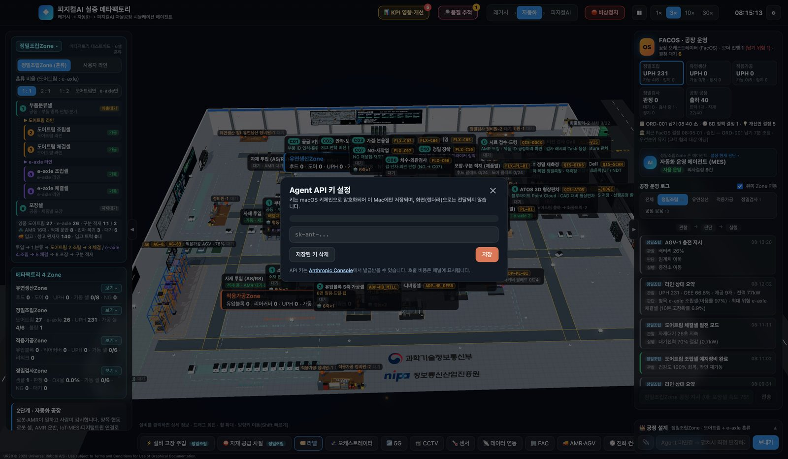

1. 상단 오른쪽 「⚙」 버튼을 누르거나 **⌘,**(맥) / **Ctrl+,**(윈도우)를 누름 (메뉴 Meta-Factory › 또는 파일 › 「Agent API 키 설정…」도 같음).
2. 「sk-ant-...」 칸에 Anthropic Console에서 발급한 키를 붙여 넣고 「저장」을 누름.
3. 「키 설정됨 — 대화 기반 Agent를 쓸 수 있습니다」가 표시되면 완료임.

- **(보관)** 키는 맥에서는 macOS 키체인, 윈도우에서는 윈도우 데이터 보호(DPAPI)로 암호화되어 이 컴퓨터에만 저장되고, 화면(렌더러)으로는 전달되지 않음. 지우려면 「저장된 키 삭제」를 누름. 저장 상태는 맥 「키 설정됨 (키체인에 저장)」, 윈도우 「키 설정됨 (PC에 암호화 저장)」으로 표시됨.
- **(키가 없을 때)** 「키가 없습니다 — 추론 기반 에이전트만 사용 가능」으로 표시됨. 시뮬레이션·운영 에이전트·내장 해석기는 모두 동작하고, 해석하지 못한 자연어 지시와 공정 설계의 자연어 요청·파일 분석만 쓸 수 없음.
- **(비용)** Agent 호출 비용은 오른쪽 패널 Agent 상태 줄(「Agent 해석 n회 · 약 $x.xxx」)과 공정 설계 도크(「설계 호출 비용 약 $x.xxx」)에 누적 표시됨.

### 1.6 웹 버전 · 공유 아티팩트 사용

설치 없이 브라우저로 여는 웹 버전은 두 가지가 있음. 화면·시뮬레이션·운영 시나리오(2~5장)는 앱과 같고, 서버가 필요한 기능만 화면 안에서 시뮬레이션으로 대신하거나 쓸 수 없음.

| 구분 | GitHub Pages 웹 버전 | claude.ai 공유 아티팩트 |
|---|---|---|
| 여는 곳 | https://theuniversepark.github.io/meta-factory/ | 소유자가 공유한 `https://claude.ai/artifact/…` 링크 |
| 로그인 | 필요 없음 | claude.ai 로그인 (공유 범위에 따라) |
| 대화 기반 Agent | ⚙에서 API 키 입력 시 | **키 없이 Claude 계정** 또는 ⚙에서 API 키 |
| 파일 내려받기(AAS·CSV·pcap·zip·영상) | ○ | × (브라우저 보안 정책으로 막힘) |
| 3D 모델 | glTF(.glb) | JSON glTF(.gltf.json) — 처음 불러올 때 조금 더 걸림 |
| MQTT·FAC API·센서 DB·RCA 서버 | 시뮬레이션으로 대체 | 시뮬레이션으로 대체 |
| 공정 설계 자연어 요청·파일 분석 | × (직접 편집) | × (직접 편집) |

**(1) 공유 아티팩트 열기**

1. 소유자에게 받은 claude.ai 링크를 엶. 링크가 「비공개」면 소유자가 페이지의 공유(Share) 메뉴에서 상대를 초대하거나 링크 공개를 켜야 열림.
2. 처음 열 때 3D 모델을 내려받는 동안 잠시 빈 공장이 보이다가 설비·로봇이 채워짐. 상단 부제에 「공유용 웹 보기 (전체 기능)」이 표시되며, 「전체 기능」을 누르면 GitHub 저장소로 이동함.
3. 이후 조작은 2~5장과 같음.

**(2) 대화 기반 Agent — Claude 계정으로 (공유 아티팩트, 키 없이)**

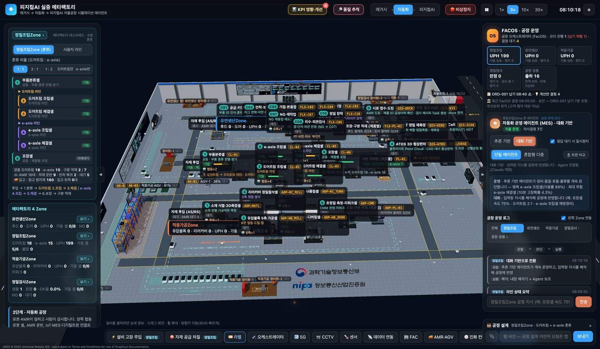

1. 오른쪽 패널의 「정밀조립Zone 존 에이전트 설정·현재 판단 ▾」을 펼쳐 엔진을 「대화 기반」으로 바꿈. 상태 줄에 「Agent 연결됨 (Claude 계정)」이 보이면 준비된 것임.
2. 입력창에 지시를 보냄. 내장 해석기가 아는 지시(5.3절 표)는 바로 처리되고, 모르는 문장(예: 「도어트림 품질 개선 아이디어를 제안해줘」)만 Claude에 보냄.
3. **처음 한 번** claude.ai가 이 페이지의 Claude 사용을 허용할지 묻는 창을 띄움 → 「허용」. 이후에는 묻지 않음.
4. Claude가 고른 조치는 지시 게이트(해석 → 대상 → 안전 → 실행 가능성 → 영향)를 거쳐 수행되거나 거절되며, 로그에 「Agent 판단」으로 남음.

- 사용량은 **보는 사람의 Claude 계정**에서 차감되며, 상태 줄 비용 칸에 「Claude 계정 사용량」으로 표시됨 (달러 금액 없음).
- 거절한 경우·조직 정책으로 막힌 경우에는 「이 페이지에 Claude 사용이 허용되지 않았습니다」가 뜨고 그 화면에서는 Claude 계정 방식이 꺼짐 → 페이지의 권한(Permissions) 메뉴에서 다시 허용하거나 아래 API 키 방식을 씀.
- Claude 계정이 없는 사람(로그인하지 않은 공개 링크 방문자 등)에게는 이 방식이 나타나지 않고 내장 해석기만 동작함.

**(3) 대화 기반 Agent — API 키로 (GitHub Pages · 공유 아티팩트)**

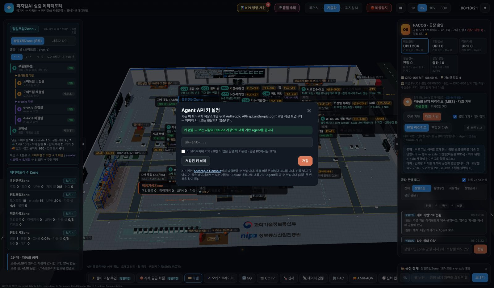

1. 상단 오른쪽 「⚙」(또는 ⌘, / Ctrl+,)를 누름.
2. 「sk-ant-...」 칸에 Anthropic API 키를 넣음 (sk-ant- 로 시작하지 않으면 거부됨).
3. 「이 브라우저에 기억」 — 켜면 브라우저를 닫아도 남고(localStorage), 끄면 **이 탭을 닫을 때 지워짐**(sessionStorage, 기본값). 공용 PC에서는 끈 채로 씀.
4. 「저장」 → 「키 설정됨 (이 브라우저) — 대화 기반 Agent가 Claude API를 직접 부릅니다」. 상태 줄에 「Agent 연결됨 (API 키 · 브라우저 직접 호출)」.

- 키는 이 브라우저 저장소에만 두고 **api.anthropic.com으로만 직접** 보냄 — 웹 페이지 서버나 공유 페이지 소유자에게는 전달되지 않음. 지우려면 「저장된 키 삭제」.
- 호출 비용은 키 소유자의 Anthropic 계정에 청구되며, 상태 줄에 「약 $x.xxx」로 누적 표시됨.
- 공유 아티팩트에서는 페이지의 네트워크 정책 때문에 직접 호출이 막힐 수 있음 → 「Claude API에 연결하지 못했습니다」가 뜨면 키를 삭제하고 (2) Claude 계정 방식을 씀.
- 키를 넣으면 공유 아티팩트에서도 Claude 계정보다 API 키 방식이 먼저 쓰임.

**(4) 웹 버전에서 쓸 수 없는 것**

- 공정 설계 도크의 자연어 요청·파일 첨부 분석 — 「웹 버전에서는 공정 설계 자연어 요청과 파일 분석을 지원하지 않습니다」 안내 후 직접 편집만 가능 (맥·윈도우 앱 또는 `npm start`에서 사용).
- MQTT 발행, FAC API, 별도 센서 서버·DB, RCA 서버 — 화면 안 시뮬레이션으로 대체되어 「시뮬레이션」으로 표시됨.
- 영상은 WebM으로만 저장되고, 공유 아티팩트에서는 모든 파일 내려받기가 막혀 있음.

---

## 2. 화면 구성

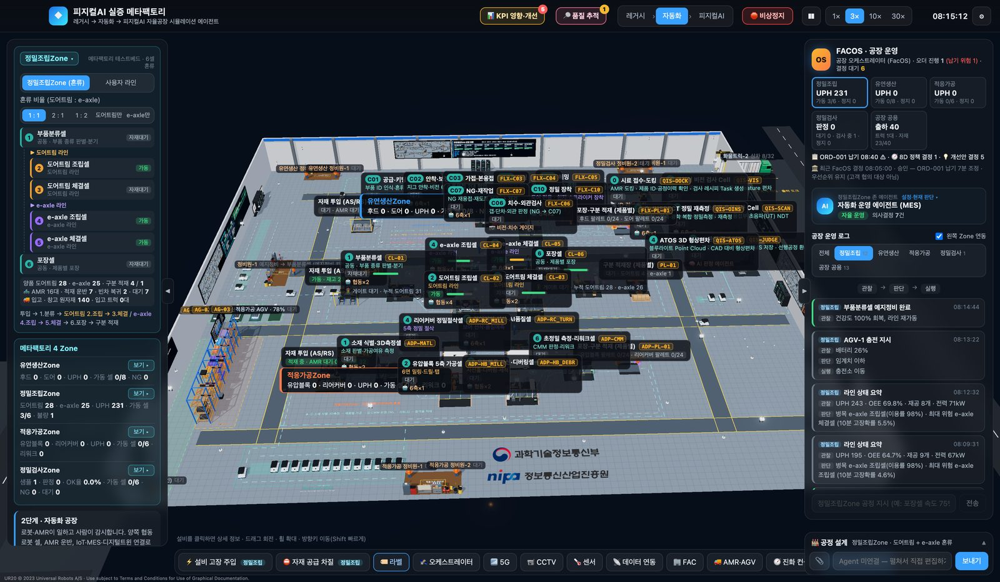

화면 전체에 3D 공장이 깔리고, 그 위에 상단 바·왼쪽 패널·오른쪽 패널·하단 바·공정 설계 도크가 겹쳐 있음.

### 2.1 상단 바

| 위치 | 요소 | 기능 |
|---|---|---|
| 왼쪽 | 제목 「피지컬AI 실증 메타팩토리」 | — |
| 가운데 | 「🧠 VLA 학습」「🏭 AIOS 학습」 | 로봇 학습·공장 운영 AI 파이프라인 창 (피지컬AI 단계에서만 보임, 5.13) |
| 가운데 | 「📊 KPI 영향·개선」 (숫자 배지) | 이벤트가 KPI에 준 영향과 개선 제안 (5.4) |
| 가운데 | 「🔎 품질 추적」 (숫자 배지) | 제품 계보·불량 원인 분석·8D (5.5) |
| 가운데 | 「레거시 › 자동화 › 피지컬AI」 | 운영 단계 전환 (3.3) |
| 가운데 | 「🛑 비상정지」 | 정밀조립Zone 전체 비상정지 / 발령 중에는 「🔄 비상정지 리셋」 (4.4) |
| 오른쪽 | 「❚❚」/「▶」 | 일시정지 / 재생 |
| 오른쪽 | 「1× 3× 10× 30×」 | 배속 (기본 3×) |
| 오른쪽 | 시계 (시작 08:00:00) | 공장 기준 시각. 날이 넘어가면 「D+n」이 붙음 |
| 오른쪽 | 「📘」 | 이 사용자 가이드를 PDF(`메타팩토리_사용자가이드.pdf`)로 내려받음 — 앱·브라우저·웹 버전은 바로 저장, 공유 아티팩트는 저장 확인 창이 뜸 |
| 오른쪽 | 「⚙」 | Agent API 키 설정 (맥·윈도우 앱에서만 보임) |

### 2.2 왼쪽 패널 — Zone 카드·KPI

| 요소 | 내용 |
|---|---|
| Zone 선택 드롭다운 | 「정밀조립Zone」「유연생산Zone」「적응가공Zone」「정밀검사Zone」. 고르면 카메라가 그 Zone으로 이동하고, 하단 주입 버튼·공정 설계·로그 필터의 대상도 함께 바뀜 |
| 라인 선택 (정밀조립) | 「정밀조립Zone (혼류)」 / 「사용자 라인」. 바꾸면 시뮬레이션이 다시 시작됨 |
| 혼류 비율 | 정밀조립 「1 : 1」「2 : 1」「1 : 2」「도어트림만」「e-axle만」(다시 시작됨) · 유연생산·적응가공은 다음 투입부터 적용 |
| 셀 목록 | 셀별 상태 칩. 누르면 설비 상세 창(정밀조립) 또는 카메라 이동(다른 Zone) |
| 「메타팩토리 4 Zone」 카드 | Zone별 UPH·가동 셀·NG 요약, 「보기 ▸」로 카메라 이동 |
| 단계 설명 | 「1단계 · 레거시 공장」 등 현재 단계 설명 |
| KPI 타일 | 「양품 생산」「시간당 생산」「설비종합효율 OEE」「불량 유출」「재공 WIP」「전력」「현장 인원」「고장」「자재 / 완제품」 |
| 개선 제안 줄 | 「💡 개선 제안 n건 — … · 적용하시겠습니까?」 → 누르면 KPI 영향 창 |
| 추이 차트 | 「시간당 생산량 (UPH, 최근 10분)」「OEE (누적, %)」. 마우스를 올리면 시각·값 표시 |

### 2.3 오른쪽 패널 — FACOS 공장 운영

| 요소 | 내용 |
|---|---|
| 「FACOS · 공장 운영」 머리말 | 진행 중 오더 수, 결정 대기 수. **누르면 존 요약 칩·존 에이전트 설정을 접고 펼침**(▾/▸) — 접으면 로그가 넓어지고, 상태는 다음 실행에도 유지 |
| 존 요약 칩 | 정밀조립·유연생산·적응가공·정밀검사·공장 공용의 UPH·가동 현황. 누르면 로그가 그 존만 보이게 걸러짐 |
| 「정밀조립Zone 존 에이전트 설정·현재 판단 ▾」 | 펼치면 엔진(「추론 기반」/「대화 기반」), 「응답 대기 시 일시정지」, 구조(「단일 에이전트」/「혼합형 다중」), 「🔬 트윈 비교」, 현재 판단 |
| 「공장 운영 로그」 | 「관찰 → 판단 → 실행」 형식의 에이전트 기록 (최근 80건). 필터 「전체·정밀조립·유연생산·적응가공·정밀검사·공장 공용」, 「왼쪽 Zone 연동」 체크 시 왼쪽에서 고른 Zone만 표시. **왼쪽에서 Zone을 고르거나(드롭다운·「보기 ▸」) 하면 로그도 그 존으로 바뀜** — 로그 탭을 손으로 눌러 연동이 꺼졌어도 다시 켜짐 |
| 지시 입력창 | 대화 기반일 때만 입력 가능 (5.3) |

### 2.4 하단 바

| 버튼 | 기능 |
|---|---|
| 「⚡ 설비 고장 주입」 | 선택 Zone의 임의 설비에 돌발 고장 (4.1) |
| 「⛔ 자재 공급 차질」 | 자재 창고 출고를 10분간 중단 (4.2) |
| 「⚠ 현장 이벤트」 | 누유·이물질·무단 진입·연기 의심 중 하나 발생 (피지컬AI 전용, 4.3) |
| 「🏷 라벨」 | 3D 설비·로봇 라벨 켜기/끄기 |
| 「🛰 오케스트레이터」 | 인시던트 처리 흐름·제어 흐름·명령 콘솔 (4.5) |
| 「📶 5G」「📹 CCTV」 | 무선 커버리지·CCTV 사각지대 지도 (5.9·5.10) |
| 「🌡 센서」「📡 데이터 연동」 | 센서망·표준 데이터 연동 (5.7·5.8) |
| 「🏢 FAC」「🚚 AMR·AGV」 | 업무 기록·이동 로봇 관제 (5.11·5.12) |
| 「🧭 진화 컨셉」「📊 3단계 8시간 비교」 | 단계별 비교 (5.6) |
| 「↺ 리셋」 | 현재 단계를 처음부터 다시 시작 |

※ 주입 버튼에는 대상 Zone 이름이 작게 붙고, 진행 중인 건이 있으면 버튼이 깜빡이며 「n건」「n분」「복구 중」이 표시됨.

### 2.5 공정 설계 도크

오른쪽 아래 「🏭 공정 설계」 제목줄을 누르면 펼쳐짐 (5.2).

---

## 3. 기본 조작

### 3.1 3D 화면 조작

| 동작 | 결과 |
|---|---|
| 마우스 왼쪽 드래그 | 시점 회전 |
| 휠 | 확대·축소 |
| 오른쪽 드래그 | 시점 이동 |
| 설비·셀 클릭 | 설비 상세 창 (5.1) |
| 로봇·AMR 클릭 | 로봇 정보 창 + 바닥에 선택 링 (5.1) |
| CCTV 카메라·전광판 클릭 | CCTV 영상 창 (5.9) |
| 5G 기지국 클릭 | 기지국 정보 창 (5.10) |
| 빈 곳 클릭 | 열린 정보 창이 닫히고, 누른 위치의 Zone으로 왼쪽 드롭다운이 바뀜 |

※ 드래그(5px 이상 움직임)는 클릭으로 인식하지 않음. 우클릭 메뉴는 없음.

### 3.2 키보드 단축키

| 키 | 기능 |
|---|---|
| `[` / `]` | 왼쪽 / 오른쪽 패널 숨기기·보이기 (화면 가장자리 「◀」「▶」 탭도 같음) |
| 방향키 | 화면 기준으로 시점 이동 (Shift와 함께 누르면 2.5배 빠름) |
| ⌘, (맥) · Ctrl+, (윈도우) | Agent API 키 설정 (맥·윈도우 앱) |

※ 입력창에 글을 쓰는 중이거나 ⌘·Ctrl·Alt를 누른 상태에서는 방향키·`[` `]`가 동작하지 않음.

### 3.3 운영 단계 전환

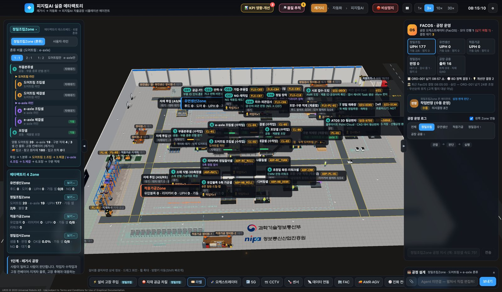

| 단계 | 의미 | 특징 |
|---|---|---|
| 레거시 | 작업자 중심·사후 보전 | 센서·데이터 수집이 없음 → FAC·5G·대화 기반 Agent 사용 불가, 건강도·RUL은 시뮬레이션 내부값으로만 표시 |
| 자동화 (기본) | 로봇·MES 기반 | 명령 전달 MES → PLC 약 0.6초 |
| 피지컬AI | 휴머노이드·AMMR·VLA·자율 에이전트 | 「⚠ 현장 이벤트」「🧠 VLA 학습」「🏭 AIOS 학습」, FACOS 계층 띠, CCTV AI 분석이 추가로 동작 |

- 단계를 바꾸면 그 단계로 시뮬레이션이 새로 시작됨.
- 같은 단계를 처음부터 다시 보려면 「↺ 리셋」을 누름.

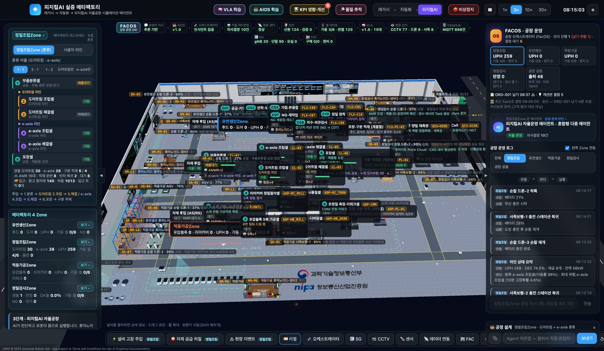

### 3.4 재생·배속·Zone 이동

- **(배속)** 「1×」「3×」「10×」「30×」 중 선택. 긴 시간 흐름을 볼 때는 10× 이상을 씀.
- **(일시정지)** 「❚❚」를 누르면 멈추고 「▶」로 재개함. 일시정지 중에도 창 열기·내려받기는 가능함.
- **(Zone 이동)** 왼쪽 드롭다운에서 Zone을 고르거나 「메타팩토리 4 Zone」 카드의 「보기 ▸」를 누르면 카메라가 이동함.

---

## 4. 운영 시나리오 실습

하단 주입 버튼은 **왼쪽 Zone 카드에서 고른 Zone** 을 대상으로 함. 먼저 대상 Zone을 고른 뒤 실행함.

### 4.1 설비 고장 주입

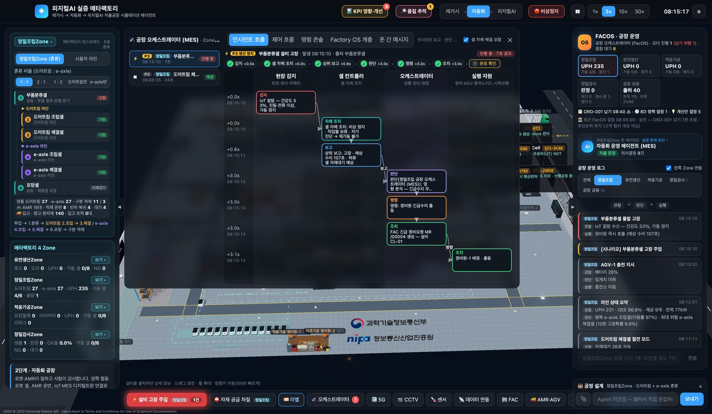

1. 「⚡ 설비 고장 주입」을 누름 → 선택 Zone의 셀 하나에 무작위 고장이 발생하고 오케스트레이터 창이 열림.
2. 「인시던트 흐름」 탭에서 감지 → 셀 자체 조치 → 상위 보고 → 판단 → 명령 → 조치 → 완료 확인 순서를 스윔레인(현장 감지·셀 컨트롤러·공장 오케스트레이터·실행 자원)으로 확인함.
3. 특정 설비를 고장 내려면 그 설비를 클릭해 설비 상세 창의 「⚡ 고장 주입」을 누름.

### 4.2 자재 공급 차질

- 「⛔ 자재 공급 차질」을 누르면 자재 창고 출고가 10분간 멈춤. 버튼에 남은 시간이 표시되고, 에이전트의 긴급 조달·투입 조정 판단이 로그에 남음.

### 4.3 현장 이벤트 (피지컬AI 단계)

- 「⚠ 현장 이벤트」를 누르면 바닥 누유·바닥 이물질·안전구역 무단 진입·연기 의심 중 하나가 로봇 카메라 앞에 발생함.
- 로봇 영상 AI가 감지하고 자율 대응(우회·대기·정비 출동)하는 과정은 오케스트레이터와 CCTV 이벤트 이력에서 확인함.

### 4.4 비상정지·리셋

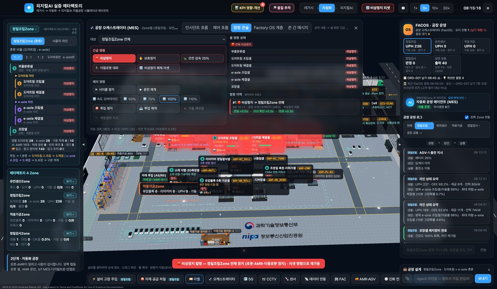

1. 상단 「🛑 비상정지」를 누름 → 정밀조립Zone 전체 로봇·AMR·이동로봇이 정지하고 배너 「🛑 비상정지 발령 — …」이 표시되며 명령 콘솔이 열림.
2. 재가동하려면 같은 버튼(「🔄 비상정지 리셋」)을 누름 → 「🔄 비상정지 해제 — 셀 자가진단 중」 후 운전이 재개됨.

### 4.5 오케스트레이터 창

「🛰 오케스트레이터」로 열며, 탭 5개로 구성됨.

| 탭 | 내용·조작 |
|---|---|
| 「인시던트 흐름」 | 인시던트 목록(P1~P5 우선순위), 처리 스윔레인, 「셀 자체 해결 포함」 체크 |
| 「제어 흐름」 | 「공정별 제어 흐름도」/「흐름 분석」 보기, STEP 바로가기, 「전체·제어·이벤트」 필터, 단계 지연 표 |
| 「명령 콘솔」 | 대상(「정밀조립Zone 전체」 또는 셀) 선택 후 명령 전송, 「셀 명령 상태」·「명령 이력」 |
| 「Factory OS 계층」 | 공장 → 존 → 존 에이전트 → 셀 OCS 트리, 오더·공장 결정 표, 「고정 운영 규칙 6종」 |
| 「존 간 메시지」 | A2A 메시지 목록, 「🔌 상위망 단절 시험」, 「🛡 가드레일 시험」, 「⬇ 메시지 기록 (.jsonl)」 |

명령 콘솔에서 보낼 수 있는 명령:

| 구분 | 명령 |
|---|---|
| 긴급 명령 | 🛑비상정지 · ✋보호정지 · 🐢안전 감속 25% · 🏃이동로봇 대피(전체만) · 🔄비상정지 해제·리셋 |
| 제어 명령 | ⏸사이클 정지 · ▶운전 재개 · ⏩속도 오버라이드 50/75/100/110% · ⛔투입 정지 · 📥투입 재개(전체만) · 🎯자율 재보정 · 🔧예방정비 지시(셀만) |

※ 명령 전달 경로·지연은 단계마다 다름 — 레거시 「무전·구두 지시 → 작업자 조작」 약 8초, 자동화 MES → PLC 약 0.6초, 피지컬AI OPC UA PubSub/TSN 약 0.2초.

---

## 5. 기능별 사용법

### 5.1 설비 상세 창 · 로봇 정보 창

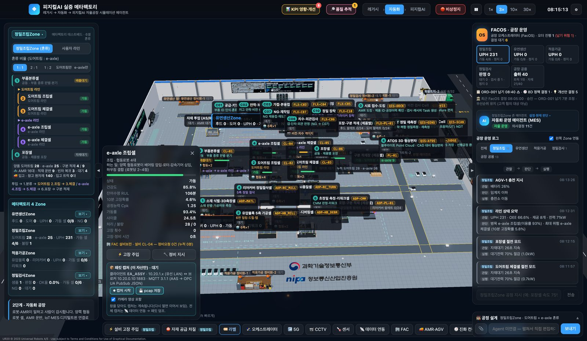

- **(여는 법)** 3D에서 설비를 클릭하거나 왼쪽 셀 목록을 누름.
- **(설비 상세)** 상태·건강도·잔여수명 RUL·10분 고장확률·공정능력 Cpk·가동률·사이클·처리/불량·고장 횟수·부품 재고·최근 순찰 점검 표시. 「⚡ 고장 주입」「🔧 정비 지시」 버튼.
- **(개별 패킷 캡처)** 「⏺ 캡처 시작」 → 「⏹ 캡처 중지」 → 「💾 pcap 저장」. 「카메라 영상 포함」을 체크하면 영상 메시지도 담김.

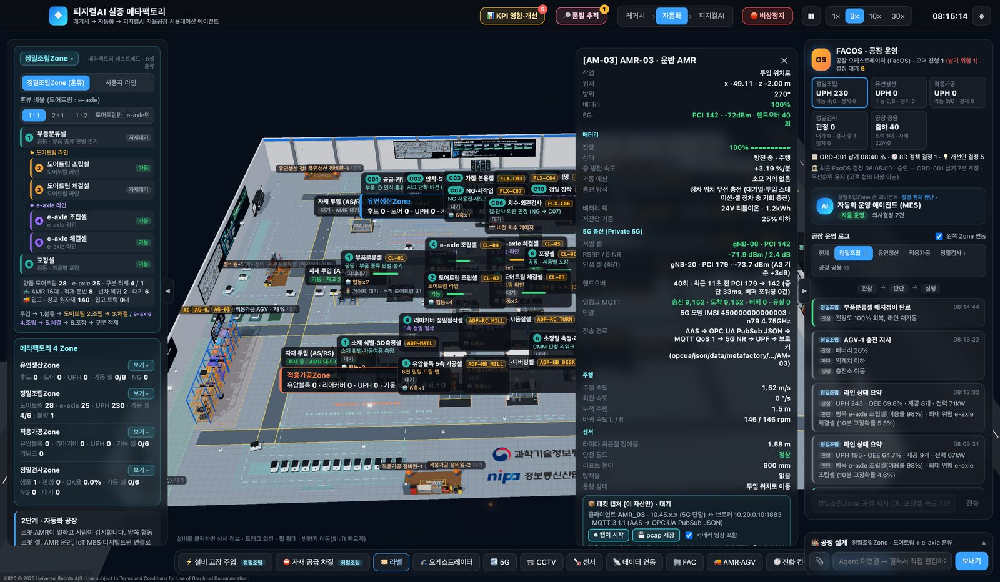

- **(로봇 정보)** 상태 표, 관절 표(위치·속도·토크·온도), 「관절 위치 추이」 차트, 센서 값. 피지컬AI 단계에서는 로봇 카메라 실시간 영상(휴머노이드·AMMR은 머리·왼손·오른손·등 탭)이 나옴.
- **(누적 데이터 저장)** 「💾 누적 데이터 저장 (AAS)」에서 형식(「AASX 패키지 (AAS Part 5, 권장)」·「AAS JSON」·「AAS XML」·「AAS RDF (Turtle)」)과 버전(v3.1/v3.0)을 고르고 「저장」.
- 로봇이 창에 가려지면 창이 반대쪽으로 자동 이동함. 창 바깥을 누르면 닫힘.

### 5.2 공정 설계

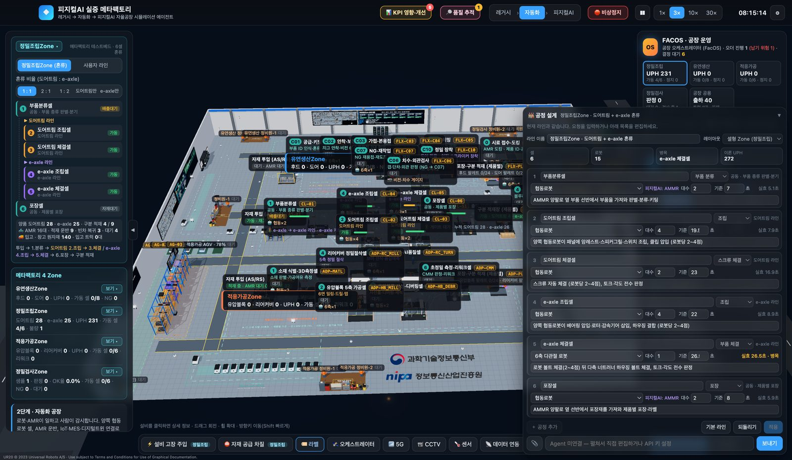

1. 오른쪽 아래 「🏭 공정 설계」를 눌러 펼침. 대상은 왼쪽에서 고른 Zone임.
2. 공정(셀) 카드에서 공정명·공정 유형·로봇 종류·대수·기준 사이클(초)·하는 일을 고침. 사용자 라인은 「↑」「↓」「✕」로 순서 변경·삭제, 「＋ 공정 추가」(최대 8공정)를 쓸 수 있음.
3. 아래 지표 비교(공정 수·로봇·병목·이론 UPH 변경 전 → 후)를 확인함.
4. 「적용 (n건)」을 누르면 3D 공장과 시뮬레이션이 새 라인으로 다시 시작됨. 「되돌리기」는 편집 취소, 「기본 라인」/「기본 레시피」는 초기값 복원.

- **(Agent로 설계)** 하단 입력줄에 요청을 쓰고 「보내기」. 「📎」 또는 끌어다 놓기로 공정도·레이아웃 파일(PDF·이미지·엑셀·워드·텍스트, 한 번에 10개, PDF 25MB 이하)을 첨부하면 「📄 파일에서 읽은 내용」을 반영한 초안이 나옴. 초안은 사람이 「적용」을 눌러야 반영됨.
- **(HWP)** 「한글(HWP) 파일은 직접 읽을 수 없습니다」가 뜨면 한글에서 PDF로 저장해 첨부함.
- **(Agent 미연결)** 직접 편집만 가능함. 맥·윈도우 앱에서는 「⚙ Agent API 키 설정 열기 (⌘,)」(윈도우는 Ctrl+,) 버튼이 함께 나옴.
- **(Zone 레시피)** 유연생산·적응가공·정밀검사 Zone은 셀 위치가 고정이라 셀 레시피(이름·하는 일·사이클·로봇)만 고침.
- 적용한 라인은 다음 실행에도 남음.

### 5.3 운영 에이전트와 대화 지시

- **(준비)** 오른쪽 패널의 「정밀조립Zone 존 에이전트 설정·현재 판단 ▾」을 펼쳐 엔진을 「대화 기반」으로 바꿈 → 아래 입력창이 열림 (레거시 단계는 사용 불가).
- **(Agent 연결)** 맥·윈도우 앱·`npm start`는 1.5절의 API 키, 웹 버전은 1.6절(API 키 또는 공유 아티팩트의 Claude 계정)로 연결함. 연결하지 않아도 내장 해석기는 동작함.
- **(입력)** 「정밀조립Zone 공정 지시 (예: 포장셀 속도 75%, 도어트림 2:1, e-axle 조립셀 예방정비)」 칸에 지시를 쓰고 「전송」. 쉼표·마침표·「그리고」로 여러 지시를 한 번에 줄 수 있음.
- **(판정)** 지시마다 해석 → 대상 확인 → 안전 규칙 → 실행 가능성 → 영향 평가 게이트를 거쳐 「✓ 반영」 또는 「✗ 미반영 · 원인 · 대안」으로 로그에 남음. 로그의 지시 게이트 항목을 누르면 판정 도식 창이 열림.
- **(응답 대기)** 「응답 대기 시 일시정지」가 켜져 있으면 Agent 응답을 기다리는 동안 시뮬레이션이 멈춤.
- **(구조 비교)** 「단일 에이전트」/「혼합형 다중」을 운전 중에 바꿀 수 있고, 「🔬 트윈 비교」에서 「▶ 1시간 × 3 비교」로 두 구조의 성과를 비교함.

내장 해석기가 알아듣는 지시 (API 키 없이 동작):

| 의도 | 예문 |
|---|---|
| 속도 조정 | 「포장셀 속도 75%」, 「e-axle 체결셀 빠르게」 (30~120%) |
| 혼류 비율 | 「도어트림 2:1로 생산」, 「e-axle만」, 「반반」 |
| 정비·보정 | 「e-axle 조립셀 예방정비」, 「도어트림 체결셀 재보정」 |
| 투입 | 「투입 정지」, 「투입 재개」, 「투입 간격 10초」 (5~20초) |
| 안전 | 「전체 보호정지」, 「보호정지 해제」, 「안전 감속」, 「감속 해제」, 「대피」, 「비상정지」, 「비상정지 리셋」 |
| 사이클 | 「포장셀 사이클 정지」, 「재개」 |
| 상태 질의 | 「부품분류셀 상태 어때?」, 「현황 알려줘」 |

※ 셀 별칭 — 부품분류(분류셀·소팅), 도어트림 조립, 도어트림 체결(스크류·나사), e-axle(이액슬) 조립, e-axle 체결, 포장. 대상이 필요한 지시에 셀이 없으면 「대상 셀을 지정하세요」로 안내함. 해석하지 못한 문장은 Claude가 연결되어 있을 때만 Agent가 해석함.

**유연생산 · 적응가공 · 정밀검사 Zone 지시**

- **(대상 Zone)** 문장에 Zone·제품 이름(유연생산·후드·도어 / 적응가공·유압블록·리어커버 / 정밀검사·ATOS·시료)이 있으면 그 Zone, 없으면 **왼쪽 패널에서 고른 Zone**에 적용함. 입력창 안내 문구도 고른 Zone에 맞게 바뀜.
- **(판정·보고)** 정밀조립Zone과 같은 게이트(해석 → 대상 확인 → 안전 규칙 → 실행 가능성 → 영향 평가)를 거쳐 「✓ 반영」 또는 「✗ 미반영 · 원인 · 대안」으로 그 Zone 로그에 남음 (「왼쪽 Zone 연동」으로 걸러 봐도 보임).
- **(AI 해석)** 내장 해석기로 알 수 없는 문장은 Agent(Claude)가 그 Zone의 셀·상태·제어 상태를 보고 해석해 같은 게이트로 반영함. 반영할 수 없으면 Agent가 판단한 원인을 「미반영」으로 보고함. Agent가 연결되어 있지 않으면 「AI(Agent) 미연결이라 해석 보조 불가」로 보고함.

| 의도 | 예문 | 비고 |
|---|---|---|
| 상태 질의 | 「유연생산 상태 어때?」, 「헤밍셀 상태」 | UPH · 양품 · 가동 셀 · 고장 · 혼류 · 제어 상태 |
| 정지·재개 | 「용접셀 정지」, 「용접셀 재개」, 「유연생산 정지」, 「유연생산 재개」 | 셀 하나 또는 Zone 전체 (공장 비상·보호정지 중에는 재개 불가) |
| 속도 | 「유연생산 속도 80%」, 「적응가공 빠르게」 | Zone 전체만 (30~120%, 셀 작업·AMR 이동) — 셀 하나의 속도는 미반영 |
| 투입 | 「유연생산 투입 정지」, 「투입 재개」 | 정밀검사Zone은 투입 단계가 없어 미반영 |
| 예방정비 | 「헤밍셀 예방정비」, 「유압블록 5축 가공셀 예방정비」 | 고장·정비 중이거나 이미 요청된 셀은 미반영 |
| 혼류 비율 | 「후드 2:1로 생산」, 「도어만」, 「유압블록만 생산」 | 유연생산 · 적응가공 (다음 투입부터) |

※ 셀은 셀 코드(C03 · HB_MILL · ATOS), 번호(「3번 셀」), 이름(「가접·본용접」), 하는 일 낱말(용접 · 실링 · 헤밍 · 장착 · 디버링 · 선삭 …)로 찾음. 운영자 정지·속도·투입 정지는 운영 단계를 바꾸면 처음으로 돌아감.

### 5.4 KPI 영향·개선

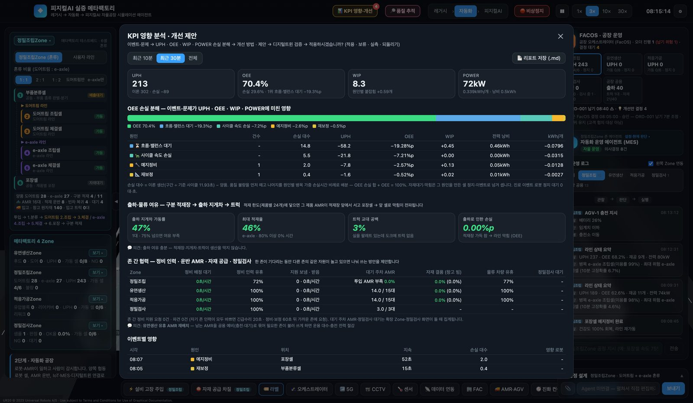

1. 상단 「📊 KPI 영향·개선」 또는 왼쪽 「💡 개선 제안」 줄을 누름.
2. 기간(「최근 10분」「최근 30분」「전체」)을 고르고 UPH·OEE·WIP·POWER 타일과 「OEE 손실 분해」를 확인함.
3. 「개선 방법 · 제안」 카드에서 근거·기대 효과·부작용을 읽고 「🧪 트윈 검증」을 누름 → 같은 조건 디지털트윈 결과가 「적용 권장」/「효과 미미」/「보류 권장」으로 나옴.
4. 「✅ 적용」 또는 「⏸ 보류」를 고름. 적용 후 실측 효과가 표시되고, 필요하면 「↩ 되돌리기」.
5. 「📄 리포트 저장 (.md)」으로 분석 리포트를 내려받음.

### 5.5 품질 추적·불량 원인 분석·8D

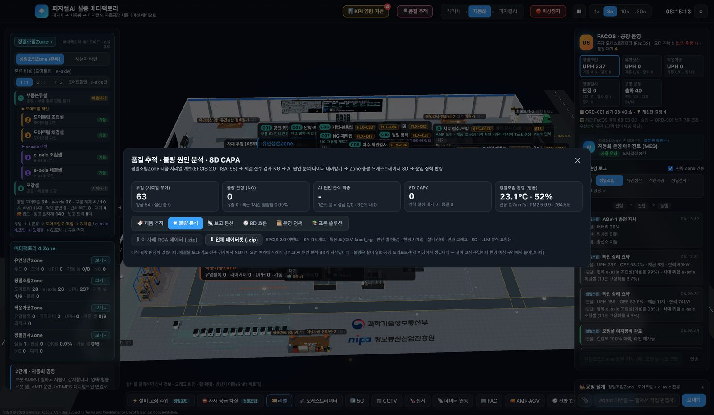

| 탭 | 사용법 |
|---|---|
| 「🔖 제품 추적」 | 「시리얼 · EPC · AMR · 로트 검색 (예: DT-, AM-03)」으로 제품을 찾아 공정 단계·파라미터·환경 계보 확인 |
| 「✖ 불량 분석」 (기본) | 사례별 AI 원인 순위·5 Why·봉쇄 범위. 「⬇ 이 사례 RCA 데이터 (.zip)」「⬇ 전체 데이터셋 (.zip)」 |
| 「📡 보고·통신」 | 검사셀 → 메인 서버 → RCA 서버 메시지 흐름. 「⬇ 이 사례 통신 (.pcap)」「⬇ 전체 품질 통신 (.pcap)」「⬇ 이 사례 리포트·RCA 결과 (.json)」, 연결 상태 「실서버 연결」/「시뮬레이션」 |
| 「🧭 8D 흐름」 | D0~D8 진행. 「자동 반영」 체크 시 대책 자동 승인, 아니면 「✔ 정책 반영」/「보류」 직접 선택 |
| 「📜 운영 정책」 | 현재 정책·이력, 행마다 「되돌리기」 |
| 「📚 표준·솔루션」 | 적용 표준·외부 솔루션 안내 |

### 5.6 3단계 8시간 비교 · 진화 컨셉

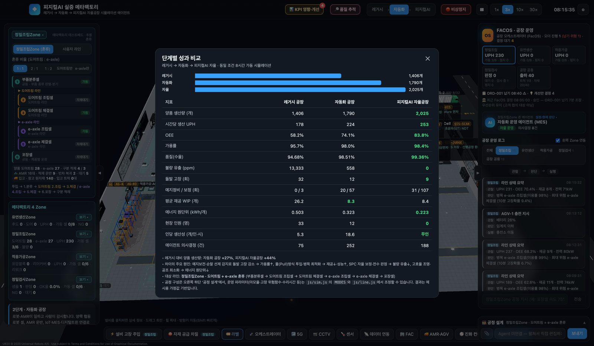

- 「📊 3단계 8시간 비교」를 누르면 같은 라인·같은 조건으로 레거시·자동화·피지컬AI를 8시간씩 계산해 막대그래프와 지표 13종 표(최적값 강조, 레거시 대비 증가율)를 보여 줌. 처음에는 「계산 중…」이 표시되며 수십 초가 걸림.

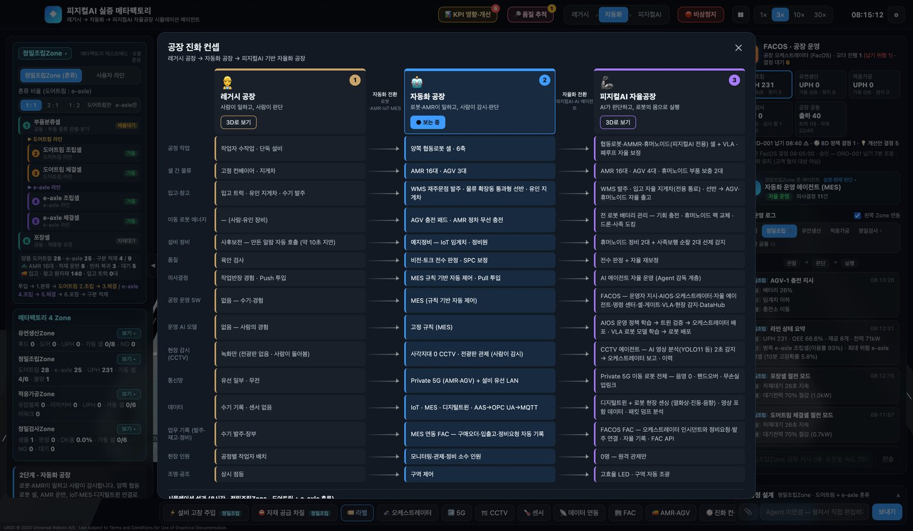

- 「🧭 진화 컨셉」은 세 단계 공장의 차이를 15개 항목으로 비교함. 열마다 「3D로 보기」를 누르면 그 단계로 전환됨.

### 5.7 데이터 연동

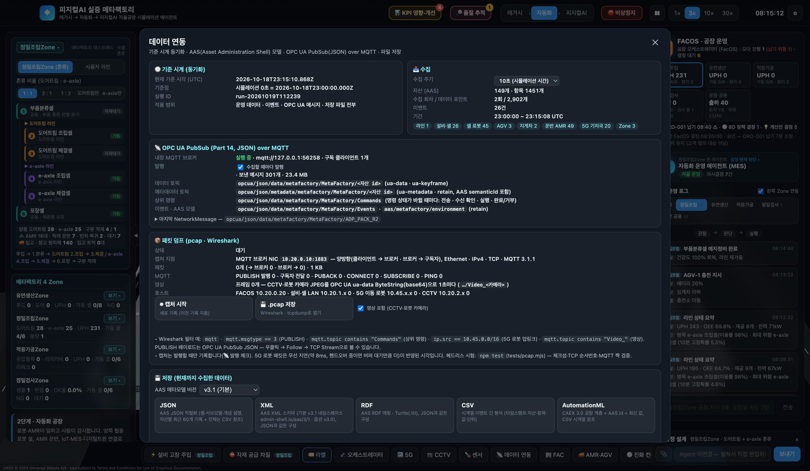

| 영역 | 사용법 |
|---|---|
| 「🕒 기준 시계 (동기화)」 | 모든 데이터·메시지가 쓰는 기준 시각(UTC)·실행 ID 확인 |
| 「📥 수집」 | 「수집 주기」 1/5/10/30초 선택, 자산·이벤트 수 확인 |
| 「📡 OPC UA PubSub … over MQTT」 | 내장 브로커 상태, 「수집할 때마다 발행」 체크, 토픽 목록. 외부 PC에서 MQTT Explorer로 `opcua/json/#` 구독 가능 |
| 「📦 패킷 덤프 (pcap · Wireshark)」 | 「⏺ 캡처 시작」→「⏹ 캡처 중지」→「💾 .pcap 저장」 (200MB에서 자동 중지), 「영상 포함」 체크 |
| 「💾 저장」 | AAS 메타모델 버전(v3.1 기본/v3.0) 선택 후 「JSON」「XML」「RDF」「CSV」「AutomationML(.aml)」 |

※ 「아직 수집된 데이터가 없습니다」가 뜨면 시뮬레이션을 잠시 돌린 뒤 저장함. 웹 버전은 MQTT 발행만 안 되고 수집·저장은 됨.

### 5.8 센서망

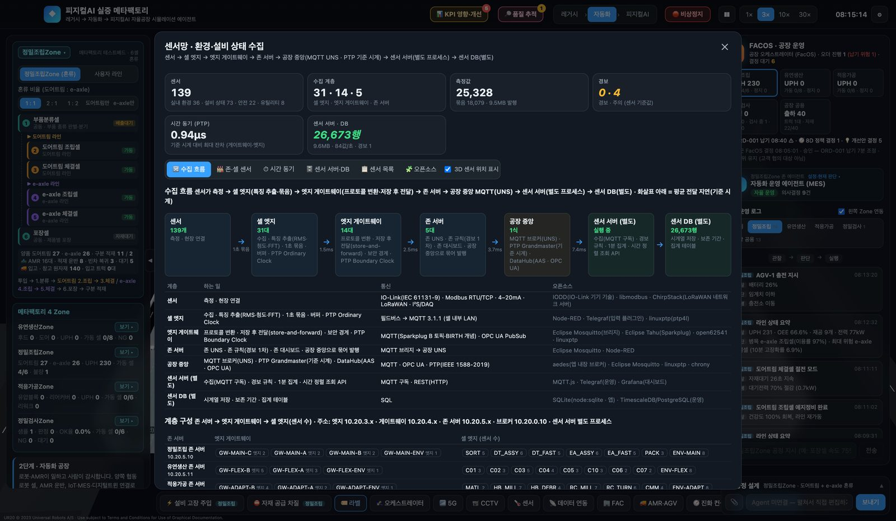

- 「🌡 센서」로 열며 탭 「🔀 수집 흐름」「🏭 존·셀 센서」「⏱ 시간 동기」「🗄 센서 서버·DB」「📋 센서 목록」「🧩 오픈소스」로 구성됨.
- 「3D 센서 위치 표시」를 켜면 셀 위에 센서 표지가 생기고 정상 초록·주의 노랑·경보 빨강으로 칠해짐.
- 「🗄 센서 서버·DB」 탭의 「CSV 내보내기」로 센서 DB 값을 내려받음. 서버가 없는 환경에서는 「시뮬레이션」으로 표시됨.

### 5.9 CCTV

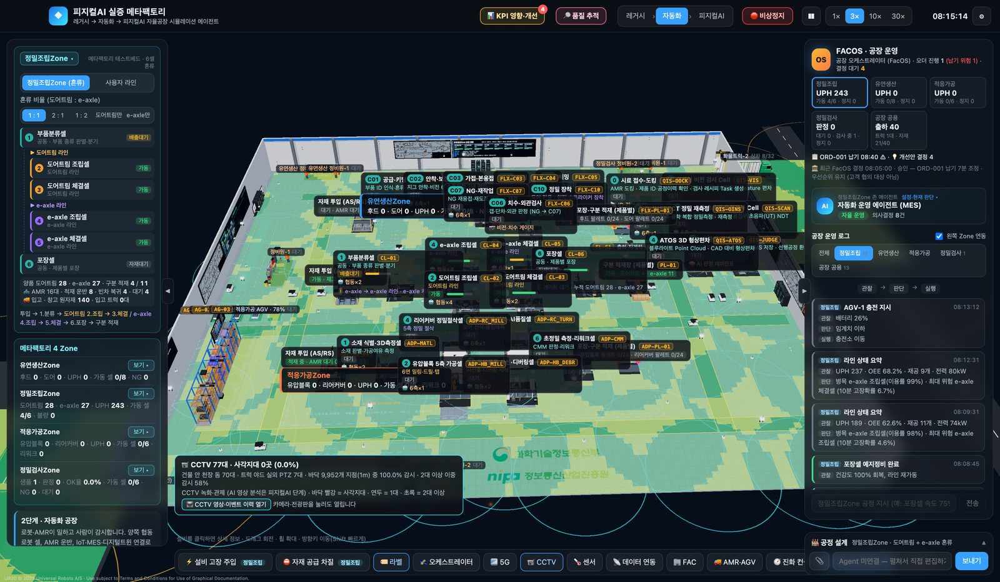

- 「📹 CCTV」를 누르면 바닥에 커버리지 지도(빨강 사각지대 · 연두 1대 · 초록 2대 이상)와 「📹 CCTV n대 · 사각지대 n곳」 카드가 나옴. 5G 지도와 동시에 켜지지 않음.

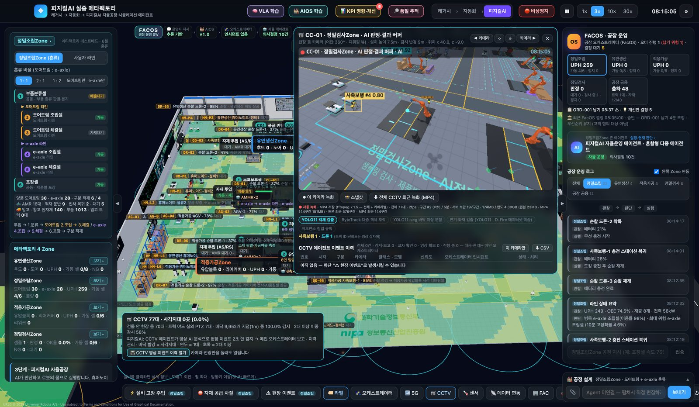

- 「📺 CCTV 영상·이벤트 이력 열기」 또는 3D의 카메라·전광판을 누르면 영상 창이 열림.
- 「◀ 카메라」「카메라 ▶」로 전환, 「⟲」「⟳」로 PTZ 회전.
- 「⏺ 이 카메라 녹화」 → 「⏹ 녹화 정지·저장」 (ffmpeg가 있으면 MP4, 없으면 WebM), 「📸 스냅샷」(JPEG), 「⬇ 전체 CCTV 최근 녹화 (MP4)」.
- 「CCTV 에이전트 이벤트 이력」 표는 「이 카메라만」으로 거르고 「⬇ CSV」로 내려받음. 피지컬AI 단계에서는 AI 모델 검출 결과가 영상 위에 표시됨.

### 5.10 Private 5G

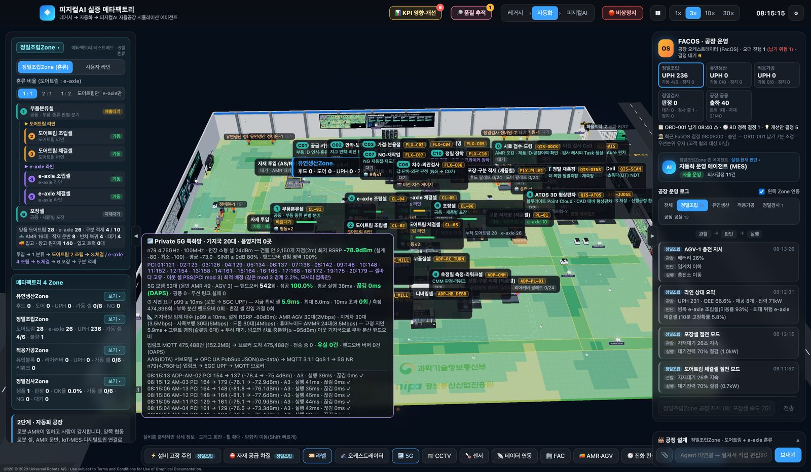

- 「📶 5G」를 누르면 RSRP 커버리지 지도와 기지국·PCI·핸드오버·지연(p99 ≤ 10ms)·최근 핸드오버 로그 카드가 나옴.
- 3D에서 기지국을 누르면 「식별 · 무선 사양」「서비스 영역」「이웃 셀」「지연 · 용량」「접속 단말」「업링크 · 핸드오버」 정보 창이 열림 (1초마다 갱신).
- 레거시 단계에는 5G 특화망이 없음.

### 5.11 AMR·AGV 관제

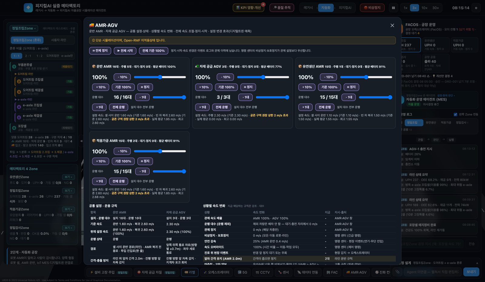

- 「⏸ 전체 정지」「▶ 전체 시작」「전체 기준 100%」로 모든 차량을 한 번에 조작함.
- 차량군(운반 AMR · 자재 공급 AGV · 유연생산 AMR · 적응가공 AMR)별로 속도(「－10%」·슬라이더 50~150%·「＋10%」)와 운행 대수(「－1대」·슬라이더·「＋1대」)를 바꿈.
- 「🔬 디지털트윈 예측」은 현재 설정과 기준 100% 운행을 15분 비교하고, 「📊 운행 대수별 비교」는 적정 대수를 표시함.
- ※ 단순 시뮬레이션이며 Open-RMF는 적용되어 있지 않음.

### 5.12 FAC 업무 기록

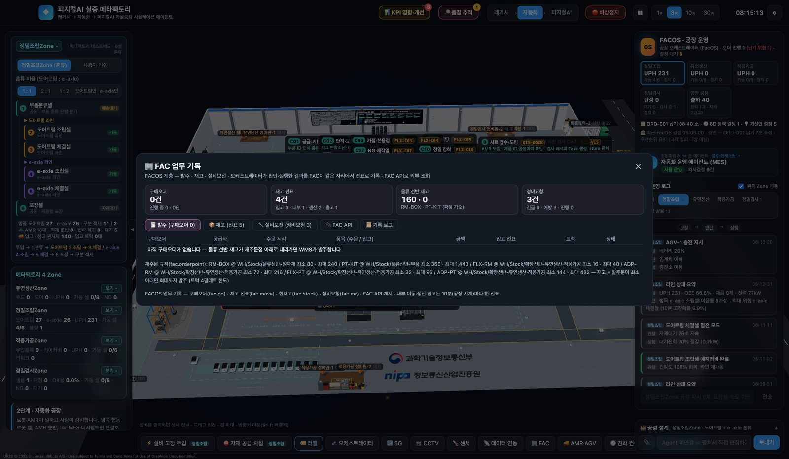

- 탭 「🧾 발주」「📦 재고」「🔧 설비보전」「🔌 FAC API」「📜 기록 로그」로 구매오더·재고 전표·정비요청을 확인함.
- 「🔌 FAC API」 탭에 조회 API 목록과 curl 예시가 있음 (웹 버전에서는 서버가 없어 사용 불가). 레거시 단계에는 FAC 기록이 없음.

### 5.13 VLA 학습 · AIOS 학습 (피지컬AI 단계)

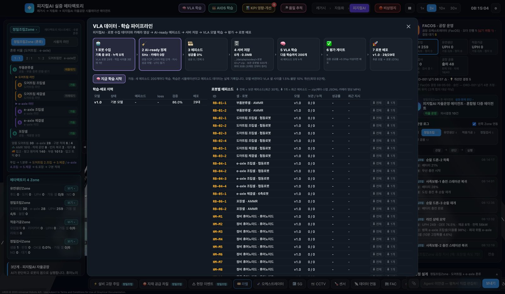

- **(VLA)** 로봇 수집 → AI-ready 정제 → 에피소드 → 서버 저장 → VLA 학습 → 평가 게이트 → 로봇 배포 7단계를 보여 줌. 새 에피소드가 5개 이상이면 「🧠 지금 학습 시작」을 쓸 수 있음. 「로봇별 에피소드」 표에서 「⬇ 전체」「⬇ 1개」로 zip을 내려받음.

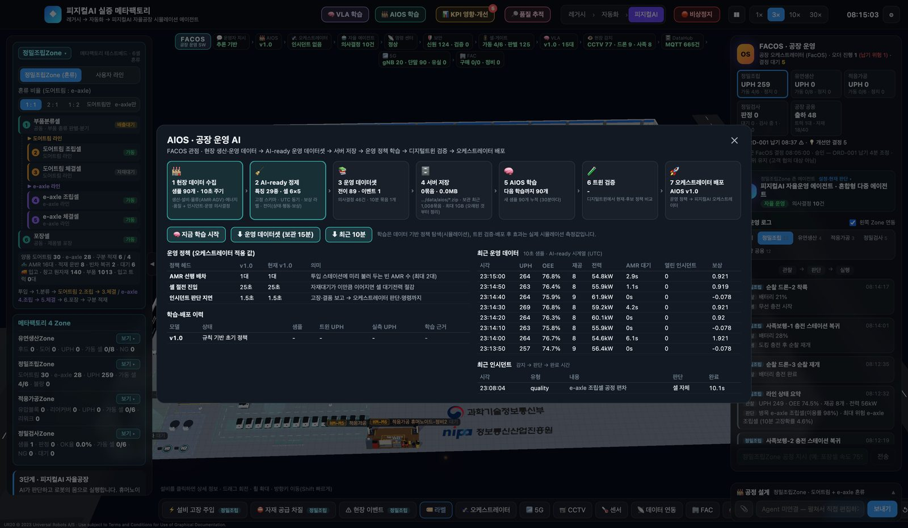

- **(AIOS)** 운영 데이터 수집 → 데이터셋 → 정책 학습 → 디지털트윈 검증 → 오케스트레이터 배포 흐름. 「🧠 지금 학습 시작」, 「⬇ 운영 데이터셋」「⬇ 최근 10분」.

### 5.14 FACOS 계층 띠·보안 (피지컬AI 단계)

- 피지컬AI 단계에서 상단에 나타나는 띠는 「운영자 지시 › AIOS › 오케스트레이터 › 자율 에이전트 › 명령 센터 › 보안 › 셀·게이트 › VLA › 현장 감지 › DataHub › 5G › FAC」 순서의 상태 칸임. 칸을 누르면 해당 창이 열리고, 맨 앞 「FACOS 공장 운영 SW」 칸은 띠를 접고 폄.
- 보안 칸의 「🛡 피지컬AI 다중 계층 보안」에서 위협(「위조 제어 명령」「권한 밖 명령」「학습 데이터 위변조」「노하우 무단 반출」)을 주입하고 처리 흐름을 확인함.

### 5.15 물류존 미니로드 AS/RS

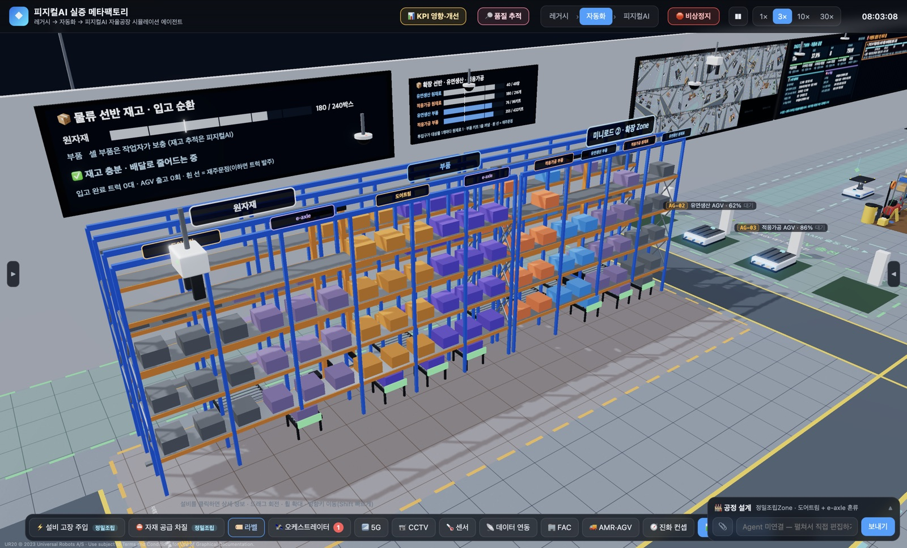

- 물류존 선반은 **미니로드 AS/RS**(SSI Miniload형 자동창고)임. 두 줄 선반(서쪽 A열 · 동쪽 B열) 사이 통로를 **스태커 크레인**이 오가며 토트를 옮기고, 저장은 **4단**임.
- 구간은 2개이고 크레인이 1대씩 맡음.

| 구간 | 보관 품목 | 칸 수 | 출고 자리 (동쪽 면) |
|---|---|---|---|
| 미니로드 ① (남쪽, 길이 10.2m) | 정밀조립 원자재(도어트림 · e-axle) · 부품(도어트림 · e-axle) | 12베이 × 2줄 × 4단 = 96칸 | 원자재 AGV 1자리 · 부품 피킹 3자리 |
| 미니로드 ② (북쪽, 길이 7.2m) | 유연생산 · 적응가공 원재료 · 부품 | 8베이 × 2줄 × 4단 = 64칸 | 원재료 AGV 2자리 · 부품 키트 피킹 1자리 |

- **입고**: 입고 지게차가 서쪽 면 바닥의 **입고 팔레트 받침**에 팔레트를 내려놓으면, 크레인이 토트 4개를 하나씩 빈 칸에 넣음.
- **출고 · AGV 자동 적재**: 크레인이 칸에서 토트를 꺼내 동쪽 면 바닥의 **출고 이재 컨베이어** 끝(초록 스토퍼)에 미리 대 둠. AGV가 상차 자리에 서면 **신축 롤러**가 선반 면 밖으로 뻗고 토트가 롤러를 타고 AGV 위로 넘어감 — **AGV 상차 2초**(유인 지게차·휴머노이드 피킹은 4초). AGV가 떠나면 롤러는 선반 안으로 접힘.
- **휴머노이드 피킹**: 부품·키트 피킹 자리의 컨베이어는 선반 면에서 끝남. 휴머노이드는 선반을 보고 서서 손을 뻗어 토트를 몸 앞까지 들어 올림.

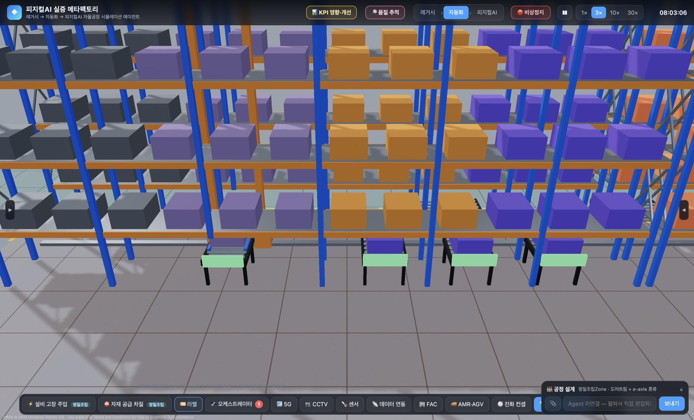

- **재고 표시**: 칸의 토트는 재고만큼 아래 단부터 참. 색으로 품목을 구분함 — 회색 도어트림 원자재 · 연보라 e-axle 원자재 · 주황 도어트림 부품 · 보라 e-axle 부품, 확장 Zone은 은색 유연생산 원재료 · 연보라 적응가공 원재료 · 파랑/주황 Zone 부품.
- **현황판**: 물류 선반 재고 현황판과 확장 선반 재고 현황판은 선반 뒤 왼쪽 벽에 나란히 걸려 있음. 열 표지·「원자재/부품」 표지는 선반 위 동쪽 면에 고정되어 화면을 돌려도 선반과 같이 돎.
- **자세히 보기**: 마우스로 화면을 물류존(왼쪽 확장동) 동쪽 면 앞으로 옮겨 컨베이어·크레인을 확대함. 크레인 통로는 북쪽 또는 남쪽 끝 위에서 내려다보면 잘 보임. 일시정지하면 크레인도 멈추고, 빠른 배속에서는 8배까지 따라감.

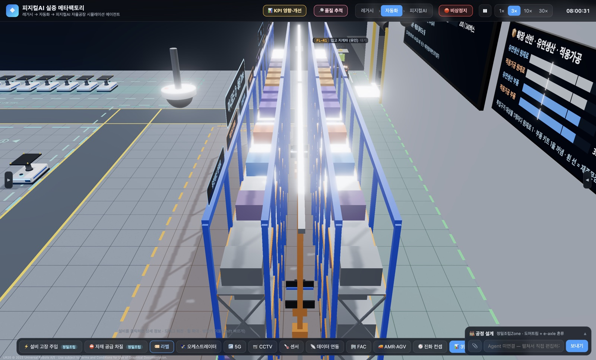

- ※ 「⛔ 자재 공급 차질」 중에는 선반 위에 「출고 중단」 표지가 깜빡이고, AGV는 출고 자리에서 출고 재개를 기다림 (4.2).

### 5.16 유연생산Zone 셀 작업

- 유연생산Zone(후드 · 도어 혼류)의 셀 로봇은 공정마다 전용 엔드이펙터를 달고, AMR 위 패널에 실제로 닿아 작업함. 자동화 · 피지컬AI 단계 모두 같음 (레거시는 작업자 수작업).
- 셀 순서: C01 키팅 → C02 안착·보정 → C03 용접 → C04 실링 → C05 헤밍 → (도어만) C10 정밀 장착 → C06 검사 → (NG) C07 재작업.

| 셀 | 엔드이펙터 | 하는 일 |
|---|---|---|
| C01 공급·키팅 | 그리퍼 | 점마다 옆 키트 빈에서 브래킷을 **1개씩** 집어 패널에 내려놓음 |
| C02 안착·보정 | 그리퍼 | 비뚤게 들어온 패널(1~2cm · 1° 남짓)을 비전 포털이 훑어 편차를 잰 뒤, 로봇이 가장자리를 잡고 1.5cm 들어 기준 자리로 옮겨 내려놓음 |
| C03 가접·본용접 | 서보 C형 스폿용접 건 | 판 밑이 비어 있는 가장자리(후드는 로봇 쪽 짧은 끝, 도어는 긴 가장자리 — 그 밖은 지그가 받침)에 점을 둠. 건을 세워 가장자리 바깥에서 판 높이로 벌린 채 밀어 넣고, 아래 전극이 판 아랫면에 닿게 닫아 위·아래 전극으로 판을 누름. **누르는 동안만 전극 접점에서 불꽃·섬광**이 나고, 점마다 용접 자국이 남음. 두 로봇이 후드의 같은 끝을 용접할 때는 앞·뒤 절반씩 차례로 |
| C04 실링 | 실러 디스펜싱 건 + 호스 | 로봇 뒤 디스펜서(드럼 펌프 · 계량 유닛)에서 팔을 따라 호스가 건까지 이어짐. 노즐이 판에 붙어 지나간 자리에 **실러 비드**가 그어짐 (불꽃 없음) |
| C05 헤밍 | 진공 그리퍼 (흡착컵 4개) | AMR 위 패널을 흡착해 들어 반 바퀴 돌려 **헤밍 프레스에 넣고**, 로봇이 물러난 뒤 램이 내려와 헤밍 → 다시 꺼내 **AMR에 원래 방향대로** 올림 |
| C10 정밀 장착 (도어) | 그리퍼 + 너트러너 | 점마다 뒤쪽 트레이에서 힌지를 1개씩 집어 도어에 놓고 그 자리에서 볼트를 조임 |

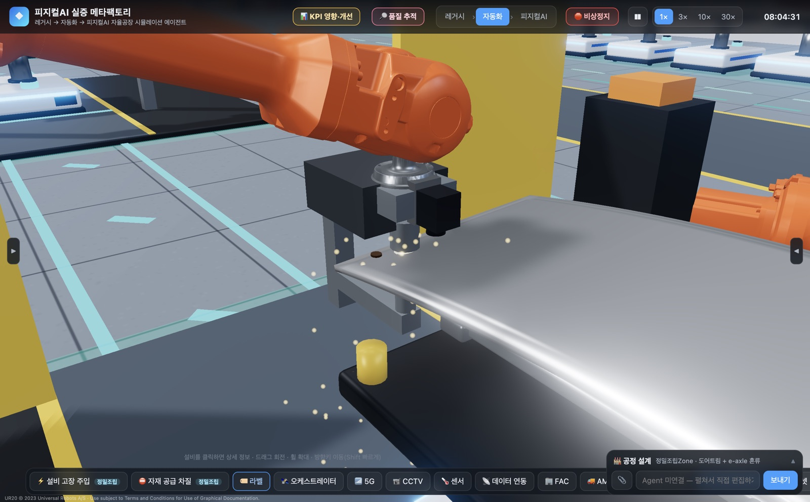

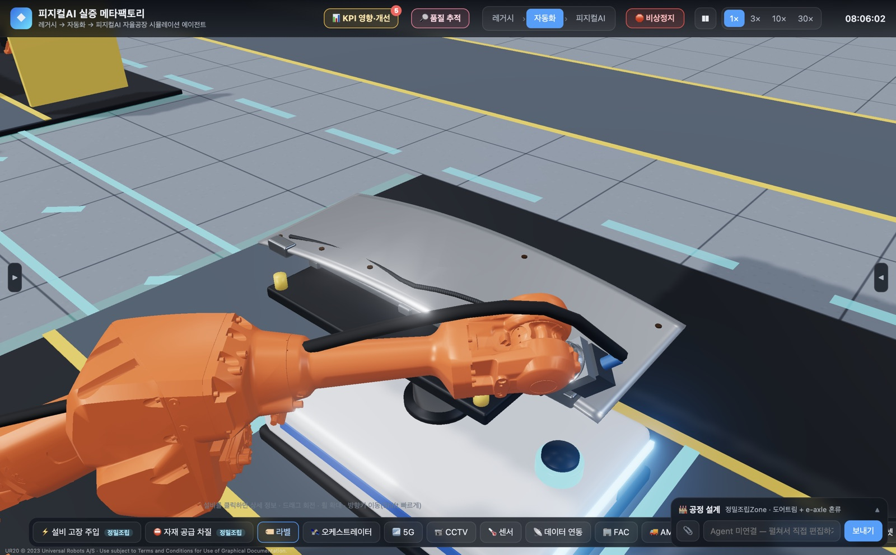

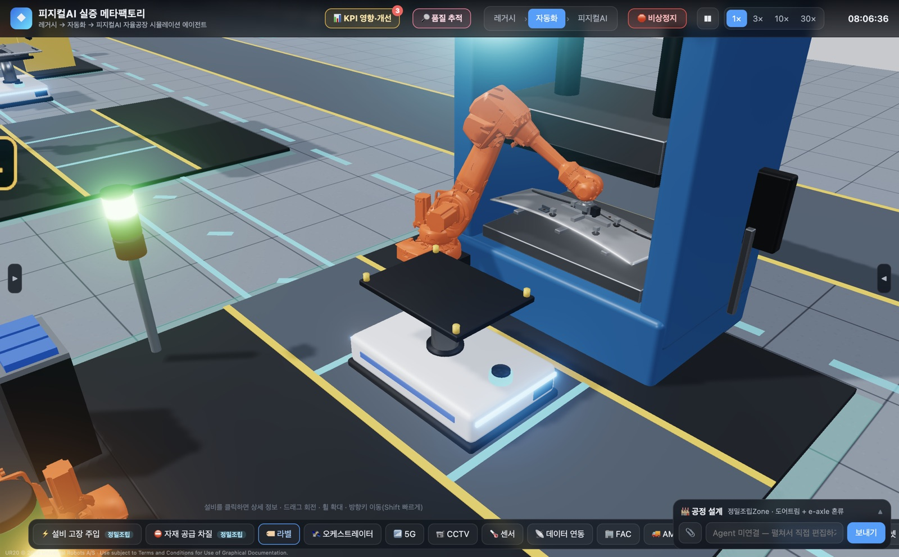

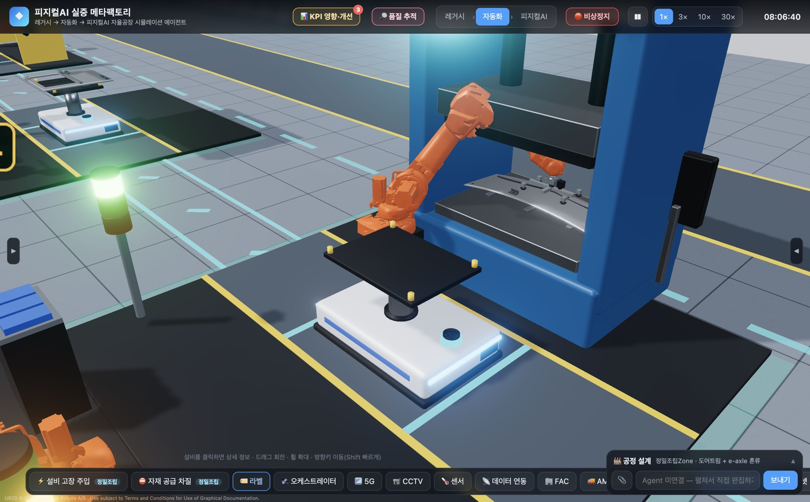

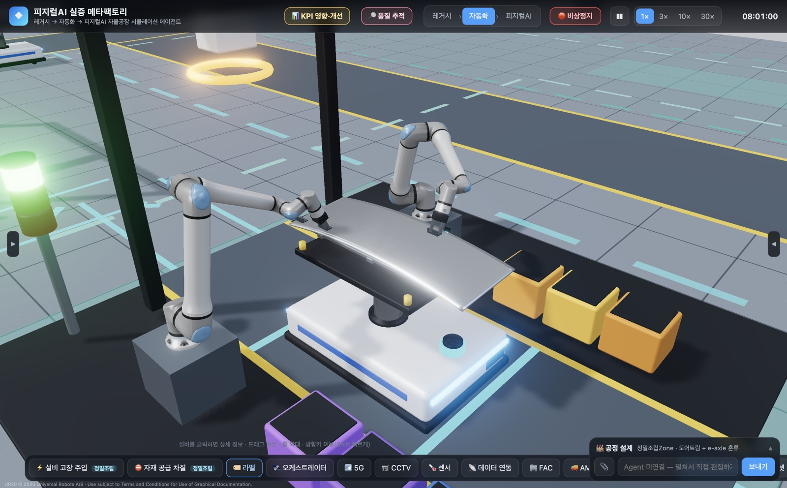

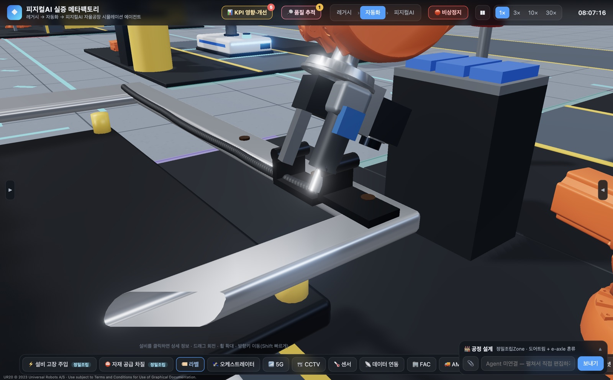

- **헤밍 셀 배치**: 로봇은 AMR 정차 자리와 프레스 사이 통로 쪽 **받침대(0.45m) 위**, 패널 끝 바깥에 섬. 패널을 넣고 뺄 때 램이 0.5m 더 열림.
- **사이클**: 셀 사이클은 **로봇 1대 기준 레시피**이고, 실제 사이클은 「레시피 × 로봇 종류 배율 ÷ (1 + 0.7 × (대수 − 1))」로 줄어듦 (예: C03 용접 109초 · 로봇 2대 → 64.1초). 공정 설계 도크(2.5 · 5.2)의 예상 UPH도 같은 식으로 계산함.
- **자세히 보기**: 마우스로 화면을 유연생산Zone 셀 앞으로 옮겨 로봇 손끝을 확대함. 1× 배속에서 용접 불꽃 · 실러 비드 · 헤밍 넣고 빼기가 잘 보임.
- ※ 작은 부품(브래킷 · 힌지)은 멀리서는 잘 보이지 않음 — 셀 가까이 확대해서 봄.


### 5.17 적응가공Zone 셀 작업

| 셀 | 엔드이펙터 | 하는 일 |
|---|---|---|
| 소재 식별·3D측정 | 3D 스캐너 (스테레오 카메라 + 청색 패턴 프로젝터) | 소재 윗면 16cm 위를 지나며 청색 스캔 빛으로 형상을 잼 (닿지 않음) |
| 유압블록 5축 가공 · 리어커버 정밀절삭 · 리어커버 선삭 | 그리퍼 (머신텐딩) | 문이 열리면 AMR 지그에서 **소재만** 집어 기계 테이블·척에 넣음 → 문 닫고 가공 (지그 판·클램프는 AMR에 남음) → 문 열리면 꺼내 지그에 다시 올림 |
| 유압블록 사선·디버링 | 고속 스핀들 + 버 | 툴을 세워 소재 가장자리를 따라가며 버가 돌고 칩이 튐 |
| 초정밀 측정·리워크 | 에어 블로 노즐 | 측정 전 소재 윗면을 따라 에어를 불어 이물을 날림 (흰 물안개) → CMM 탐침 측정 |


### 5.18 적응가공 가공기 상태 감시 · 예지보전

- 적응가공Zone 가공기 4대(유압블록 5축 가공 · 리어커버 정밀절삭 · 리어커버 선삭 · 유압블록 사선·디버링)에 **상태 감시 장비**가 붙어 있음 — 공구 검사 카메라(링 조명) · 주축 머리의 3축 가속도계·AE 센서·베어링 온도 센서(금색) · 절삭유 유량계 · 레이저 공구 측정기 · 엣지 AI 박스(옆면, 청록 LED).
- **가공기를 누르면** 정보 창이 로봇 창처럼 넓게 열려 왼쪽에 셀 정보, 오른쪽에 「📡 가공기 상태 감시」가 나란히 나옴 (레거시 단계는 센서 없음). 저장 버튼까지 한 화면에 보이며, 높이가 낮은 화면(900px 이하)에서는 「💾 누적 데이터 저장」이 공구 상태 바로 아래로 올라옴.

| 항목 | 내용 |
|---|---|
| 센서 13종 | 주축 부하·전류·가공 전력·회전수 · 주축 진동 RMS·첨도 · 음향방출(AE) · 베어링 온도 · 절삭유 온도·유량 · 공구 플랭크 마모 VB · 공구 치핑 점수 · 공구 길이 편차. 경고는 노랑, 경보는 빨강 (진동 ISO 10816 · 공구 수명 VB 300µm ISO 3685 기준) |
| 공구 상태 | 공구 ID · 마모율 · 가공 개수/수명 · VB · 치핑 · 길이 편차 |
| 🧠 엣지 AI 판단 | 정상 · 감시 · 공구 교체 권고 · 즉시 공구 교체 · 공구 교환 중 · 주축 점검·정비 권고 · 설비 정비 중. 이상 점수와 공구 잔여 수명(개·분)·주축 잔여 수명(분)을 함께 보임 |
| 예지보전 판단 기록 | 판단이 바뀔 때마다 근거 센서값과 함께 남는 정비·교체 데이터 (공구 ID · VB · 잔여 수명 · 작업 유형) |

- **존 자체 예지보전**: 엣지 AI가 공구 마모 추세로 잔여 수명을 계산해 **파손 전에 공구 교환**을 실행함(모바일 매니퓰레이터). 주축 베어링 온도·진동 이상이면 **주축 예지정비**를 요청함.
- **상위 보고**: 판단은 적응가공 오케스트레이터 → 공장 오케스트레이터(FacOS)로 A2A 「상태 보고」로 올라가고, 주축 정비는 「결정 요청」 → FacOS 승인으로 처리됨. 공장 운영 로그 「적응가공」 탭에서 확인함.
- **📤 서버로 전송**: 측정값(5초 묶음)과 판단 기록은 앱 서버로 자동 전송되어 `data/machmon/<실행 ID>.jsonl`에 저장되고 내장 MQTT(`metafactory/machmon/v1/adapt/<셀>`)로도 발행됨. 버튼을 누르면 그 순간의 스냅샷·최근 이력을 바로 보냄. **패킷 캡처**가 켜져 있으면 같은 MQTT 메시지가 pcap에도 기록됨 — 가공기 정보 창 아래 「📦 패킷 캡처 (이 자산만)」(클라이언트 `ADP_<셀>`, 「가공기 감시 N건」 표시)과 📡 데이터 연동 → 패킷 덤프 전체 캡처(「가공기 감시」 행). Wireshark에서 `mqtt.topic contains "machmon"`으로 거르면 측정(`…/adapt/<셀>`)·판단 기록(`…/event`)만 보임.
- **💾 누적 데이터 저장 (AAS)**: 로봇 정보 창과 같은 꼴 — 「패키지 종류(AASX · AAS JSON · AAS XML · AAS RDF) → AAS 버전(v3.1 · v3.0) → 저장」. 셸 1개 · 서브모델 6개(명판 · 기술 데이터 · 운영 데이터 · 공구 상태 · 예지보전 · 시계열, AASX에는 시계열 CSV 포함).
- **AASX 서버 전송**: 가공기·로봇 정보 창에서 **AASX 패키지**를 저장하면 내려받기와 동시에 앱 서버로도 전송되고, 저장 결과 아래에 **전송 위치**(서버 주소 → 저장 경로)가 표시됨 — 맥 앱은 `~/Library/Application Support/Meta-Factory/data/aasx/machine/`(가공기) · `…/aasx/robot/`(로봇), `npm start`는 프로젝트 `data/aasx/`. 웹·공유 페이지는 서버가 없어 전송하지 않음.
- ※ 웹 버전·공유 아티팩트에서는 서버가 없어 서버 전송·서버 저장을 할 수 없음 (공유 페이지는 파일 내려받기도 막힘).

---

## 6. 파일 저장·내보내기 요약

| 데이터 | 저장하는 곳 | 형식·파일명 |
|---|---|---|
| 자산 데이터 (AAS) | 데이터 연동 「💾 저장」 | JSON·XML·RDF (v3.1/v3.0) |
| 표 데이터 | 데이터 연동 「CSV」 | CSV |
| 공장 구성 | 데이터 연동 「AutomationML(.aml)」 | .aml |
| 로봇별 누적 데이터 | 로봇 정보 창 「💾 누적 데이터 저장 (AAS)」 | AASX·JSON·XML·RDF |
| 통신 패킷 | 데이터 연동·설비 상세 「💾 .pcap 저장」 | `<base>_mqtt.pcap` |
| 품질 통신·리포트 | 품질 추적 「📡 보고·통신」 | `QualityComm_<id>.pcap`, `QualityReport_<id>.json` |
| 불량 원인 분석 데이터 | 품질 추적 「✖ 불량 분석」 | `RCA_<case>_<serial>.zip`, 전체 데이터셋 .zip |
| KPI 리포트 | KPI 영향·개선 「📄 리포트 저장」 | `KPI_impact_<mode>_<s>s.md` |
| CCTV 영상·이력 | CCTV 영상 창 | MP4(또는 WebM)·JPEG, `CCTV_이벤트이력_<runId>.csv` |
| 존 간 메시지 | 오케스트레이터 「존 간 메시지」 | `A2A_messages_<seq>.jsonl` |
| VLA 에피소드 | VLA 학습 「로봇별 에피소드」 | 로봇별 .zip (영상 MP4 또는 JPEG) |
| AIOS 운영 데이터셋 | AIOS 학습 | `AIOS_ops_….zip` |
| 센서 값 | 센서 「CSV 내보내기」 | CSV |

※ 공유 페이지에서는 브라우저 보안 정책으로 내려받기가 막혀 있음 — 맥·윈도우 앱이나 `npm start` 화면에서 저장함.

---

## 7. 서버·데이터 관리

### 7.1 서버와 포트

| 서버 | 기본 포트 | 비고 |
|---|---|---|
| 앱 서버 (맥·윈도우 앱) | 127.0.0.1:47625 | 쓰이고 있으면 빈 포트. 고정 포트여야 AAS 안의 영상 링크가 재실행 후에도 열림 |
| 앱 서버 (`npm start`) | 8780 | `PORT` 로 변경 |
| 내장 MQTT 브로커 | 127.0.0.1:1885 | `MQTT_HOST`·`MQTT_PORT` 로 변경, 외부 PC 공개는 `MQTT_HOST=0.0.0.0`, 외부 브로커 연동은 `MQTT_BRIDGE_URL` |
| 센서 서버 | 자동 (단독 실행 8791) | `npm run sensor-server` |
| RCA 서버 (더미) | 앱 서버 내장 (단독 실행 8790) | `npm run rca-server` |

### 7.2 데이터 폴더

| 실행 형태 | 위치 |
|---|---|
| 맥 앱 | `~/Library/Application Support/Meta-Factory/data/` |
| 윈도우 앱 | `%APPDATA%\Meta-Factory\data\` (보통 `C:\Users\<사용자>\AppData\Roaming\Meta-Factory\data\`) |
| `npm start` | 프로젝트의 `data/` |

- 하위 폴더 — `episodes/`(VLA 에피소드), `aios/`, `cctv/`, `robotcam/`, `sensors/sensors.db`(센서 DB).
- 보관 한도는 환경변수로 바꿈 — `METAFACTORY_EPISODE_KEEP`(기본 500), `METAFACTORY_AIOS_KEEP`(기본 1008), `METAFACTORY_CCTV_KEEP`, `METAFACTORY_ROBOTCAM_KEEP`, `METAFACTORY_MP4_KEEP` 등.
- 메모리에만 있는 데이터(RCA 티켓·FAC 기록)는 앱을 다시 켜면 사라짐. 필요한 것은 종료 전에 내려받음.

### 7.3 영상 변환 (ffmpeg)

- ffmpeg가 설치되어 있으면 녹화 영상을 MP4(H.264)로 변환함. 없으면 WebM으로만 저장함.
- **(맥)** `brew install ffmpeg`. 찾는 순서는 `FFMPEG_PATH` → Homebrew → `~/.local/bin` → PATH.
- **(윈도우)** 명령 프롬프트에서 `winget install Gyan.FFmpeg` 로 설치하거나, 받은 ffmpeg를 `C:\ffmpeg\bin\ffmpeg.exe` 에 둠. 찾는 순서는 `FFMPEG_PATH` → winget 설치 위치 → `C:\ffmpeg\bin` → `Program Files\ffmpeg\bin` → PATH. 설치 후 앱을 다시 켜야 반영됨.

---

## 8. 문제 해결

| 증상 | 원인 | 조치 |
|---|---|---|
| 다른 Mac에서 앱이 열리지 않음 | ad-hoc 서명 | Finder에서 우클릭 → 열기 (처음 한 번) |
| 「내장 서버를 시작하지 못했습니다.」 | 서버 시작 실패 | 앱 종료 후 재실행, 이전 앱 프로세스가 남아 있으면 종료 |
| 데이터 연동의 브로커가 1885가 아닌 포트 | 1885를 다른 프로그램이 사용 중 | 그대로 써도 됨. 오래된 프로세스가 잡고 있으면 정리 후 재실행 |
| 3D 화면이 하얗거나 「3D 화면 복구 중…」 | 그래픽 컨텍스트 끊김 | 자동 복구를 기다림. 안 되면 메뉴 보기 › 「시뮬레이션 다시 불러오기」 |
| 대화 입력창이 비활성 | 엔진이 추론 기반이거나 레거시 단계 | 존 에이전트 설정에서 「대화 기반」 선택, 자동화·피지컬AI 단계 사용 |
| 「내장 해석기 (Agent 미연결)」 | API 키 없음 | 1.5 절차로 키 설정 (`npm start` 는 `.env`) |
| 공정 설계에서 자연어 요청이 안 됨 | Agent 미연결 | 직접 편집하거나 API 키 설정 |
| VLA·AIOS·현장 이벤트 버튼이 안 보임 | 피지컬AI 전용 기능 | 상단에서 「피지컬AI」 선택 |
| 「아직 수집된 데이터가 없습니다」 | 시뮬레이션 진행 전 | 재생해 잠시 돌린 뒤 저장 |
| 영상이 WebM으로만 저장됨 | ffmpeg 미설치 또는 웹 버전 | ffmpeg 설치(7.3절) 후 앱 재실행 |
| 공유 페이지에서 내려받기 불가 | 브라우저 보안 정책 | 맥·윈도우 앱 또는 `npm start` 화면에서 저장 |
| (웹) 「API 키가 올바르지 않습니다」 | 키 오타·폐기된 키 | ⚙에서 키를 다시 입력 (Anthropic Console에서 확인) |
| (공유 아티팩트) 「Claude API에 연결하지 못했습니다」 | 페이지 네트워크 정책이 직접 호출을 막음 | ⚙에서 「저장된 키 삭제」 후 Claude 계정 방식 사용 (1.6절) |
| (공유 아티팩트) 「이 페이지에 Claude 사용이 허용되지 않았습니다」 | 허용 창에서 거절 또는 조직 정책 | 페이지 권한(Permissions) 메뉴에서 허용, 또는 API 키 사용 |
| (공유 아티팩트) 「Claude 사용 한도에 걸렸습니다」 | 보는 사람의 Claude 사용 한도 | 잠시 뒤 다시 시도 — 같은 지시를 반복해서 보내지 않음 |
| (웹) 공정 설계 자연어 요청이 안 됨 | 웹 버전은 서버가 없음 | 직접 편집하거나 맥·윈도우 앱·`npm start` 사용 |
| (공유 아티팩트) 링크가 열리지 않음 | 비공개 아티팩트 | 소유자에게 공유(초대·링크 공개) 요청 |
| (윈도우) 「Windows의 PC 보호」 창이 뜸 | 코드 서명 인증서 없음 | 「추가 정보」 → 「실행」 (처음 한 번, 1.3절) |
| (윈도우) exe를 실행하면 바로 꺼지거나 DLL 오류 | `Meta-Factory.exe` 만 따로 복사함 | `Meta-Factory-win32-x64` 폴더를 통째로 둠 |
| (윈도우) 3D 화면이 검거나 매우 느림 | 그래픽 드라이버가 오래됨 또는 원격 데스크톱 | 그래픽 드라이버 업데이트, 원격 접속이 아닌 PC에서 직접 실행 |
| (윈도우) 「Windows 보안 경고」(방화벽) | MQTT를 외부 PC에 공개하도록 설정 | 사내망만이면 「개인 네트워크」만 허용, 외부 공개가 필요 없으면 「취소」 |
| (윈도우) API 키를 다시 입력하라고 함 | 다른 사용자 계정·다른 PC로 옮김 (DPAPI는 계정별) | 그 계정에서 1.5 절차로 다시 저장 |
| `index.html` 을 열었더니 빈 화면 | ES 모듈은 파일로 직접 실행 불가 | `npm start` 후 http://localhost:8780 접속 |

---

## [부록 A] 첫 30분 실습 순서

1. 자동화 단계에서 3×로 5분 재생 — 왼쪽 KPI와 오른쪽 운영 로그 확인.
2. 「⚡ 설비 고장 주입」 → 오케스트레이터 「인시던트 흐름」에서 처리 과정 확인.
3. 「⛔ 자재 공급 차질」 → 운영 로그에서 에이전트 대응 확인.
4. 「📊 KPI 영향·개선」 → 개선 제안 「🧪 트윈 검증」 → 「✅ 적용」.
5. 「피지컬AI」로 전환 → 「⚠ 현장 이벤트」 → CCTV 영상 창에서 AI 검출 확인.
6. 「🔎 품질 추적」 → 불량 사례의 AI 원인 순위·8D 흐름 확인 → 「⬇ 이 사례 RCA 데이터 (.zip)」.
7. 「📡 데이터 연동」 → 「💾 저장」에서 AAS JSON 저장.
8. 「📊 3단계 8시간 비교」로 단계별 성과 확인.

## [부록 B] 용어

| 용어 | 뜻 |
|---|---|
| UPH | 시간당 생산량 (Units Per Hour) |
| OEE | 설비종합효율 = 가용률 × 성능률 × 품질률 |
| WIP | 재공 — 공정 안에 머무는 미완성 제품 수 |
| RUL | 잔여수명 (Remaining Useful Life) |
| AMR · AGV · AMMR | 자율이동로봇 · 무인운반차 · 팔 달린 자율이동로봇 |
| VLA | 시각·언어·동작 통합 로봇 AI 모델 (Vision-Language-Action) |
| AIOS | 공장 운영 정책을 학습하는 운영 AI |
| FACOS | 공장 → 존 → 셀 → 엣지 계층의 공장 운영 소프트웨어 |
| AAS · AASX | 자산관리셸(Asset Administration Shell) · 그 패키지 파일 |
| OPC UA PubSub · MQTT | 산업용 데이터 발행 규격 · 경량 메시지 전송 프로토콜 |
| pcap | 통신 패킷 기록 파일 (Wireshark로 열람) |
| RCA · 8D | 불량 근본 원인 분석 · 8단계 품질 문제 해결 절차 |
| 미니로드 AS/RS · 스태커 크레인 | 두 줄 선반 사이 통로를 크레인이 오가며 토트(소형 상자)를 넣고 꺼내는 자동창고 · 그 크레인 |
| 디지털트윈 검증 | 개선안을 같은 조건의 가상 공장에서 먼저 돌려 효과를 확인하는 것 |
